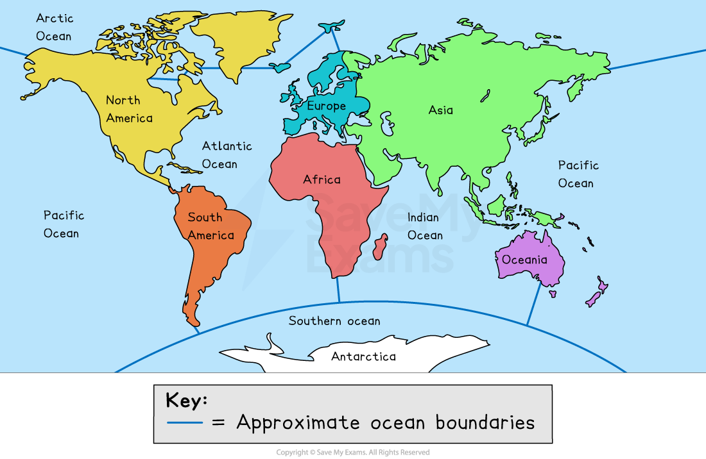

# Oceans

## The world’s oceans

> **Spec point** — `spcpt_6MkQJqwxCq7GzghC`

## The world’s oceans

- Oceans are **very large **expanses of sea (**saltwater**)

  - They represent the main areas into which the sea is divided geographically
- There are **five** recognised oceans:

  - Pacific Ocean
  - Atlantic Ocean
  - Indian Ocean
  - Arctic Ocean
  - Southern Ocean

*A map of the world showing the seven recognised continents and five recognised oceans*

- There are also many recognised **seas** on the planet, such as:

  - Mediterranean Sea
  - Black Sea
  - Irish Sea
  - Dead Sea
  - Caribbean Sea
- Seas are **smaller** areas of water than oceans and they are often **partially enclosed by land**
