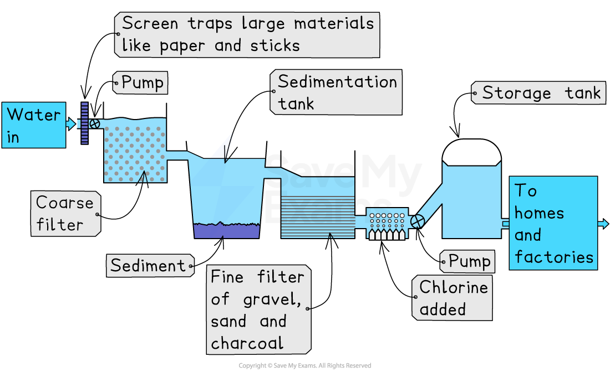

# Potable Water

## What is potable water?

> **Spec point** — `spcpt_DgMNHVHxZm7ftvbQ`

## What is potable water?

- **Potable water** is water that is **safe to drink**

  - Contains **no harmful microorganisms** or toxic chemicals
- Potable water must be **clean, clear and treated** before people can use it for drinking or cooking
- Safe drinking water is essential for **health**, preventing diseases such as cholera and diarrhoea

> **Exam Hint**
> Students sometimes think 'potable water is clean water', but this is too vague. Examiners seek the exact idea that** potable water is safe to drink**, meaning it contains no harmful pathogens or pollutants.

## Stages in water treatment

> **Spec point** — `spcpt_C997tSm5ZSVd24yH`

## Stages in water treatment

- Water from rivers, lakes or reservoirs may contain **dirt, organisms and pollutants**

  - It must be treated to make it **potable**
- Water treatment uses several stages to remove **solid particles**, **microorganisms** and **harmful chemicals**

### Screening

- **Screening**—passing water through large metal bars or meshes

  - Removes **big objects** such as leaves, sticks, plastics and rubbish
- Prevents damage to pumps and machinery in later stages

### Sedimentation

- Water is left to **stand in settling tanks** (also known as sedimentation tanks)

  - Heavy particles such as sand and soil **sink to the bottom**
- Forms a layer of **sludge**, which is removed
- Reduces the amount of solid material that enters the filters

### Filtration

- Water passes through layers of **gravel, sand and sometimes *****activated carbon***

  - Traps smaller particles such as clay, organic matter and microorganisms
- Produces much **clearer water** before disinfection
- Activated carbon can remove **chemicals and odours**

### Chlorination

- A small amount of **chlorine** is added to kill harmful bacteria and viruses

  - Ensures the water is safe to drink
- Chlorine continues to protect the water as it travels through **pipes** to homes and buildings

*Stages in the treatment of water*

## Availability of potable water

> **Spec point** — `spcpt_8rCmn8ccT6c9Y599`

## Availability of potable water

- Potable water is not available equally around the world

  - Some regions have **plentiful fresh water**, while others struggle with shortages
- Differences depend on **climate**, **population**, **infrastructure**, and **access to sewage treatment**
- Understanding these inequalities helps explain why some areas face ***water stress*** while others do not

### Water-rich and water-poor regions

- **Water-rich regions** have high rainfall, many rivers or large lakes

  - Examples include tropical regions with **heavy seasonal rainfall**
  - Abundant surface and groundwater make the water supply more reliable
- **Water-poor regions** have low rainfall, dry climates or frequent droughts

  - Large parts of **semi-arid and arid regions** experience long dry seasons
  - Water scarcity makes it harder to provide sufficient safe drinking water
- Even water-rich regions can face shortages due to **pollution events** or poor water management

### Urban and rural regions

- **Urban regions** often have better access to treated potable water

  - Cities usually have **piped water systems**, treatment plants and sewage networks
  - More investment in infrastructure allows a reliable water supply
- **Rural regions** may rely on **wells, rivers or unprotected sources**

  - These sources are more easily contaminated and may not be treated
  - Lack of pipes and treatment facilities makes access inconsistent
- People living in rural areas may have to **travel long distances** to collect water

### Global inequalities in water availability and sewage treatment

- Wealthier countries have advanced **water treatment plants**, storage systems and safe sewage disposal

  - This ensures reliable access to **clean, safe drinking water**
- Low-income countries may lack infrastructure for **pumping, treating or storing** water

  - People may depend on unsafe streams, ponds or unprotected wells
- Poor sewage treatment leads to **polluted water sources**

  - Increases diseases such as cholera and diarrhoea
- Wealth affects water access: communities with more resources can **build wells**, buy bottled water or install filtration systems

  - Poorer communities often cannot

> **Exam Hint**
> In longer answers, it is important to demonstrate the connection between water availability and health outcomes. Linking poor water access to diseases demonstrates deeper understanding and gains higher-level marks.
