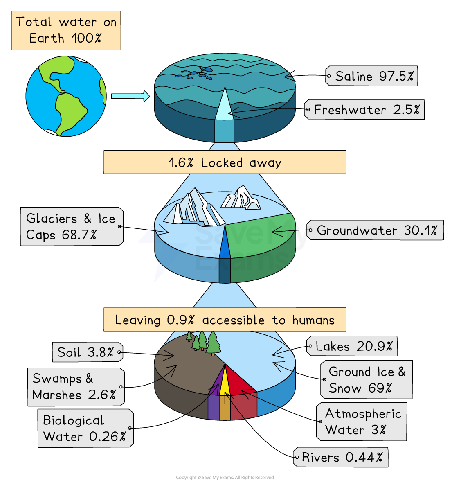
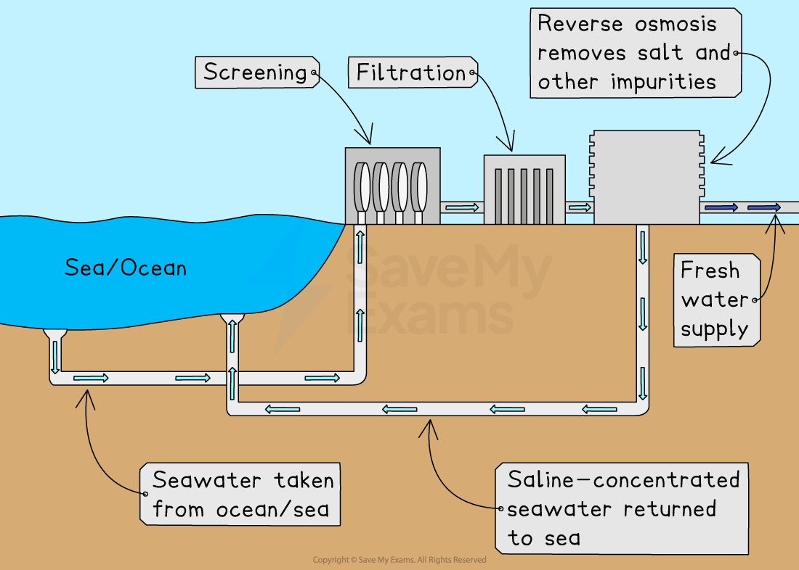

# Sources of Fresh Water

## What are the main sources of fresh water?

> **Spec point** — `spcpt_pjdPgVGYW4xdrnfv`

## What are the main sources of fresh water?

- **Fresh water** refers to water with **low salt content**, used by people for drinking, washing, farming and industry

  - Only a small percentage of Earth’s water is fresh water

*Sources of fresh water*

- People obtain fresh water from **four main sources**:

  - Atmosphere
  - Surface water
  - Groundwater
  - Desalinated ocean water

### Atmosphere: rain and snow

- Rain and snow come from ***precipitation***, when water vapour in the atmosphere cools and falls to the Earth

  - Used directly by plants and stored in rivers, lakes and groundwater
- Many regions depend on **seasonal rainfall** for drinking water, farming and filling reservoirs
- Snow in mountains melts in warmer seasons

  - Meltwater feeds rivers and provides water during dry periods

### Surface water: rivers, lakes and reservoirs

- Surface water is fresh water found **above ground**

#### Rivers

- Flow across the land and collect rainfall and meltwater

  - Used for drinking water, irrigation and hydroelectric power

#### Lakes

- Store large amounts of water in natural basins

  - Provide a reliable supply throughout the year

#### Reservoirs

- **Reservoirs**—artificial lakes created by building dams

  - Store water for cities, agriculture and industry
  - Help control flooding and maintain water supply during droughts

### Groundwater: aquifers and wells

- Groundwater is stored **below the Earth’s surface** in soil and rock

#### Aquifers

- **Aquifers**—underground layers of rock that hold water

  - Filled by rainwater soaking into the ground
- Provide clean, filtered water for drinking but hard to access

#### Wells

- Wells are **holes dug or drilled** into the ground to reach aquifers

  - Communities pump water to the surface for home use, farming and livestock

### Oceans: desalination plants

- Oceans contain **salt water**, which is not safe to drink
- **Desalination** is the process of removing salt from seawater to make fresh water

  - This can be done using **heat** (distillation) or **membranes** (reverse osmosis)
- A **desalination plant** is a large facility where machines remove salt from seawater to produce fresh drinking water
- They are usually found in coastal areas where freshwater supplies are limited
- They are useful in dry countries with little rainfall

  - Provides a reliable supply but uses **large amounts of energy**

*Desalination process*

> **Exam Hint**
> You need to be able to **describe **how desalination plants actually work (i.e. how they use **distillation **or **reverse osmosis**) to turn seawater into fresh water. This is covered in detail in our [revision note page on desalination](https://www.savemyexams.com/igcse/environmental-management/cie/25/revision-notes/water/water-sources-and-supply/desalination/).
