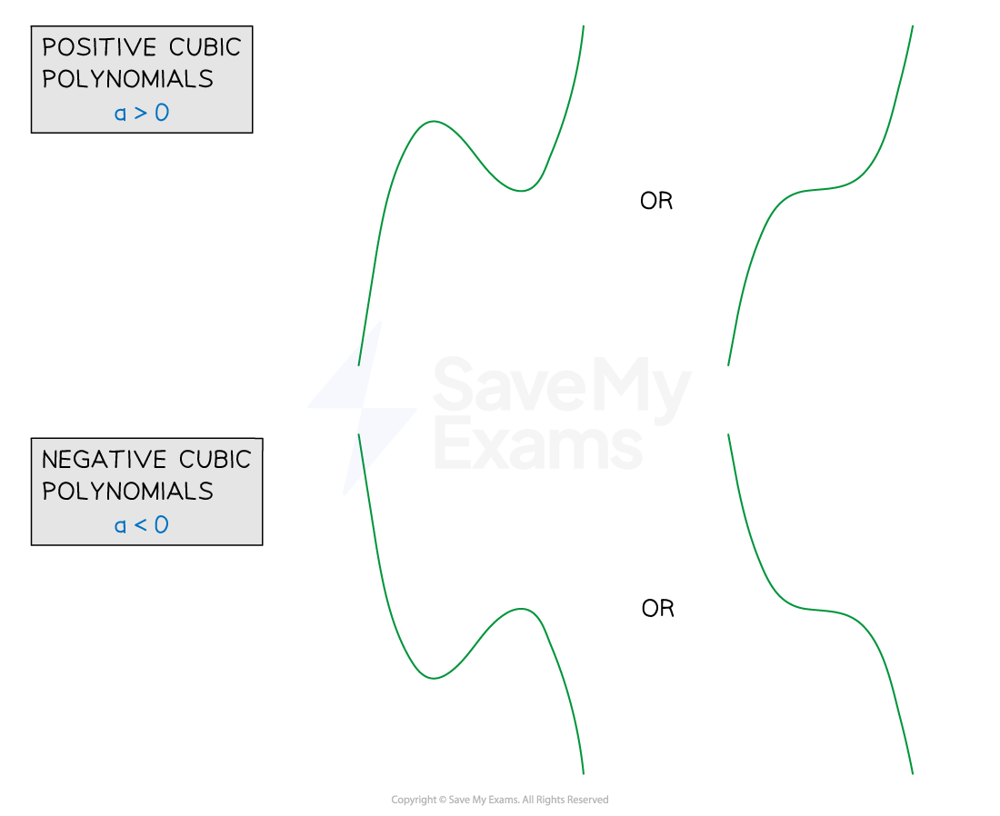
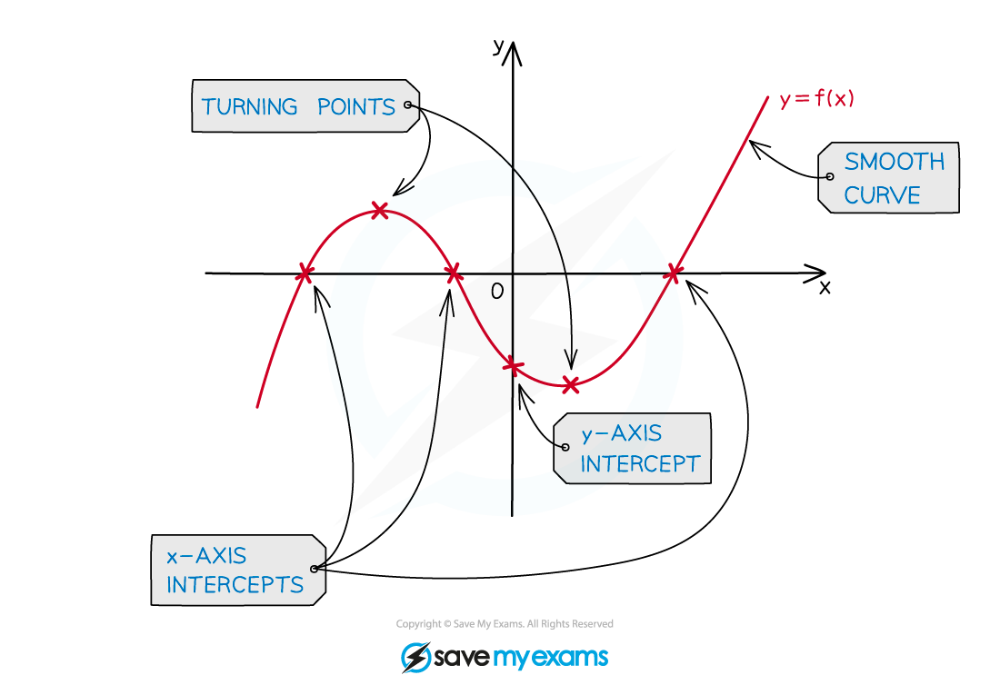
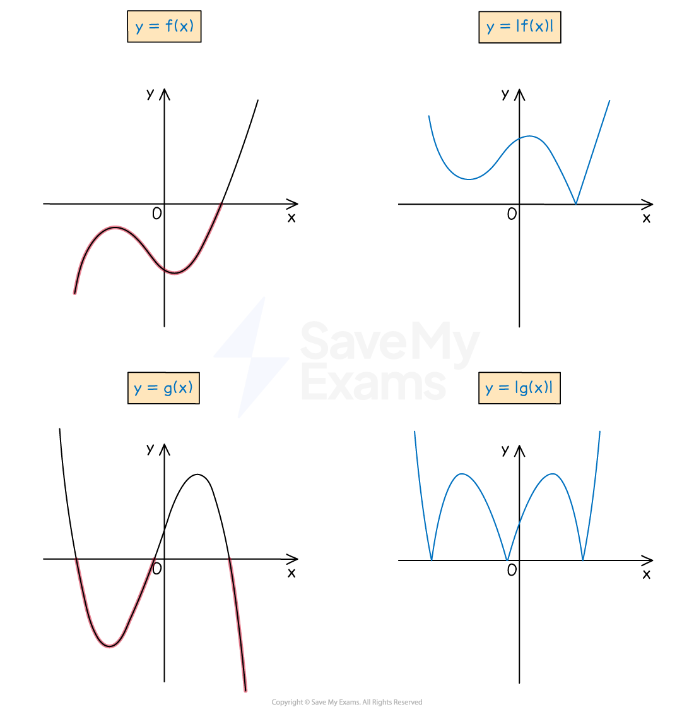
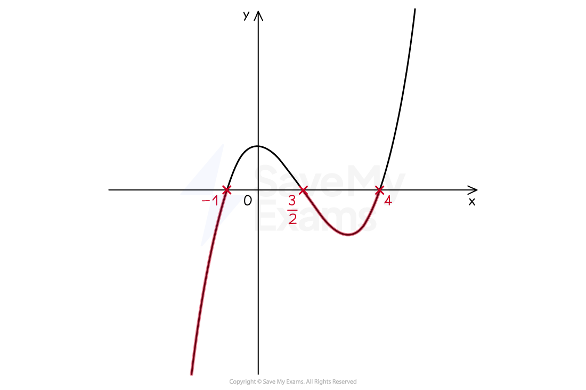

# Graphs of Cubic Polynomials

## Graphs of Cubic Polynomials

> **Spec point** — `spcpt_66pHx8mgVqvGTMRG`

## Graphs of cubic polynomials

### What is a cubic polynomial?

- A **cubic *****polynomial*** is a function of the form $ax^{3}+bx^{2}+cx+d$

  - $a,b,c$ and $d$ are constants
  - it is a polynomial of *degree* 3
  
    - so $b,c$ and/or $d$ could be zero
- To sketch the graph of a cubic polynomial it will need to be in factorised form

  - e.g.  `open parentheses 2 x minus 1 close parentheses open parentheses x plus 2 close parentheses open parentheses x minus 3 close parentheses` is the factorised form of $2x^{3}-3x^{2}-11x+6$

### What does the graph of a cubic polynomial look like?

- In general the graph of a cubic polynomial will take one of the four forms

  - All are **smooth** curves that take some practice to sketch!

- The exact form a particular cubic polynomial will depend on

  - The number (and value) of ***roots*** ($x$-axis intercepts) of the cubic polynomial
  - The $y$-axis intercept
  - The sign of the coefficient of the $x^{3}$ term ($a$)
  
    - If $a>0$ the graph is a **positive cubic** ('starts' in the third quadrant, 'ends' in the first)
    - If $a<0$ the graph is a **negative cubic** ('starts' in the second quadrant, 'ends' in the fourth)
  - ***Turning points***

### How do I sketch the graph of a cubic polynomial?

STEP 1 Find the $y$-axis intercept by setting $x=0$

STEP 2 Find the $x$-axis intercepts (roots) by setting $y=0$ (Any repeated roots will mean the graph *touches* - rather than crosses - the $x$-axis)

STEP 3 Consider the shape of the graph - is it a **positive cubic** or a **negative cubic**? Where does the graph 'start' and 'end'?

STEP 4 Consider where any turning points should go

STEP 5 Sketch the graph with a *smooth* curve, labelling points where the graph intercepts the $x$ and $y$ axes

> **Exam Hint**
> - In the exam, a cubic polynomial that requires sketching will be given in factorised form
> 
>   - i.e. as the product of three linear factors
>   - a factor could be repeated
> - Build your sketch up as you work through each step to gradually build a mental picture of it
> 
>   - If you need to redraw the graph for your final answer, that's fine!

> **Worked Example**
> Sketch the graph of `y equals open parentheses 2 x minus 1 close parentheses open parentheses x minus 3 close parentheses squared`.
> 
> > *STEP 1 - *$y$*-axis intercept*
> 
> `y equals open parentheses negative 1 close parentheses open parentheses negative 3 close parentheses squared equals negative 9`
> 
> > *STEP 2 - *$x$*-axis intercepts*
> 
> $2x-1=0,x=\frac{1}{2}$
> 
> $x-3=0,x=3$* (repeated)*
> 
> > *STEP 3 - shape, 'start'/'end'*
> 
> > `a greater than 0 space open parentheses a equals 2 close parentheses`* so it is a positive cubic *$x=3$* is a repeated root so the graph will touch the *$x$*-axis at this point*
> 
> > *STEP 4 - turning points*
> 
> > *One turning point (minimum) will need to be where the curve touches the *$x$*-axis The other (maximum) will need to be between*$x=\frac{1}{2}$* and *$x=3$
> 
> > *STEP 5 - smooth curve with labelled intercepts*
> 
> 

## Modulus Cubic Graphs

> **Spec point** — `spcpt_3VsSczXgRNskFpVz`

## Modulus cubic graphs

### What is a modulus cubic graph?

- A (factorised) **cubic** polynomial is of the from `straight f open parentheses x close parentheses equals a open parentheses x minus b close parentheses open parentheses x minus c close parentheses open parentheses x minus d close parentheses`
- The graph of `y equals straight f open parentheses x close parentheses` must cross the $x$-axis at least once

  - therefore $y$ must take both positive and negative values
- The **modulus** cubic graph, `y equals vertical line straight f open parentheses x close parentheses vertical line` will mean all values of $y$ are p**o**sitive

  - Any negative values become their positive equivalents
  
    - e.g.  If `straight f open parentheses x close parentheses equals x cubed` then `straight f open parentheses negative 1 close parentheses equals open parentheses negative 1 close parentheses cubed equals negative 1`, but `vertical line straight f open parentheses negative 1 close parentheses vertical line equals vertical line open parentheses negative 1 close parentheses cubed vertical line equals vertical line minus 1 vertical line equals 1`
- A modulus cubic graph will not have any negative values

  - the graph will not *cross* the $x$-axis
  - the graph will *touch* the $x$-axis (at least once)

### How do I sketch a modulus cubic graph?

- **Sketch** the graph of the (original) cubic polynomial, `y equals straight f open parentheses x close parentheses`
- Any parts of this graph that are **below** the $x$**-axis** should be **reflected** in the $x$**-axis** to sketch the graph of** **`y equals vertical line straight f open parentheses x close parentheses vertical line`

- The points at which a modulus graph touches the $x$-axis are the same as the points at which the original graph intercepts the $x$-axis (i.e. the roots of `straight f open parentheses x close parentheses`)

  - **Label** these points, and the $y$-axis intercept, on a sketch
- Notice that the points at which a modulus graph touches the $x$-axis are **not** smooth

  - they are 'pointy' (V-shaped)
  - turning points are smooth (U-shaped)

### How do I find a cubic function from its modulus graph?

- To deduce a cubic expression from its modulus graph consider

  - whether the (original) expression could be a **positive** or **negative** cubic
  
    - a positive cubic 'starts' in the third quadrant and 'ends' in the first
    - a negative cubic 'starts' in the second quadrant and 'ends' in the fourth
    
      - a negative cubic can have a "-" at the start of its expression
  - the $x$-axis intercepts - the *roots*
  
    - for the roots $b,c$ and $d$, write the factors `open parentheses x minus b close parentheses open parentheses x minus c close parentheses open parentheses x minus d close parentheses`
  - the $y$-axis intercept - to deduce the expression in the form `a open parentheses x minus b close parentheses open parentheses x minus c close parentheses open parentheses x minus d close parentheses`
  
    - lots of cubic functions have the same roots but have different *coefficients*
    - the $y$-axis intercept should be the product $a\times-b\times-c\times-d=-abcd$
    
      - $a$ may often, but not always, be 1

> **Exam Hint**
> - Sketching the (original) graph of `y equals straight f open parentheses x close parentheses` first is often helpful rather than trying to sketch the modulus graph from scratch
> - If asked to find a cubic function from a given graph
> 
>   - there may be more than one possibility
>   
>     - consider which parts of the graph may have been reflected in the $x$-axis
>     - could it be either a positive or negative cubic polynomial?
>   - the factorised form is usually sufficient (unless a question says otherwise)

> **Worked Example**
> The diagram below shows the graph of `y equals vertical line straight f open parentheses x close parentheses vertical line` where `straight f open parentheses x close parentheses` is a **positive** cubic polynomial.
> 
> 
> 
> Deduce an expression for `straight f open parentheses x close parentheses` leaving your answer in factorised form, with each factor having integer coefficients.
> 
> `straight f open parentheses x close parentheses`* is a positive cubic polynomial so the graph should 'start' in the third quadrant and 'end' in the first.* *A quick sketch (without labels) can help.*
> 
> 
> 
> > *The *$x$*-axis intercepts indicate the roots.*
> 
> `open parentheses x plus 4 close parentheses open parentheses x plus 1 half close parentheses open parentheses x minus 3 close parentheses`
> 
> > *The expression for *`straight f open parentheses x close parentheses`* is of the form *`a open parentheses x plus 4 close parentheses open parentheses x plus 1 half close parentheses open parentheses x minus 3 close parentheses`*. Use the *$y$*-axis intercept to deduce the value of *$a$*. From the sketch of *`y equals straight f open parentheses x close parentheses`* the *$y$*-axis intercept is -12 (not 12).*
> 
> `table row cell a cross times 4 cross times 1 half cross times negative 3 end cell equals cell negative 12 end cell row cell negative 6 a end cell equals cell negative 12 end cell row a equals 2 end table`
> 
> > *The final answer requires each factor to have integer coefficients so multiply 2 into *`open parentheses x plus 1 half close parentheses`* and write down *`straight f open parentheses x close parentheses`*.*
> 
> $f(x)=(x+4)(2x+1)(x-3)$

## Solving Cubic Inequalities Graphically

> **Spec point** — `spcpt_H4Xs5VnYVDFyFfg9`

## Solving cubic inequalities graphically

### What is a cubic inequality?

- A cubic function is of the form `straight f open parentheses x close parentheses equals a x cubed plus b x squared plus c x plus d` where $a,b,c$ and $d$ are constants
- A **cubic inequality** can be any of the following

  - `straight f open parentheses x close parentheses greater than 0`
  - `straight f open parentheses x close parentheses greater or equal than 0`
  - `straight f open parentheses x close parentheses less than 0`
  - `straight f open parentheses x close parentheses less or equal than 0`
- An inequality may need **rearranging** into one of these forms first before solving

  - Furthermore, solving cubic equations graphically is easiest when the expression has been **factorised**
  
    - e.g.  for a cubic with three (real) roots this would be `open parentheses x minus p close parentheses open parentheses x minus q close parentheses open parentheses x minus r close parentheses` where $p,q$ and $r$ are the roots

### How do I solve a cubic inequality graphically?

STEP 1 If need be, rearrange the inequality so that one side of the inequality is zero This should leave a **cubic polynomial** on the other side **Factorise** the cubic polynomial if required e.g.  `open parentheses 2 x minus 3 close parentheses open parentheses x minus 4 close parentheses open parentheses x plus 1 close parentheses less or equal than 0`

STEP 2** Sketch** the graph of the cubic polynomial The $x$-axis intercepts (roots) are crucial to finding the solution but the $y$-axis intercept is not needed e.g.

STEP 3
 **Identify** the part(s) of the graph that **satisfy** the inequality 
**Highlighting** this on the sketch will help 
Consider whether you need to **include** (≤, ≥) or **exclude** (<, >) the **roots **e.g.

STEP 4 
Write down the **solutions** to the inequality
 e.g.  $x\leq-1,\frac{3}{2}\leqx\leq4$

> **Worked Example**
> a) Sketch the graph of `y equals straight f open parentheses x close parentheses` where `straight f open parentheses x close parentheses equals open parentheses 3 x minus 1 close parentheses open parentheses x minus 3 close parentheses squared`.
> 
> > *This is a **positive** cubic polynomial with roots *$x=\frac{1}{3}$* and *$x=3$
> 
> > $x=3$* is a **repeated** root so the graph will **touch** the *$x$*-axis at this point*
> 
> 
> 
> a) Hence solve the inequality  `straight f open parentheses x close parentheses greater than 0`.
> 
> > *STEP 1 - the cubic polynomial is already in factorised form*
> 
> > *STEP 2 - the graph has been sketched in part (a)*
> 
> > *STEP 3 - Highlight the graph to show the parts of the graph which lie above zero*
> 
> 
> 
> > *STEP 4 - Write the solution mathematically. Remember that in this case it is a strict inequality, so it cannot be equal to 3 or *$\frac{1}{3}$
> 
> $x>\frac{1}{3},x\neq3$
