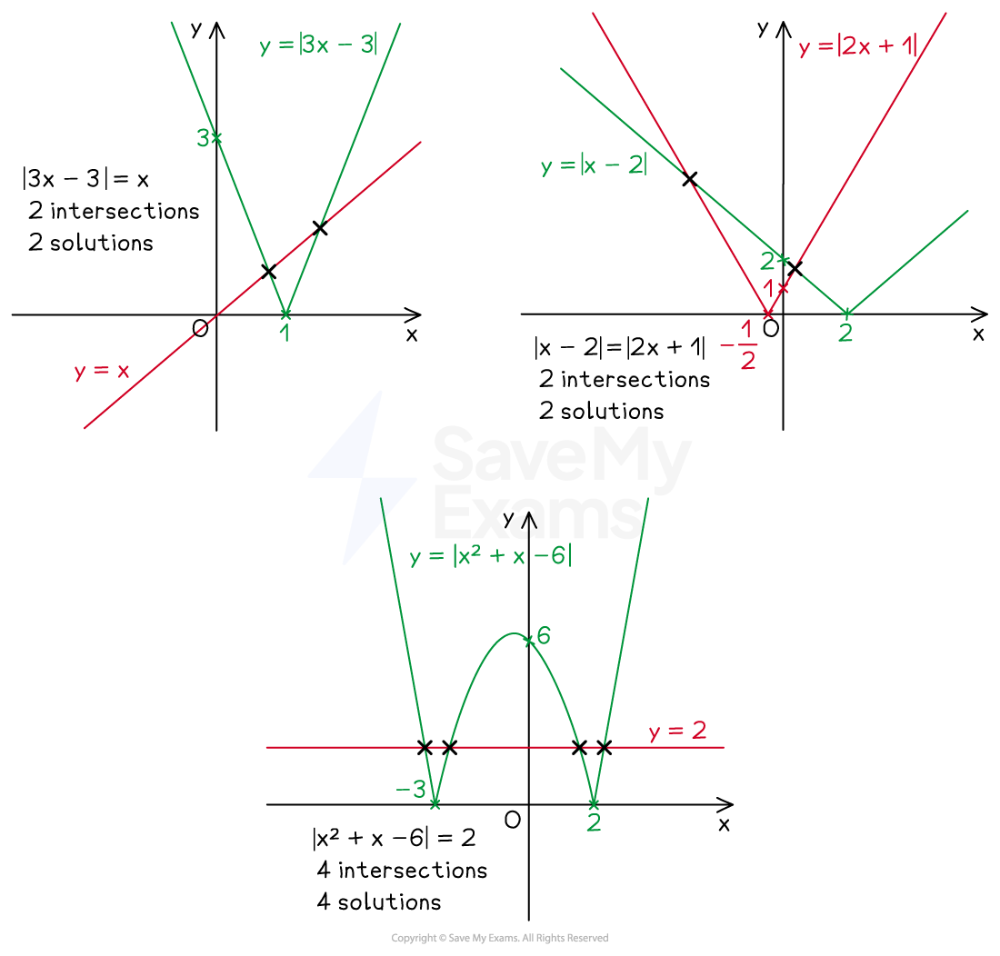
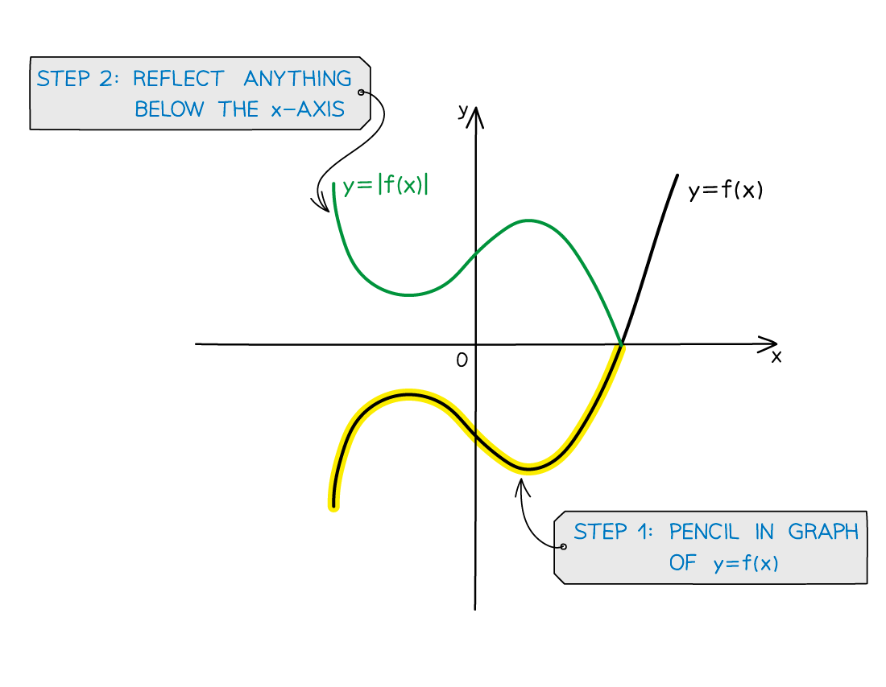
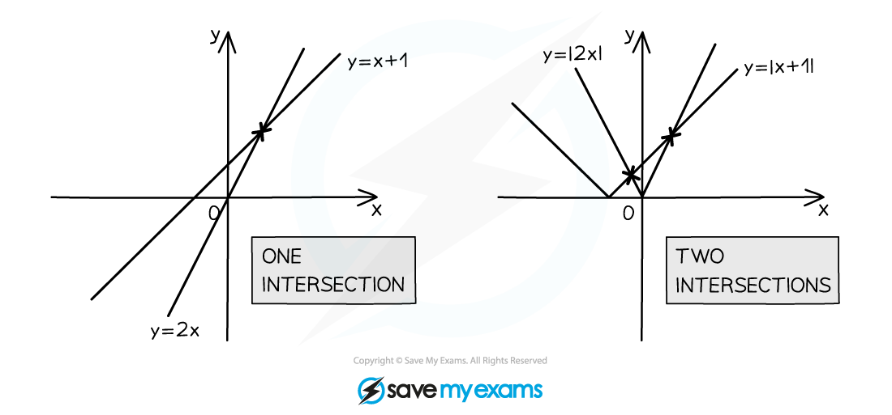
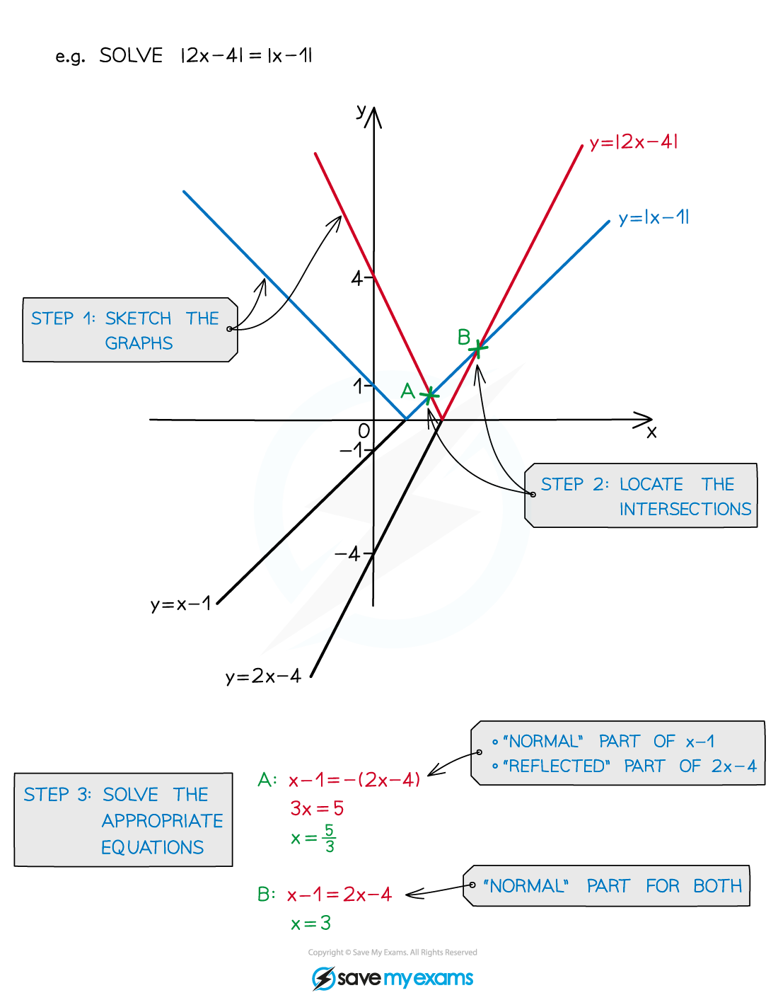
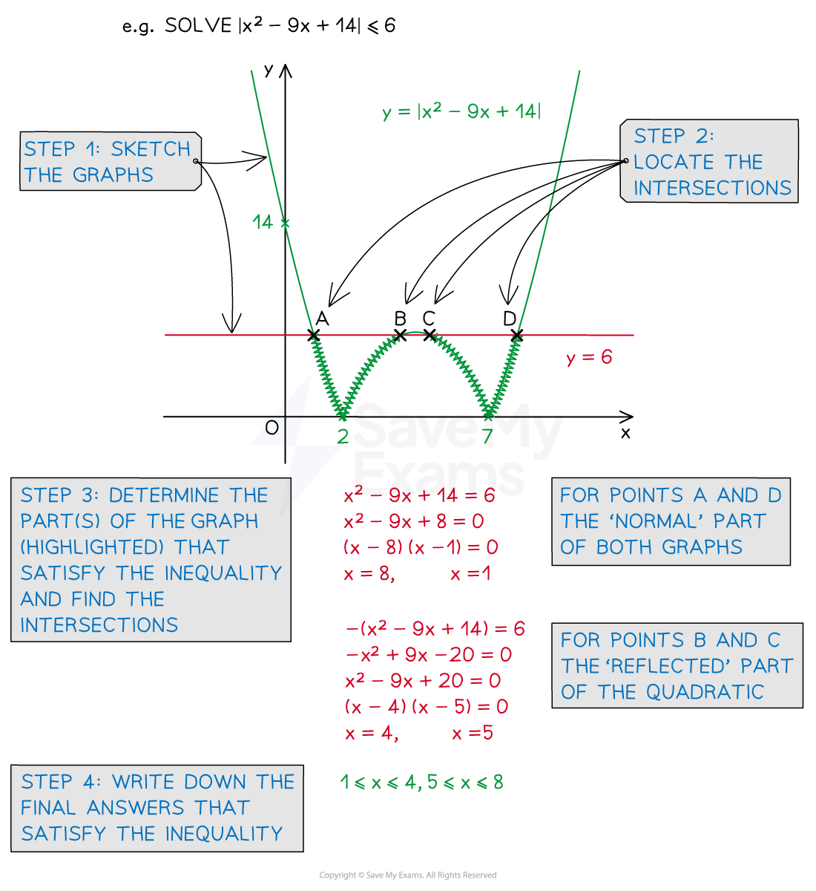

# Modulus Functions

## Sketching Modulus Graphs

> **Spec point** — `spcpt_hJcP5cMfGjPB9Wfb`

## Sketching modulus graphs

### What is a modulus function?

- The **modulus function** makes any ‘input’ **positive**

  - This is sometimes called the **absolute value** (of the input)
  - The modulus function is indicated by a pair of vertical lines being written around the input
  
    - Similar to how brackets are used
    - e.g.  `vertical line 7 vertical line equals 7 comma space space vertical line minus 7 vertical line equals 7`

### What types of modulus graphs will I need to sketch?

- Modulus graphs required will be of **linear,** or **quadratic** form

  - **Linear** form will be `vertical line a x plus b vertical line`
  - **Quadratic** form will be `vertical line a x squared plus b x plus c vertical line`
- Often, there will be two graphs to sketch as this helps with **solving equations** involving modulus functions

  - In linear form, equations could be of the form `vertical line a x plus b vertical line equals vertical line c x plus d vertical line`
  
    - One side of the equation may not involve the modulus
    - One side may have a constant term only (i.e. $b=0$ and/or $d=0$
  - In quadratic form, equations could be of the form `vertical line a x squared plus b x plus c vertical line equals d`
- In both cases, graphs of the left hand side and right hand side drawn on the same diagram will reveal the number of intersections of the graphs (and so the number of solutions to the equation)

### How do I sketch the graph of the modulus of a function: y = |f(x)|?

STEP 1
 Pencil in the graph of **y = f(x)**

STEP 2
 **Reflect** anything **below** the **x**-axis, in the **x**-axis, to get **y = |f(x)| **

- Note in particular that the $y$-axis intercept, if negative on the graph of `y equals straight f open parentheses x close parentheses` will be positive on the graph of `y equals vertical line straight f open parentheses x close parentheses vertical line`
- At the $x$-axis intercepts, the graph will have a sharp `logical or`-shape

  - this is **not **a smooth curve like with a turning point
  - if the graph is of the form `y equals negative vertical line straight f open parentheses x close parentheses vertical line` then the graph would be wholly negative and the $x$-axis intercepts would have a sharp `logical and`-shape

> **Worked Example**
> 

## Solving Modulus Equations

> **Spec point** — `spcpt_Tkq54FVG7c9TsQ6c`

## Solving modulus equations

### Why are graphs needed to solve modulus equations?

- **Sketching** the graphs of two modulus function(s) on the same diagram quickly reveals

  - the number of solutions there are to the equation
  - which parts of the graph (equation) - either the 'normal' part or the 'reflected' part - will be needed to solve equations
- For example, two non-parallel linear graphs would intersect

  - the solution to the linear functions being equal to each other would have one solution
  - if a **modulus** is involved there **could** be **more** than one intersection/solution

### How do I solve modulus equations?

STEP 1 **Sketch** the graphs including any **modulus** (reflected) parts

STEP 2 **Locate** the graph **intersections**

STEP 3

Determine which part of each graph ('normal' or 'reflected' part) is needed to solve the equation **Solve** the appropriate equation(s)

### How do I solve modulus inequalities?

- The process is very similar to that as solving equations - with the graph sketching being essential

STEP 1 **Sketch** the graph(s) including any **modulus** (reflected) parts

STEP 2 **Locate** the graph **intersections** (or $x$-axis intercepts if zero on one side)

STEP 3 Determine which part(s) of the graph(s) satisfy the inequality (highlight any on the graph) Find the **intersections** (by solving equation(s))

STEP 4 Write the final answer(s) down, being careful with the use of <, >, ≤ and/or ≥

> **Exam Hint**
> - Sketching the graphs is important as solving algebraically can lead to invalid solutions
> 
>   - For example, *x* = 1 is a solution to $x-4=2x-5$
>   - but $x=1$ is not a solution to `vertical line x minus 4 vertical line equals 2 x minus 5`
>   
>     - (substitute *x* = 1 into both sides and see why it does not work)

> **Worked Example**
> 
> 
> 
