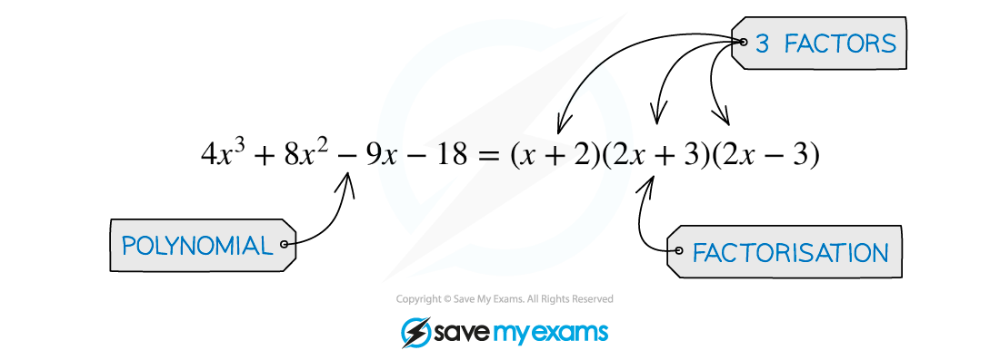
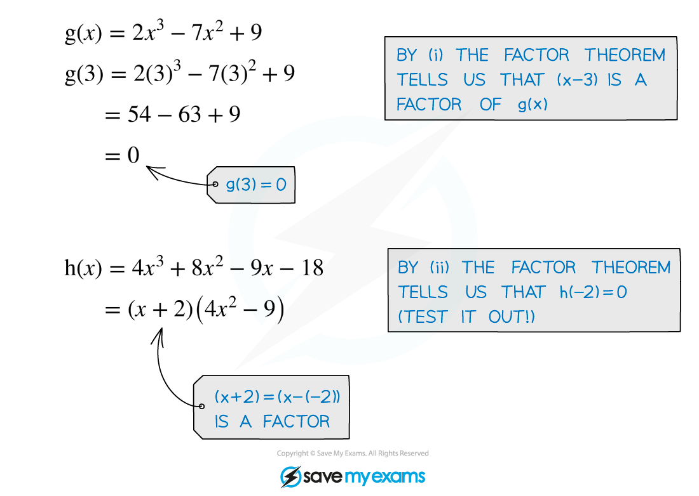

# Factor & Remainder Theorem

## Factor Theorem

> **Spec point** — `spcpt_qXnjgtRXNtVkk5Db`

## Factor theorem

### What is the factor theorem?

- The **factor theorem** is a useful result concerning the **roots** and **factors** of *polynomials*

  - In the example below, the polynomial $4x^{3}+8x^{2}-9x-18$ has three (linear) **factors**
  
    - $( x + 2 ) , ( 2 x + 3 )$ and $( 2 x - 3 )$
    - and so it has the three **roots** $x=-2,x=-\frac{3}{2}$ and $x=\frac{3}{2}$

- For a polynomial $\mathrm{f} ( x )$ the **factor theorem** states that:

i) if $\mathrm{f} ( p ) = 0$, then $( x - p )$ is a factor of $\mathrm{f} ( x )$ 
($x=p$ is a root of $\mathrm{f} ( x )$)

**and**

ii) if $( x - p )$ is a factor of $\mathrm{f} ( x )$, then $\mathrm{f} ( p ) = 0$

> **Exam Hint**
> - In an exam, the values of $p$ you'll need to find that make $\mathrm{f} ( p ) = 0$ are going to be integers close to zero
> 
>   - Try $p=1$ and $p=-1$ first, then 2 and -2, then 3 and -3
>   - It is unlikely that you'll have to go beyond that

> **Worked Example**
> a) Show that $( x - 2 )$ is a factor of the polynomial $\mathrm{f} ( x ) = x^{3} + 6 x^{2} - 9 x - 14$.
> 
> *(From part (ii) of our definition of factor theorem ...)* *... if *$( x - 2 )$* is a factor of *$\mathrm{f} ( x )$* then *$\mathrm{f} ( 2 ) = 0$*.*
> 
> $\begin{gathered} \mathrm{f} ( 2 ) & = ( 2 )^{3} + 6 ( 2 )^{2} - 9 ( 2 ) - 14 \\ \mathrm{f} ( 2 ) & = 8 + 24 - 18 - 14 \\ \mathrm{f} ( 2 ) & = 0 \end{gathered}$
> 
> **Final answer:** **Since **$f(2)=0$**, **$(x-2)$** is factor of **$f(x)$**.**
> 
> b) Use the factor theorem to find another factor of $\mathrm{f} ( x )$.
> 
> > *Try *$\mathrm{f} ( 1 )$* first,*
> 
> $\begin{array}{rcl} \mathrm{f} ( 1 ) & = ( 1 )^{3} + 6 ( 1 )^{2} - 9 ( 1 ) - 14 \\ \mathrm{f} ( 1 ) & = 1 + 6 - 9 - 14 \\ \mathrm{f} ( 1 ) & = - 16 \end{array}$
> 
> > *Since *$\mathrm{f} ( 1 ) \text{eq} 0$*, *$( x - 1 )$* is **not** a factor of *$\mathrm{f} ( x )$*.*
> 
> > *Try *$\mathrm{f} ( - 1 )$*,*
> 
> $\begin{gathered} \mathrm{f} ( - 1 ) & = ( - 1 )^{3} + 6 ( - 1 )^{2} - 9 ( - 1 ) - 14 \\ \mathrm{f} ( - 1 ) & = - 1 + 6 + 9 - 14 \\ \mathrm{f} ( - 1 ) & = 0 \end{gathered}$
> 
> > *Since *$\mathrm{f} ( - 1 ) = 0$*, *$( x + 1 )$* **is** a factor of *$\mathrm{f} ( x )$*.*
> 
> **Final answer:** $(x+1)$** is another factor of **$f(x)$**.**
> 
> $( x + 7 )$** is the third (linear) factor. **
> **Once one factor is known, polynomial division could be used to find the others. (In this case we were specifically asked to use factor theorem.)**

## Remainder Theorem

> **Spec point** — `spcpt_MMYSScSQhVSp55tZ`

## Remainder theorem

### What is the remainder theorem?

- The **factor** **theorem** is actually a special case of the more general **remainder** **theorem**
- The **remainder** **theorem** states that when the polynomial $\mathrm{f} ( x )$ is divided by $( x - a )$ the remainder is $\mathrm{f} ( a )$

  - You may see this written formally as $\mathrm{f} ( x ) = ( x - a ) \mathrm{Q} ( x ) + \mathrm{f} ( a )$
  - In **polynomial** **division**
  
    - $\mathrm{Q} ( x )$ would be the **result** (at the top) of the division (the **quotient**)
    - $\mathrm{f} ( a )$ would be the **remainder** (at the bottom)
    - $( x - a )$ is called the **divisor**
  - In the case when $\mathrm{f} ( a ) = 0 , \mathrm{f} ( x ) = ( x - a ) \mathrm{Q} ( x )$ and hence $( x - a )$ is a factor of $\mathrm{f} ( x )$ – the **factor** **theorem**!

### How do I solve problems involving the remainder theorem?

- If it is the **remainder** that is of particular interest, the remainder theorem saves the need to carry out polynomial division in full

  - e.g.  The remainder from $(x^{2}-2x)\div(x-3)$ is $3^{2}-2\times3=3$
  - This is because if $\mathrm{f} ( x ) = x^{2} - 2 x$ and $a=3$
- If the remainder from a polynomial division is known, the **remainder** **theorem **can be used to find unknown **coefficients** in polynomials

  - g. The remainder from $(x^{2}+px)\div(x-2)$ is 8 so the value of *p* can be found by solving $2^{2} + p ( 2 ) = 8$, leading to $p=2$
  - In harder problems there may be more than one unknown in which case **simultaneous equations** would need setting up and solving
- The more general version of remainder theorem is if $\mathrm{f} ( x )$ is divided by $( a x - b )$ then the remainder is  $f(\frac{b}{a})$

  - The remainder is still found by evaluating the polynomial at the value of $x$ such that $ax-b=0$ (the divisor is zero) but it is not necessarily an integer

> **Exam Hint**
> - Exam questions will use formal mathematical language which can make factor and remainder theorem questions sound more complicated than they are
> 
>   - Ensure you are familiar with the various terms from these revision notes

> **Worked Example**
> The polynomial $\mathrm{p} ( x )$ is given by $8x^{4}+ax^{2}+bx-1$, where $a$ and $b$ are integer constants. 
> When $\mathrm{p} ( x )$ is divided by $( x - 1 )$ the remainder is 9.
> When $\mathrm{p} ( x )$ is divided by $( 2 x - 1 )$ the remainder is 1. 
> Find the values of $a$ and $b$.
> 
> > *Remainder theorem: "*$\mathrm{f} ( a )$* is the remainder when *$\mathrm{f} ( x )$* is divided by *$( x - a )$*".*
> 
> > $x-1=0$* when *$x=1$*:*
> 
> $\begin{array}{rcl} \mathrm{p} ( 1 ) & = 9 \\ 8 + a + b - 1 & = 9 \\ a + b & = 2 \end{array}$
> 
> > $2x-1=0$* when *$x=\frac{1}{2}$*:*
> 
> $\begin{gathered} \mathrm{p} ( 1 \frac{1}{2} ) & = 1 \\ 8 ( 1 \frac{1}{2} )^{4} + a ( 1 \frac{1}{2} )^{2} + b ( 1 \frac{1}{2} ) - 1 & = 1 \\ 1 \frac{1}{2} + 1 \frac{1}{4} a + 1 \frac{1}{2} b - 1 & = 1 \\ a + 2 b & = 6 \end{gathered}$
> 
> > *Solving simultaneously,*
> 
> `| _ _ charalign center stackalign right end | a + b = 2 end | | a + 2 b = 6 end | horizontal line | b = 4 end | end | |`
> 
> $\thereforea=2-4=-2$
> 
> $a=-2,b=4$
> 
> $p(x)=8x^{4}-2x^{2}+4x-1$
