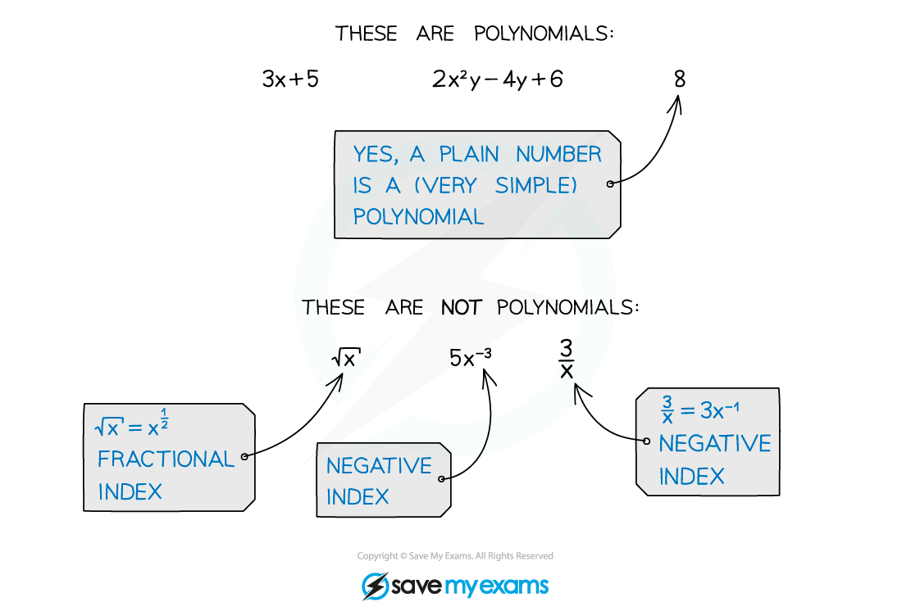

# Operations with Polynomials

## Expanding Brackets

> **Spec point** — `spcpt_csNNFjDt9k3MwXJr`

## Expanding brackets

### What is a polynomial?

- A **polynomial** is an algebraic expression consisting of a finite number of terms, with **non-negative integer** indices only

### What do I need to know about expanding brackets?

- **Expanding brackets** is now extended to include

  - brackets with more than 2 terms
  - brackets that are **polynomials** (beyond linear)
- To expand two brackets, **each term** in the **first** set of brackets must be **multiplied** by **each term** in the **second** set of brackets

  - If there are more than 2 brackets to expand, only work with a pair at a time
  - You may have seen or used FOIL to expand quadratic expressions
  
    - that is helpful but is a special case (shortcut) of this more general approach

- If you are trying to expand a two term bracket to a higher power (i.e. `open parentheses a plus b close parentheses to the power of n`) then use the **binomial expansion**

> **Worked Example**
> 

> **Worked Example**
> 
