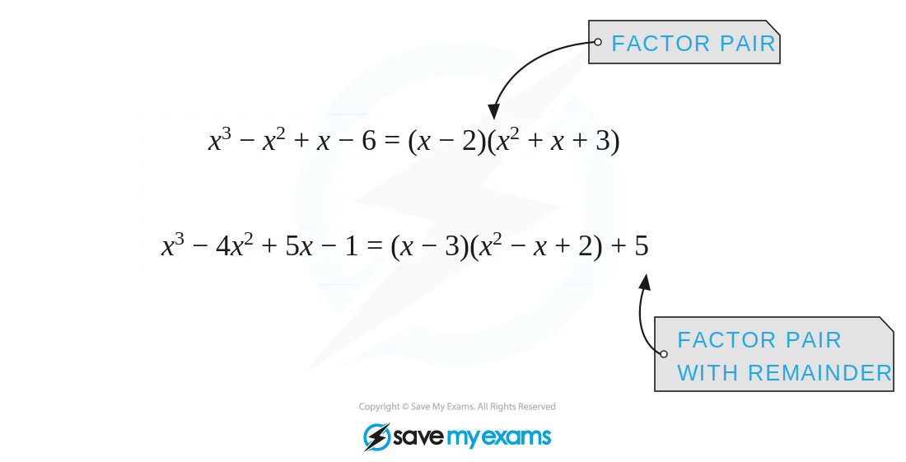
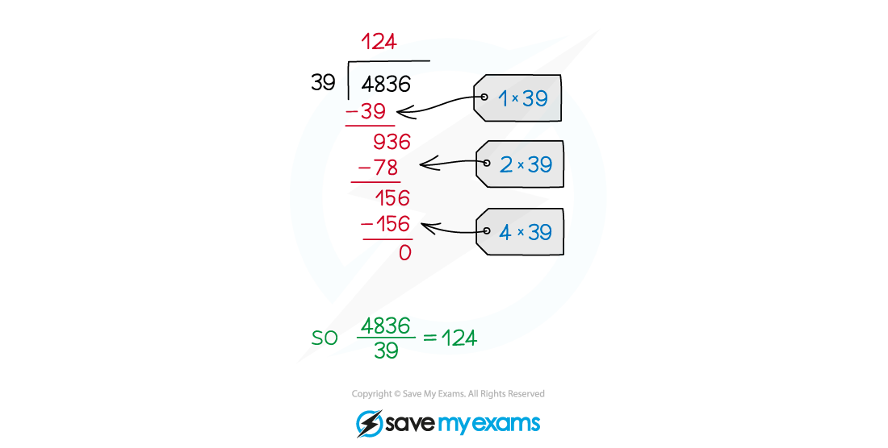
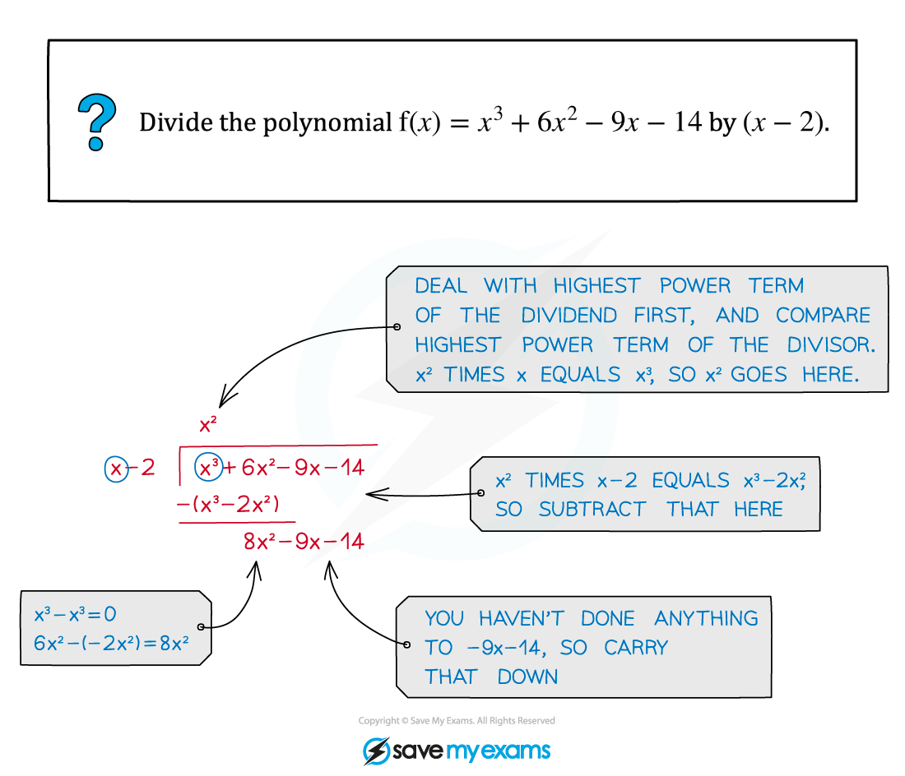
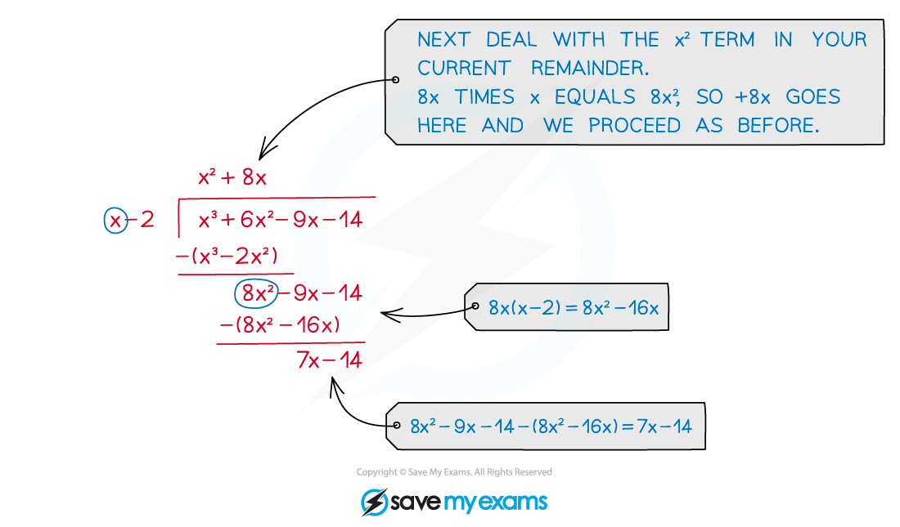

# Polynomial Division

## Polynomial Division

> **Spec point** — `spcpt_Xmmw5xQYXQbJN3xr`

## Polynomial division

### What is polynomial division?

- Polynomial division is the process of **dividing two polynomials**

  - This is usually only useful when the **degree of the denominator** is **less than or equal** to the **degree of the numerator**

- **Polynomial division** is a method for splitting polynomials into factor pairs

  - (with or without a remainder term)

- The main uses of polynomial division are

  - factorising polynomials
  - simplifying 'top-heavy' algebraic fractions

### How do I divide polynomials?

- The method used for polynomial division is just like the **long division** method for numbers

  - sometimes called the 'bus stop method'

- The answer to a polynomial division question is built up term by term

  - Start by dividing by the highest power term
  - Write out this multiplied by the divisor and subtract

- Continue to divide by each reducing power term and subtracting your answer each time

- Continue until you are left with zero

- If the divisor is **not** a **factor** of the **polynomial** then there will be a **remainder** term left at the end of the division

> **Worked Example**
> For the polynomial `straight f open parentheses x close parentheses space equals space x to the power of 4 plus 11 x squared minus 1`divide `straight f open parentheses x close parentheses` by $x+3$ and write the remainder.
> 
> > *Set up the polynomial division ('bus stop')*
> 
> > *There is no *$x^{3}$* term so write this as *$0x^{3}$* in the method. There is no *$x$* term so write this as *$0x$* in the method.*
> 
> > *The first division step to consider is *$x^{4}\divx$*.*
> 
> 
> 
> > *.Multiply *$x^{3}$* by *$x+3$* and subtract from *$x^{4}+0x$*.*
> 
> 
> 
> > *Bring the *$11x^{2}$* down and divide *$-3x^{3}$* by *$x$*. Continue with each step until you are finished.*
> 
> 
> 
> **Final answer:** **The remainder is 179.**

## Quadratic Divisor

> **Spec point** — `spcpt_rvWQVXDsYyFX7d29`

## Quadratic divisor

### What is meant by a quadratic divisor?

- **Polynomial** division usually involves **dividing** by a **linear** term

  - a term of the form `open parentheses x plus p close parentheses` where $p$ is a constant and usually an **integer**
- It is possible to divide a polynomial by a **quadratic term** (and cubic, etc)

  - this would be a term of the form `open parentheses x squared plus q x plus r close parentheses` where $q$ and $r$ are constants
  - this is what is meant by a **quadratic divisor**

### How do I divide by a quadratic divisor?

- The process is the same as for a linear divisor

  - However, as $x^{2}$ will not divide into $x$ (in the polynomial division sense at least) the **remainder,** if there is one, could be of **linear form,** i.e. `open parentheses r x plus s close parentheses` where $r$ and $s$ are constants
  
    - It is possible that $r=0$ and so the remainder is still a constant

> **Exam Hint**
> - Give yourself plenty of room to do polynomial division
> 
>   - Not only will this help avoid errors, it will make your working clear
> - If you make a mistake and change something, fine, but if your method starts to get too messy it is best to restart

> **Worked Example**
> Find the remainder when $x^{4}+4x^{3}-x+1$ is divided by $x^{2}-2x$.
> 
> > *Set up the polynomial division ('bus stop') - there is no *$x^{2}$* term so write this as *$0x^{2}$* in the method.*
> 
> > *The first division step to consider is *$x^{4}\divx^{2}$*.*
> 
> 
> 
> **Final answer:** **The remainder is **$23x+1$**.**
