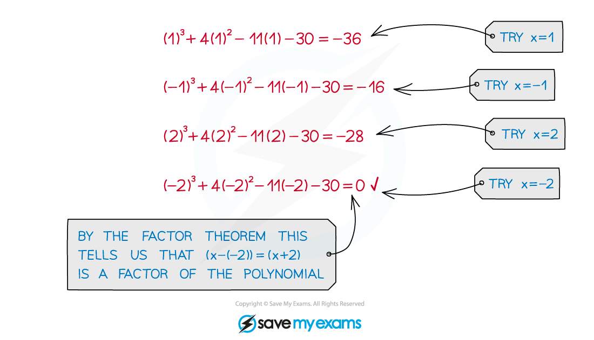
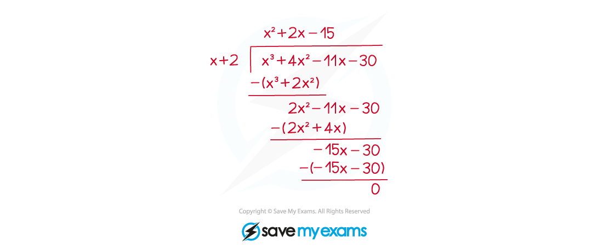

# Solving Cubic Equations

## Solving Cubic Equations

> **Spec point** — `spcpt_fBT3kZpGCVKd7BqS`

## Solving cubic equations

### What is a cubic equation?

- A **cubic** function is an **polynomial** of *degree* 3

  - i.e.  the highest power of $x$ is 3
- A cubic equation can be written in the form

  - $ax^{3}+bx^{2}+cx+d=0$
- Solving a cubic equation involves **factorising** the cubic function first.

### How do I factorise a cubic function?

- **Factorising** a cubic (function) combines the **factor theorem** with the method of **polynomial division**
- The example below shows the steps for factorising a cubic 

STEP 1 
Use factor theorem.
 Find a value*** ***$p$ such that `straight f open parentheses p close parentheses equals 0`.

STEP 2 
Use polynomial division. 
Divide `straight f open parentheses x close parentheses` by `open parentheses x minus p close parentheses`**. **
(It is possible to do this step 'by inspection', see the worked example below)

STEP 3
 Use the result of your division to write `straight f open parentheses x close parentheses equals open parentheses x minus p close parentheses open parentheses a x squared plus b x plus c close parentheses`.

STEP 4
 If the quadratic `open parentheses a x squared plus b x plus c close parentheses` can be factorised, do so.
** **`straight f open parentheses x close parentheses` can then be written as the product of three linear factors. 
If the quadratic cannot be factorised, then the result from STEP 3 is the final factorisation.

### How do I solve a cubic equation?

- A cubic equation will have either 1, 2 or 3 (real) solutions

  - (The cubic function will have either 1, 2 or 3 (real) roots)
- Once the cubic function is factorised using the four steps above, there is one more step to carry out

STEP 5 Find the solutions to the cubic equation by making each factor equal to zero

- For each **linear** factor, `open parentheses x minus p close parentheses`

  - $x-p=0$
  - so $x=p$ is a solution
  - This is the factor theorem!

  - For a **quadratic** factor, `open parentheses a x squared plus b x plus c close parentheses`
  
    - $ax^{2}+bx+c=0$
    - use either the **quadratic formula** or **completing the square **(as it won't factorise)
    
      - this will give two of the solutions to the cubic equation
    - if there are no solutions to the quadratic equation there are no solutions other than that from the linear factor

- From the example above,

  - `x cubed plus 4 x squared minus 11 x minus 30 equals open parentheses x plus 2 close parentheses open parentheses x plus 5 close parentheses open parentheses x minus 3 close parentheses`
  - so the solutions to the cubic equation $x^{3}+4x^{2}-11x-30=0$ are
  
    - $x=-2,x=-5$ and $x=3$
- Cubic equations can have equal (repeated) solutions

  - e.g.   `open parentheses x minus 2 close parentheses squared open parentheses x plus 1 close parentheses` has two (equal and real) roots, $x=2$ (repeated) and $x=-1$
  - e.g.   `open parentheses 2 x minus 1 close parentheses cubed` has three (equal and real) roots, $x=\frac{1}{2}$

> **Exam Hint**
> - When $d=0$ (i.e. there is no constant term) then $x$ is a factor of the cubic function, and so $x=0$ is a solution
> 
>   - This is a special case of factor theorem, where `straight f open parentheses 0 close parentheses equals 0`
>   
>     - spotting the factor of $x$ means there is no need to test values
>   - Take out a factor of $x$ and a quadratic function will remain
>   - Deal with the quadratic in any of the usual ways

> **Worked Example**
> a) Solve the cubic equation $x^{3}-10x^{2}+12x+8=0$.
> 
> > *STEP 1 - use factor theorem with *`straight f open parentheses x close parentheses equals x cubed minus 10 x squared plus 12 x plus 8`
> 
> `straight f open parentheses 1 close parentheses equals open parentheses 1 close parentheses cubed minus 10 open parentheses 1 close parentheses squared plus 12 open parentheses 1 close parentheses plus 8 equals 11 space space bold not equal to bold 0`
> 
> `straight f open parentheses negative 1 close parentheses equals open parentheses negative 1 close parentheses cubed minus 10 open parentheses negative 1 close parentheses squared plus 12 open parentheses negative 1 close parentheses plus 8 equals negative 15 space space bold not equal to bold 0`
> 
> `straight f open parentheses 2 close parentheses equals open parentheses 2 close parentheses cubed minus 10 open parentheses 2 close parentheses squared plus 12 open parentheses 2 close parentheses plus 8 equals 0`
> 
> `therefore space space open parentheses x minus 2 close parentheses`* is a factor of *`straight f open parentheses x close parentheses`
> 
> *STEP 2 - polynomial division (*`f open parentheses x close parentheses space divided by space open parentheses x minus 2 close parentheses`*) or 'by inspection'* *By inspection ...*
> 
> `straight f open parentheses x close parentheses equals open parentheses x minus 2 close parentheses open parentheses a x squared plus b x plus c close parentheses`
> 
> > *('cubic' ÷ 'linear' = 'quadratic')*
> 
> $a=1$
> 
> > *(because the *$x^{3}$* is generated **only** from *$x\timesax^{2}$*)*
> 
> $c=-4$
> 
> > *(because the constant term is generated **only** from *$-2\timesc$*)*
> 
> > *Equate coefficients of *$x$* (or *$x^{2}$*) terms to find *$b$*,*
> 
> $12=c-2b$
> 
> $b=\frac{-4-12}{2}=-8$
> 
> > *STEP 3*
> 
> `straight f open parentheses x close parentheses equals open parentheses x minus 2 close parentheses open parentheses x squared minus 8 x minus 4 close parentheses`
> 
> > *STEP 4 - the quadratic does not factorise*
> 
> > *STEP 5 - Use the factors to find the solutions*
> 
> `table row cell x minus 2 end cell equals cell 0 comma space space space space space x equals 2 end cell end table`
> 
> $x^{2}-8x-4=0,x=\frac{8\pm\sqrt{64+16}}{2},x=4\pm2\sqrt{5}$
> 
> > *(using the quadratic formula)*
> 
> **Final answer:** **The solutions to **$x^{3}-10x^{2}+12x+8=0$** are **$x=2,x=4+2\sqrt{5}$** and **$x=4-2\sqrt{5}$**.**
