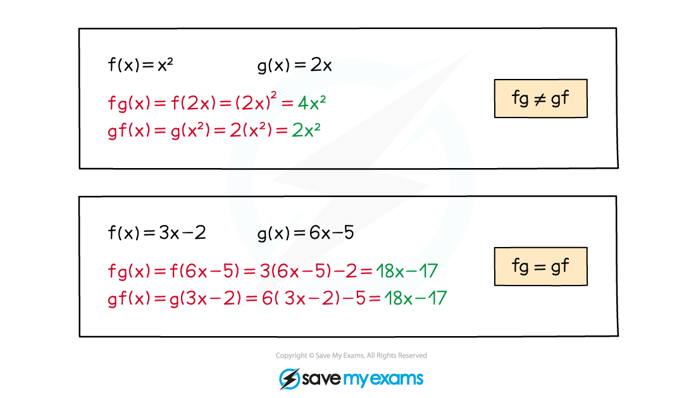

# Composite Functions

## Composite Functions

> **Spec point** — `spcpt_NbgkVjMb8tWmrx9b`

## Composite functions

### What is a composite function?

- A **composite function **is where one function is applied after another function

- The ‘**output’** of one function will be the ‘**input’** of the next one
- Sometimes called **function-of-a-function**
- A composite function can be denoted

  - $\mathrm{fg}(x)$
  - $f(g(x))$
  - All of these mean “$f$ of $g(x)$”

### How do I work with composite functions?

- **Recognise** the notation The order matters

  - $\mathrm{fg}(x)$ means **“f **of** g **of** x”**

  - First apply $g$* *to $x$* *to get $g(x)$
  - Then apply $f$ to $\mathrm{g} ( x )$ to get $f(g(x))$
  - Always start with the function **closest to the variable**
  - $\mathrm{fg}(x)$ is not usually equal to $\mathrm{gf}(x)$

#### Special cases

- $fg ( x )$ and $gf ( x )$ are generally different but can sometimes be the same
- $ff ( x )$ is written as $f^{2}(x)$

  - Note that** trig functions** are **exceptions** to this rule
  
    - e.g. $\sin ^{2} ( x )$ means $( \sin ( x ) )^{2}$ not $\sin ( \sin ( x ) )$
- For inverse functions, $ff^{- 1} ( x ) = \mathrm{f}^{- 1} \mathrm{f} ( x ) = x$

> **Worked Example**
> Two functions, $\mathrm{f} ( x )$ and $\mathrm{g} ( x )$ are
> 
> $\mathrm{f} ( x ) = x^{2} + 3 x - 2
> \mathrm{g} ( x ) = x + 3$
> 
> a) Find $\mathrm{f} ( 3 )$ and $\mathrm{g} ( 3 )$.
> 
> $\begin{gathered} \mathrm{f} ( 3 ) & = ( 3 )^{2} + 3 ( 3 ) - 2 \\ = 9 + 9 - 2 \\ = 16 \end{gathered}$
> 
> $\mathrm{g} ( 3 ) = 3 + 3$
> 
> $f(3)=16,g(3)=6$
> 
> b) Find, in terms of $x$, $fg ( x )$.
> 
> > $g$ *is the first function to be applied ...*
> 
> $\begin{gathered} \therefore \text{fg} ( x ) & = \mathrm{f} [ x + 3 ] \\ = ( x + 3 )^{2} + 3 ( x + 3 ) - 2 \\ = x^{2} + 6 x + 9 + 3 x + 9 - 2 \end{gathered}$
> 
> $\mathrm{fg}(x)=x^{2}+9x+16$

## Domain & Range of Composite Functions

> **Spec point** — `spcpt_22RwCmKzC8PNYndf`

## Domain & range of composite functions

### How do I find the domain and range of composite functions?

- Use logic to determine the *domain* and *range* of a **composite function**
- For $fg ( x )$ the first function to be applied will be $g$

  - So, *at best*, the **domain** of $fg ( x )$ will be the **same** as the **domain** of $\mathrm{g} ( x )$
- However, for this to be the case, the range of $\mathrm{g} ( x )$ must be contained within the domain of $\mathrm{f} ( x )$

  - If this is *not* the case, then **restrictions** on the **domain** of $fg ( x )$ will be required
- Similarly, *at best,* the **range** of $fg ( x )$ will be the same as the **range** of $\mathrm{f} ( x )$

  - But if the domain of $\mathrm{f} ( x )$ has been affected, the range of $fg ( x )$ will also be affected

> **Exam Hint**
> - **Domain** and **range** are important in composite funcitons like $fg ( x )$
> 
>   - the ‘output’ (range) of **g** **must** be in the domain of **f(x), s**o $fg ( x )$ could exist, but $gf ( x )$** **may not (or not for some values of $x$)

> **Worked Example**
> Two functions, $\mathrm{f} ( x )$ and $\mathrm{g} ( x )$ are defined as follows
> 
> $f(x)=\frac{1}{x},0<x<1$
> 
> $\mathrm{g} ( x ) = x^{2} , x > 1$
> 
> a) Write down the range of $\mathrm{f} ( x )$ and the range of $\mathrm{g} ( x )$.
> 
> > *As the domain of* $\mathrm{f} ( x )$ *is* $0<x<1$*,* $\frac{1}{x}$ *will always be greater than 1,*
> 
> **Final answer:** **The range of **$f(x)$** is **$f>1$
> 
> > *The square of any value will be positive or zero, but here,* $x=0$ *is not included in the domain for* $\mathrm{g} ( x )$*.*
> 
> **Final answer:** **The range of **$g(x)$** is **$g>1$
> 
> b) Use your answers to (a) to help explain why $fg ( x )$ does not exist.
> 
> **Final answer:** $g$** is the first function to be applied**** ****The range of **$g$** would need to be contained within the domain of **$f$** ****But the range of **$g$** is **$g>1$** which is outside the domain of **$f$** which is **$0<x<1$** **$\therefore\mathrm{fg}(x)$** does not exist**
> 
> c) Find the range of $gf ( x )$,
> 
> > $f$ *is the first function.  The range of* $f$ *is* $f>1$*.  This is the same as the domain of* $\mathrm{g} ( x > 1 )$*.*
> 
> **Final answer:** **The range of **$\mathrm{gf}$** is **$\mathrm{gf}>1$
