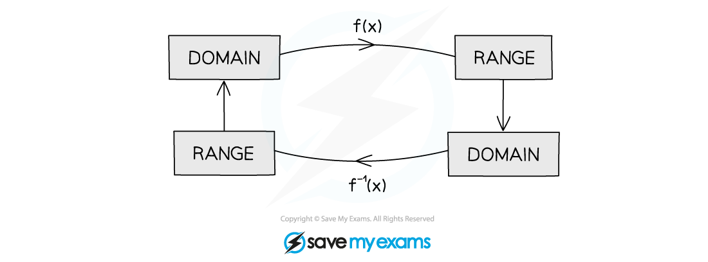

# Inverse Functions

## Inverse Functions

> **Spec point** — `spcpt_rqhzVMXZ3X4XpbYw`

## Inverse functions

### What is an inverse function?

- An **inverse function** does the exact opposite of the function it came from

  - For example, if the function “doubles the number and adds 1” then its inverse is
  - “subtract 1 and halve the result”
- It is the **inverse **operations in the **reverse** order

### How do I write inverse functions?

- An inverse function f-1 can be written as $f^{-1}(x)=\dots$ or  `straight f to the power of negative 1 end exponent space colon space x space rightwards arrow from bar space horizontal ellipsis`

  - For example, if $f(x)=2x+1$ its inverse can be written as
  - $f^{-1}(x)=\frac{(x--1)}{2}$  or   `straight f to the power of negative 1 end exponent colon space x space rightwards arrow from bar space fraction numerator left parenthesis x space – space 1 right parenthesis over denominator 2 end fraction`

### How do I find an inverse function?

- The easiest way to find an inverse function is to 'cheat' and swap the $x$* *and $y$ variables

  - Note that this is a useful method but you MUST remember **not** to do this in any other circumstances in maths
- **STEP 1** Write the function in the form$y=\dots$ e.g.   $y=2x+1$
- **STEP 2** Swap the $x$'s and$y$'s to get $x=\dots$ e.g.  $x=2y+1$
- **STEP 3** **Rearrange **the expression to make $y$ the subject again `table row cell x space minus space 1 space end cell equals cell space 2 y end cell row cell fraction numerator x space minus space 1 over denominator 2 end fraction space end cell equals cell space y space space space space space space rightwards arrow space space space y space equals space fraction numerator x space minus space 1 over denominator 2 end fraction end cell end table`
- **STEP 4** Rewrite using the correct **notation** for an inverse function

  - either as f-1(x) = … or f-1 : x ↦ …
  - $y$should not exist in the final answer
  
    - e.g.  `straight f to the power of negative 1 end exponent open parentheses x close parentheses space equals space fraction numerator space x italic space minus space 1 over denominator 2 end fraction`

### How does a function relate to its inverse?

- If `straight f open parentheses 3 close parentheses equals 10` then the input of 3 gives an output of 10

  - The inverse function undoes f(*x*)
  - An input of 10 into the inverse function gives an output of 3
  
    - If `straight f open parentheses 3 close parentheses equals 10` then `straight f to the power of negative 1 end exponent open parentheses 10 close parentheses equals 3`
- `ff to the power of negative 1 end exponent open parentheses x close parentheses equals straight f to the power of negative 1 end exponent straight f open parentheses x close parentheses equals x`

  - If you apply a function to *x*, then immediately apply its inverse function, you get *x*
  
    - Whatever happened to *x* gets undone
  - f and f-1 cancel each other out when applied together
- If `straight f open parentheses x close parentheses space equals space 2 to the power of x` and you want to solve `straight f to the power of negative 1 end exponent open parentheses x close parentheses space equals space 5`

  - Finding the inverse function `straight f to the power of negative 1 end exponent open parentheses x close parentheses` in this case is tricky (impossible if you haven't studied logarithms)
  - instead, take f of both sides and use that $\mathrm{ff}^{-1}$ cancel each other out:

`table row cell ff to the power of negative 1 end exponent open parentheses x close parentheses end cell equals cell straight f open parentheses 5 close parentheses end cell row x equals cell straight f open parentheses 5 close parentheses end cell row x equals cell 2 to the power of 5 equals 32 end cell end table`

### What condition is needed for an inverse function to exist?

- For the **inverse function to exist**, `straight f to the power of negative 1 end exponent open parentheses x close parentheses`, the original **function **`straight f open parentheses x close parentheses` must be** one-to-one**

  - Substituting 1 input into $f$ must give 1 output only
  - Substituting this 1 output into $f^{-1}$ must give back the original input only
  
    - At no point are more values allowed to be created!

> **Worked Example**
> Find the inverse of the function `straight f open parentheses x close parentheses space equals space 5 space minus space 3 x`.
> 
> > *Write the function in the form *$y=5-3x$* and then swap the *$x$* and *$y.$*  *
> 
> $y=5-3x\,x=5-3y$
> 
> > *Rearrange **the expression to make *$y$* the subject again.*
> 
> `table row cell x space end cell equals cell space 5 space minus space 3 y end cell row cell space x space plus space 3 y space end cell equals cell space 5 end cell row cell 3 y space end cell equals cell space 5 space minus space x end cell row cell y space end cell equals cell space fraction numerator 5 space minus space x over denominator 3 end fraction end cell end table`
> 
> *Rewrite using the correct **notation** for an inverse function.*
> 
> $f^{-1}(x)=\frac{5-x}{3}$

## Domain & Range of Inverse Functions

> **Spec point** — `spcpt_2b724HbPFJPDMZ2Y`

## Domain & range of inverse functions

### How do I find the domain and range of inverse functions?

- The ***range*** of a function will be the **domain** of its **inverse** function
- The ***domain*** of a function will be the **range** of its **inverse** function

> **Worked Example**
> A function is defined as $f(x)=\sqrt{3x-2},x>\frac{3}{2}$.
> 
> Write down the domain and range of $f^{-1}(x)$.
> 
> > *The domain of an inverse function is the range of the function.*
> 
> > *The range of *`straight f open parentheses x close parentheses`* is*
> 
> $f>0$
> 
> **Final answer:** $\therefore$** T****he domain of **$f^{-1}(x)$** is **$x>0$
> 
> > *The range of an inverse function is the domain of the function.*
> 
> **Final answer:** $\therefore$** The range of **$f^{-1}(x)$** is **$f^{-1}>\frac{3}{2}$

## Graphs of Inverse Functions

> **Spec point** — `spcpt_VsPqmkcp657mcw6N`

## Graphs of inverse functions

### How are the graphs of a function and its inverse related?

- The graph of an **inverse function,** `y equals straight f to the power of negative 1 end exponent open parentheses x close parentheses`, is a **reflection** of the graph of the function, `y equals straight f open parentheses x close parentheses`, in the line $y=x$
- Key features of the graph of `y equals straight f open parentheses x close parentheses` will be reflected, such as

  - $x$ and $y$ axes **intercepts**
  - ***turning points***
  - ***asymptotes***

### How do I sketch the graph of an inverse function?

- **STEP 1**

  - **Sketch** the line $y=x$, and if need be, the graph of `y equals straight f open parentheses x close parentheses`
- **STEP 2**

  - **Reflect** the graph of `y equals straight f open parentheses x close parentheses` in the line $y=x$
  
    - Remember it is a **sketch**, but the graphs together should look like reflections
  - Consider points where the reflected graph will **intersect** the $x$ and $y$ axes
  
    - e.g.  The point `open parentheses 4 comma space 0 close parentheses` will be reflected to the point `open parentheses 0 comma space 4 close parentheses`
  - Consider any **asymptotes** on the graph of `y equals straight f open parentheses x close parentheses` - these will also be need reflecting
  
    - e.g.  The asymptote (line) $x=-2$ will be reflected to the line $y=-2$
  - Consider any restrictions on the **domain** and **range** of `straight f open parentheses x close parentheses`
  
    - e.g.  If the domain is $x>0$ only sketch the graph for positive values of $x$
- **STEP 3**

  - Label key points on the sketch of `y equals straight f to the power of negative 1 end exponent open parentheses x close parentheses` and state the equations of any asymptotes
- This process works the other way round - the graph of `y equals straight f open parentheses x close parentheses` can be sketched from the graph of `y equals straight f to the power of negative 1 end exponent open parentheses x close parentheses`

> **Exam Hint**
> - If **not** given, sketch the graphs of `y equals straight f open parentheses x close parentheses` and $y=x$ to help sketch the graph of the inverse, `y equals straight f to the power of negative 1 end exponent open parentheses x close parentheses`
> - If the graph of `y equals straight f open parentheses x close parentheses` is given you do not need to know the expression for `straight f open parentheses x close parentheses` to sketch `y equals straight f to the power of negative 1 end exponent open parentheses x close parentheses`
> 
>   - Just reflect whatever is given in the line $y=x$

> **Worked Example**
> The diagram below shows the graph of `y equals straight f open parentheses x close parentheses`, where `straight f open parentheses x close parentheses equals 4 minus 4 over x comma space space x greater than 0`.
> 
> 
> 
> a)On a copy of the diagram, sketch the graph of `y equals straight f to the power of negative 1 end exponent open parentheses x close parentheses`. Label the point where the graph crosses the $y$-axis and write down the equation of the asymptote.
> 
> > *The graph of an inverse function is the reflection of the graph of that function in the line *$y=x$*.*
> 
> > *Draw the line *$y=x$* to help sketch the inverse function.*
> 
> > *The *$x$*-axis intercept *`open parentheses 1 comma space 0 close parentheses`* becomes the *$y$*-axis intercept, *`open parentheses 0 comma space 1 close parentheses`*.*
> 
> > *The (horizontal) asymptote *$y=4$* will. become the (vertical) asymptote *$x=4$*.*
> 
> 
> 
> b) Use your sketch, or otherwise, to write down the value of $x$ such that `straight f open parentheses x close parentheses equals straight f to the power of negative 1 space end exponent open parentheses x close parentheses`.
> 
> > *This will be the point at which the two graphs meet.*
> 
> > *The point will be on the line *$y=x$* so there is no need to work out *`straight f to the power of negative 1 end exponent open parentheses x close parentheses`*.*
> 
> > *By sketching the graph in part (a) this point (with coordinates *`open parentheses 2 comma space 2 close parentheses`*) should have already been considered. Only the *$x$* value is required.*
> 
> $x=2$
> 
> **The **$x$** value could also be found by solving **`straight f open parentheses x close parentheses equals x`**.**
