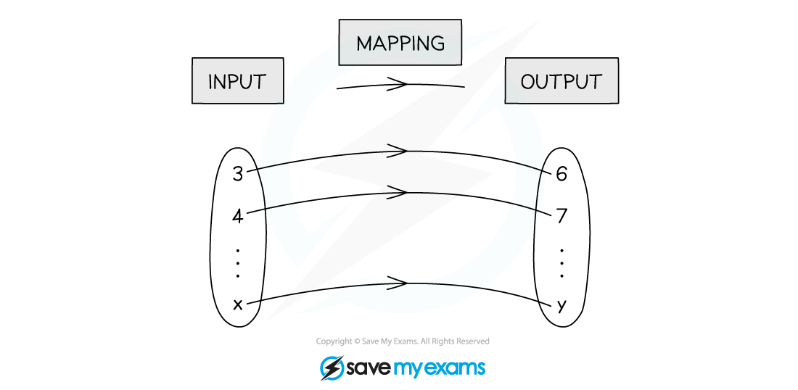
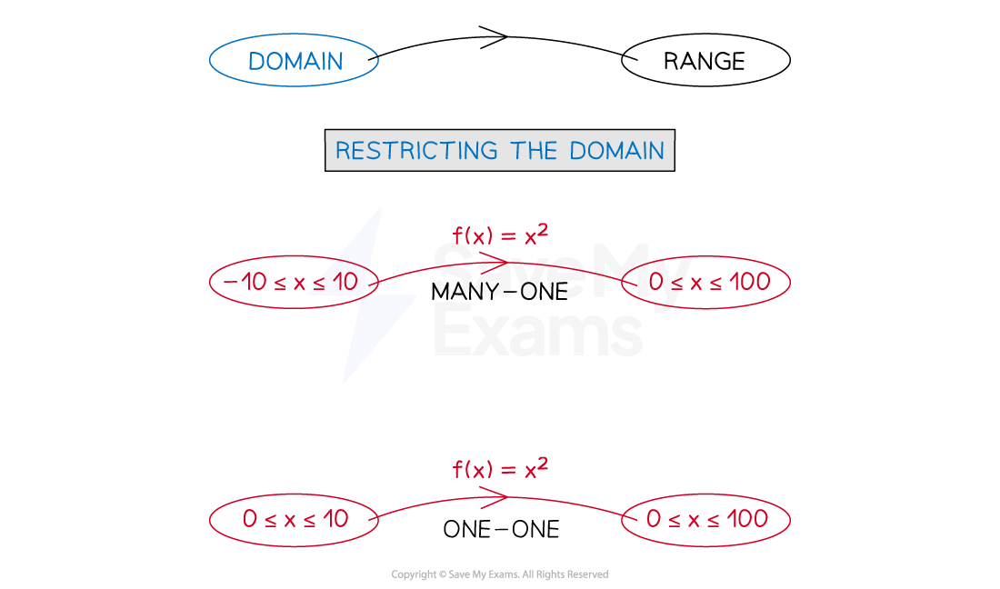
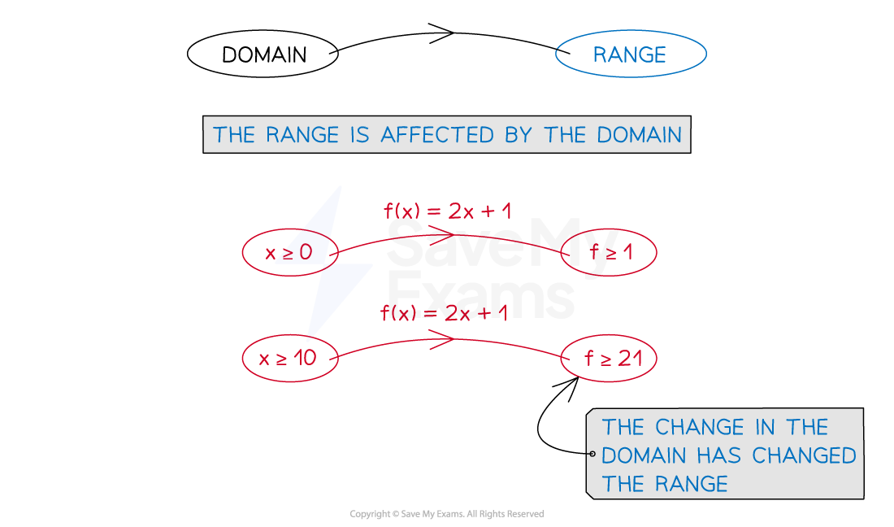

# Language of Functions

## Introduction to Functions

> **Spec point** — `spcpt_yxJ4zdcrjvnzZcfN`

## Introduction to functions

### What is a mapping?

- A **mapping** takes an **'input'** from one **set** of values to an **'output'** in another

- Mappings can be

  - **'many-one' (many** 'input' values map to **one** 'output' value)
  - **'one-one' (one** 'input' value maps to **one** 'output' value)
  
    - You may also come across 'many-many' and 'one-many' functions

### What is a function?

- A **function** is a mapping where every 'input' value maps to a **single** 'output'
- Therefore only **many-one** and **one-one** mappings are **functions**

### What notation is used for functions?

- Functions are denoted by `straight f open parentheses x close parentheses comma space straight g open parentheses x close parentheses`, etc

  - e.g.  `straight f open parentheses x close parentheses equals x squared minus 3 x plus 2`
  - These would be pronounced as 'f of x', 'g of x', etc
- There is an alternative notation

  - e.g.  `straight f colon x rightwards arrow from bar x squared minus 3 x plus 2`
  - Which may be pronounced 'the function f maps x to x-squared minus three x plus two'

### How does a function work?

- A function has an **input **`open parentheses x close parentheses` and **output **`left parenthesis straight f open parentheses x close parentheses space or space space y right parenthesis`
- Whatever goes in the bracket (instead of $x$) with f, replaces the $x$ on the other side

  - This is the input
- If the input is known, the output can be calculated

  - For example, given the function $f(x)=2x+1$
  
    - $f(3)=2\times3+1=7$
    - $f(-4)=2\times(-4)+1=-7$
    - $f(a)=2a+1$

- If the output is known, an equation can be formed and solved to find the input

  - For example, given the function $f(x)=2x+1$
  
    - If $f(x)=15$, the equation $2x+1=15$ can be formed
    - Solving this equation gives an input of 7

> **Worked Example**
> A function is defined as `straight f open parentheses x close parentheses space equals space 3 x to the power of 2 space end exponent minus space 2 x space plus space 1`.
> 
> a) Find `straight f open parentheses 7 close parentheses`.
> 
> > *The input is *$x=7$*, so substitute 7 into the expression everywhere you see an *$x$*.*
> 
> > *  *
> 
> `straight f open parentheses 7 close parentheses space equals space 3 open parentheses 7 close parentheses squared space minus space 2 open parentheses 7 close parentheses space plus space 1`
> 
> > *  *
> 
> > *Calculate.*
> 
> > *  *
> 
> `table row cell straight f open parentheses 7 close parentheses space end cell equals cell space 3 open parentheses 49 close parentheses space minus space 14 space plus space 1 end cell row blank equals cell space 147 space minus space 14 space plus space 1 end cell end table`
> 
> > *  *
> 
> $f(7)=134$
> 
> b) Find `straight f open parentheses x space plus space 3 close parentheses`.
> 
> > *The input is *$x=x+3$* so substitute *$x+3$* into the expression everywhere you see an *$x$*.  *
> 
> > `straight f open parentheses x space plus space 3 close parentheses space equals space 3 open parentheses x space plus space 3 close parentheses squared space minus space 2 open parentheses x space plus space 3 close parentheses space plus space 1`*  *
> 
> > *Expand the brackets and simplify.  *
> 
> > `table row cell straight f open parentheses x space plus space 3 close parentheses space end cell equals cell space 3 open parentheses x squared space plus space 6 x space plus space 9 close parentheses space minus space 2 open parentheses x space plus space 3 close parentheses space plus space 1 end cell row blank equals cell space 3 x squared space plus space 18 x space plus space 27 space minus space 2 x space minus space 6 space plus space 1 end cell row blank equals cell space 3 x squared space plus space 16 x space plus space 22 end cell end table`*  *
> 
> $f(x+3)=3x^{2}+16x+22$
> 
> A second function is defined `straight g space colon space x space rightwards arrow from bar space 3 x space – space 4`.
> 
> c) Find the value of $x$ for which `straight g space colon space x space rightwards arrow from bar space minus 16`.
> 
> > *Form an equation by setting the function equal to -16.*
> 
> > * *
> 
> `table row cell 3 x space minus space 4 space end cell equals cell space minus 16 end cell end table`
> 
> > * *
> 
> > *Solve the equation by first adding 4 to both sides, then dividing by 3. *
> 
> > * *
> 
> `table row cell 3 x space minus space 4 space end cell equals cell space minus 16 end cell row cell 3 x space end cell equals cell space minus 12 end cell row cell x space end cell equals cell space minus 12 over 3 end cell end table`
> 
> > * *
> 
> $x=-4$

## Domain & Range

> **Spec point** — `spcpt_pYXZH2ttg7ZPH73n`

## Domain & range

### What is the domain of a function?

- The **domain** of a function is the set of values that are allowed to be the ‘input’
- A function is only fully defined once its domain has been stated

  - If a domain is not stated then it is assumed that the domain is the **largest set of possible values**
  
    - e.g. the largest set of possible values for the function `straight f open parentheses x close parentheses equals square root of x` would be $x\geq0$
- **Restrictions** on a domain can turn **many**-**one** functions into **one**-**one** functions

### What is the range of a function?

- The **range** of a function is the set of values of all possible ‘outputs’
- The type of values in the range depend on the **domain**

### How do I find a range from a given domain?

- The **domain** of a function is the set of values that are used as **inputs**
- The **range** of a function is the set of values that are given as **outputs**
- Finding the** range** of a function involves determining all possible **output **values from a given **domain**

  - This may need to be done by calculating each output value individually by** applying the function **to each input value
  - Or by considering the** shape **or **pattern **of the function
- To graph a function we use the **inputs as the *****x*****-coordinates** and the **outputs as the *****y*****-coordinates**

  - $f(2)=5$ corresponds to the coordinates (2, 5)
- Graphing the function can help you visualise the range

  - For example the range of the function `straight f open parentheses x close parentheses space equals space x squared` for a domain of all real values of $x$ will be `straight f open parentheses x close parentheses space greater or equal than 0 space`as the *y-*coordinates on the graph are all greater than or equal to zero

> **Worked Example**
> The many-one function, $f(x)$, is given by
> 
> `straight f open parentheses x close parentheses equals open parentheses x minus 3 close parentheses to the power of 2 space end exponent`
> 
> for all values of $x$.
> 
> a)  State the range of `straight f open parentheses x close parentheses`.
> 
> > *The 'output' from the function *$f$* is a squared value and so will be positive, or zero.*
> 
> $f(x)\geq0$
> 
> b) The domain of `straight f open parentheses x close parentheses` is changed to $x>5$. Write down the changed range of `straight f open parentheses x close parentheses`.
> 
> *As *$x>5$*, *`straight f open parentheses x close parentheses greater than open parentheses 5 minus 3 close parentheses squared`
> 
> $\thereforef(x)>4$

## The Modulus Function

> **Spec point** — `spcpt_PQmGGSY2kf3PFGpX`

## The modulus function

### What is the modulus function?

- The **modulus function** makes **any** 'input' **positive**

  - This is sometimes called the **absolute** value (of the input)
  - The modulus function is indicated by a pair of vertical lines being written around the input
  
    - Similar to how brackets are used
    - e.g.  `vertical line 7 vertical line equals 7 comma space space space vertical line minus 7 vertical line equals 7`

### What is the relationship between a function and its modulus?

- For an 'output' such that `straight f open parentheses x close parentheses greater or equal than 0`, then `vertical line straight f open parentheses x close parentheses vertical line equals straight f open parentheses x close parentheses`

  - Both the function and its modulus are positive

- For an 'output' such that `straight f open parentheses x close parentheses less than 0`, then `vertical line straight f open parentheses x close parentheses vertical line equals negative straight f open parentheses x close parentheses`

  - The function value is **negative,** but its modulus is **positive**
