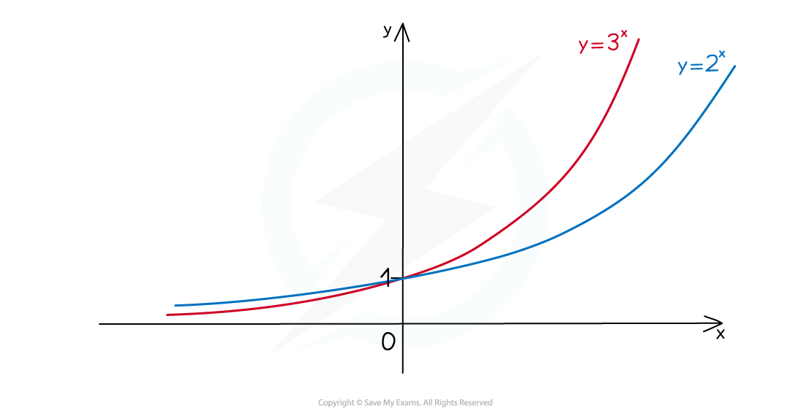

# Exponential Functions

## Exponential Functions

> **Spec point** — `spcpt_J4yG78VbHv8xST3p`

## Exponential functions

### What is an exponential function?

- An exponential functions in a function where the variable is the power
- They are of the form **y = a****x** with **a > 0**

### What is an exponential graph?

- All graphs of the form **y = a****x** will pass through (0, 1) because **a****0**** = 1**
- The **x**-axis is an **asymptote** 

### Exponential graphs when a > 1

- Where **x < 0** the higher value of **a** is the “lower” graph
- Where **x > 0** the higher value of **a** is the “higher” graph
- **a > 1** is **exponential** **growth **

### What about when a ≤ 1?

- You may like to think about why** a = 1** is **not** considered... If a = 1, y = 1x = 1 for all values of x
- **0 < a < 1** represents **exponential decay** 

  - Where **x < 0** the higher value of **a** is the “higher” graph
  - Where **x > 0** the higher value of **a** is the “lower” graph

> **Worked Example**
> 

## "e"

> **Spec point** — `spcpt_M4DwVz7wGgncWnbR`

## "e"

### What is e, the exponential function?

- The exponential function is **y = e****x**

  - **e** is an *irrational* number
  - **e ≈ 2.718**
- As with other exponential graphs **y = e****x** 

  - passes through (0, 1)
  - has the x-axis as an asymptote

### What is the big deal with e?

- **y = e****x** has the particular property

$\frac{dy}{dx}=e^{x}$

- i.e. for *every* real number **x**, the gradient of **y = e****x** is also equal to **e****x **(see Differentiating e^x and lnx)

### The negative exponential graph

- **y = e****-x** is a reflection in the **y**-axis of **y = e****x** 

** **

### What is exponential growth and decay?

** **

- **y = Ae****kx** (**k > 0**) is exponential growth
- **y = Ae****-kx** (**k > 0**) is exponential decay
- **A** is the initial value
- **k** is a (usually positive) constant
- A** negative sign** is used in the equation making clear whether it is growth or decay

> **Worked Example**
> 
> 
> 
