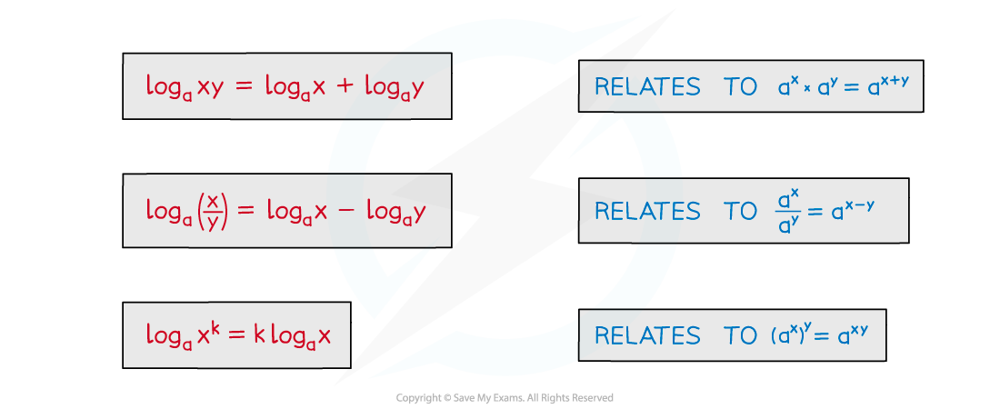
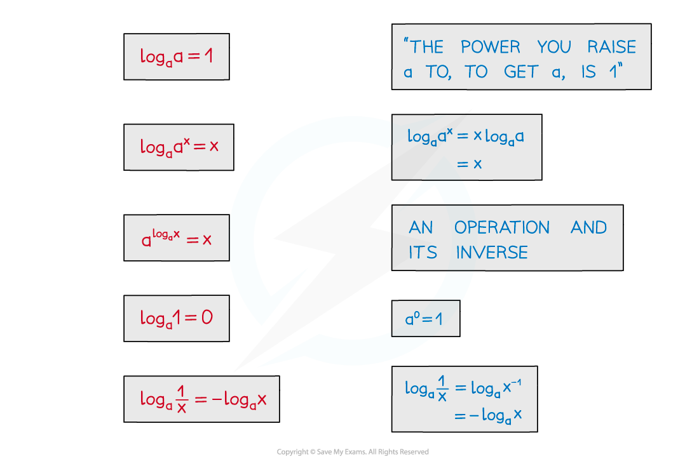
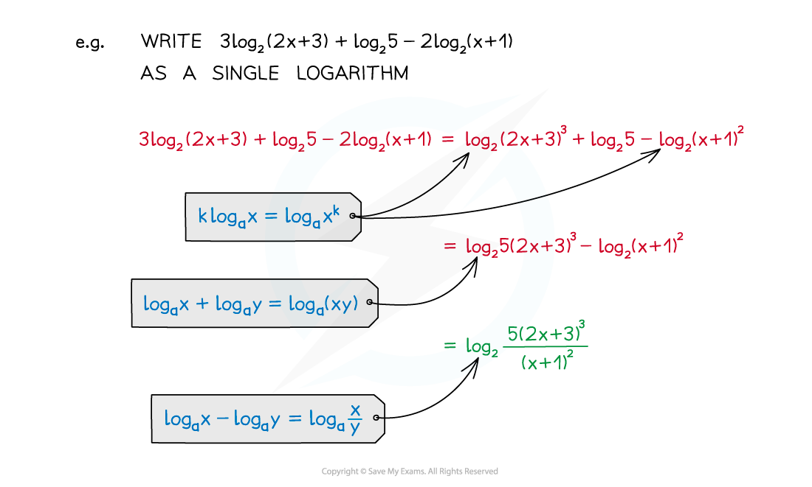

# Laws of Logarithms

## Laws of Logarithms

> **Spec point** — `spcpt_4YfHY6sGGvMBwfvz`

## Laws of logarithms

### What are the laws of logarithms?

- Laws of logarithms allow you to simplify and manipulate expressions involving logarithms

  - The laws of logarithms are equivalent to the **laws of indices**
- The laws you need to know are, given $a,x,y>0$:

  - $\mathrm{log}_{a}xy=\mathrm{log}_{a}x+\mathrm{log}_{a}y$
  
    - This relates to $a^{x}\timesa^{y}=a^{x+y}$
  - $\mathrm{log}_{a}\frac{x}{y}=\mathrm{log}_{a}x-\mathrm{log}_{a}y$
  
    - This relates to $a^{x}\diva^{y}=a^{x-y}$
  - $\mathrm{log}_{a}x^{m}=m\mathrm{log}_{a}x$
  
    - This relates to $(a^{x})^{y}=a^{xy}$

- There are also some particular results these lead to

  - $\mathrm{log}_{a}a=1$
  - $\mathrm{log}_{a}a^{x}=x$
  - $a^{\mathrm{log}_{a}x}=x$
  - $\mathrm{log}_{a}1=0$
  - $\mathrm{log}_{a}(\frac{1}{x})=-\mathrm{log}_{a}x$

- Beware…

  - …`log subscript a open parentheses x plus y close parentheses space not equal to space log subscript a x plus log subscript a y`
- These results apply to $\mathrm{ln}x(\mathrm{log}_{e}x)$ too

  - Two particularly useful results are
  
    - $\mathrm{ln}e^{x}=x$
    - $e^{\mathrm{ln}x}=x$

### How do I use the laws of logarithms?

- Laws of logarithms can be used to …

  - … simplify expressions
  - … solve logarithmic equations
  - … solve exponential equations

> **Exam Hint**
> - Remember to check whether your solutions are valid
> 
>   - log (x+k) is only defined if x > -k
>   - You will lose marks if you forget to reject invalid solutions

> **Worked Example**
> a) Write the expression $2\mathrm{log}4-\mathrm{log}2$ in the form $\mathrm{log}k$, where $k\inℤ$.
> 
> > *Using the law *$\mathrm{log}_{a}x^{m}=m\mathrm{log}_{a}x$* we can rewrite *$2\mathrm{log}4$* as *$\mathrm{log}4^{2}=\mathrm{log}16$*.*
> 
> > *  *
> 
> $2\mathrm{log}4-\mathrm{log}2=\mathrm{log}16-\mathrm{log}2$
> 
> > *Using the law *$\mathrm{log}_{a}\frac{x}{y}=\mathrm{log}_{a}x-\mathrm{log}_{a}y$*:*
> 
> > * *
> 
> > * *$\mathrm{log}16-\mathrm{log}2=\mathrm{log}\frac{16}{2}=\mathrm{log}8$
> 
> $2\mathrm{log}4-\mathrm{log}2=\mathrm{log}8$
> 
> b)   Hence, or otherwise, solve $2\mathrm{log}4-\mathrm{log}2=-\mathrm{log}\frac{1}{x}$.
> 
> > *Rewrite the equation using the expression found in part (a).*
> 
> > $2\mathrm{log}4-\mathrm{log}2=\mathrm{log}8$*: *
> 
> > *  *
> 
> $\mathrm{log}8=-\mathrm{log}\frac{1}{x}$
> 
> > *Using the index law *$\frac{1}{x}=x^{-1}$*::*
> 
> > * *
> 
> > * *$\mathrm{log}8=-\mathrm{log}x^{-1}$
> 
> > *Using the law *$\mathrm{log}_{a}x^{m}=m\mathrm{log}_{a}x$*:*
> 
> > *  *
> 
> `log space 8 equals space space log space x to the power of negative open parentheses negative 1 close parentheses end exponent space equals space log space x`
> 
> > * *
> 
> > *Compare the two sides.*
> 
> > * *$\mathrm{log}8=\mathrm{log}x$
> 
> $x=8$

## Change of Base

> **Spec point** — `spcpt_7D6JfdxSZVhhGkYM`

## Change of base

### How do I change the base of a logarithm?

- The formula for changing the base of a logarithm is

$\mathrm{log}_{a}x=\frac{\mathrm{log}_{b}x}{\mathrm{log}_{b}a}$

- The value you choose for *b* does not matter, however if you do not have a calculator, you can choose *b *such that the problem will be possible to solve

### Why change the base of a logarithm?

- The laws of logarithms can only be used if the logs have the same** base**

  - If a problem involves logarithms with different bases, you can change the base of the logarithm and then apply the laws of logarithms
- **Changing the base **of a logarithm can be particularly useful if you need to evaluate a log problem **without a calculator**

  - Choose the base such that you would know how to solve the problem from the equivalent exponent

- This formula had more use when calculators were less advanced

  - Some old calculators only had a button for logarithm of base 10
  - To calculate $\mathrm{log}_{5}7$on these calculators you would have to enter
  
    - `fraction numerator log subscript 10 invisible function application 7 over denominator log subscript 10 invisible function application 5 end fraction`

- The formula can be useful when evaluating a logarithm where the two numbers are **powers of a common number**

  - $\mathrm{log}_{4}8=\frac{\mathrm{log}_{2}8}{\mathrm{log}_{2}4}=\frac{3}{2}$
- The formula can be useful when you are solving equations and two logarithms have **different bases**

  - For example, if you have $\mathrm{log}_{3}k$ and $\mathrm{log}_{9}n$ within the same equation
  
    - You can rewrite $\mathrm{log}_{9}n$ as `fraction numerator log subscript 3 invisible function application n over denominator log subscript 3 invisible function application 9 end fraction blank` which simplifies to $\frac{1}{2}\mathrm{log}_{3}n$
    - Or you can rewrite $\mathrm{log}_{3}k$ as `fraction numerator log subscript 9 invisible function application k over denominator log subscript 9 invisible function application 3 end fraction blank` which simplifies to $2\mathrm{log}_{9}k$
- The formula also allows you to derive and use a formula for switching the numbers:

`log subscript a invisible function application x equals fraction numerator 1 over denominator log subscript x invisible function application a end fraction`

- Using the fact that $\mathrm{log}_{x}x=1$

> **Exam Hint**
> - It is very rare that you will need to use the change of base formula
> - Only use it when the bases of the logarithms are different

> **Worked Example**
> By choosing a suitable value for *b, *use the change of base law to find the value of  $\mathrm{log}_{8}32$ without using a calculator.
> 
> > *Note that 8 and 32 are both powers of 2, where 8 = 2**3 ** and 32 = 2**5**.*
> 
> > *Therefore we can choose **b** = 2 in the change of base formula. *
> 
> > $\mathrm{log}_{a}x=\frac{\mathrm{log}_{b}x}{\mathrm{log}_{b}a}$*: *
> 
> > *  *
> 
> $\mathrm{log}_{8}32=\frac{\mathrm{log}_{2}32}{\mathrm{log}_{2}8}$
> 
> > *If  2**3** = 8 then log**2 **8 = 3 and if  2**5** = 32 then log**2 **32 = 5.*
> 
> > * *
> 
> > * *$\frac{\mathrm{log}_{2}32}{\mathrm{log}_{2}8}=\frac{5}{3}$
> 
> $\mathrm{log}_{8}32=\frac{5}{3}=1\frac{2}{3}$
