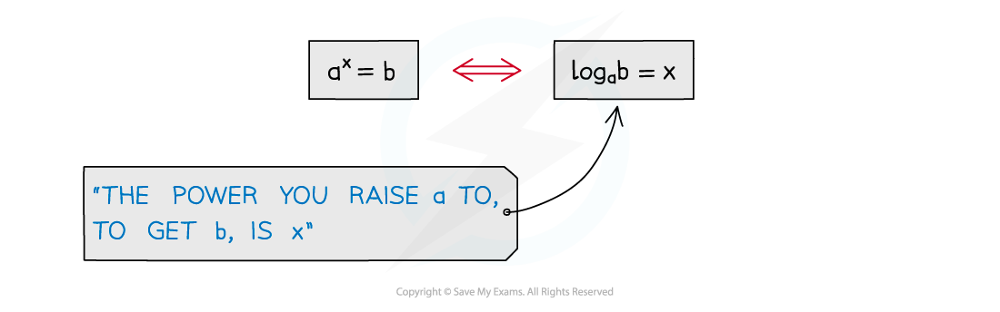
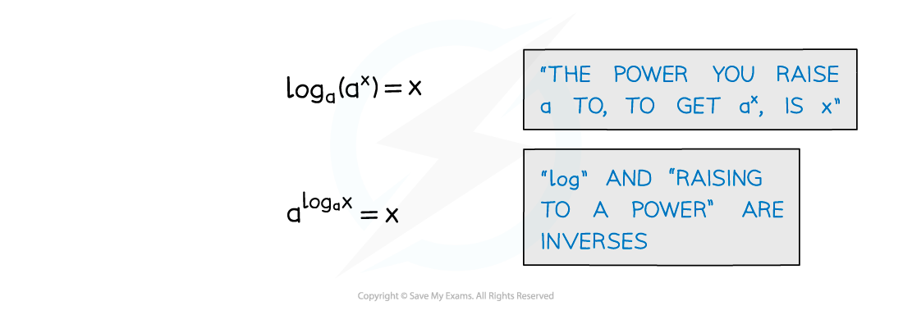
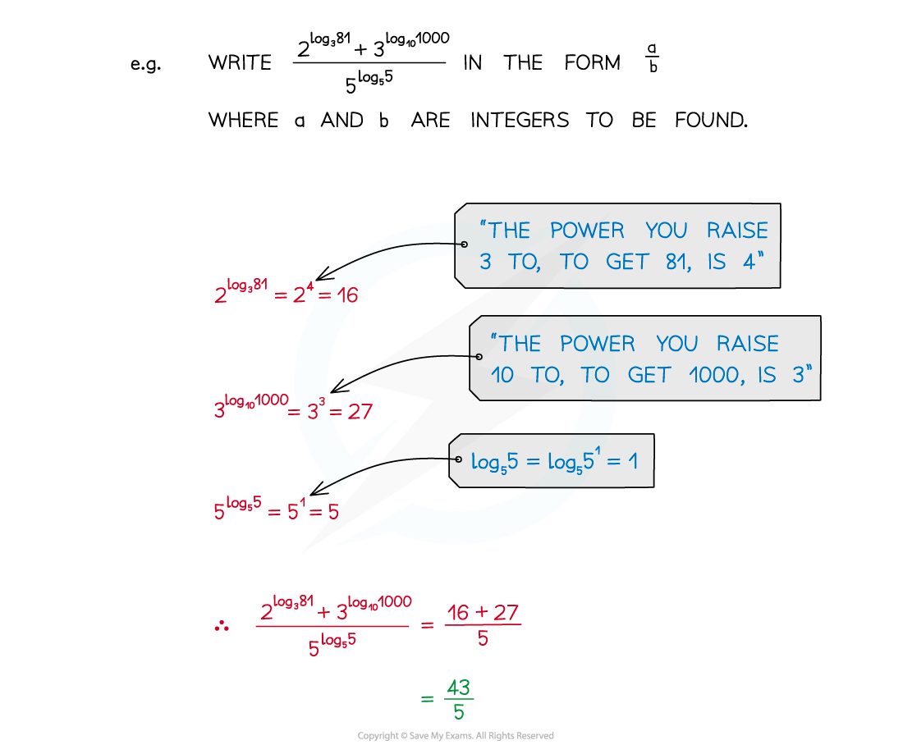

# Logarithmic Functions

## Logarithmic Functions

> **Spec point** — `spcpt_TvBTg3PdqhCKDMcC`

## Logarithmic functions

### What are logarithmic functions?

- A logarithm is the inverse of raising to a power
- If $a=b^{x}$ then $\mathrm{log}_{b}a=x$

  - $a>0$
  - $b$ is called the **base **of the logarithm
- Try to get used to ‘reading’ logarithm statements to yourself

  - `log subscript... end subscript open parentheses... close parentheses space equals` would be read as “the power that you raise ... to, to get ..., is ”
  - So `log subscript 5 open parentheses 125 close parentheses equals 3` would be read as “the power that you raise 5 to, to get 125, is 3”

- A logarithm is the inverse of raising to a power so we can use rules to simplify logarithmic functions

### Why use logarithms?

- Logarithms allow us to solve equations where the exponent is the unknown value

  - We can solve some of these by inspection
  
    - For example, for the equation 2*x** *= 8 we know that *x *must be 3
  - Logarithms allow use to solve more complicated problems
  
    - For example, the equation 2*x* = 10 does not have a clear answer
    - Instead, we can use our calculator to find the value of $\mathrm{log}_{2}10$

### How do I use logarithms?

- Recognising the rules of logarithms allows expressions to be simplified

- Recognition of common powers helps in simple cases For more awkward cases a calculator is needed** ** 

  - Powers of 2: 20 = 1, 21 = 2, 22 = 4, 23 = 8, 24 =16, …
  - Powers of 3: 30 = 1, 31 = 3, 32 = 9, 33 = 27, 34 = 81, …
  - The first few powers of 4, 5 and 10 should also be familiar

- Calculators can have, possibly, three different logarithm buttons

- This button allows you to type in any number for the base

- Natural logarithms (see “e”)

- Shortcut for base 10 although SHIFT button needed** **
- Before calculators, logarithmic values had to be looked up in printed tables

### What notation might I see with logarithms?

- 10 is a common base

  - **log****10 ****x** is abbreviated to **log x** or **lg x**
- The value **e** is another common base

  - **log****e**** x** is abbreviated to **ln x**
- **(log x)****2**** ≠ log x****2**

> **Exam Hint**
> - Before going into the exam, make sure you are completely familiar with your calculator and know how to use its logarithm functions

## ln x

> **Spec point** — `spcpt_wN9sKgkbHtyrCPZ3`

## ln x

### What is ln?

- **ln** is a function that stands for **natural logarithm**
- It is a logarithm where the **base** is the constant "**e**"

  - $\mathrm{ln}x\equiv\mathrm{log}_{e}x$
  - It is important to remember that **ln** is a function and **not a number**
- The natural logarithm ($\mathrm{ln}x$) and the exponential function ($e^{x}$) are inverses of each other
- It is defined for all positive numbers ($x>0$)

  - $\mathrm{ln}x$ cannot be defined for negative numbers or $x=0$

### What are the properties of ln?

- Using the **definition** of a **logarithm** you can see

  - $\mathrm{ln}1=0$
  - $\mathrm{ln}e=1$
  - $\mathrm{ln}e^{x}=x$
  - $\mathrm{ln}x$ is only defined for positive *x*

### How can I solve equations involving e & ln?

- The functions $e^{x}$ and $\mathrm{ln}x$ are **inverses** of each other

  - If $e^{x}=a$ then `x equals ln invisible function application space a`
  - If `ln invisible function application space x equals a` then $x=e^{a}$
  - If $e^{f(x)}=g(x)$ then `straight f stretchy left parenthesis x stretchy right parenthesis equals ln invisible function application space straight g stretchy left parenthesis x stretchy right parenthesis`
  - If `ln invisible function application space straight f left parenthesis x right parenthesis equals straight g open parentheses x close parentheses` then `straight f open parentheses x close parentheses equals straight e to the power of straight g open parentheses x close parentheses end exponent`
- If your equation involves "e" then try to get all the "e" terms on one side

  - If "e" terms are multiplied, you can add the powers
  
    - $e^{x}\timese^{y}=e^{x+y}$
    - You can then apply ln to both sides of the equation
  - If "e" terms are added, try transforming the equation with a substitution
  
    - For example: If $y=e^{x}$ then $e^{4x}=y^{4}$
    - You can then solve the resulting equation (usually a quadratic)
    - Once you solve for *y* then solve for *x *using the substitution formula
- If your equation involves "ln", try to combine all "ln" terms together

  - Use the laws of logarithms to combine terms into a single term
  - If you have `ln invisible function application space straight f open parentheses x close parentheses equals ln invisible function application space straight g left parenthesis x right parenthesis` then solve `straight f open parentheses x close parentheses equals straight g left parenthesis x right parenthesis`
  - If you have `ln invisible function application space straight f open parentheses x close parentheses equals k` then solve `straight f open parentheses x close parentheses equals straight e to the power of k`

> **Exam Hint**
> - If you're working on the non-calculator exam paper you may need to leave answers as exact values so using ln*x *is a good idea
> 
>   - This can be solved with e*x *which can then be left as an exact value

> **Worked Example**
> Solve the equation $e^{2x}=5$, leaving your answer as an exact value.
> 
> > *Take the natural logarithm of both sides. *
> 
> `ln space open parentheses straight e to the power of 2 x end exponent close parentheses space equals space ln space 5`
> 
> > *Use the property that *`ln space open parentheses straight e to the power of a close parentheses space equals space a`*.*
> 
> > $2x=\mathrm{ln}5$* *
> 
> > *Divide both sides by 2. *
> 
> `table row cell x space end cell equals cell space fraction numerator ln space 5 over denominator 2 end fraction end cell end table`
> 
> > *Do not use your calculator to evaluate this as the question asks for the answer given as an exact value.*
> 
> $x=\frac{\mathrm{ln}5}{2}$
