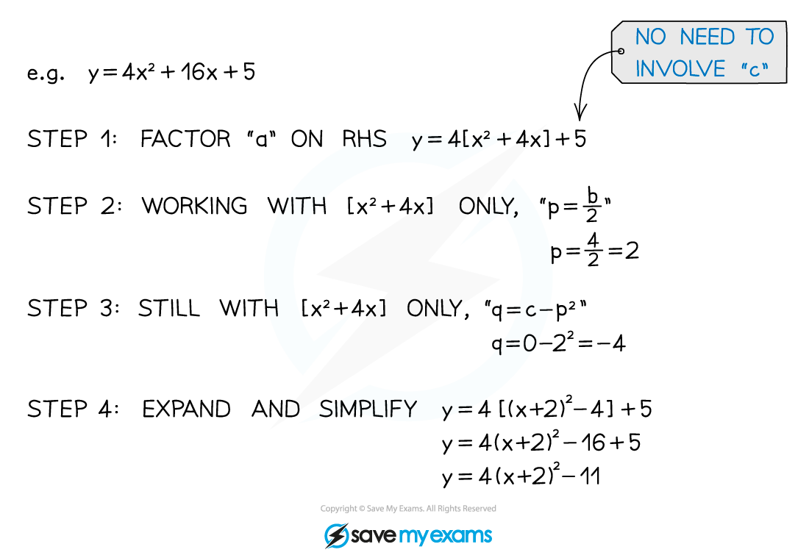

# Completing the Square

## Completing the Square

> **Spec point** — `spcpt_69qXcFBbcmd6HWHX`

## Completing the square

### What is completing the square?

- **Completing the square** is another way of writing a quadratic function
- It means rewriting $y=ax^{2}+bx+c$ in the form $y=a(x+p)^{2}+q$

  - The key point is that $x$ now only occurs once in the equation
- It can be used to solve quadratic equations, sketch their graphs and to find the coordinates of the turning point

### How do I complete the square?

The method used will depend on the value of the *coefficient* of the $x^{2}$ term in $y=ax^{2}+bx+c$

- When $a=1$

  - $p$ is half of $b$
  - $q$ is $c-p^{2}$

- When **a ≠ 1 **

  - First take a factor of $a$ out of the $x^{2}$ and $x$ terms
  - Then continue as above

> **Exam Hint**
> - Sometimes a question will explicitly use the phrase **complete the square**
> - Sometimes a question will use the form $a ( x + p )^{2} + q$ without using the phrase completing the square

> **Worked Example**
> Write $3x^{2}-12x+k$ in the form $a ( x + p )^{2} + k + q$, where $a,p$ and $q$ are constants to be found, and $k$ is an unknown constant.
> 
> > *The form required is 'completing the square' (do not be put off by the *$k$*, it is just a constant!).*
> 
> > *STEP 1 - Take a factor of 3 out of the *$x^{2}$* and *$x$* terms - leaving *$k$* avoids awkward fractions.*
> 
> $3 x^{2} - 12 x + k = 3 ( x^{2} - 4 x ) + k$
> 
> > *STEPS 2 and 3 - Complete the square on the *$( x^{2} - 4 x )$* part only. "*$p=-\frac{4}{2}=-2$*" and "*$q = 0 - ( - 2 )^{2} = 4$*".*
> 
> $3 [ ( x - 2 )^{2} - 4 ] + k$
> 
> > *STEP 4 - Expand and simplify.*
> 
> $3 ( x - 2 )^{2} - 12 + k$
> 
> $3(x-2)^{2}+k-12$
> 
> **i.e. **$a=3,p=-2,q=-12$

## Solving by Completing the Square

> **Spec point** — `spcpt_zYf2TBFZSBm6Csns`

## Solving by completing the square

#### How do I solve a quadratic equation by completing the square?

- To solve *x*2 + *bx *+* c* = 0

  - **replace** the first two terms, ***x*****2**** + *****bx***, with **(*****x***** + *****p*****)****2**** - *****p*****2** where ***p***** is half of *****b***
  - this is called** completing the square**
  
    - *x*2 + *bx *+* c* = 0 becomes
    
      - (*x* + *p*)2 - *p*2 + *c *= 0 where *p* is half of *b*
  - rearrange this equation to **make *****x***** the subject** (using ±√)
- For example, solve *x*2 + 10*x* + 9 = 0 by completing the square

  - *x*2 + 10*x *becomes (*x* + 5)2 - 52
  - so* x*2 + 10*x* + 9 = 0 becomes (*x* + 5)2 - 52 + 9 = 0
  - make *x* the subject (using ±√)
  
    - (*x* + 5)2 - 25 + 9 = 0
    - (*x* + 5)2 = 16
    - *x* + 5 = ±√16
    - *x*  = ±4 - 5
    - *x*  = -1 or *x*  = -9

- If the equation is *ax*2 + *bx* + *c* = 0 with a number in front of *x*2, then divide both sides by *a* first, before completing the square

> **Exam Hint**
> - When making *x* the subject to find the solutions at the end, don't expand the squared brackets back out again!
> 
>   - Remember to use ±√ to get** two** solutions

> **Worked Example**
> Solve $2x^{2}-8x-24=0$ by completing the square.
> 
> *Divide both sides by 2 to make the quadratic start with **x**2** * * *
> 
> $x^{2}-4x-12=0$ * *
> 
> *Halve the middle number, -4, to get -2 *
> *Replace the first two terms, **x**2** - 4**x**, with (**x** - 2)**2** - (-2)**2* * *
> 
> $( x - 2 )^{2} - ( - 2 )^{2} - 12 = 0$ * *
> 
> *Simplify the numbers* * *
> 
> $\begin{array}{rcl} ( x - 2 )^{2} - 4 - 12 & = 0 \\ ( x - 2 )^{2} - 16 & = 0 \end{array}$ * *
> 
> *Add 16 to both sides* * *
> 
> $( x - 2 )^{2} = 16$ * *
> 
> *Square root both sides *
> *Include the ± sign to get two solutions* * *
> 
> $x-2=\pm\sqrt{16}=\pm4$ * *
> 
> *Add 2 to both sides* * *
> 
> $x=\pm4+2$ * *
> 
> > *Work out each solution separately*
> 
> **Final answer:** **x**** = 6 or ****x**** = -2**
