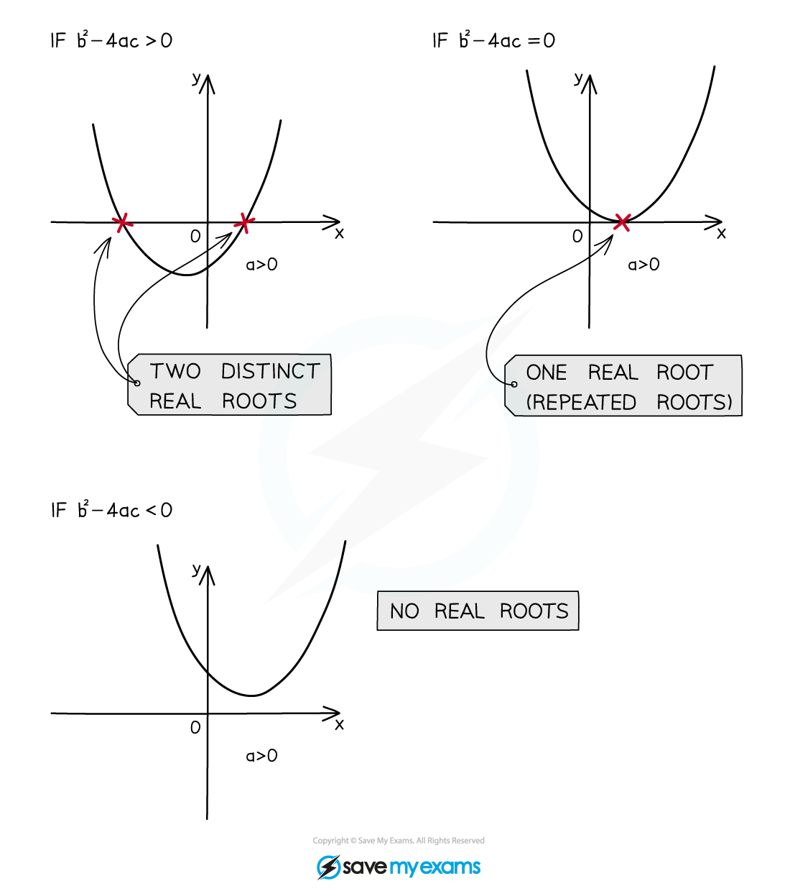
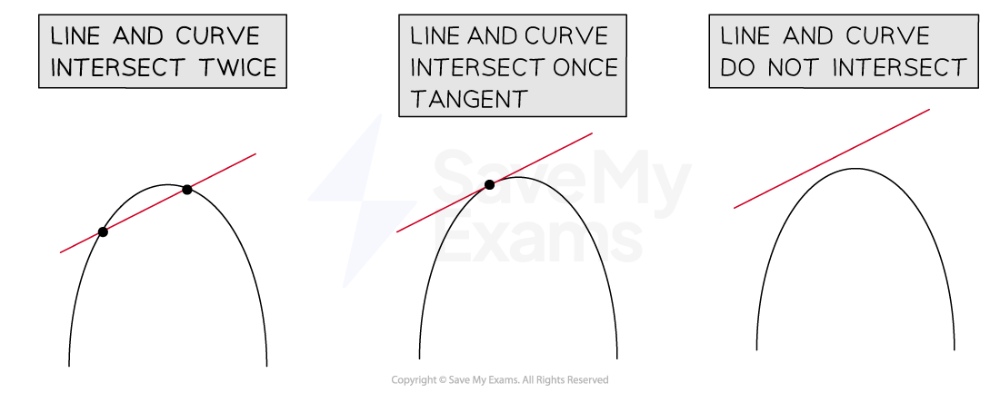

# Discriminants

## Discriminants

> **Spec point** — `spcpt_NvHCD8kCbVz7tb7N`

## Discriminants

### What is a discriminant?

- The **discriminant** is the part of the quadratic formula that is **under the square root** sign
- It is $b^{2}-4ac$

  - The **quadratic formula,** in full, is

$x=\frac{-b\pm\sqrt{b^{2}-4ac}}{2a}$

where the quadratic equation is written in the form

$ax^{2}+bx+c=0$

- It is sometimes denoted by the Greek letter $Δ$ (capital delta)

> **Worked Example**
> Find, in terms of the constant $k$, the discriminant of the quadratic equation $3x^{2}+2kx-k=kx^{2}-4kx+2$.
> 
> > *First write the quadratic equation in the form* $ax^{2}+bx+c=0$*.*
> 
> $\begin{gathered} 3 x^{2} - k x^{2} + 2 k x + 4 k x - k - 2 & = 0 \\ ( 3 - k ) x^{2} + 6 k x - ( k + 2 ) & = 0 \end{gathered}$
> 
> > *It can be easier/clearer to pick out* $a,b$ *and* $c$ *first, before finding the discriminant.*
> 
> $\begin{array}{rcl} a = 3 - k \\ b = 6 k \\ c = - ( k + 2 ) \end{array}$
> 
> > *The discriminant is* $b^{2}-4ac$*.*
> 
> $\begin{gathered} \Delta = ( 6 k )^{2} - 4 \times ( 3 - k ) \times - ( k + 2 ) \\ \Delta = 36 k^{2} + 4 ( 6 + k - k^{2} ) \end{gathered}$
> 
> $\Delta=32k^{2}+4k+24$

## Applications of Discriminant

> **Spec point** — `spcpt_cWq7d2hrR4fZkxtW`

## Applications of discriminant

### How does the value of the discriminant affect roots?

- There are three options for the outcome of the discriminant:

  - If $b^{2}-4ac>0$ the square root part of the quadratic formula can be calculated leading to two solutions (values of $x$)
  
    - i.e. **two** different **real roots**
  - If  $b^{2}-4ac=0$ the square root part of the quadratic formula will be zero leading to one solution
  
    - i.e. **one repeated** root or **two equal roots**
  - If  $b^{2}-4ac<0$ the square root part of the quadratic formula cannot be calculated leading to no solutions
  
    - i.e.** no (real) roots**

### How do I sketch quadratic graphs using the discriminant?

- If $b^{2}-4ac>0$ the quadratic equation has **two** different real **roots**

  - The graph of the quadratic will **intersect** the $x$-axis **twice** (at the roots)
- If  $b^{2}-4ac=0$ the quadratic equation has two equal roots **(one root)**

  - The graph of the quadratic will **intersect** (touch) the $x$-axis **once** (at the root)
- If  $b^{2}-4ac<0$ the quadratic equation has **no** (real) **roots**

  - The graph of the quadratic will **not intercept** the $x$-axis

### How do I use the discriminant to find the number of intersections between a line and a curve?

- For the graphs of two functions, $y = \mathrm{f} ( x )$ and $y = \mathrm{g} ( x )$ where

  - $\mathrm{f} ( x )$ is **quadratic**
  - $\mathrm{g} ( x )$ is **linear**

the number of intersections between the graphs can be found using the discriminant.

- **STEP 1**

  - Set $\mathrm{f} ( x ) = \mathrm{g} ( x )$
- **STEP 2**

  - Rearrange into the form $\mathrm{h} ( x ) = 0$ such that $\mathrm{h} ( x )$ is in the quadratic form $ax^{2}+bx+c=0$
- **STEP 3**

  - Find the **discriminant** and thus determine the **number** of **intersections** between the graphs of $y = \mathrm{f} ( x )$and $y = \mathrm{g} ( x )$
  
    - if $b^{2}-4ac>0$ (two real roots) the graphs **intersect twice**
    - if $b^{2}-4ac=0$ (equal roots) the graphs **intersect once**
    - this means the line ($\mathrm{g} ( x )$) is a *tangent* to the curve ($\mathrm{f} ( x )$)
    - if $b^{2}-4ac<0$ (no real roots) the graphs **do not intersect**

> **Worked Example**
> Show that the line with equation $y=3x-7$ is tangent to the curve with equation $y = ( x + 3 ) ( x - 2 )$.
> 
> > *STEP 1 - set the equations of the line and curve equal to each other.*
> 
> $3 x - 7 = ( x + 3 ) ( x - 2 )$
> 
> > *STEP 2 - rearrange to quadratic form.*
> 
> $\begin{gathered} 3 x - 7 & = x^{2} + x - 6 \\ x^{2} - 2 x + 1 & = 0 \end{gathered}$
> 
> > *STEP 3 - find the discriminant and interpret its value.*
> 
> $\Delta = ( - 2 )^{2} - 4 ( 1 ) ( 1 ) = 0$
> 
> **Final answer:** **Since the discriminant is zero, the line and the curve intersect at one point only. Therefore the line is a tangent to the curve.**
