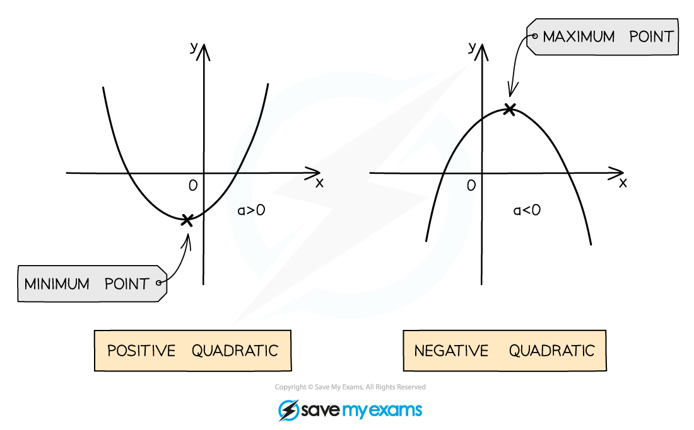

# Quadratic Graphs

## Quadratic Graphs

> **Spec point** — `spcpt_DCMWMHJWb5gF28By`

## Quadratic graphs

A quadratic is a function of the form $y=ax^{2}+bx+c$ where $a$ is not zero They are a very common type of function in mathematics, so it is important to know their key features

### What does a quadratic graph look like?

- The shape made by a quadratic graph is known as a **parabola**
- The parabola shape of a quadratic graph can either look like a “∪-shape” or a “∩-shape”

  - A quadratic with a **positive** *coefficient* of $x^{2}$ will be a ∪-shape
  - A quadratic with a **negative coefficient** of $x^{2}$ will be a ∩-shape
- A quadratic will always cross the $y$-axis
- A quadratic may cross the $x$-axis twice, once, or not at all

  - The points where the graph crosses the $x$-axis are called the **roots**
- If the quadratic is a ∪-shape, it has a** minimum point** (the bottom of the ∪)
- If the quadratic is a ∩-shape, it has a **maximum point** (the top of the ∩)
- Minimum and maximum points are both examples of *turning points*

### How do I sketch a quadratic graph?

- We could create a table of values for the function and then plot it accurately

  - However we often only require a sketch to be drawn, showing just the key features
- The key features needed to be able to sketch a quadratic graph are

  - the overall shape
  
    - ∪-shape graphs occur when $a>0$ (positive quadratic)
    - ∩-shape graphs occur when $a<0$ (negative quadratic)
  - the $x$-intercept(s), these are also known as the **roots** (there may be none!)
  
    - roots are found by setting the quadratic function (or $y$) equal to zero
    - i.e. solve $ax^{2}+bx+c=0$
    - if there are **no** (real) **solutions** (i.e. no roots), the graph does **not intersect** the $x$-axis
    
      - the *discriminant*** **can be used to determine whether a quadratic function has 0, 1 or 2 roots
  - the $y$-intercept
  
    - this is found by setting $x=0$ in the quadratic function
    - so for $ax^{2}+bx+c$ the coordinates of the $y$-intercept will be $( 0 , c )$
  - the **minimum** or **maximum** point (turning point)
  
    - sometimes a rough idea of where this should lie is enough
    - sometimes the specific coordinates of the turning point will be needed
    - when required the coordinates of the turning point can be found by either **completing the square** or **differentiation**
    
      - in cases where the quadratic has just **one root,** the graph will *touch* (rather than *cross)* the $x$-axis and so this will be the turning point

> **Worked Example**
> a) Sketch the graph of $y=x^{2}-5x+6$, labelling any intercepts with the coordinate axes.
> 
> > *It is a positive quadratic, so will be a *$\cup$*-shape*
> 
> *The '*$+c$*' at the end is the *$y$*-intercept (*$y=c$* when *$x=0$*), so the graph crosses the *$y$*-axis at* *(0,6)*
> 
> > *Factorise*
> 
> $y = ( x - 2 ) ( x - 3 )$
> 
> > *Solve *$y=0$
> 
> $( x - 2 ) ( x - 3 ) = 0$
> 
> $x=2\mathrm{or}x=3$
> 
> > *So the roots of the graph are*
> 
> *(2,0)  and (3,0)*
> 
> 
> 
> b) Sketch the graph of $y=x^{2}-6x+13$, labelling any intercepts with the coordinate axes.
> 
> > *It is a positive quadratic, so will be a *$\cup$*-shape*
> 
> > *The '*$+c$*' at the end is the *$y$*-intercept, so this graph crosses the y-axis at*
> 
> *(0,13)*
> 
> > *The discriminant of the quadratic is '*$b^{2}-4ac$*'*
> 
> $( - 6 )^{2} - 4 ( 1 ) ( 13 ) = 36 - 52 = - 16$
> 
> > *As the discriminant is negative, there are no (real) roots and the graph does not intersect the *$x$*-axis*
> 
> > *(Note we have included the coordinates of the turning point, *$( 3 , 4 )$* to help you visualise the graph, but there was no requirement from the question to do this - on a sketch like this, the turning point should be in the correct quadrant)*
> 
> 
> 
> c) Sketch the graph of $y=-x^{2}-4x-4$,  labelling any intercepts with the coordinate axes and the turning point.
> 
> > *It is a negative quadratic, so will be an *$\cap$*-shape*
> 
> *The '*$+c$*' at the end is the *$y$*-intercept, so this graph crosses the *$y$*-axis at **(0, -4)*
> 
> > *Factorising*
> 
> $- x^{2} - 4 x - 4 = - ( x^{2} + 4 x + 4 ) = - ( x + 2 )^{2}$
> 
> *This shows that there is only one root and the graph will touch the *$x$*-axis at the point* *(-2, 0)* *This point will also be the turning point - and as this is a negative quadratic - will be a maximum point*
> 
> 

## Sketching Graphs by Completing the Square

> **Spec point** — `spcpt_8vg6Q67S8QzSRKwZ`

## Sketching graphs by completing the square

### How does completing the square help me sketch graphs?

- Completing the square can quickly tell us the coordinates of the *turning point* on a quadratic graph
- This is based on the fact that a **squared term** (e.g.  $( x + 1 )^{2}$) cannot be **negative**
- **STEP 1** 
**Complete the square** - rewrite $ax^{2}+bx+c=0$ in the form $a ( x + p )^{2} + q$
- **STEP 2** 
Deduce the $x$**-coordinate** of the turning point
- $( x + p ) ^{2} \ge 0$ for all values of $x$

  - Therefore it's minimum value is 0, and this occurs when $x=-p$

The $x$-coordinate is $-p$

- **STEP 3** 
Deduce the $y$**-coordinate** of the turning point
- $a ( x + p )^{2} = 0$

  - Therefore $y=q$

The $y$-coordinate is $q$

- **STEP 4** 
The **turning point** has coordinates $( - p , q )$ This can be considered when sketching the graph of the quadratic function
- Note that the turning point could be a **maximum** or **minimum** point - this will depend on the value of $a$

  - $a$ is the **coefficient** of the $x^{2}$ term
  - If $a$ is **positive,** the graph is $\cup$**- shaped **and will have a **minimum** point
  - If $a$ is **negative,** the graph is $\cap$**- shaped **and will have a** maximum** point 

### How do I use the graph of a quadratic function to find its range?

- The **range** of a quadratic function will be shown on its graph by the values $y$ takes

  - i.e.  the **turning point** from a quadratic graph will determine its **range**
- For the quadratic function $\mathrm{f} ( x )$ whose graph has a **minimum** point $( x_{m i n} , y_{m i n} )$

  - the range of the $\mathrm{f} ( x )$ will be $f\geqy_{min}$
- For the quadratic function $\mathrm{f} ( x )$ whose graph has a **maximum** point $( x_{m a x} , y_{m a x} )$

  - the range of $\mathrm{f} ( x )$ will be $f\leqy_{max}$
- If there any restrictions on the domain of $\mathrm{f} ( x )$ then they could affect the range of $\mathrm{f} ( x )$

> **Worked Example**
> Sketch the graph of $y = \mathrm{f} ( x )$ where $\mathrm{f} ( x ) = 2 x^{2} - 4 x - 6$, giving the coordinates of the turning point, and any points where the graph intercepts the coordinate axes.  Use your graph to write down the range of $\mathrm{f} ( x )$.
> 
> > *STEP 1 - Complete the square.*
> 
> $\begin{gathered} \mathrm{f} ( x ) & = 2 ( x^{2} - 2 x ) - 6 \\ = 2 [ ( x - 1 )^{2} - 1 ] - 6 \\ = 2 ( x - 1 )^{2} - 8 \end{gathered}$
> 
> > *STEP 2 - Deduce the *$x$*-coordinate.*
> 
> $x = - ( - 1 ) = 1$
> 
> > *STEP 3 - Deduce the *$y$*-coordinate.*
> 
> $y=-8$
> 
> > *STEP 4 - Label the turning point when sketching the graph of the quadratic function.*
> 
> 
> 
> > *The graph has a minimum point so the range will be **greater than or equal to** the *$y$*-coordinate of this point.*
> 
> **Final answer:** **The range of **$f(x)$** is**** **$f>-8$
