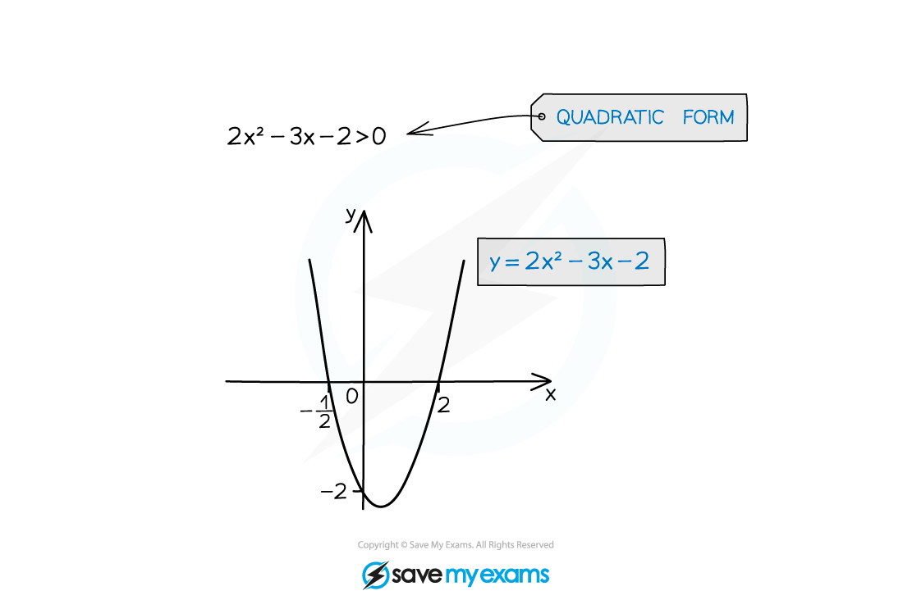
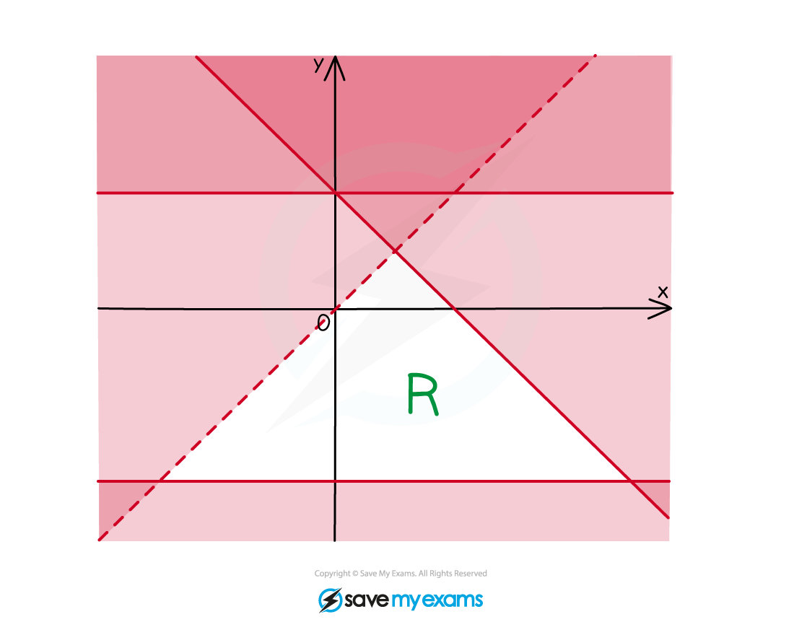
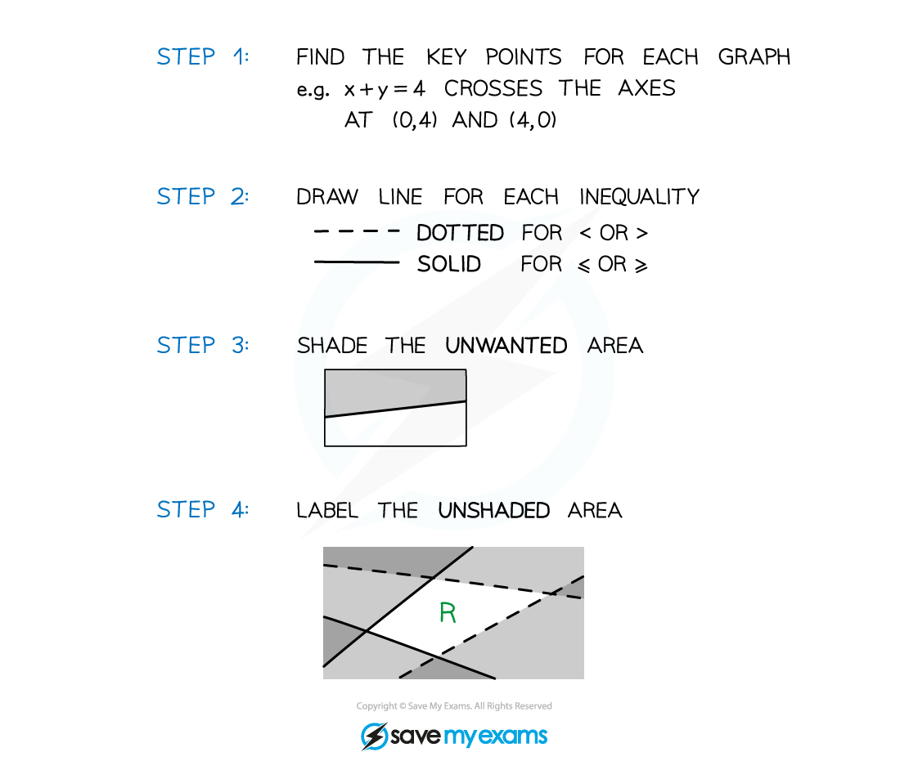

# Quadratic Inequalities

## Quadratic Inequalities

> **Spec point** — `spcpt_xpY6Fjvr8NfCHTb4`

## Quadratic inequalities

### What are quadratic inequalities?

- They are similar to quadratic equations with the "=" replaced by one of <, >, ≤ or ≥

  - Just like equations such inequalities should be in a form such that 0 is on one side of the inequality
  
    - e.g.  $ax^{2}+bx+c\leq0$
- **Sketching** a **quadratic graph** is essential to finding the correct solution(s)

  - Some modern calculators may be able to solve quadratic inequalities directly
  
    - You could use this to check your answer

### How do I solve quadratic inequalities?

- **STEP 1 **
**Rearrange** the inequality into quadratic form with a **positive squared term *****ax*****2**** + *****bx***** + *****c***** > 0** (>, <, ≤ or ≥)
- **STEP 2 **
Find the **roots** of the quadratic equation **Solve** *ax*2 + *bx* + *c* = 0 to get ***x*****1*** *and* ****x*****2 **where** *****x*****1**** ≤ *****x*****2**
- **STEP 3 **
**Sketch** the graph of the quadratic and **label the roots **As Step 1 makes the $x$-squared term positive it will be $\cup$-shaped
- **STEP 4 **
**Identify** the **region** that satisfies the inequality For ***ax*****2**** + *****bx***** + *****c***** > 0 **you want the region **above** the *x*-axis - the solution will be ***x *****< *****x*****1** **or** ***x *****> *****x*****2****  **For ***ax*****2**** + *****bx***** + *****c***** < 0 **you want the region below the *x*-axis - the solution will be ***x*****1**** < *****x***** < *****x*****2**

- Be careful: 

  - **avoid** multiplying or dividing by a negative number if unavoidable, “**flip**” the inequality sign so **<** → **>**, **≥** → **≤**, etc
  - **do** rearrange to make the x2 term positive

### Quadratic inequalities and the discriminant

- The **discriminant** of the quadratic function $ax^{2}+bx+c$ is $b^{2}-4ac$
- It's value indicates the number of (real) **roots** the quadratic function has

  - if $b^{2}-4ac>0$ there are **two roots**
  - if $b^{2}-4ac=0$ there is **one root** (repeated)
  - if $b^{2}-4ac<0$ there are **no roots**
- The firsts and last of these are **quadratic inequalities**
- Some questions will require you to use the discriminant to set up and solve a quadratic inequality

  - For example: Find the values of $k$ such that the equation `(k+1) x²−4x+(k−2)=0` has no real roots
  
    - Using the **discriminant,** and for **no real roots**, `(−4)²−4 (k+1)(k−2) less than 0`
    - Using the approach above, this leads to the **quadratic inequality **in $k$**,** $k^{2}-k-6>0$
    - And using the method above, including **sketching a graph**, leads to the solutions $k<-2$ and $k>3$

> **Exam Hint**
> - Some calculators will solve quadratic inequalities directly and just give you the answer
> 
>   - Beware!
>   
>     - make sure you have typed the inequality in correctly
>     - the calculator may not display the answer in a conventional way
>     
>       - e.g  $x_{1}<x<x_{2}$ may be shown as $x_{2}>x>x_{1}$ Both are mathematically correct but the first way is how it would normally be written
>     - these questions could crop up on the non-calculator exam paper

> **Worked Example**
> 

## Inequalities on Graphs

> **Spec point** — `spcpt_HDV2QKZhrpNm9GYJ`

## Inequalities on graphs

### What are inequalities on graphs?

- Inequalities can be represented on graphs by **shaded regions** and **dotted** or **solid** lines
- These inequalities have two variables, **x** and **y**
- Several inequalities are used at once
- The solution is an **area** on a graph (often called a **region** and labelled **R**)
- The inequalities can be **linear** or **quadratic**

#### 

### How do I draw inequalities on a graph?

- Sketch each line or curve

  - If the inequality is **strict (< or >)** then use a **dotted line**
  - If the inequality is **weak (≤ or ≥)** then use a **solid line**
- Decide **which side** of the line **satisfies** the inequality

  - If unsure, choose a coordinate on one side and **test** it in the inequality
  
    - The origin is an easy point to use
  - If it satisfies the inequality then that whole side of the line satisfies the inequality
  
    - For example: (0,0) satisfies the inequality y < *x*2 + 1 so you want the side of the curve that contains the origin

#### 

> **Exam Hint**
> - **Recognise** this type of inequality by the use of **two** variables
> - You may have to **deduce** the inequalities from a **given** graph
> - Pay careful attention to which **region** you are **asked to shade**
> 
>   - Sometimes the exam could ask you to shade the region that **satisfies the inequalities this means** you should **shade** the region that is **wanted**.

> **Worked Example**
> 
