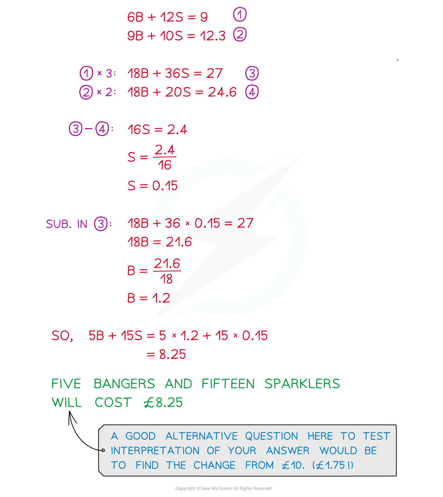
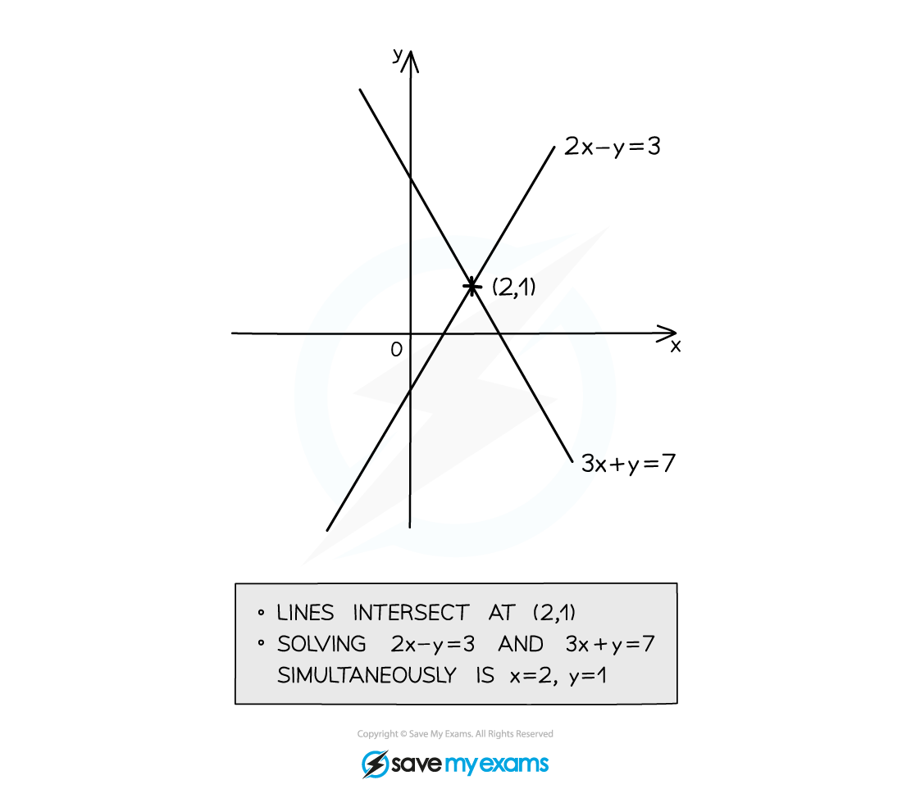

# Linear Simultaneous Equations

## Elimination Method

> **Spec point** — `spcpt_7WC8ZhjytbbK2kDN`

## Elimination method

### What are simultaneous linear equations?

- When there are two unknowns (say ***x***** **and ***y***) in a problem, we need two equations to be able to find them both: these are called **simultaneous equations**

  - you solve **two **equations to find **two **unknowns, *x* and *y*
  
    - for example, 3*x* + 2*y* = 11 and 2*x* - *y* = 5
    - the solutions are *x* = 3 and *y* = 1
- If they just have* x* and *y* in them (no *x*2 or *y*2 or *xy* etc) then they are **linear** simultaneous equations
- Solving a **pair of simultaneous equations** means finding **pairs of values** that make **both equations true** at the same time
- A linear equation in two unknowns will produce a straight line if you graph it... linear = line
- A pair of simultaneous equations will produce lines that will cross each other (if there is a solution!)

### How do I use elimination to solve simultaneous linear equations?

- "Elimination" completely removes one of the variables, *x *or *y*
- Begin by multiplying one (or both) of the equations by a constant (or constants)to get the numbers in front of **one** of the unknowns to match

  - For example to eliminate the *x*'s from 3*x* + 2*y* = 11 and 2*x* - *y* = 5
  
    - Multiply every term in the first equation by 2 6*x* + 4*y* = 22
    - Multiply every term in the second equation by 3 6*x* - 3*y* = 15
- If the matching numbers have the **same **sign, then **subtract **one equation from the other
- If the matching numbers have **different **signs then **add **the equations together

  - Subtract the second result from the first to eliminate the 6x's
  
    - 4*y* - (-3*y*) = 22 - 15
    - 7*y* = 7
- Solve the new equation to find the value of one of the unknowns

  - Solve to find *y*
  
    - *y* = 1
- Substitute the value into one of the original equations and solve to find the value of the other unknown

  - Substitute *y* = 1 back into either original equation
  
    - 3*x *+ 2(1) = 11
    - *x* = 3
  - Alternatively, to eliminate the *y*'s from 3*x* + 2*y* = 11 and 2*x* - *y* = 5
  
    - Multiply every term in the second equation by 2
    - 4*x* - 2*y* = 10
    - **Add** this result to the first equation to eliminate the 2*y*'s (as 2*y* + (-2*y*) = 0)
    - The process then continues as above
- **Check** your final solutions satisfy both equations

  - 3(3) + 2(1) = 11 and 2(3) - (1) = 5

### How do I solve linear simultaneous equations from worded contexts?

> **Exam Hint**
> - Don't skip the checking step (it only takes a few seconds) – there are many places to go wrong when solving simultaneous equations!
> - Mishandling minus signs is probably the single biggest cause of student error in simultaneous equations questions

> **Worked Example**
> 

## Substitution Method

> **Spec point** — `spcpt_hd3mfrNrkCXYMS4j`

## Substitution method

### How do I use substitution to solve simultaneous linear equations?

- "Substitution" means substituting one equation into the other
- Rearrange one of the equations to make one of the unknowns the subject

  - To solve 3*x* + 2*y* = 11 and 2*x* - *y* = 5 by substitution
  - Rearrange one of the equation into *y* = ... (or *x* = ...)
  
    - For example, the second equation becomes *y* = 2*x* - 5
- Substitute the expression found for *x *or *y* into the equation not used to rearrange

  - Replace all *y*'s with 2*x* - 5 in brackets
  
    - 3*x* + 2(2*x* - 5) = 11
- Solve the new equation to find the value of one of the unknowns

  - Solve this equation to find *x*
  
    - *x* = 3
- Substitute the value found for *x *or *y* into the rearranged equation from to find the value of the other unknown

  - Substitute *x* = 3 into *y* = 2*x* - 5 to find *y*
  
    - *y *= 2(3) - 5
    - *y* = 1
- **Check** your final solutions satisfy both equations

  - 3(3) + 2(1) = 11 and 2(3) - (1) = 5

### How do you use graphs to solve linear simultaneous equations?

- **Plot** both equations on the same set of axes

  - to do this, you can use a table of values or rearrange into *y* = *mx* + *c *if that helps
- Find where the lines **intersect** (cross over)

  - The *x* and *y ***solutions** to the simultaneous equations are the *x *and *y ***coordinates** of the point of **intersection**
- e.g. to solve 2*x *- *y* = 3 and 3*x* + *y* = 4 simultaneously, first plot them both (see graph)

  - find the point of intersection, (2, 1)
  - the solution is *x* = 2 and *y* = 1

> **Exam Hint**
> - Although elimination will always work to solve simultaneous linear equations, sometimes substitution can be easier and quicker
> - Knowing both methods can help you a lot in the exam (plus you will need substitution to solve quadratic simultaneous equations)

> **Worked Example**
> 
