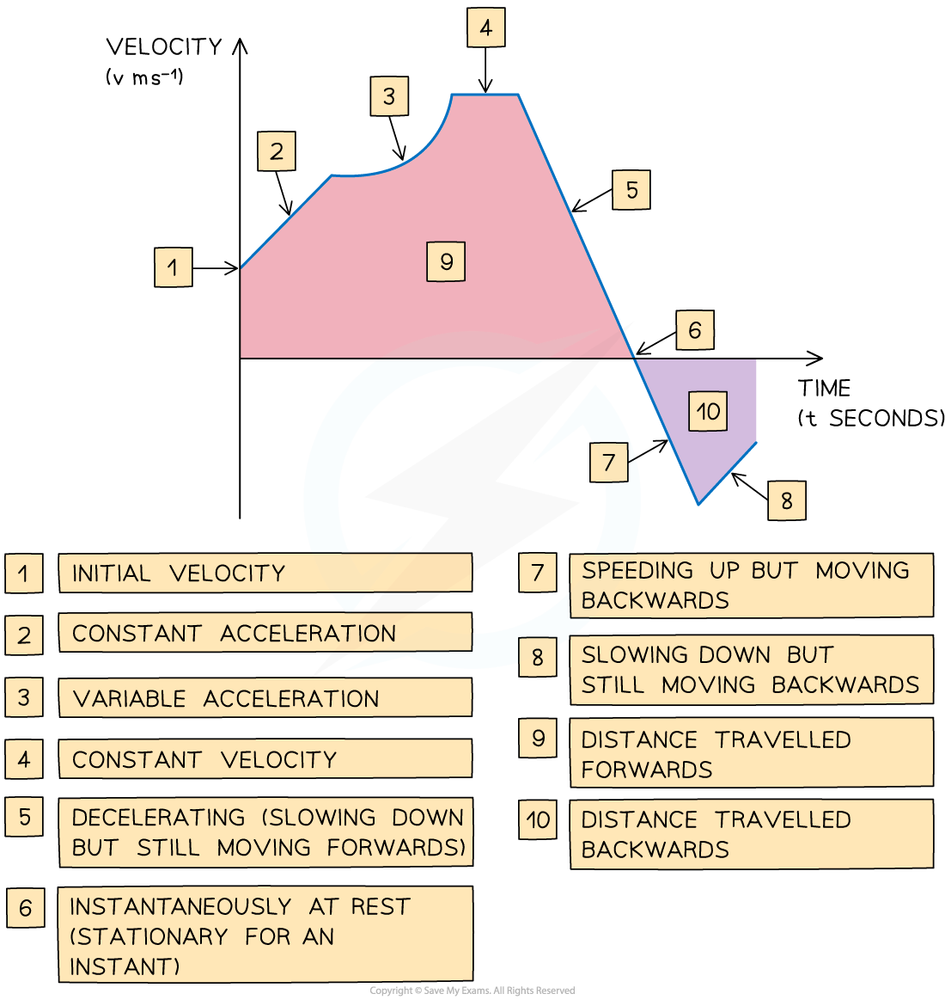

# Kinematics Toolkit

## Displacement, Velocity & Acceleration

> **Spec point** — `spcpt_7BHPktVdQnJG7Kgq`

## Displacement, velocity & acceleration

### What is kinematics?

- **Kinematics** is the branch of mathematics that models and analyses the **motion** of objects
- Common words such as **distance, speed** and **acceleration** are used in kinematics but are used according to their technical definition

### What definitions do I need to be aware of?

- Firstly, only motion of an object in a **straight** **line** is considered

  - this could be a **horizontal** straight line
  
    - the **positive** direction would be to the **right**
  - or this could be a **vertical** straight line
  
    - the **positive** direction would be **upwards**
- **Particle**

  - A **particle** is the general term for an **object**
  - some questions may use a **specific** object such as a **car** or a **ball**
- **Time **$t$** **seconds

  - **Displacement**, **velocity** and **acceleration** are all **functions** of **time**$t$
  - **Initially **time is zero $t=0$
- **Displacement** $s$ m

  - The **displacement** of a particle is its **distance** **relative** to a **fixed** **point**
  - the fixed point is often (but not always) the particle’s **initial** **position**
  - **Displacement **will be **zero **$s=0$** **if the object is at or has returned to its initial position
  - **Displacement** will be negative if its **position** **relative** to the **fixed** **point** is in the **negative** **direction** (left or down)
- **Distance **$d$ m

  - Use of the word **distance** needs to be considered carefully and could refer to
  
    - the distance **travelled** by a particle
    - the **(straight line)** distance the particle is from a **particular point**
  - Be careful not to confuse **displacement** with **distance**
  - if a bus route starts and ends at a bus depot, when the bus has returned to the depot, its **displacement** will be **zero **but the distance the bus has travelled will be the length of the route
  - **Distance** is always **positive**
- **Velocity **$v$m s-1

  - The **velocity** of a particle is the **rate** **of** **change** of its **displacement** at time$t$
  - **Velocity** will be **negative** if the **particle** is moving in the **negative** **direction**
  - A **velocity** of **zero** means the particle is **stationary **$v=0$
- **Speed **`space open vertical bar v close vertical bar` m s-1

  - **Speed** is the **magnitude** (a.k.a. absolute value or modulus) of **velocity**
  - as the particle is **moving** in a **straight line, speed** is the **velocity ignoring** the **direction**
  
    - if`space v equals 4 comma space open vertical bar v close vertical bar equals 4`
    - if`space v equals negative 6 comma space open vertical bar v close vertical bar equals 6`
- **Acceleration **$a$ m s-2

  - The **acceleration** of a particle is the **rate** **of** **change** of its **velocity** at time$t$
  - Acceleration can be **negative** but this alone cannot fully describe the particle’s motion
  
    - if **velocity** and **acceleration** have the **same** sign the particle is **accelerating** (speeding up)
    - if **velocity** and **acceleration** have **different** signs then the particle is **decelerating** (slowing down)
    - if **acceleration** is **zero** $a=0$ the particle is moving with **constant** velocity
    - in all cases the **direction** of **motion** is determined by the **sign** of **velocity**

### Are there any other words or phrases in kinematics I should know?

- Certain words and phrases can imply values or directions in kinematics

  - a particle described as “at **rest**” means that its velocity is zero,$v=0$
  - a particle described as moving “**due** **east**” or “**right**” or would be moving in the **positive** **horizontal** direction
  
    - this also means that$v>0$
  - a particle “**dropped from the top of a cliff**” or “**down**” would be moving in the **negative** **vertical** direction
  
    - this also means that$v<0$

### What are the key features of a velocity-time graph?

- The **gradient** of the graph equals the ***acceleration*** ** **of an object
- A **straight line** shows that the object is **accelerating** at a **constant rate**
- A **horizontal** line shows that the object is moving at a **constant velocity**
- Graph **above** the x-axis means the object is moving** forwards**

  - Graph **below** the x-axis means the object is moving** backwards**
  - The **area **between graph and the x-axis tells us the **change in** ***displacement***** **of the object
- The** total displacement **of the object from its starting point is the sum of the **areas above** the x-axis **minus** the sum of the **areas below** the x-axis
- The** total distance travelled **by the object is the sum of **all** the **areas**
- If the graph **touches** the **x-axis** then the object is** *****stationary***** **at that time
- If the graph is **above** the **x-axis** then the object has positive velocity and is **travelling forwards**
- If the graph is **below** the **x-axis** then the object has negative velocity and is **travelling backwards**

> **Exam Hint**
> - In an exam if you are given an expression for the velocity then sketching a velocity-time graph can help visualise the problem

> **Worked Example**
> A particle is projected vertically upwards from ground level, taking 8 seconds to return to the ground.
> 
> The velocity-time graph below illustrates the motion of the particle for these 8 seconds.
> 
> 
> 
> i) How many seconds does the particle take to reach its maximum height? Give a reason for your answer.
> 
> ii) State, with a reason, whether the particle is accelerating or decelerating at time$t=3$.
> 
> *i) **At maximum height, velocity is zero.  *
> 
> $v=0$* at *$t=4$*  *
> 
> **Final answer:** **The particle takes ****4 seconds**** to reach its maximum height. This is because its ****velocity is 0 ms****-1**** at 4 seconds.**
> 
> **  **
> 
> *ii) *
> 
> *At *$t=3$*, velocity is positive  *
> 
> > *Acceleration is the gradient of velocity.  *
> 
> *At *$t=3$*, acceleration is negative  *
> 
> **Final answer:** **At 3 seconds the particle is ****decelerating ****as its ****velocity and acceleration have different signs****.**
