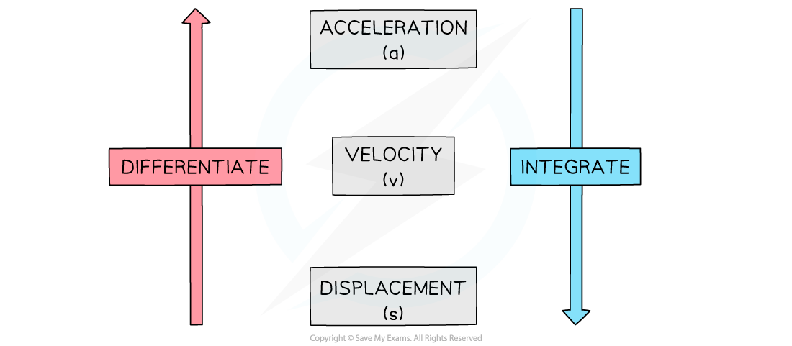
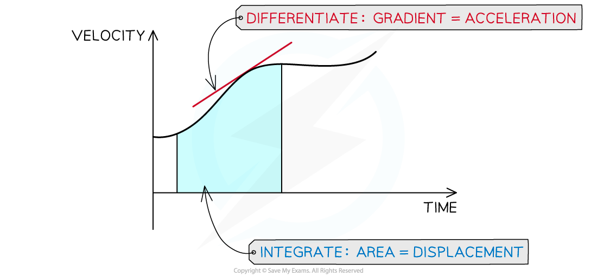
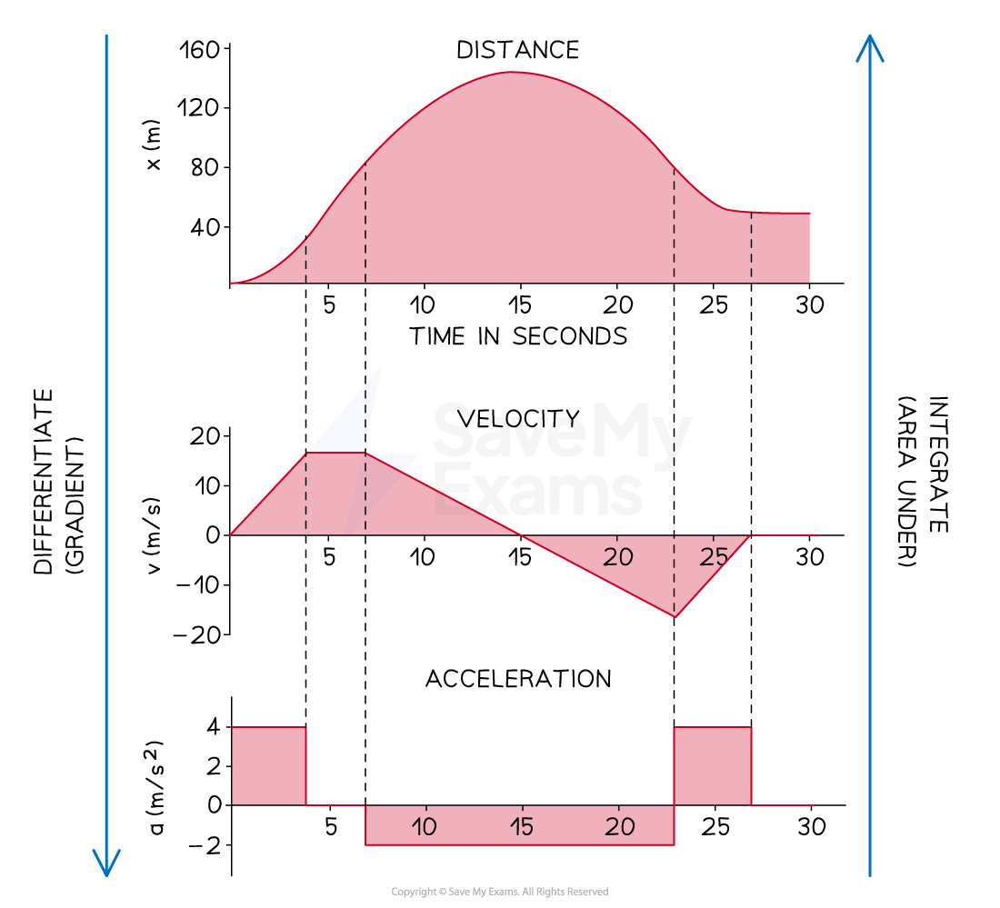

# Sketching Travel Graphs

## Sketching Travel Graphs

> **Spec point** — `spcpt_DYWnwdsNmWF33WyQ`

## Sketching travel graphs

### How are s-t, v-t, and a-t graphs related?

- Recall that:

  - Velocity, **v**, is the rate of change of displacement, **s**, with respect to time
  - Acceleration, **a**, is the rate of change of velocity, **v**, with respect to time
  - **Differentiate** to go from **s** to **v** and from **v** to **a**
  - **Integrate** to go from **a** to **v** and from **v** to **s**
  
    - There will be a **constant of integration**, c, **each time** you integrate

- On a **velocity-time graph:**

  - **Acceleration** is the **gradient** which is found using **differentiation**
  - **Displacement** is the **area **under the graph which is found using **integration**
- This can also be seen from the units:

  - $\mathrm{Gradient}=\frac{\mathrm{ms}^{-1}}{s}=\mathrm{ms}^{-2}=\mathrm{Acceleration}$
  - $\mathrm{Area}=\mathrm{ms}^{-1}\timess=m=\mathrm{Displacement}$

- On a **displacement-time graph:**

  - **Velocity** is the **gradient** which is found using **differentiation**
  - The area has no significant meaning
- This can also be seen from the units:

  - $\mathrm{Gradient}=\frac{m}{s}=\mathrm{ms}^{-1}=\mathrm{Velocity}$

- On an **acceleration-time graph:**

  - **Velocity **is the **area **under the graph which is found using **integration**
  - The gradient is generally not used
  
    - It is a measure called 'jolt' but this is beyond the scope of this course
- This can also be seen from the units:

  - $\mathrm{Area}=\mathrm{ms}^{-2}\timess=\mathrm{ms}^{-1}=\mathrm{Velocity}$

### How can I use one travel graph to draw another?

- Using the relations stated above, we can inspect either the graph or the equation of the graph, in order to sketch a related travel graph
- For example, if a **velocity-time** graph is a **series of sections**, with mostly straight lines:

  - Find the **gradient **of each section to plot the **acceleration-time** graph
  
    - Remember if the gradient is negative, the acceleration-time graph will be below the *x*-axis
  - Find the **area **underneath each section to help plot the **displacement-time** graph
  
    - Remember that if the velocity is a positive constant (a horizontal line above the *x*-axis), the displacement will be increasing (a line with positive gradient)
    - If the velocity is a negative constant (a horizontal line below the *x*-axis), the displacement will be decreasing (a line with negative gradient)
- If a graph is a **curve with a known equation**, we can use **calculus **to find the equations of the other related functions

  - Remember you may need extra information about the velocity or displacement at a point in time when integrating
  - Once the equations of the other functions are found, they can be **sketched**
  - For example if the graph of the **displacement**-time graph is a **cubic**
  
    - the **velocity**-time graph will be a **quadratic **graph
    - and the **acceleration**-time graph will be a **linear **graph

### Corresponding s-t, v-t, and a-t graphs for the same journey

> **Exam Hint**
> - Questions may involve both differentiation and integration (or finding gradients and areas)
> 
>   - take a moment to double check you have selected the correct method!

> **Worked Example**
> A particle moves in a straight line. Its displacement, $s$ metres, from a fixed point at time, $t$ seconds, is given by $s=-2t^{3}+12t^{2}$ for $0\leqt\leq7$.
> 
> Sketch its displacement-time, velocity-time, and acceleration-time graphs.
> 
> > *To sketch the displacement;* $s=-2t^{3}+12t^{2}$ *it can be factorised*
> 
> `s=−2t³+12t²=−2t² (t−6)`
> 
> > *The roots can then be found*
> 
> $s=0$ *when:*
>  $t=0$ *(repeated root)* 
> *and* $t=6$
> 
> > *The graph can then be sketched, noting that it is a negative cubic, and remembering the restriction on the domain;* $0\leqt\leq7$
> 
> 
> 
> > *To find the velocity, differentiate the displacement with respect to* $t$ *(time)*
> 
> $v=\frac{ds}{dt}=-6t^{2}+24t$
> 
> > *This can be factorised to*
> 
> `v=−6t (t−4)`
> 
> > *The roots can then be found*
> 
> $v=0$ *when:* 
> $t=0$ *and* $t=4$
> 
> > *The graph can then be sketched, noting that it is a negative quadratic, and remembering the restriction on the domain;* $0\leqt\leq7$
> 
> 
> 
> > *To find the acceleration, differentiate the velocity with respect to* $t$ *This is also the second derivative of the displacement*
> 
> $a=\frac{d^{2}s}{dt^{2}}=\frac{dv}{dt}=-12t+24$
> 
> > *The graph can then be sketched This is a straight line with* $y$*-intercept 24, and gradient -12 Remember the restriction on the domain;* $0\leqt\leq7$
> 
> 
