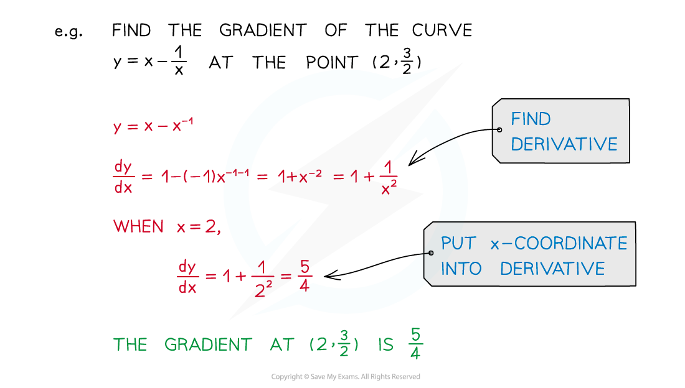
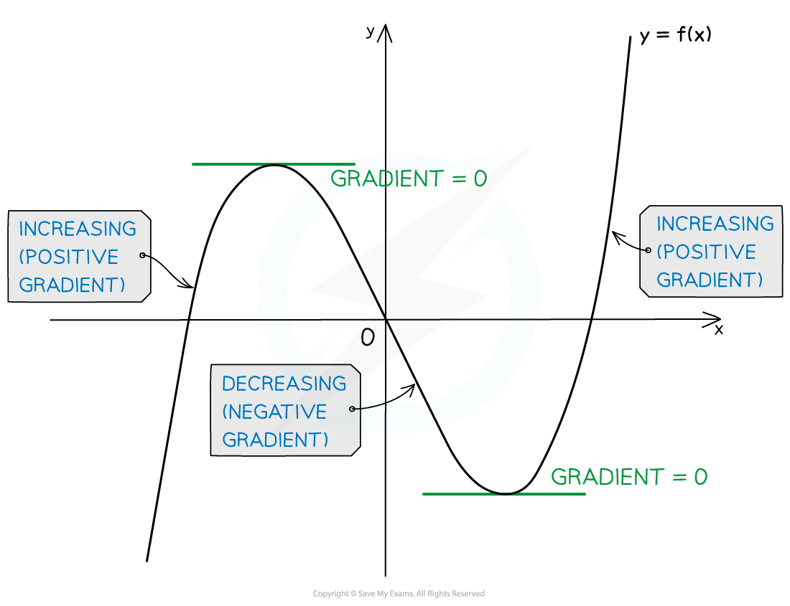
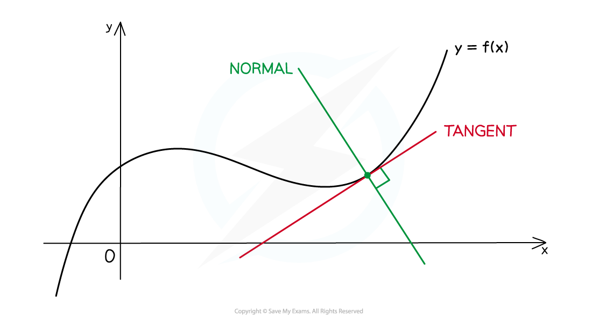

# Applications of Differentiation

## Finding Gradients

> **Spec point** — `spcpt_7sd9RjXKbFpCY5kB`

## Finding gradients

### How do I use the derivative to find the gradient of a curve?

- The **gradient of a curve** at a point is the **gradient of the tangent** to the curve at that point
- To find the gradient of a curve, at any point on the curve

  - **differentiate** to find $\frac{dy}{dx}$ (unless $\frac{dy}{dx}$is already known)
  - substitute the ***x*****‑coordinate** of the point into the derivative $\frac{dy}{dx}$** **and evaluate

### How do I find the approximate change in y as x increases?

- $\mathrm{gradient}=\frac{\mathrm{change} \mathrm{in}y}{\mathrm{change} \mathrm{in}x}$so, for **small** changes you can write

  - $\mathrm{change} \mathrm{in}y=\mathrm{gradient}\times\mathrm{change} \mathrm{in}x$
- For example, if the gradient of $y=x-\frac{1}{x}$ at $x=2$ is $\frac{5}{4}$

  - what is the approximate change in $y$ as $x$ increases from $2$ to $2+h$, where $h$ is small?
  
    - $\mathrm{change} \mathrm{in}y=\mathrm{gradient}\times\mathrm{change} \mathrm{in}x=\frac{5}{4}h$

> **Exam Hint**
> - Read the question carefully; sometimes you are given $\frac{dy}{dx}$ and so don't need to differentiate initially - don't just automatically differentiate the first thing you see!
> - The following mean the same thing:
> 
>   - "Find the gradient of the curve at $x=2$"
>   - "Find the gradient of the tangent at $x=2$"
>   
>     - the tangent gradient = curve gradient at that point
>   - "Find the **rate of change** of *y* with respect to *x* at $x=2$"

> **Worked Example**
> A curve has the equation $y=\frac{4}{3}x^{3}+3x-8$.
> 
> (a) Find the gradient of the curve when $x=2$.
> 
> > $y$* is already in a form that can be differentiated*
> 
> $\frac{dy}{dx}=4x^{2}+3$
> 
> > *Substitute *$x=2$* into *$\frac{dy}{dx}$
> 
> $\frac{dy}{dx}=4\times2^{2}+3=19$
> 
> **Final answer:** **The gradient of the curve at **$x=2$** is 19**
> 
> (b) Work out the possible values of $x$ for which the rate of change of $y$ with respect to $x$ is 4.
> 
> > *"Rate of change" is another way of describing the derivative*
> 
> `table row cell fraction numerator straight d y over denominator straight d x end fraction end cell equals 4 row cell 4 x squared plus 3 end cell equals 4 end table`
> 
> *Solve this equation to find *$x$
>  *Note that it is quadratic equation so it could have up to two solutions* 
> *The question refers to 'values' implying there is (or could be) more than one value for *$x$
> 
> `table row cell 4 x squared end cell equals 1 row cell x squared end cell equals cell 1 fourth end cell row x equals cell plus-or-minus square root of 1 fourth end root end cell row x equals cell plus-or-minus 1 half end cell end table`
> 
> **Final answer:** **The possible values of **$x$**, that give a rate of change of 4, are **$x=\frac{1}{2}$** and **$x=-\frac{1}{2}$

## Increasing & Decreasing Functions

> **Spec point** — `spcpt_r46Wb9qP6W5PWX9W`

## Increasing & decreasing functions

### What are increasing and decreasing functions?

- A function is **increasing** when $\frac{dy}{dx}>0$** (the gradient is positive)**

  - This means graph of a function goes **up** as $x$ increases
- A function is **decreasing **when $\frac{dy}{dx}<0$** (the gradient is negative)**

  - This means graph of a function goes **down** as $x$ increases

### How do I find where functions are increasing or decreasing?

- To identify the **intervals** on which a function is increasing or decreasing

**STEP 1**

Find the derivative **f'(*****x*****)**

**STEP 2**

Solve the inequalities

$f'(x)>0$ (for increasing intervals) and/or

$f'(x)<0$ (for decreasing intervals)

- Most functions are a combination of **increasing, decreasing** and **stationary**

  - a range of values of$x$ (**interval**)** **is given where a function satisfies each condition
  - e.g.  The function$f(x)=x^{2}$ has **derivative**$f^{'}(x)=2x$ so
  
    - $f(x)$ is **decreasing** for $x<0$
    - $f(x)$ is **stationary** at $x=0$
    - $f(x)$ is **increasing** for $x>0$

- To identify the intervals (the range of $x$ values) for which a curve is increasing or decreasing you need to:

1. Find the derivative $\frac{dy}{dx}$
2. Solve the inequalities $\frac{dy}{dx}>0$ (for increasing intervals) or $\frac{dy}{dx}<0$ (for decreasing intervals)

> **Exam Hint**
> - In an exam, if you need to show a function is increasing or decreasing you can use either strict (<, >) or non-strict (≤, ≥) inequalities
> 
>   - You will get the marks either way in this course

> **Worked Example**
> For what values of $x$ is $y=2x^{3}-3x^{2}+5$ a decreasing function?
> 
> > *The function is decreasing when its gradient *`open parentheses fraction numerator d y over denominator d x end fraction close parentheses`* is less than 0.*
> 
> > *Find the derivative of the function by differentiating.*
> 
> > `table row cell fraction numerator d y over denominator d x end fraction end cell equals cell space 6 x squared space minus space 6 x end cell end table`* *
> 
> > *Solve the inequality *$\frac{dy}{dx}<0$* to find the set of values where the gradient is negative.*
> 
> `table row cell 6 x squared space minus space 6 x space end cell less than cell space 0 end cell end table`
> 
> > *Factorise.*
> 
> `table row cell 6 x open parentheses x space minus space 1 close parentheses space end cell less than cell space 0 end cell end table`
> 
> > *The solutions to *$\frac{dy}{dx}=0$* are *$x=0$* and  *$x=1$*. Find the correct way around for the inequalities by considering the graph of *$\frac{dy}{dx}$*. The graph is a positive quadratic, so the function is negative between the values of 0 and 1 (where it is below the *$x$*-axis).*
> 
> > *Considering a sketch of the graph of the gradient function may help you see this.*
> 
> 
> 
> > * *
> 
> > *You can check your answers by considering a sketch of the original function, it should be decreasing at the point where *$0<x<1.$
> 
> 
> 
> $0<x<1$

## Tangents & Normals

> **Spec point** — `spcpt_FScGqnRknDzxbdmN`

## Tangents & normals

### What is a tangent?

- At any point on the graph of a (non-linear) **function**, the **tangent** is the straight line that **touches** the graph at a point **without crossing** through it
- Its **gradient** is given by the **derivative function**

### How do I find the equation of a tangent?

- To find the **equation of a straight line**, a **point** and the **gradient** are needed
- The **gradient**, $m$, of the **tangent** to the function `y equals straight f open parentheses x close parentheses` at $(x_{1},y_{1})$ is $f'(x_{1})$

  - You can find this by differentiating the function, and then substituting the $x$-coordinate of the point into the derivative
- Therefore find the **equation** of the **tangent** to the function $y=f(x)$ at the point $(x_{1},y_{1})$ by substituting the gradient, `straight f apostrophe open parentheses x subscript 1 close parentheses`, and point $(x_{1},y_{1})$ into `y minus y subscript 1 equals m open parentheses x minus x subscript 1 close parentheses`, giving:

  - $y-y_{1}=f^{'}(x_{1})(x-x_{1})$
- (You could also substitute into $y=mx+c$)

### What is a normal?

- At any point on the graph of a (non-linear) function, the **normal** is the straight line that passes through that point and is **perpendicular** to the **tangent**

### How do I find the equation of a normal?

- The gradients of two perpendicular lines are **negative reciprocals**

  - This means that if** **$m_{1}$ is the gradient of the first line and $m_{2}$ is the gradient of a line perpendicular to the first line, then $m_{2}=\frac{-1}{m_{1}}$
  - Rearranging the formula above, $m_{1}\timesm_{2}=-1$ is a useful way to test whether two lines are perpendicular
- Therefore **gradient** of the **normal** to the function `y equals straight f open parentheses x close parentheses`at $(x_{1},y_{1})$ is $\frac{-1}{f'(x_{1})}$
- Find the **equation** of the **normal** to the function $y=f(x)$ at the point $(x_{1},y_{1})$ by using $y-y_{1}=\frac{-1}{f^{'}(x_{1})}(x-x_{1})$

  - (or `y equals fraction numerator negative 1 over denominator straight f to the power of apostrophe open parentheses x subscript 1 close parentheses end fraction x plus c`)

> **Exam Hint**
> - To be successful in this topic, first make sure you are confident with finding the equation of a straight line!

> **Worked Example**
> The function $f(x)$ is defined by
> 
> $f(x)=2x^{4}+\frac{3}{x^{2}}x\neq0$
> 
> a) Find an equation for the tangent to the curve $y=f(x)$ at the point where $x=1$, giving your answer in the form $y=mx+c$.
> 
> > *First find the derivative *`straight f apostrophe open parentheses x close parentheses`* by differentiating*
> 
> > *Start by rewriting *`straight f open parentheses x close parentheses`*as powers of **x*
> 
> `straight f open parentheses x close parentheses equals 2 x to the power of 4 plus 3 x to the power of negative 2 end exponent`
> 
> > *Now differentiate*
> 
> `straight f apostrophe open parentheses x close parentheses equals 8 x cubed minus 6 x to the power of negative 3 end exponent`
> 
> > *Now substitute *$x=1$* into *`straight f apostrophe open parentheses x close parentheses`* to find the gradient of the tangent*
> 
> `table attributes columnalign right center left columnspacing 0px end attributes row cell straight f apostrophe open parentheses 1 close parentheses end cell equals cell 8 open parentheses 1 close parentheses cubed minus 6 open parentheses 1 close parentheses to the power of negative 3 end exponent end cell row blank equals cell 8 minus 6 end cell row blank equals 2 end table`
> 
> > *We also need the **y**-coordinate, so substitute *$x=1$* into *`straight f open parentheses x close parentheses`* also*
> 
> `table row cell straight f open parentheses 1 close parentheses end cell equals cell 2 open parentheses 1 close parentheses to the power of 4 plus 3 open parentheses 1 close parentheses to the power of negative 2 end exponent end cell row blank equals cell 2 plus 3 end cell row blank equals 5 end table`
> 
> > *Now we can substitute the point (1, 5) and the gradient, 2, into *`y minus y subscript 1 equals m open parentheses x subscript 1 close parentheses open parentheses x minus x subscript 1 close parentheses`
> 
> `table row cell y minus 5 end cell equals cell 2 stretchy left parenthesis x minus 1 stretchy right parenthesis end cell end table`
> 
> > *Note that we are asked for the final answer in the form *$y=mx+c$*, so rearrange to this form*
> 
> `table attributes columnalign right center left columnspacing 0px end attributes row cell y minus 5 end cell equals cell 2 x minus 2 end cell end table`
> 
> $y=2x+3$
> 
> b) Find an equation for the normal at the point where $x=1$, giving your answer in the form $ax+by+d=0$, where $a$, $b$ and $d$ are integers.
> 
> > *We already have the gradient of the tangent; the gradient of the normal is *$\frac{-1}{m}$* where *$m$* is the gradient of the tangent*
> 
> *gradient of normal = *$\frac{-1}{2}$
> 
> > *Substitute the point (1, 5) from part (a) and the gradient of the normal into *`y minus y subscript 1 equals m open parentheses x minus x subscript 1 close parentheses`
> 
> `table row cell y minus 5 end cell equals cell open parentheses fraction numerator negative 1 over denominator 2 end fraction close parentheses open parentheses x minus 1 close parentheses end cell end table`
> 
> > *And rearrange into the form required*
> 
> `table row cell y minus 5 end cell equals cell negative 1 half x plus 1 half end cell row cell 1 half x plus y minus 5 1 half end cell equals 0 end table`
> 
> > *Note that *$a$*, *$b$* and *$d$* must be integers so multiply by 2 to clear the fractions*
> 
> `table row cell bold italic x bold plus bold 2 bold italic y bold minus bold 11 end cell bold equals bold 0 end table`
