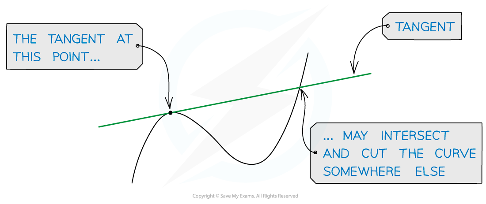

# Introduction to Differentiation

## Definition of Gradient

> **Spec point** — `spcpt_2F38jtmjhxhyBKTH`

## Definition of gradient

### What is the gradient of a curve?

- At a given point the **gradient** of a curve is defined as the gradient of the **tangent** to the curve at that point
- A **tangent** to a curve is a line that just **touches** the curve at one point but doesn't cut the curve at that point

- A tangent *may* cut the curve somewhere else on the curve

- It is only possible to draw **one** tangent to a curve at any given point
- Note that unlike the gradient of a straight line, the gradient of a curve is constantly changing

> **Exam Hint**
> - If a question asks for the "rate of change of ..." then it is asking for the "gradient"

> **Worked Example**
> The diagram shows the curve with equation $y=x^{3}-2x^{2}-x+3.$ The tangent, $T$, to the curve at the point $A(2,1)$ is also shown.
> 
> 
> 
> Using the diagram, calculate the gradient of the curve at $A$.
> 
> > *The gradient of the curve at the point **A** is the same as the gradient of the tangent **T**. Calculate the gradient of the line.*
> 
> 
> 
> $\frac{4 - ( - 2 )}{3 - 1}$
> 
> **Final answer:** **The gradient is 3**

## Definition of Derivatives

> **Spec point** — `spcpt_DFgC3zsxZYHkCjTY`

## Definition of derivatives

### What is a derivative?

- **Calculus** is about **rates** of **change**

  - the way a car’s position on a road changes is its speed (velocity)
  - the way the car’s speed changes is its acceleration
- The **gradient** (rate of change) of a (non-linear) **function** varies with $x$
- The **derivative** of a function is a function that relates the **gradient** to the value of $x$

  - For example, the derivative of  $y=x^{2}$  is  $2x$
  
    - This means that when $x=1$, the gradient of $y=x^{2}$  is  $2 ( 1 ) = 2$
    - And when $x=5$, the gradient of $y=x^{2}$  is  $2 ( 5 ) = 10$
- The derivative is also called the **gradient** **function**

> **Worked Example**
> The derivative of $y=x^{3}-2x^{2}-x+3$ is $3x^{2}-4x-1$.
> 
> Use the derivative to find the gradient of $y=x^{3}-2x^{2}-x+3$ at the point $A ( 2 , 1 )$.
> 
> > *Substitute* $x=2$ *into the derivative,* $3x^{2}-4x-1$
> 
> $3 ( 2 )^{2} - 4 ( 2 ) - 1 = 12 - 8 - 1$
> 
> **Final answer:** **gradient = 3**
> 
> **Note that the answer is the same as in the method above**

## Differentiating Powers of x

> **Spec point** — `spcpt_8sWGzKGYGWnq9NJy`

## Differentiating powers of x

### What is differentiation?

- **Differentiation** is the process of finding an expression for the **derivative** (**gradient** **function**) from the equation of a curve

  - The equation of the curve is written $y=...$ and the gradient function is written $\frac{dy}{dx}=...$

### How do I differentiate powers of x?

- Powers of $x$ are **differentiated **according to the following formula:

  - If $y=ax^{n}$ then $\frac{dy}{dx}=anx^{n-1}$
  
    - e.g.  If $y=4x^{3}$ then $\frac{dy}{dx}=4\times3\timesx^{3-1}=12x^{2}$
    - you "bring down the power" then "subtract one from the power"
- Don't forget these **two** special cases:

  - If $y=ax$ then$\frac{dy}{dx}=a$
  
    - e.g.  If $y=6x$ then $\frac{dy}{dx}=6$
  - If $y=a$ then$\frac{dy}{dx}=0$
  
    - e.g.  If $y=5$ then $\frac{dy}{dx}=0$
  - These allow you to differentiate **linear terms** in $x$ and **constants**
- Functions involving **fractions** with **denominators** in terms of $x$ will need to be rewritten as **negative powers** of $x$ first

  - e.g.  If $y=\frac{4}{x}$ then rewrite as $y=4x^{-1}$ and differentiate

### How do I differentiate sums and differences of powers of x?

- The formulae for differentiating powers of $x$ work for a **sum** or **difference** of **powers** of $x$

  - e.g.  If$y=5x^{4}+3x^{-2}+4$ then $\frac{d y}{d x} = 5 \times 4 x^{4 - 1} + 3 \times ( - 2 ) x^{- 2 - 1} + 0$ $\frac{dy}{dx}=20x^{3}-6x^{-3}$
  - This is sometimes referred to differentiating 'term-by-term'
- **Products** and **quotients (divisions) cannot** be differentiated in this way so they need **expanding/simplifying** first

  - e.g.  If $y=(2x-3)(x^{2}-4)$ then expand to $y=2x^{3}-3x^{2}-8x+12$ which **is** a **sum/difference** of powers of $x$ and can then be differentiated

### What can I do with derivatives (gradient functions)?

- The **derivative** can be used to find the **gradient** of a **function** at any point

  - The gradient of a function at a point is equal to the **gradient** of the **tangent** to the curve at that point
  - A question may refer to the gradient of the tangent

> **Exam Hint**
> - Don't try to do too many steps in your head; write the expression in a format that you can differentiate before you actually differentiate it
> 
>   - e.g. $y=\frac{1}{x^{4}}+\frac{2}{x^{3}}$ can be rewritten as $y=x^{-4}+2x^{-3}$ which is then far easier to differentiate

> **Worked Example**
> Find the derivative of
> 
> (a)$\begin{gathered} \\ \\ \end{gathered}y=5x^{3}+2x+\frac{3}{x^{2}}+8$
> 
> > *Rewrite the* $\frac{3}{x^{2}}$ *term*
> 
> $y=5x^{3}+2x+3x^{-2}+8$
> 
> > *Apply the rule for differentiating powers (*$y=ax^{n},\frac{dy}{dx}=anx^{n-1}$*) and apply the special cases for the terms* $2x$ *and 8 (*$y=ax,\frac{dy}{dx}=a$ *and* $y=a,\frac{dy}{dx}=0$*)*
> 
> $\frac{dy}{dx}=15x^{2}+2-6x^{-3}$
> 
> > *Unless a question specifies there is not usually a need to rewrite/simplify the answer*
> 
> $\frac{dy}{dx}=15x^{2}+2-\frac{6}{x^{3}}$
> 
> (b) $y = ( 2 x + 3 )^{2}$
> 
> > *This is a product of two (equal) brackets so cannot be differentiated directly Expand the brackets to get an expression in powers of* $x$ *Take time to get the expansion correct, writing stages out in full if necessary*
> 
> $\begin{gathered} y = ( 2 x + 3 ) ( 2 x + 3 ) \\ y = 4 x^{2} + 6 x + 6 x + 9 \\ y = 4 x^{2} + 12 x + 9 \end{gathered}$
> 
> > *Differentiate 'term-by-term', looking out for those special cases*
> 
> $\frac{dy}{dx}=8x+12$
> 
> > *There is a factor of 4 but there is no demand to factorise the final answer in the question*
> 
> $\frac{dy}{dx}=8x+12$
> 
> (c)$\begin{gathered} \\ \\ \end{gathered}$ $y=\frac{8x^{6}-x^{3}}{2x^{4}}$
> 
> > *This is a quotient so cannot be differentiated directly Spot the single denominator which means we can split the fraction by the two terms on the numerator*
> 
> $y=\frac{8x^{6}}{2x^{4}}-\frac{x^{3}}{2x^{4}}$
> 
> > *Simplify using the laws of indices*
> 
> $y=4x^{6-4}-\frac{1}{2}x^{3-4}\,y=4x^{2}-\frac{1}{2}x^{-1}$
> 
> > *Each term is now a power of* $x$*, so differentiate 'term-by-term'*
> 
> $\frac{dy}{dx}=8x+\frac{1}{2}x^{-2}$
> 
> > *There is demand to simplify or write the answer in a particular form*
> 
> $\frac{dy}{dx}=8x+\frac{1}{2}x^{-2}$
