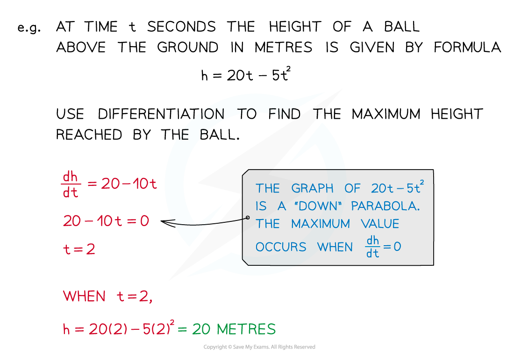

# Modelling with Differentiation

## Modelling with Differentiation

> **Spec point** — `spcpt_rxyn2MtzRV7t5ZtP`

## Modelling with differentiation

### How is differentiation used in modelling questions?

- **Derivatives** can be calculated for any variables – not just ***y*** and ***x***
- The derivative is a formula giving the **rate of change** of one variable with **respect** to the other variable

  - For example if $A=4πr^{2}$ then $\frac{dA}{dr}=8πr$
  - $\frac{dA}{dr}$ is the **rate of change** of $A$ with **respect** to $r$
- The phrase 'increasing at a rate of' means the **rate of change** of one variable with **respect** to time

  - $\frac{d}{dt}$

- **Differentiation** can be used to find **maximum** and **minimum** points of a function

  - In modelling, this is called **optimisation**
  - Second derivative tests help to determine is the point is a maximum or minimum

> **Exam Hint**
> - Read the question carefully to determine which variables you will need to use
> 
>   - The question may give you a formula to help you

> **Worked Example**
> The volume, $V$, of a sphere of radius $r$ is given by $V=\frac{4}{3}πr^{3}.$
> 
> Find the rate of change of the volume with respect to the radius.
> 
> > *Differentiate the formula given for the volume of a sphere. *
> 
> $\frac{dV}{dr}=3\times\frac{4}{3}π\timesr^{2}$
> 
> $\frac{dV}{dr}=4πr^{2}$

## Optimisation

> **Spec point** — `spcpt_n3Yp8bCGKw2Nc93Z`

## Optimisation

### What is optimisation?

- In general, optimisation is finding the best way to do something
- In mathematics, optimisation is finding the maximum or minimum output of a function

  - For example, finding the maximum possible profit or minimum costs

- Differentiation can be used to **solve optimisation problems** in **modelling** questions

  - For example you may want to
  
    - **Maximise** the **volume** of a **container**
    - **Minimise** the **amount** of **fuel** used

> **Exam Hint**
> - Exam questions on this topic will often be divided into two parts:
> 
>   - First a 'Show that...' part where you derive a given formula from the information in the question
>   - And then a 'Find...' part where you use differentiation to answer a question about the formula
> - Even if you can't answer the first part you can still use the formula to answer the second part

> **Worked Example**
> A cuboid has length $4x$ cm, width $x$ cm, and height `open parentheses 3 over x minus 5 close parentheses` cm.
> 
> (a)`table row blank row blank row blank end table` Show that the volume, $V$ cm3 is given by $V=12x-20x^{2}$.
>  
> *The volume of a cuboid is "*$V=length\timeswidth\timesheight$*"*
> 
> `therefore V equals 4 x cross times x cross times open parentheses 3 over x minus 5 close parentheses`
> 
> > *Expand and simplify*
> 
> `table row V equals cell 4 x squared open parentheses 3 over x minus 5 close parentheses end cell row V equals cell fraction numerator 12 x squared over denominator x end fraction minus 20 x squared end cell end table`
> 
> > $\thereforeV=12x-20x^{2}$*  *
> 
> (b) Find the maximum volume of the cuboid.   *Differentiate **V** with respect to **x*
> 
> $\frac{dV}{dx}=12-40x$
> 
> > *At the maximum volume, *$\frac{dV}{dx}=0$
> 
> $\therefore12-40x=0$
> 
> > *Solve for **x*
> 
> `table attributes columnalign right center left columnspacing 0px end attributes row cell 40 x end cell equals 12 row x equals cell 12 over 40 equals 0.3 end cell end table`
> 
> > *So the value of **x**, at the maximum volume is 0.3 Find the maximum volume by substituting **x** = 0.3 in to the formula for **V*
> 
> `V equals 12 open parentheses 0.3 close parentheses minus 20 open parentheses 0.3 close parentheses squared equals 1.8`
> 
> **Final answer:** **The maximum volume of the cuboid is 1.8 cm****3****  **
> 
> (c) Prove that your answer is a maximum value.
> 
> > *Using the second derivative is usually the easiest way to find the nature of a stationary point *
> 
> `fraction numerator straight d squared y over denominator straight d x squared end fraction equals negative 40 space space open parentheses less than 0 close parentheses`
> 
> **Final answer:** **The value of the second derivative (at **$x=0.3$**) is negative**
> 
> **Final answer:** **Therefore ****V**** = 1.8 cm****3**** is a maximum volume**
