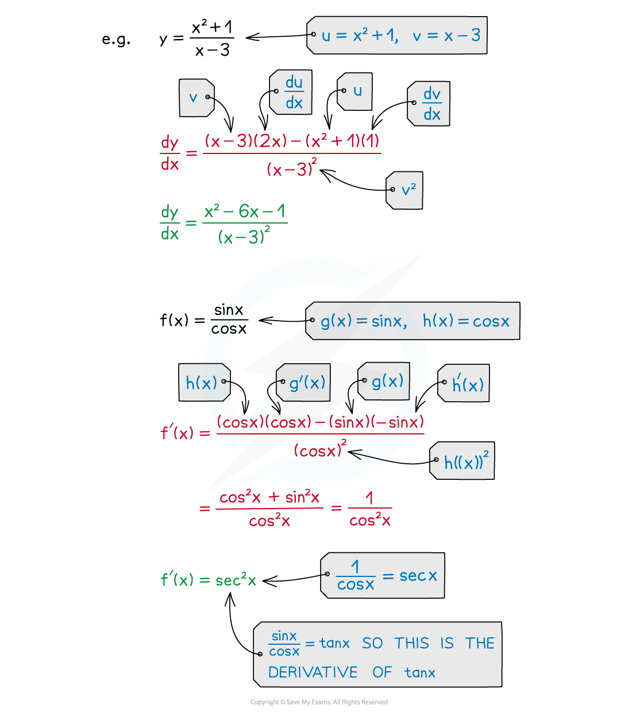

# Quotient Rule

## Quotient Rule

> **Spec point** — `spcpt_vfrW6FKn3DDvN64D`

## Quotient rule

### What is the quotient rule?

- The quotient rule is a formula that allows you to differentiate a **quotient of two functions**

  - i.e. one function divided by another
- If $y=\frac{u}{v}$ where ***u ***and ***v***** **are functions of** *****x*** then the quotient rule is:

$\frac{dy}{dx}=\frac{v\frac{du}{dx}-u\frac{dv}{dx}}{v^{2}}$

- In **function notation, **if $f(x)=\frac{g(x)}{h(x)}$ then the quotient rule can be written as:

$f'(x)=\frac{h(x)g'(x)-g(x)h'(x)}{(h(x))^{2}}$

- As with the product rule, **‘dash notation’** may be used to make remembering it easier

$y=\frac{u}{v}$

$y'=\frac{vu'-uv'}{v^{2}}$

- Final answers should match the notation used throughout the question

### How do I know when to use the quotient rule?

- The **quotient** **rule** is used when trying to differentiate a fraction where **both** the **numerator** and **denominator** are **functions** of$x$

  - if the **numerator** is a **constant**, **negative** **powers** can be used
  - if the **denominator** is a **constant**, treat it as a **factor** of the expression\

### How do I use the quotient rule?

- Make it clear what$u,v,u'$ and$v'$ are

  - arranging them in a square can help
  
    - opposite diagonals match up (like they do for product rule)

**STEP 1**

Identify the two functions,$u$ and$v$

Differentiate both$u$ and$v$ with respect to$x$ to find$u'$ and$v'$

**STEP 2**

Obtain $\frac{dy}{dx}$ by applying the quotient rule formula$\frac{dy}{dx}=\frac{v\frac{du}{dx}-u\frac{dv}{dx}}{v^{2}}$ Be careful using the formula – because of the **minus** **sign** in the **numerator**,** **the **order** of the functions is important Simplify the answer if straightforward or if the question requires a particular form

> **Exam Hint**
> - The quotient rule formula is **not **on the list of formulas page – you have to memorise it
> 
>   - however if you do forget it in an exam, you could rewrite $y=\frac{u}{v}$ as $y=u\timesv^{-1}$ and then use the **product rule**
>   - (the quotient rule is really doing exactly this)
> - Be careful using the formula – because of the minus sign in the numerator the order of the functions is important!

> **Worked Example**
> 
