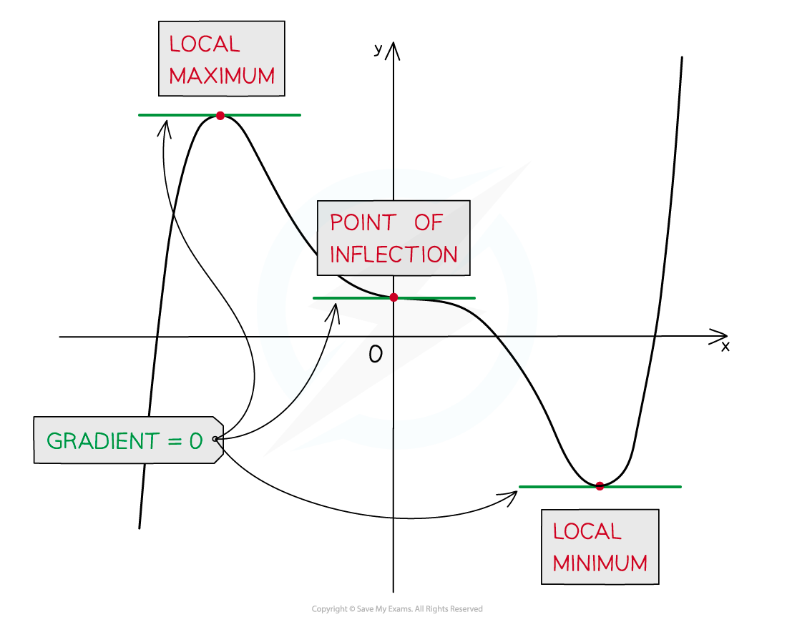
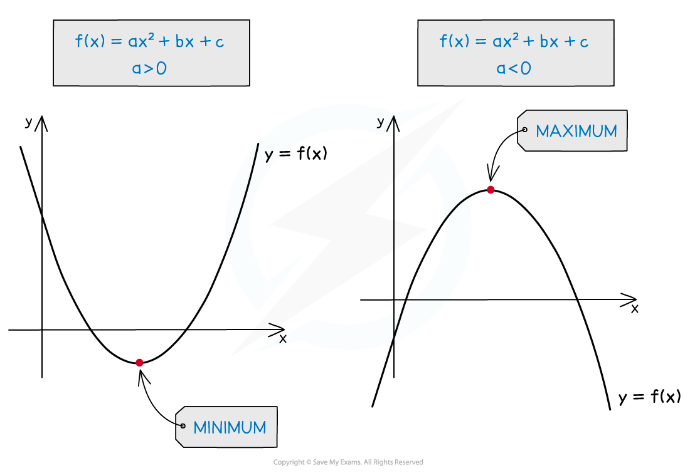
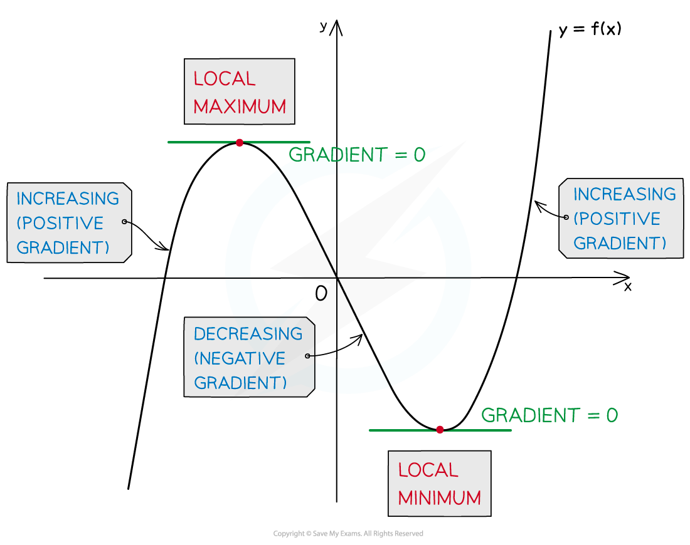

# Second Order Derivatives

## Second Order Derivatives

> **Spec point** — `spcpt_38crrsQhJKNDqnWH`

## Second order derivatives

### What is the second order derivative of a function?

- If you **differentiate** **the derivative** of a function (i.e. differentiate the function a second time) you get the **second order derivative** of the function

  - The second order derivative can be referred to simply as the second derivative
- We can write the second derivative as $\frac{d^{2}y}{dx^{2}}$
- Note the position of the powers of 2

  - **d**ifferentiating twice (so$d^{2}$) with respect to $x$ twice (so$x^{2}$)
- A **first** **derivative** is the **rate** of **change** of a function (the gradient)

  - a **second** **order** **derivative** is the **rate of change of the rate of change** of a function
  
    - i.e. the rate of change of the function’s gradient
  - A positive second derivative means the gradient is increasing
  
    - For instance in a u-shape, the gradient is changing from negative to positive
  - A negative second derivative means the gradient is decreasing
  
    - For instance in an n-shape, the gradient is changing from positive to negative
- Second order derivatives can be used to test whether a point is a minimum or maximum
- To find a second derivative, you simply **differentiate twice**!

  - It is important to write down your working with the correct notation, so you know what each expression means
  - For example
  
    - $y=5x^{3}+10x^{2}$
    - $\frac{dy}{dx}=15x^{2}+20x$
    - $\frac{d^{2}y}{dx^{2}}=30x+20$

> **Exam Hint**
> - Even if you think you can find the second derivative in your head and write it down, make sure you write down the first derivative as well
> 
>   - If you make a mistake, you will most likely get marks for finding the first derivative

> **Worked Example**
> Work out $\frac{d^{2}y}{dx^{2}}$ when
> 
> (a) $y=x^{5}-2x^{3}+7x^{2}+9x-18$
> 
> *Find the first derivative of the function first by considering each term in turn.*
> 
> $\begin{gathered} \frac{d y}{d x} & = 5 x^{4} - 6 x^{2} + 14 x + 9 \end{gathered}$* *
> 
> > *Find the second derivative, *$\frac{d^{2}y}{dx^{2}}$* by differentiating each term in the first derivative.*
> 
> $\begin{array}{ccc}\frac{ d^{ } 2 y}{ d x^{ } 2} & = & 20 x^{ } 3 - 12 x + 14\end{array}$**  **
> 
> (b)$\begin{gathered} \\ \\ \end{gathered}$ $y=\frac{3x+7}{x^{4}}$
> 
> > *To find the first derivative of the function, begin by separating the terms in the fraction.*
> 
> > $\begin{gathered} y & = \frac{3 x}{x^{4} } + \frac{7}{x^{4}} \end{gathered}$*  *
> 
> > *Rewrite each term using index notation so that they are in a form that can be differentiated. *
> 
> $\begin{gathered} y & = 3 x ( x^{- 4} ) + 7 x^{- 4} = 3 x^{- 3} + 7 x^{- 4} \end{gathered}$
> 
> > *Find the first derivative of the function first by differentiating each term in turn.*
> 
> > $\begin{gathered} \frac{d y}{d x} & = - 9 x^{- 4} - 28 x^{- 5} \end{gathered}$* *
> 
> > *Find the second derivative, *$\frac{d^{2}y}{dx^{2}}$* by differentiating each term in the first derivative.*
> 
> $\begin{gathered} \frac{d^{2} y}{d x^{2}} & = - 9 ( - 4 ) x^{- 5} - 28 ( - 5 ) x^{- 6} = 36 x^{- 5} + 140 x^{- 6} \end{gathered}$
> 
> > *You can turn the second derivative back into the same format as the original function by rewriting as a fraction.*
> 
> $\begin{gathered} \frac{d^{2} y}{d x^{2}} & = \frac{36}{x^{5}} + \frac{140}{x^{6}} = \frac{36 x + 140}{x^{6} } \end{gathered}$
> 
> $\begin{array}{ccc}\frac{ d^{ } 2 y}{ d x^{ } 2} & = & \frac{ 36 x + 140}{ x^{ } 6}\end{array}$

## Stationary Points & Turning Points

> **Spec point** — `spcpt_T9w5YPktpppqKK2Q`

## Stationary points & turning points

### What are stationary points?

- A **stationary point** is any point on a curve where the **gradient** is **zero**
- To find stationary points of a curve

**Step 1 **Find the first derivative $\frac{dy}{dx}$

**Step 2 **Solve $\frac{dy}{dx}=0$ to find the $x$-coordinates of any stationary points

**Step 3 **Substitute those $x$-coordinates into the equation of the curve** **to find the corresponding $y$-coordinates

- A stationary point may be either a **local minimum**, a **local maximum**, or a **point of inflection**

### Stationary points on quadratics

- The graph of a **quadratic** function only has a **single stationary point**
- For a **positive** quadratic this is the **minimum**; for a **negative** quadratic it is the **maximum**

  - No need to talk about 'local' here, as it is the overall minimum/maximum for the whole curve

- The ***y*** value/coordinate of the stationary point is therefore the minimum or maximum value of the quadratic function
- For quadratics especially, minimum and maximum points are often referred to as **turning points**

> **Worked Example**
> Find the stationary point of
> 
> $y=x^{2}-2x$
> 
> and explain why it will be a minimum point.
> 
> > *Find the derivative.*
> 
> $\frac{dy}{dx}=2x-2$
> 
> > *Solve *$\frac{dy}{dx}=0$
> 
> $\begin{gathered} 2 x - 2 & = 0 \\ 2 x & = 2 \\ x & = 1 \end{gathered}$
> 
> > *Find the corresponding *$y$*-coordinate.*
> 
> $\begin{gathered} x = 1 , y = ( 1 )^{2} - 2 ( 1 ) = - 1 \end{gathered}$
> 
> > *Write the answer as a coordinate.*
> 
> **Final answer:** **The stationary point is (1, -1)**
> 
> > *To explain why it is a minimum point, consider the shape of the quadratic. *
> 
> **Final answer:** **(1, -1) is a minimum point because it is a positive quadratic.**

## Testing for Local Minimum & Maximum Points

> **Spec point** — `spcpt_C5CX4bT5T5fKrR5d`

## Testing for local minimum & maximum points

### How do I determine the nature of stationary points on a curve?

- For a graph** **there are two ways to determine the nature of its stationary points** **
- **Method A**

  - Compare the signs of the **first derivative, **$\frac{dy}{dx}$**,** (positive or negative) a little bit **to either side of the stationary point**
  
    - e.g. if the stationary point is at *x*=2 then you could find the gradient at *x*=1.9 and *x*=2.1

- Compare the **signs** (positive or negative) of the derivatives on the left and right of the stationary point

  - If the derivatives are **negative** on the **left** and **positive** on the **right**, the point is a** local minimum (a u-shape)**
  - If the derivatives are **positive** on the **left** and **negative** on the **right**, the point is a** local maximum (an n-shape)**

- **Method B**

  - Look at the sign of the **second derivative** (positive or negative) **at the stationary point**
  - Find the second derivative $\frac{d^{2}y}{dx^{2}}$
  - For each stationary point find the value of** **$\frac{d^{2}y}{dx^{2}}$** **at the stationary point
  
    - i.e. substitute the *x*-coordinate of the stationary point into $\frac{d^{2}y}{dx^{2}}$ and evaluate

- If $\frac{d^{2}y}{dx^{2}}$ is **positive** then the point is a **local minimum**

  - If $\frac{d^{2}y}{dx^{2}}$ is **negative** then the point is a **local maximum**
  - If $\frac{d^{2}y}{dx^{2}}$ is **zero** then the point could be a **local minimum**, a **local maximum** OR a **point of inflection**
  
    - In this case you will need to use method A instead

> **Exam Hint**
> - Usually, using the second derivative (Method B above) is a much quicker way of determining the nature of a stationary point
> - Sketching the curve can also help

> **Worked Example**
> Find the stationary points of
> 
> $y = x^{2} ( 2 x^{2} - 4 )$
> 
> and determine the nature of each.
> 
> > *Start by expanding the brackets in the expression for *$y$
> 
> $y=2x^{4}-4x^{2}$
> 
> *Step 1* *Find the first derivative*
> 
> $\frac{dy}{dx}=8x^{3}-8x$
> 
> *Step 2* *Solve *$\frac{dy}{dx}=0$
> 
> $\begin{gathered} 8 x^{3} - 8 x & = 0 \end{gathered}$
> 
> > *Divide through by 8*
> 
> $\begin{array}{rcl} x^{3} - x & = 0 \end{array}$
> 
> > *Fully factorise, spotting the difference of two squares*
> 
> $\begin{gathered} x ( x^{2} - 1 ) & = 0 \\ x ( x - 1 ) ( x + 1 ) & = 0 \end{gathered}$
> 
> > *Solve to find the *$x$*-coordinates of the stationary (turning) points*
> 
> $x_{1}=0,x_{2}=1,x_{3}=-1$
> 
> *Step 3* *Find the corresponding *$y$*-coordinates*
> 
> $\begin{gathered} x_{1} & = 0 , y_{1} = ( 0 )^{2} ( 2 ( 0 )^{2} - 4 ) = 0 \\ x_{2} & = 1 , y_{2} = ( 1 )^{2} ( 2 ( 1 )^{2} - 4 ) = - 2 \\ x_{3} & = - 1 , y_{3} = ( - 1 )^{2} ( 2 ( - 1 )^{2} - 4 ) = - 2 \end{gathered}$
> 
> > *Write the answers as coordinates, being careful to correctly match *$x$*'s and *$y$*'s*
> 
> **Final answer:** **The stationary points are (0, 0), (1, -2) and (-1, -2)**
> 
> > *To find the nature of each stationary point, use Method B *
> 
> > *Step 4 Find the second derivative*
> 
> $\frac{d^{2}y}{dx^{2}}=24x^{2}-8$
> 
> > *Step 5 Evaluate the second derivative at each stationary point*
> 
> $\begin{gathered} x = 0 , \frac{ \mathrm{d}^{2} y}{ \mathrm{d} x^{2}} = 24 ( 0 )^{2} - 8 = - 8 ( < 0 ) \\ x = 1 , \frac{ \mathrm{d}^{2} y}{ \mathrm{d} x^{2}} = 24 ( 1 )^{2} - 8 = 16 ( > 0 ) \\ x = - 1 , \frac{ \mathrm{d}^{2} y}{ \mathrm{d} x^{2}} = 24 ( - 1 )^{2} - 8 = 16 ( > 0 ) \end{gathered}$
> 
> > *The nature of each stationary point is now determined*
> 
> **(0, 0) is a local maximum point**
>  **(1, -2) is a local minimum point **
> **(-1, -2) is a local minimum point**
