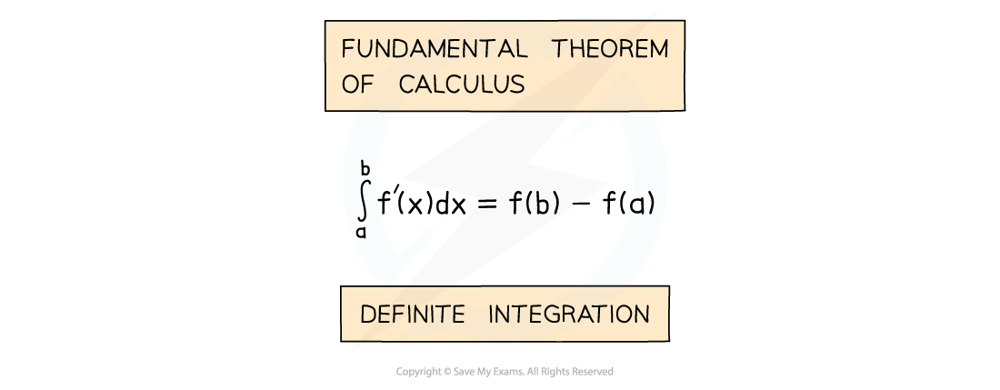
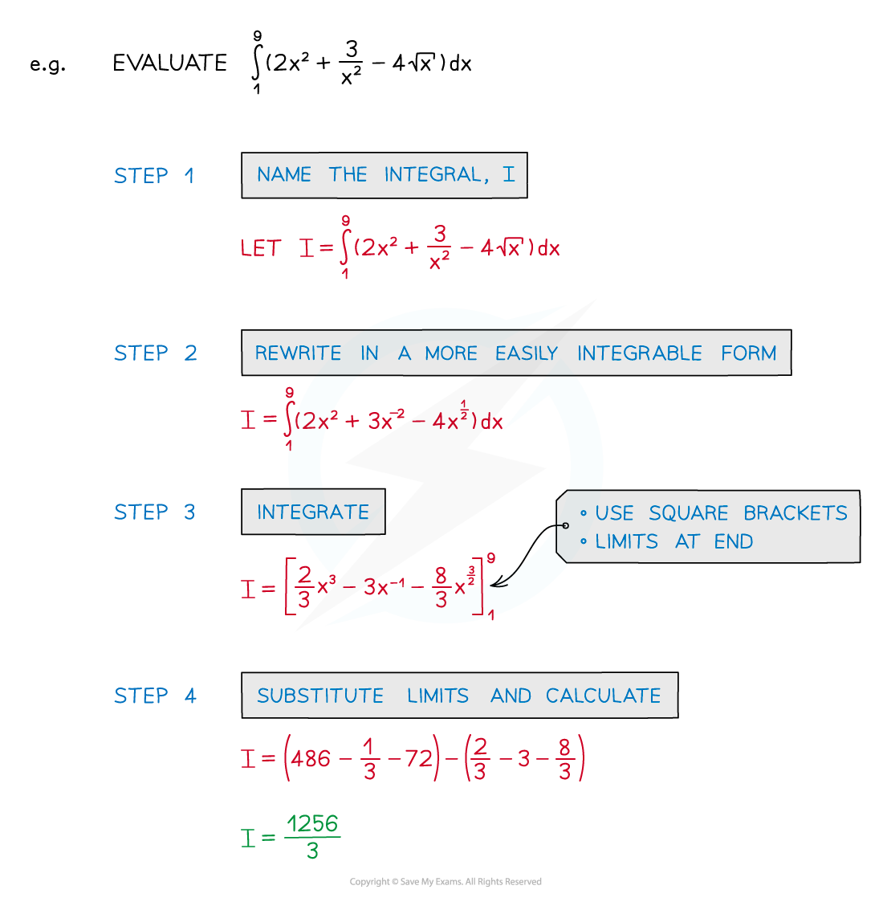

# Definite Integrals

## Definite Integrals

> **Spec point** — `spcpt_D8yXJgjNvHXZ9KQk`

## Definite integration

### What is definite integration?

- **Definite** **Integration** occurs in an alternative version of the Fundamental Theorem of Calculus
- This version of the Theorem is the one referred to by most textbooks/websites

- **a** and **b** are called limits

  - **a** is the lower limit
  - **b** is the upper limit
- **f’(x)** is the **derivative** of **f(x)**
- The value can be **positive, zero** or **negative**

### Why do I not need to include a constant of integration for definite integration?

- “**+c**” would appear in both **f(a)** and **f(b)**

  - Since we then calculate **f(b)** – **f(a)** they cancel each other out
  - So “**+c**” is not included with definite integration

### How do I find a definite integral?

- **STEP 1**

  - Give the integral a name (if it does not already have one)
  
    - This saves you having to rewrite the whole integral every time!
- **STEP 2**

  - If necessary rewrite the integral into a more easily *integrable* form
  
    - Not all functions can be integrated directly
- **STEP 3**

  - Integrate without applying the limits
  
    - Notation: use square brackets [ ] with limits placed after the end bracket
- **STEP 4**

  - Substitute the limits into the function and calculate the answer
  
    - Substitute the top limit first
    - Then substitute the bottom limit
    - Subtract the second value from the first

### What are the special properties of definite integrals?

- Some of these have been encountered already and some may seem obvious …

  - taking **constant** factors outside the integral
  
    - $\int_{a}^{b} k \mathrm{f} ( x ) \mathrm{d} x = k \int_{a}^{b} \mathrm{f} ( x ) \mathrm{d} x$ where$k$ is a constant
    - useful when fractional and/or negative values involved
  - integrating term by term
  
    - $integral_{a}^{b} [ \mathrm{f} ( x ) + \mathrm{g} ( x ) ] \mathrm{d} x = integral_{a}^{b} \mathrm{f} ( x ) \mathrm{d} x + integral_{a}^{b} \mathrm{g} ( x ) \mathrm{d} x$
    - the above works for subtraction of terms/functions too
  - equal upper and lower limits
  
    - $\int_{a}^{a} \mathrm{f} ( x ) d x = 0$
    - on evaluating, this would be a value subtracted from itself!
  - swapping limits gives the same, but negative, result
  
    - $\int_{a}^{b} \mathrm{f} ( x ) \mathrm{d} x = - \int_{b}^{a} \mathrm{f} ( x ) \mathrm{d} x$
    - compare 8 subtract 5 say, with 5 subtract 8 …
  - splitting the interval
  
    - $\int_{a}^{b} \mathrm{f} ( x ) \mathrm{d} x = \int_{a}^{c} \mathrm{f} ( x ) \mathrm{d} x + \int_{c}^{b} \mathrm{f} ( x ) \mathrm{d} x$ where$a\leqc\leqb$
    - this is particularly useful for areas under multiple curves or areas under the$x$-axis

> **Exam Hint**
> - Look out for questions that ask you to find an **indefinite** integral in one part (so “**+c**” needed), then in a later part use the same integral as a **definite** integral (where “**+c**” is not needed)

> **Worked Example**
> Find the value of
> 
> $\int_{2}^{4} 3 x ( x^{2} - 2 ) \mathrm{d} x$
> 
> **Answer:**
> 
> > *Start by expanding the brackets inside the integral*
> 
> $\int_{2}^{4} ( 3 x^{3} - 6 x ) \mathrm{d} x$
> 
> > *Integrate as usual (here it's a 'powers of* $x$*' integration)*
> 
> > *Write the answer in square brackets with the integration limits outside*
> 
> $\begin{gathered} \int_{2}^{4} ( 3 x^{3} - 6 x ) \mathrm{d} x & = [ 3 ( \frac{x^{3 + 1} }{3 + 1} ) - 6 ( \frac{x^{1 + 1} }{1 + 1} ) ]_{2}^{4} \\ = [ \frac{3}{4} x^{4} - 3 x^{2} ]_{2}^{4} \end{gathered}$
> 
> > *Now substitute 4 into that function*
> *And subtract from it the function with 2 substituted in*
> 
> $\begin{array}{rcl} [ \frac{3}{4} x^{4} - 3 x^{2} ]_{2}^{4} & = ( \frac{3}{4} ( 4 )^{4} - 3 ( 4 )^{2} ) - ( \frac{3}{4} ( 2 )^{4} - 3 ( 2^{2} ) ) \\ = ( 192 - 48 ) - ( 12 - 12 ) \\ = 144 - 0 \\ = 144 \end{array}$
> 
> `Error converting from MathML to accessible text.`
