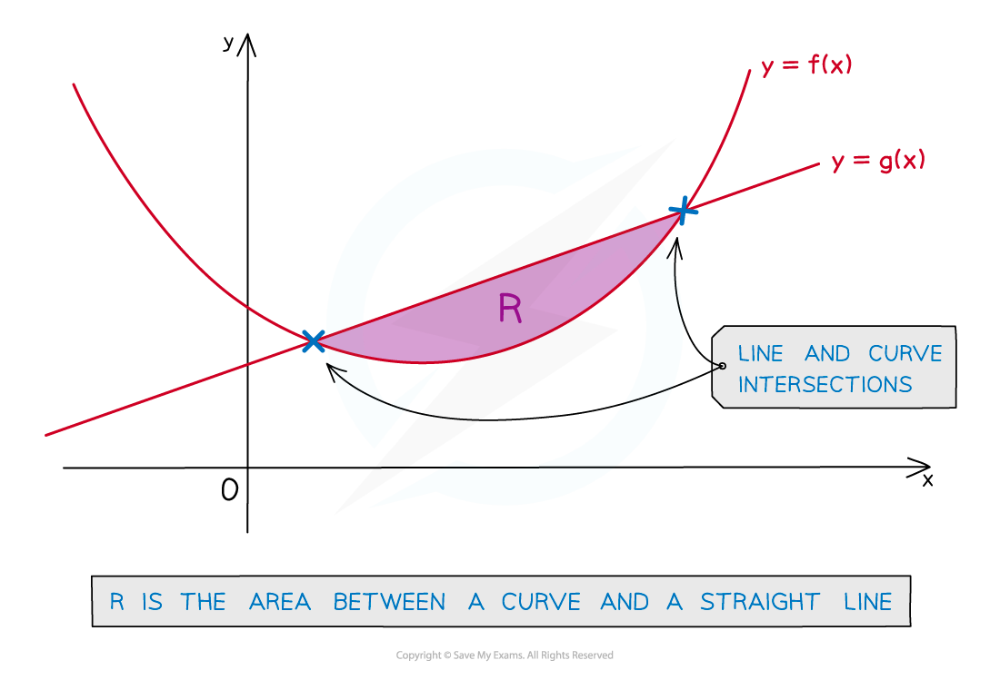
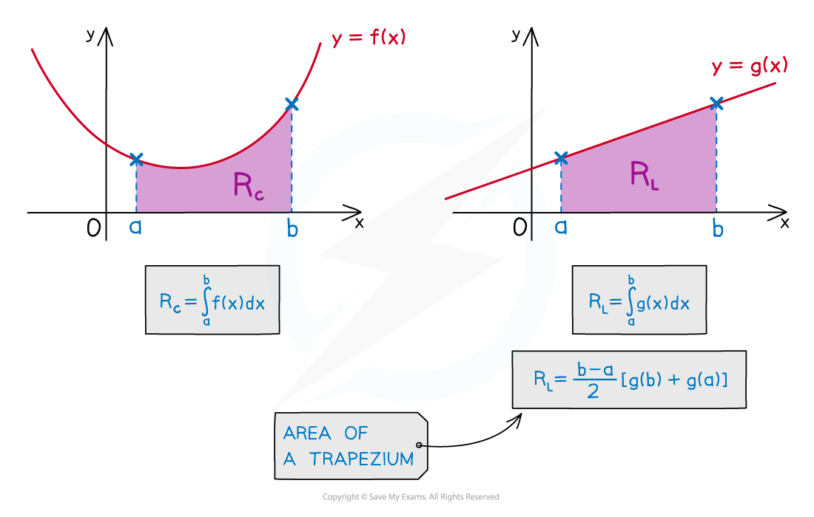
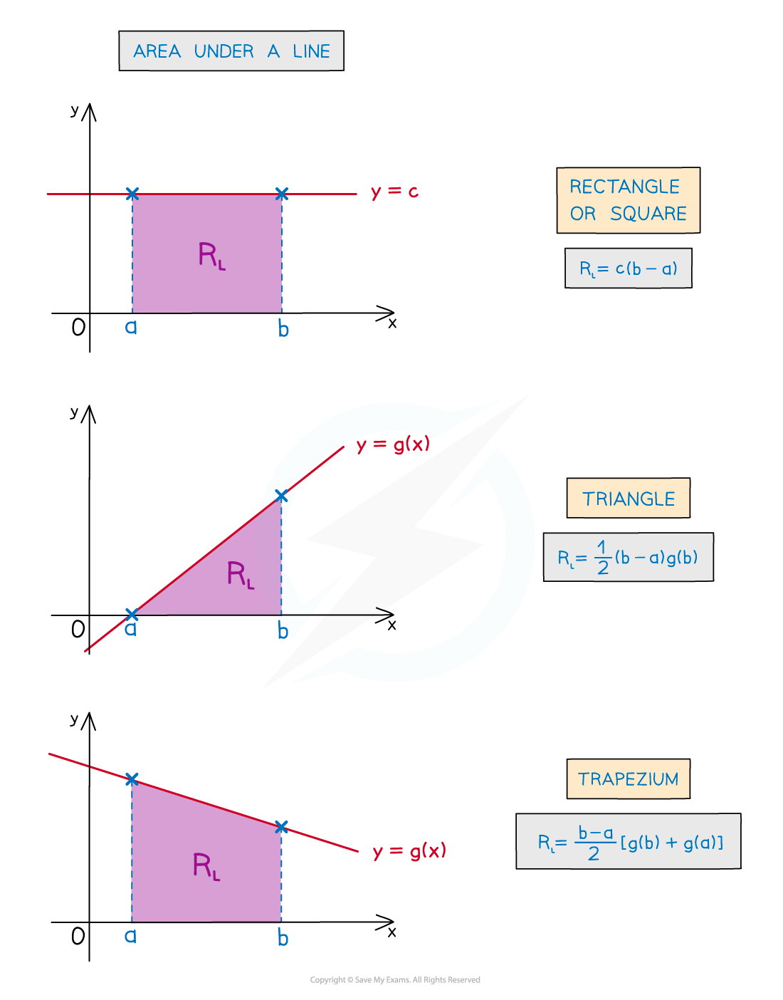
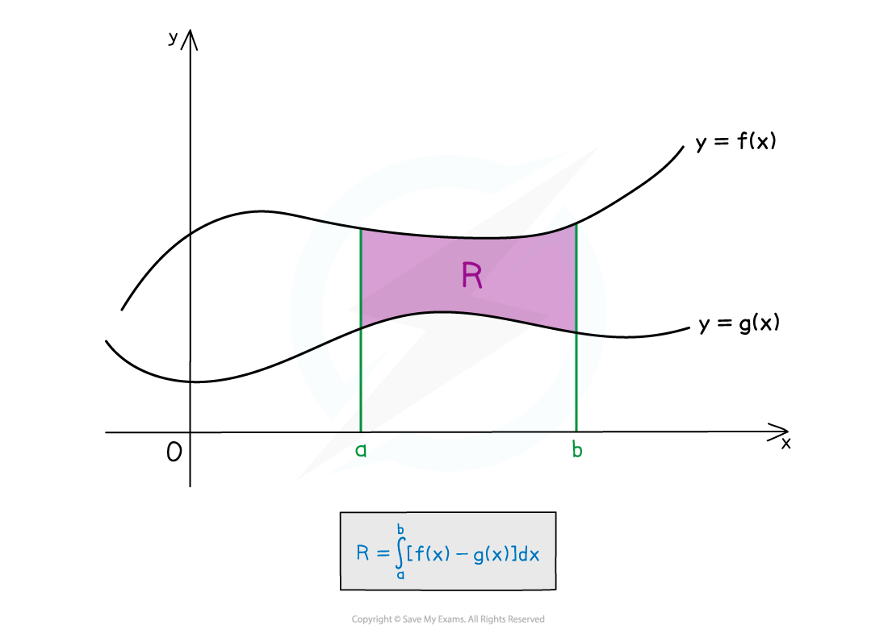
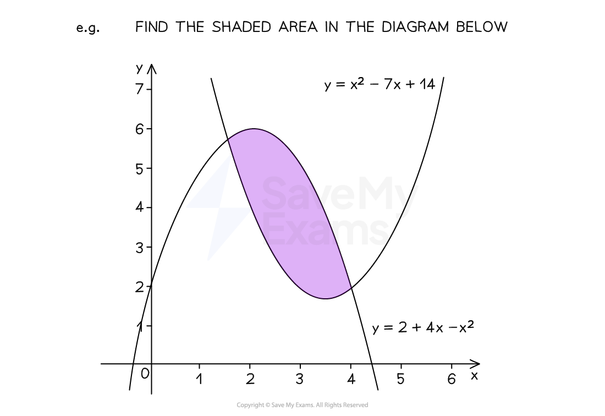
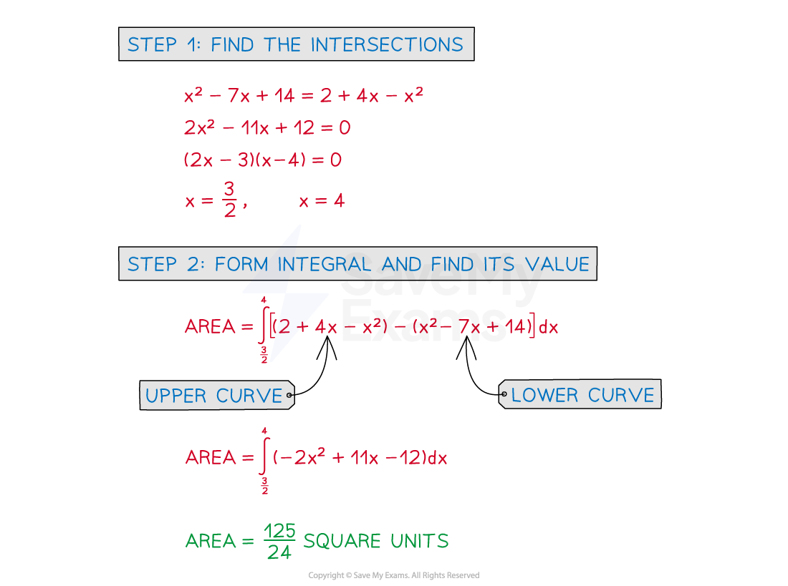

# Finding Areas Between Lines & Curves

## Area Between a Curve & a Line

> **Spec point** — `spcpt_Pdm8xXYjwCtVmfjN`

## Area between a curve & a line

### How do I find the area between a curve and a line?

- The area enclosed will be the **difference** between …

  - the **area under **the **line **and
  - the **area under** the **curve**

- These can be found separately

- **STEP 1**

  - Find the intersections of the line and the curve (if not given)
- **STEP 2**

  - Find the area under a curve, **R****C**, using definite integration
- **STEP 3**

  - Find the area under a line, **R****L**, either using definite integration **or** the area formulae for basic shapes
- **STEP 4**

  - To find the area, **R**, between the curve and the line **subtract** the **smaller **area **from** the **larger** area
  - If curve on top this will be **R****C**** – R****L**
  - If line on top this will be **R****L**** - R****C**

- There may be easier ways to find the area under a line

### Can I subtract before integrating?

- **Yes** - see the next note on "**Area between two curves**"
- Essentially you treat the line as a second curve

  - It can be easier to make mistakes using this method

> **Exam Hint**
> - Add information to any diagram provided
> 
>   - Add axes intercepts, as well as intercepts between lines and curves
> - Mark and shade the area you’re trying to find
> - If no diagram is provided, **sketch** one!

> **Worked Example**
> 
> 
> 
> 
> 
> 
> 

## Area Between Two Curves

> **Spec point** — `spcpt_m4WMGrn2YKjy9nqy`

## Area between two curves

### What is the area between two curves?

- In general find the definite integral of “upper curve” – “lower curve”
- However this does depend on …

  - … the area being found
  - … if the curves intersect (and cross over)

- The area may have to be split into separate integrals

- The points at which curves intersect may need to be calculated

### How do I find the area between two curves?

- **STEP 1**

  - Find the intersections of the curves if needed
- **STEP 2**

  - Form the integral …
  
    - … using the intersections as limits
    - … “upper curve” – “lower curve” …
    - … and find the value of the integral
- **STEP 3**

  - Repeat STEP 2 if more than one area needed
- **STEP 4**

  - Add areas together

> **Exam Hint**
> - If no diagram is provided sketch one, even if the curves are not accurate
> - Add information to any given diagram as you work through a question

> **Worked Example**
> 
> 
> 
