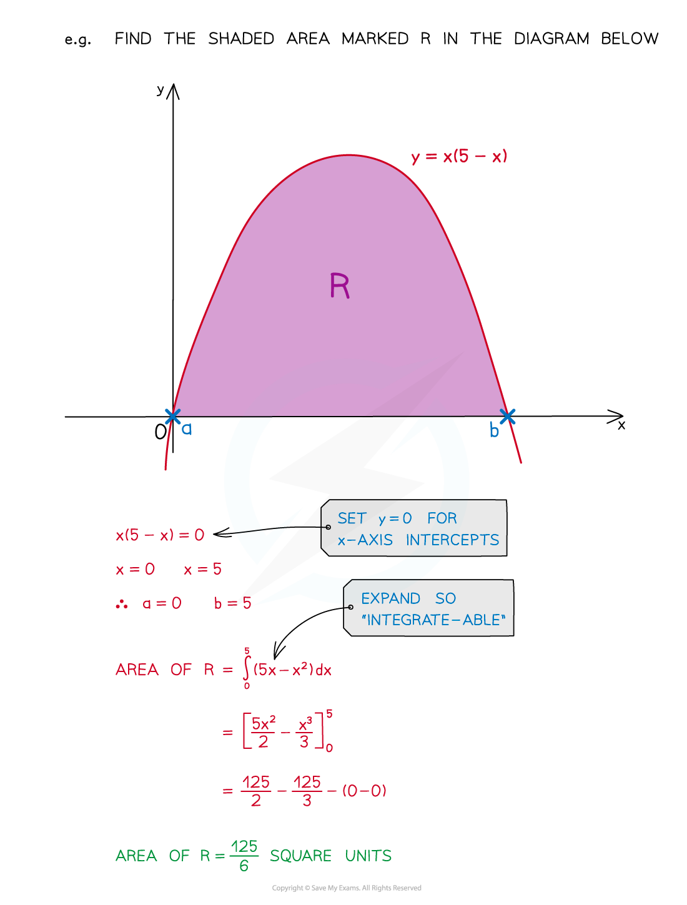
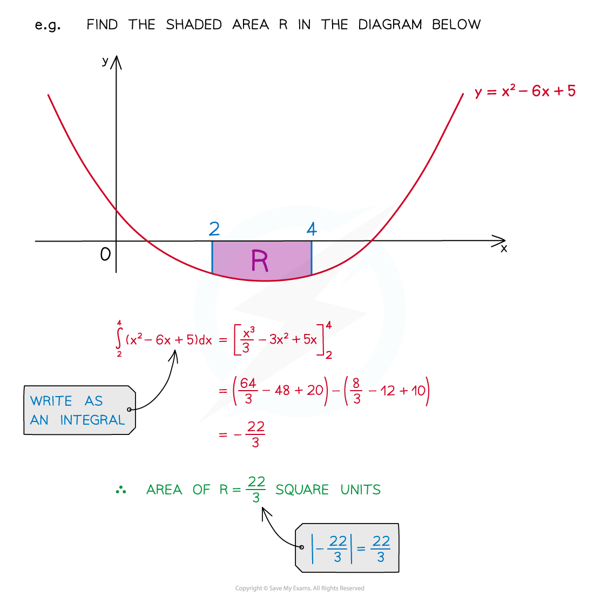
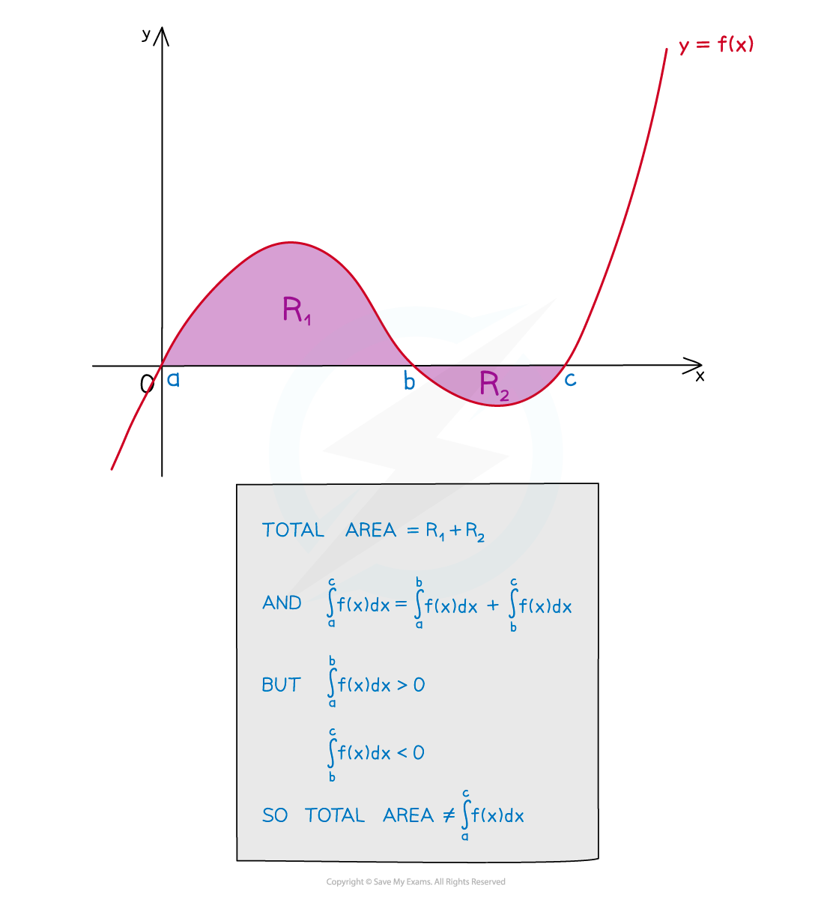

# Finding Areas with Integration

## Area Under a Curve

> **Spec point** — `spcpt_NfNBhBGVj6NP5t5s`

## Area under a curve

### What does area under a curve mean?

- The phrase “area under a curve” refers to the area bounded by …

  - ... the **x**-axis
  - … the graph of **y = f(x)**
  - … the vertical line **x = a**
  - … the vertical line **x = b**

### How do I find the area under a curve?

- The value from **definite** **integration** is equal to the “area under a curve”  

### What if I am not told the limits?

- If limits are not provided they will likely be the **x**-axis intercepts

  - Set **y = 0** and solve the equation to find the **x**-axis intercepts

### What happens if the graph is below the x-axis?

- If the area lies underneath the **x**-axis the value of the integral will be negative
- An **area** cannot be negative, so take the **modulus** of the integral 

### What if the area is made up of more than one section?

- Be careful when one section is above and one section is below the **x**-axis

  - You will need a separate integral for each section, BUT...
  - ...One section's integral will be **negative**
  - ...One section's integral will be **positive**
  - So you’ll need to take the **modulus** before adding to find the total area

> **Exam Hint**
> - Add information to any diagram provided in the question, as well as axes intercepts and values of limits
> - Mark and shade the area you’re trying to find, and if no diagram is provided, **sketch** one!

> **Worked Example**
> 
