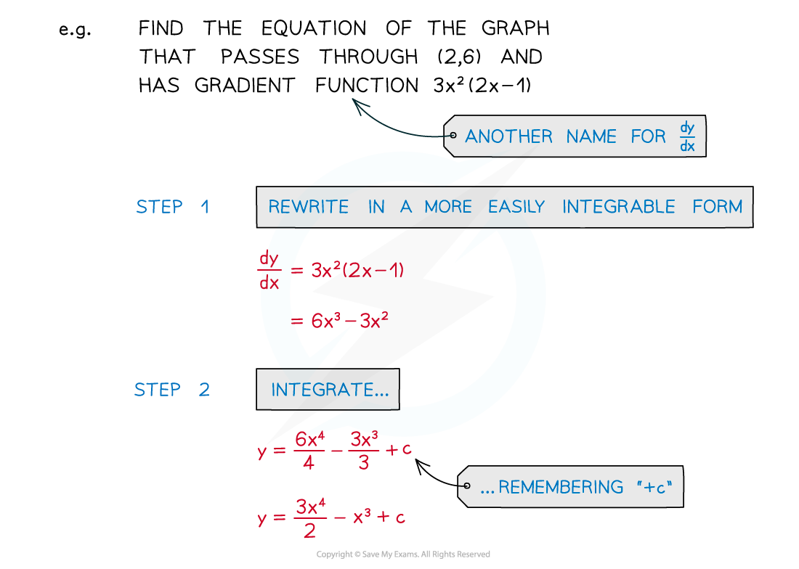
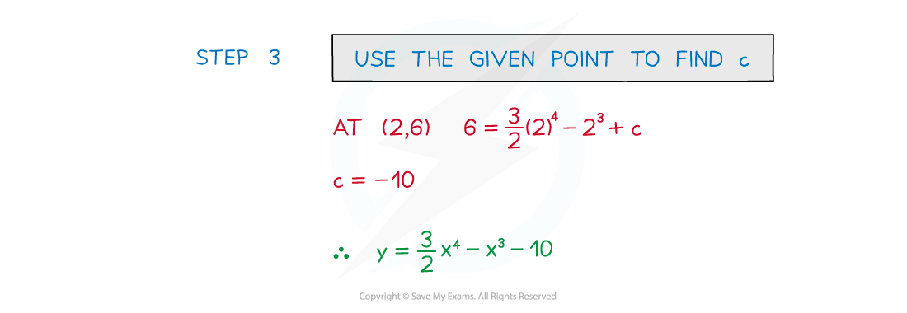

# Integrating Powers of x

## Integrating Powers of x

> **Spec point** — `spcpt_b8YJ77mKsSyF3zCy`

## Integrating powers of x

### How do I integrate powers of x?

- Powers of$x$ are integrated according to the following formulae:

  - If$f(x)=x^{n}$ then`space integral f left parenthesis x right parenthesis space straight d x equals fraction numerator x to the power of n plus 1 end exponent over denominator n plus 1 end fraction plus c` where$n\inℚ,n\neq-1$ and$c$ is the **constant** of **integration**
  - For each term …
  
    - … increase the power (of x) by 1
    - … divide by the new power
  - This does not apply when the original power is -1
  
    - the new power would be 0 and division by 0 is undefined

- If the power of$x$ is multiplied by a constant then the integral is also multiplied by that constant

  - If$f(x)=ax^{n}$ then`space integral f left parenthesis x right parenthesis space straight d x equals fraction numerator a x to the power of n plus 1 end exponent over denominator n plus 1 end fraction plus c` where$n\inℚ,n\neq-1$ and$a$ is a constant and$c$ is the **constant** of **integration**
- Remember the special case:

  - `space integral a space straight d x equals a x plus c`
  
    - e.g. `space integral 4 space straight d x equals 4 x plus c`
  - This allows **constant** terms to be integrated

### How do I integrate expressions containing powers of x?

- The formulae for integrating powers of$x$ apply to **all** **rational** **numbers** so it is possible to integrate any expression that is a sum or difference of powers of$x$

  - e.g.  If$f(x)=8x^{3}-2x+4$ then`space integral f stretchy left parenthesis x stretchy right parenthesis blank straight d x equals fraction numerator 8 x to the power of 3 plus 1 end exponent over denominator 3 plus 1 end fraction minus fraction numerator 2 x to the power of 1 plus 1 end exponent over denominator 1 plus 1 end fraction plus 4 x plus c equals 2 x to the power of 4 minus x squared plus 4 x plus c`
- Functions involving **roots** will need to be rewritten as **fractional powers** of$x$ first

  - eg. If`space f left parenthesis x right parenthesis equals 5 cube root of x` then rewrite as$f(x)=5x^{\frac{1}{3}}$ and integrate
- Functions involving **fractions** with **denominators** in **terms** of$x$ will need to be rewritten as **negative powers** of$x$ first

  - e.g.  If$f(x)=\frac{4}{x^{2}}+x^{2}$ then rewrite as$f(x)=4x^{-2}+x^{2}$ and integrate
- **Products** and **quotients** cannot be integrated this way so would need **expanding**/**simplifying** first

  - e.g.  If$f(x)=8x^{2}(2x-3)$ then`Error converting from MathML to accessible text.`

> **Exam Hint**
> - You can speed up the process of integration in the exam by committing the pattern of basic integration to memory
> 
>   - In general you can think of it as 'raising the power by one and dividing by the new power'
>   - Practice this lots before your exam so that it comes quickly and naturally when doing more complicated integration questions

> **Worked Example**
> Given that
> 
> $\frac{dy}{dx}=3x^{4}-2x^{2}+3-\frac{1}{\sqrt{x}}$
> 
> find an expression for$y$ in terms of$x$.
> 
> > *Rewrite all terms as powers of **x **using the laws of indices for fractional and negative powers on the last term.*
> 
> $\frac{dy}{dx}=3x^{4}-2x^{2}+3-x^{-\frac{1}{2}}$
> 
> > *Find **y **by integrating each term. *
> 
> `y space equals space integral space open parentheses 3 x to the power of 4 space minus space 2 x squared space plus space 3 space minus space x to the power of negative 1 half end exponent space close parentheses space straight d x`
> 
> $y=\frac{3x^{5}}{5}-\frac{2x^{3}}{3}+3x-\frac{x^{\frac{1}{2}}}{\frac{1}{2}}+c$
> 
> > *Rewrite using the same format given in the question. *
> 
> $y=\frac{3}{5}x^{5}-\frac{2}{3}x^{3}+3x-2\sqrt{x}+c$

## Finding the Constant of Integration

> **Spec point** — `spcpt_ZQNM4dHgZkvDTmXJ`

## Finding the constant of integration

### How do I find the constant of integration?

- **STEP 1 **

  - Rewrite the function into a more easily *integrable* form
  
    - Each term needs to be a power of **x** (or a constant)
- **STEP 2**

  - Integrate each term and remember “+c”
  
    - Increase power by 1 and divide by new power
- **STEP 3**

  - Substitute the coordinates of a given point in to form an equation in **c**
  
    - Solve the equation to find **c**

> **Exam Hint**
> - If a constant of integration can be found then the question will need to give you some extra information
> 
>   - If this is given then make sure you use it to find the value of c

> **Worked Example**
> Given `straight f apostrophe open parentheses x close parentheses space equals space fraction numerator open parentheses x plus 3 close parentheses squared over denominator square root of x end fraction` and `straight f open parentheses 1 close parentheses space equals space 25`, find `straight f open parentheses x close parentheses`.
> 
> > *Rewrite *`straight f to the power of apostrophe open parentheses x close parentheses`* in a form the can be integrated more easily. *
> 
> > `table row cell straight f to the power of apostrophe open parentheses x close parentheses space end cell equals cell space fraction numerator open parentheses x plus 3 close parentheses open parentheses x plus 3 close parentheses over denominator square root of x end fraction end cell row blank equals cell space fraction numerator x to the power of 2 space end exponent plus space 6 x space plus space 9 over denominator x to the power of 1 half end exponent end fraction end cell row space equals cell fraction numerator space x squared over denominator x to the power of 1 half end exponent end fraction space plus fraction numerator space 6 x over denominator x to the power of 1 half end exponent end fraction space plus fraction numerator space 9 over denominator x to the power of 1 half end exponent end fraction end cell row blank equals cell space x to the power of 3 over 2 space end exponent plus space 6 x to the power of 1 half end exponent space plus space 9 x to the power of negative 1 half end exponent end cell end table`*   *
> 
> > *Integrate each term, remember to include a constant of integration.*
> 
> > `straight f open parentheses x close parentheses space equals fraction numerator space x to the power of 5 over 2 end exponent over denominator 5 over 2 end fraction plus fraction numerator 6 x to the power of 3 over 2 end exponent over denominator 3 over 2 end fraction plus fraction numerator 9 x to the power of 1 half end exponent over denominator 1 half end fraction plus c`*   *
> 
> > *Simplify.*
> 
> `straight f open parentheses x close parentheses space equals 2 over 5 x to the power of 5 over 2 end exponent plus 4 x to the power of 3 over 2 end exponent plus 18 x to the power of 1 half end exponent plus c`
> 
> > *Use f(1) =25 to find the value of **c.*
> 
> `straight f open parentheses 1 close parentheses space equals 2 over 5 open parentheses 1 close parentheses to the power of 5 over 2 end exponent plus 4 open parentheses 1 close parentheses to the power of 3 over 2 end exponent plus 18 open parentheses 1 close parentheses to the power of 1 half end exponent plus c
> `
> 
> `table row cell 2 over 5 plus 4 plus 18 space plus c space end cell equals cell space 25 end cell row cell 22 2 over 5 space plus space c space end cell equals cell space 25 end cell row cell c space end cell equals cell fraction numerator space 13 space over denominator 5 end fraction end cell end table`
> 
> $f(x)=\frac{2}{5}x^{\frac{5}{2}}+4x^{\frac{3}{2}}+18x^{\frac{1}{2}}+\frac{13}{5}$
