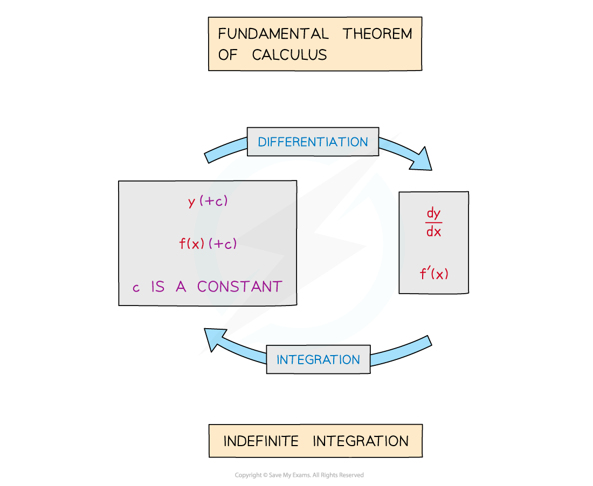
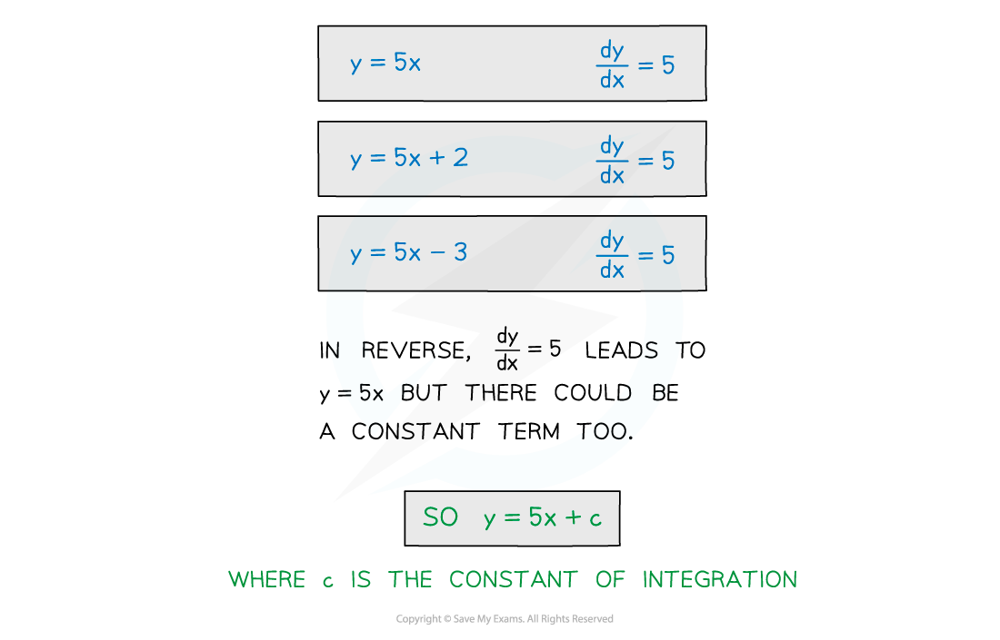
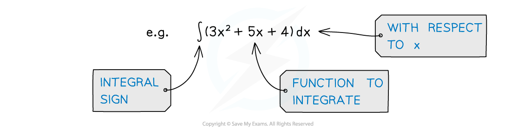

# Introduction to Integration

## Introduction to Integration

> **Spec point** — `spcpt_zHBZvh2CZth3D8dz`

## Introduction to integration

### What is integration?

- **Integration** is the opposite to **differentiation**
- **Integration** is the process of finding the expression of a function from an expression of the **derivative **(**gradient** **function**)

### What is the fundamental theorem of calculus?

- The Fundamental Theorem of Calculus states that integration is the inverse process of differentiation

  - This form of the Theorem relates to **Indefinite** **Integration**
  - An alternative version of the Fundamental Theorem of Calculus involves **Definite Integration**

### What is the constant of integration (+c)?

- When differentiating ***y***, constant terms ‘disappear’

  - for constants ***y *****= *****c***, $\frac{dy}{dx}=0$
  - graphs of constants are horizontal lines and so have gradient** **of 0
- Integrating $\frac{dy}{dx}$, to get ***y***, cannot determine the constant

  - To acknowledge this constant, “**+ *****c***” is used
  - ***c*** is called the **constant** **of** **integration**

### What is the notation for integration?

- An **integral** is normally written in the form

`integral f left parenthesis x right parenthesis space straight d x`

- the large operator `integral` means “integrate”

  - “$dx$” indicates which variable to integrate with respect to
  - $f(x)$ is the function to be integrated
- If it has more than one term the function to be integrated (called the **integrand**) should be in brackets

  - “Integrate” -–  “**all** of (…)”  -–  “with respect to x”

> **Worked Example**
> 
