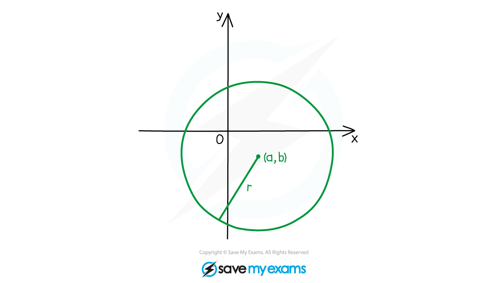
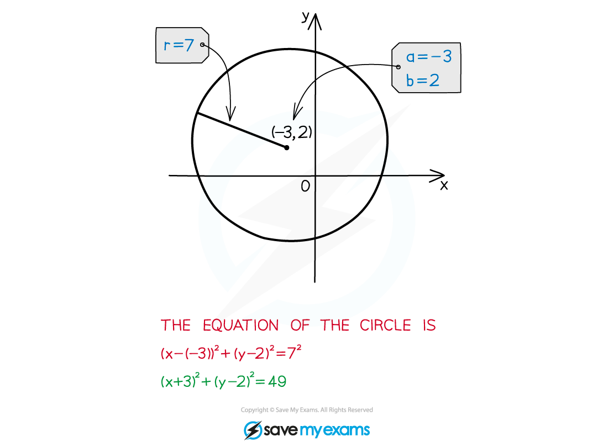
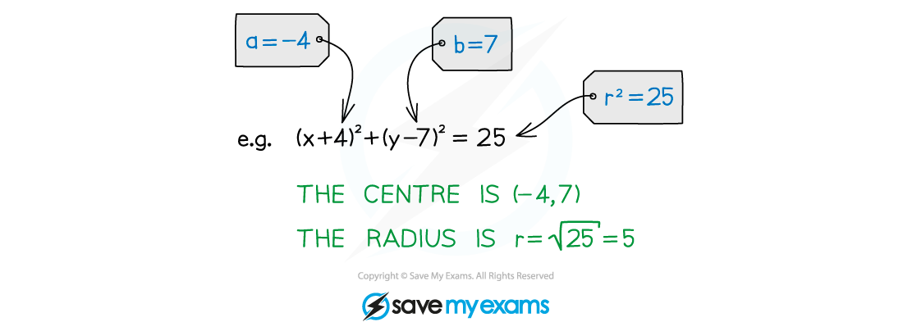
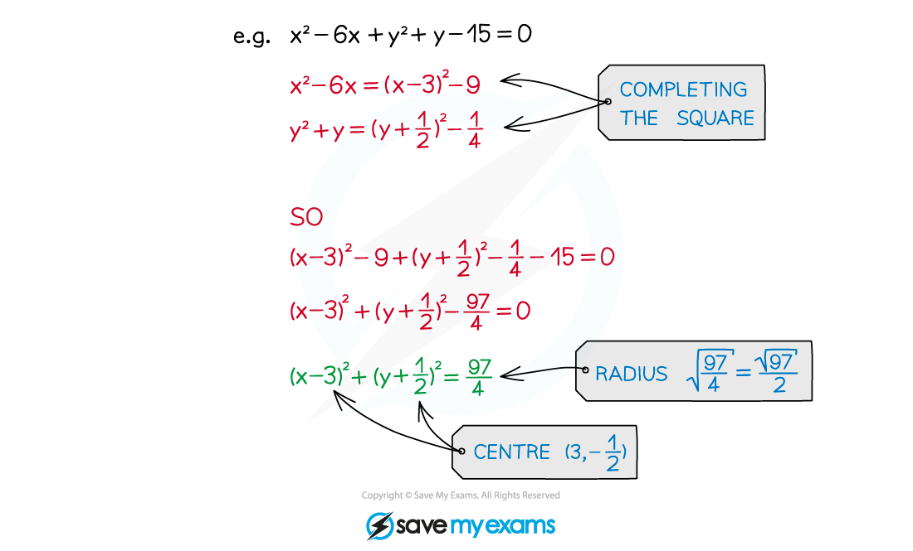
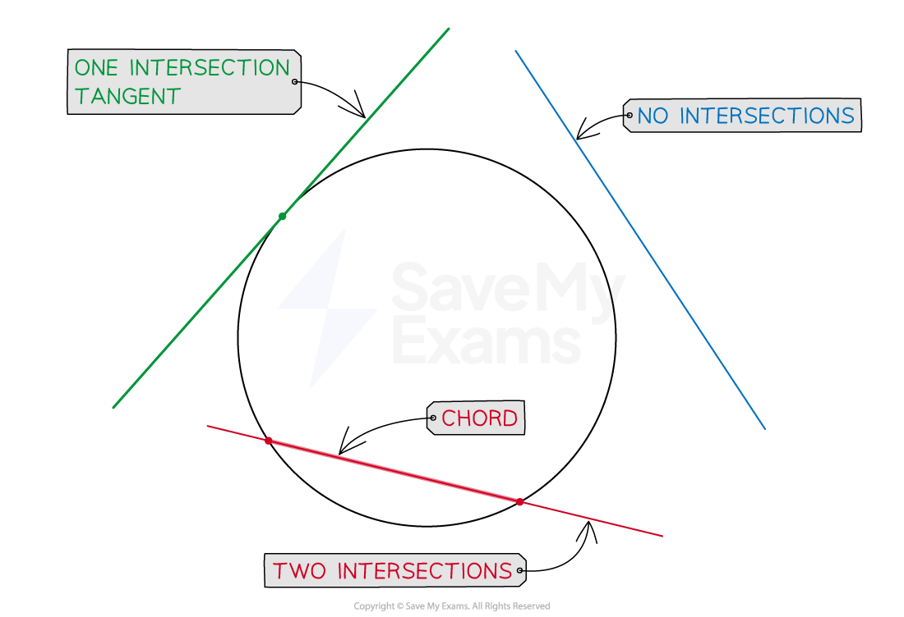

# Equation of a Circle

## Equation of a Circle

> **Spec point** — `spcpt_jVGRzDfj5S8cQf3J`

## Equation of a circle

### What is the equation of a circle?

- A circle with centre **(*****a, b*****)** and radius ***r*** has the equation

$(x-a)^{2}+(y-b)^{2}=r^{2}$** **

- You need to be able to find the equation of a circle given its centre and radius

  - Substitute the values into the formula

### How do I find the centre and radius of a centre given its equation?

- Make sure it is in the form `open parentheses x minus a close parentheses squared plus open parentheses y minus b close parentheses squared equals r squared`

  - The **radius** is the **positive square root** of the constant term
  - The **coordinates of the centre** can be found by finding the values that make **each bracket equal to zero**

> **Exam Hint**
> - Remember that the numbers in the brackets have the opposite signs to the coordinates of the centre  ** **
> - Don't forget to take the **square root **of the right-hand side of the equation when finding the radius

> **Worked Example**
> 

## Finding the Centre & Radius

> **Spec point** — `spcpt_KrxMdrKpc2g33tcB`

## Finding the centre & radius

### What are the different forms of the equation of a circle?

- The most useful equation of a circle is `open parentheses x minus a close parentheses squared plus open parentheses y minus b close parentheses squared equals r squared`

  - This is so the centre, `open parentheses a comma space b close parentheses` and radius $r$ are easy to see
- Any other form of the equation of a circle can be rearranged into this form

  - The most common alternative form for the equation of a circle is called the general form $x^{2}+y^{2}+2gx+2fy+c=0$

### How do I find the centre and radius of a circle from any form of its equation?

- A circle equation in a different form can always be rearranged into** (*****x*****- *****a*****)****2**** + (*****y***** - *****b*****)****2**** = *****r*****2**

  - The centre is then `open parentheses a comma space b close parentheses` and radius $r$
- Rearranging to this form will often involve **completing the square**

> **Worked Example**
> 

## Intersection of a Circle & a Line

> **Spec point** — `spcpt_vmzR3bWpQtptBf4G`

## Intersection of a circle & a line

### What is meant by the intersection of a circle and a line?

- A **line** may pass **through** a circle

  - in which case it will **intersect** the circle **twice**
  - the part of the line between the two points of intersection will be a **chord**
  
    - or, if it passes through the **centre** of the circle, a **diameter**
- A **line** may **touch** a circle

  - in which case it will **intersect** the circle **once**
  - such a line would be called a **tangent** to the circle
- A line may **not intersect** a circle at all

### How do I determine whether a line and a circle intersect?

- For the equation of a circle in the form `open parentheses x minus a close parentheses squared plus open parentheses y minus b close parentheses squared equals r squared` and the equation of a line in the form $y=mx+c$
- **STEP 1** 
**Substitute** the **linear** equation into the **circle** equation

  - e.g. `open parentheses x minus 5 close parentheses squared plus open parentheses y minus 2 close parentheses squared equals 13` and $y=x-4$ would become `open parentheses x minus 5 close parentheses squared plus open parentheses open parentheses x minus 4 close parentheses minus 2 close parentheses squared equals 13`
- **STEP 2** 
**Expand, rearrange** and **simplify** this equation - it should be a quadratic

  - e.g. `open parentheses x minus 5 close parentheses squared plus open parentheses x minus 6 close parentheses squared equals 13` $x^{2}-10x+25+x^{2}-12x+36-13=0$ $x^{2}-11x+24=0$
- **STEP 3** 
**Solve** the equation to deduce the number of intersections
 If there are **two solutions**, there are **two intersections**, **one solution** (repeated) indicates a **tangent, no** (real) **solutions** indicates **no intersection**

  - e.g.  ** **`open parentheses x minus 3 close parentheses open parentheses x minus 8 close parentheses equals 0
  x equals 3 comma space space x equals 8` Two solutions so the line and the circle intersect twice
- **STEP 4** If required, find the $y$-coordinates of the intersection(s)

  - e.g.

$y=x-4\,y=3-4=-1,y=8-4=4$

The line and the circle intersect at the points `open parentheses 3 comma space minus 1 close parentheses` and `open parentheses 8 comma space 4 close parentheses`

> **Exam Hint**
> - A horizontal or vertical line could intersect a circle, when the full method shown above is unnecessary
> 
>   - Horizontal lines have the form $y=k$, so substitute $k$ for $y$ in the circle equation (and solve for $x$)
>   - Vertical lines have the form $x=k$, so substitute $k$ for $x$ in the circle equation (and solve for $y$)

> **Worked Example**
> Show that the line $y=4x+4$ is tangent to the circle `open parentheses x minus 4 close parentheses squared plus open parentheses y minus 3 close parentheses squared equals 17`. State the coordinates of the point of intersection between the tangent and the circle.
> 
> > *STEP 1 - Substitute the linear equation into the circle equation*
> 
> `open parentheses x minus 4 close parentheses squared plus open parentheses 4 x plus 4 minus 3 close parentheses squared equals 17`
> 
> > *STEP 2 - Rearrange to a quadratic*
> 
> `table row cell open parentheses x minus 4 close parentheses squared plus open parentheses 4 x plus 1 close parentheses squared minus 17 end cell equals 0 row cell x squared minus 8 x plus 16 plus 16 x squared plus 8 x plus 1 minus 17 end cell equals 0 row cell 17 x squared end cell equals 0 end table`
> 
> > *STEP 3 - Solve*
> 
> $x^{2}=0$
> 
> $x=0$* (repeated)*
> 
> **Final answer:** **There is only one point of intersection so the line **$y=4x+4$** is tangent to the circle**** **$(x-4)^{2}+(y-3)^{2}=17$
> 
> > *STEP 4 - The coordinates are required*
> 
> `y equals 4 open parentheses 0 close parentheses plus 4 equals 4`
> 
> **Final answer:** **The line and circle intersect at**** **$(0,4)$
