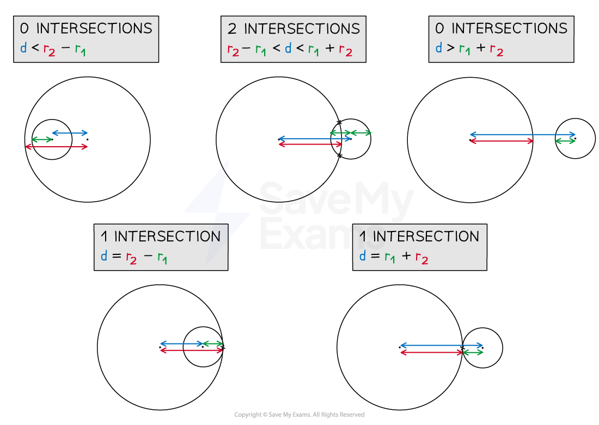
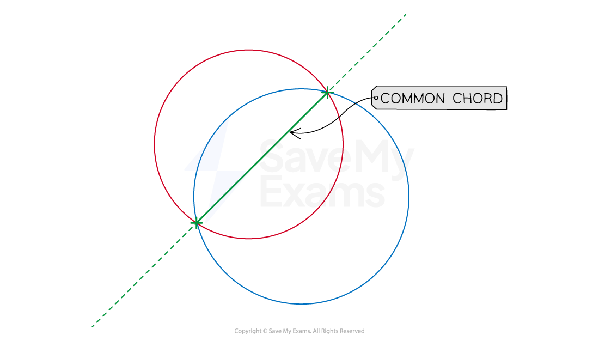

# Intersection of Two Circles

## Intersection of Two Circles

> **Spec point** — `spcpt_ZydKgKr5dTycvPvp`

## Intersection of two circles

### What is meant by the intersection of two circles?

- Two circles may ***intersect*** once (touch), twice (cross), or not at all

  - Touching circles may be referred to as **tangent** to each other
  
    - they would have a **common tangent line**

### How do I determine if two circles intersect or not?

- Find the distance, $d$, between the centres of the two circles

  - This can be found using Pythagoras' theorem
  
    - For centres $( x_{1} , y_{1} )$ and $( x_{2} , y_{2} )$, $d^{2} = ( x_{2} - x_{1} )^{2} + ( y_{2} - y_{1} )^{2}$
- The radii of the two circles, $r_{1}$ and $r_{2}$, where $r_{2}\geqr_{1}$ are also needed
- If $r_{2}-r_{1}<d<r_{1}+r_{2}$ then the circles intersect **twice**

- If $d=r_{2}-r_{1}$ or $d=r_{1}+r_{2}$ then the circles intersect **once**

- If $d>r_{1}+r_{2}$ or $d<r_{2}-r_{1}$ then the circles do **not** intersect

- Rather than trying to remember those formulae, try to understand the logic behind each situation

### How do I find the coordinates of the point(s) of intersection of two circles?

- Once it has been determined that the circles do intersect at least once, the following process can be used to determine the coordinates of any intersections
- **STEP 1** **Rearrange both** circle equations so that one side is **zero**
- **STEP 2** Put the circle equations equal to each other (i.e. solve simultaneously!)
- **STEP 3** Expand/rearrange/simplify into a **linear** equation

  - The $x^{2}$ and $y^{2}$ terms will **cancel,** leaving an equation of the form $y=mx+c,x=k$ or $y=k$ (These are 'diagonal line', 'vertical line' and 'horizontal line') The intersection(s) will lie on this line
- **STEP 4** **Substitute** the **linear** equation into **either** of the **circle** equations Solving this equation will lead to either the $x$-coordinate(s) or $y$-coordinate(s) of the intersection(s)
- **STEP 5** **Substitute** the $x$ (or $y$) coordinates into either circle equation to find the corresponding $y$ (or $x$) coordinates This step will not be needed in the case of the linear equation being of the form $x=k$ or $y=k$

> **Exam Hint**
> - Even if not given, or asked for, a sketch of the circles can help visualise their positions relative to each other
> 
>   - You can then see if your final answers make sense with your sketch

> **Worked Example**
> a) Determine the number of intersections between the circles with equations $x^{2}+y^{2}=2$ and $( x - 4 )^{2} + y^{2} = 10$.
> 
> > $x^{2}+y^{2}=2$ *has centre* $( 0 , 0 )$*and radius* $\sqrt{2}$*.*
> 
> > $( x - 4 )^{2} + y^{2} = 10$ *has centre* $( 4 , 0 )$*and radius* $\sqrt{10}$*.*
> 
> $\begin{array}{rcl} d^{2} & = ( 4 - 0 )^{2} + ( 0 - 0 )^{2} \\ d = 4 \end{array}$
> 
> > *Using a sketch may help you to 'see' that* $d=4$*.*
> 
> $r_{1}=\sqrt{2},r_{2}=\sqrt{10}$
> 
> > *Compare* $d$ *with the sum and difference of* $r_{1}$ *and* $r_{2}$*.*
> 
> $\begin{gathered} r_{1} + r_{2} & = 4.576 ... \\ r_{2} - r_{1} & = 1.748 ... \end{gathered}$
> 
> $\begin{gathered} \therefore r_{2} - r_{1} & < d < r_{1} + r_{2} \end{gathered}$
> 
> **Final answer:** **The circles intersect twice**
> 
> b) Determine the coordinates of any intersections between the circles with equations $x^{2}+y^{2}=2$ and $( x - 4 )^{2} + y^{2} = 10$.
> 
> > *STEP 1 - Rearrange both equations so zero is on one side*
> 
> $\begin{gathered} x^{2} + y^{2} - 2 & = 0 \\ ( x - 4 )^{2} + y^{2} - 10 & = 0 \end{gathered}$
> 
> > *STEP 2 - Put the equations equal to each other*
> 
> $x^{2} + y^{2} - 2 = ( x - 4 )^{2} + y^{2} - 10$
> 
> > *STEP 3 - Expand and rearrange until in linear form*
> 
> $\begin{gathered} x^{2} + 8 & = x^{2} - 8 x + 16 \\ 8 x - 8 & = 0 \\ x = 1 \end{gathered}$
> 
> > *STEP 4 - Substitute into either circle equation*
> 
> $\begin{gathered} ( 1 )^{2} + y^{2} & = 2 \\ y^{2} & = 1 \\ y = 1 , y = - 1 \end{gathered}$
> 
> > *STEP 5 - Not required in this case*
> 
> **Final answer:** **The intersections of the two circles have coordinates (1, 1) and (1,-1)**

## Equation of Common Chord

> **Spec point** — `spcpt_rNBh9Hv9B4nxcQnz`

## Equation of common chord

### What is a common chord?

- For circles that **intersect twice** the **common chord** is the line that joins the points of intersection
- This line is a **chord** in both circles

  - Circles that intersect once (touch) have a common tangent

### How do I find the equation of a common chord?

- As a **common chord** is a **straight line,** its equation will be of the form $y=mx+c$ unless

  - it is a **horizontal** line, in which case its equation will be of the form $y=k$
  - it is a **vertical** line, in which case its equation will be of the form $x=k$
- Depending on the known information, there are two ways to find the **equation** of the **common chord**

  - If the **equations** of the **circles** are known
  
    - **Equate** the equations and rearrange the equation into one of the three forms above
    - For example, $x^{2}+y^{2}-4x+2y-8=x^{2}+y^{2}-8x-2y+16$ $4x+4y=24$ So the equation of the common chord is $y=6-x$
  - If the points of **intersection** are known
  
    - Use the method of finding the **equation** of a **straight line** from **two known points**
    - If the intersection points are $( x_{1} , y_{1} )$ and $( x_{2} , y_{2} )$ then the equation of the common chord would be
    
      - $y - y_{1} = \frac{y_{2} - y_{1} }{x_{2} - x_{1} } ( x - x_{1} )$
      - $\frac{y_{2}-y_{1}}{x_{2}-x_{1}}$ is the gradient and it can be easier to work this out first, separately

> **Worked Example**
> Two circles intersect at the points with coordinates $( 3 , - 1 )$ and $( 8 , 4 )$.
> 
> Find the equation of the common chord of the two circles.
> 
> *The points of intersection are known.* *Use the method of finding the equation of a straight line from two known points.*
> 
> > *First find the gradient,*
> 
> $m = \frac{y_{2} - y_{1} }{x_{2} - x_{1} } = \frac{4 - ( - 1 )}{8 - 3} = \frac{5}{5} = 1$
> 
> > *Apply* $y - y_{1} = m ( x - x_{1} )$ *to get the equation of the common chord.*
> 
> $\begin{array}{rcl} y - ( - 1 ) & = 1 ( x - 3 ) \\ y + 1 & = x - 3 \end{array}$
> 
> **Final answer:** **The equation of the common chord is**** **$y=x-4$
