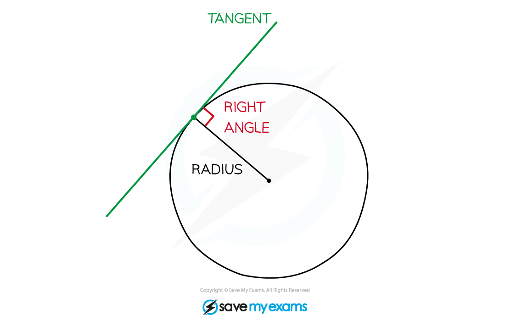

# Tangents to Circles

## Tangents to Circles

> **Spec point** — `spcpt_KdmVZvt5PCWRMb8D`

## Tangents to circles

### What is a tangent to a circle?

- A **tangent** (to a circle) is a line that **touches** the circle at a **single point** but does *not* cut across the circle 
- A **tangent** to a circle is **perpendicular** to the **radius** of the circle at the point of intersection

### How can I find the equation of the tangent line to a circle at a given point?

- **STEP 1** Find the **gradient** of the **radius *****OP***

- **STEP 2** Find the **gradient** of the **tangent **As they are perpendicular, if the gradient of the radius is $m_{r}$, then, the gradient of the tangent is $m_{t}=-\frac{1}{m_{r}}$** **(Negative reciprocal) Alternatively,

- **STEP 3** The **equation** of the **tangent** is the equation of the line with that **gradient** that goes through point ***P (x******2******, y******2******) ***Write down the equation using `y−y_ 2=m_ t (x−x_ 2)`where $m_{t}$is the gradient

> **Exam Hint**
> - If you understand the formula in Step 2 above
> 
> Gradient of tangent $=-\frac{x_{2}-x_{1}}{y_{2}-y_{1}}$
> 
> you can find the gradient of the tangent directly without having to find the gradient of the radius first.

> **Worked Example**
> 
