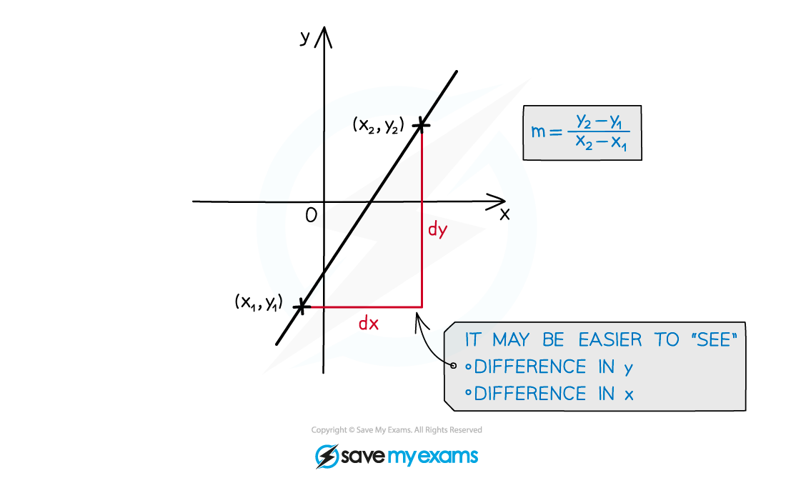
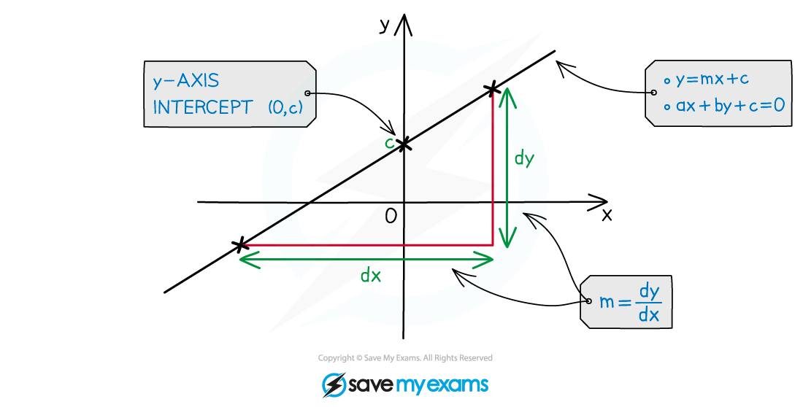
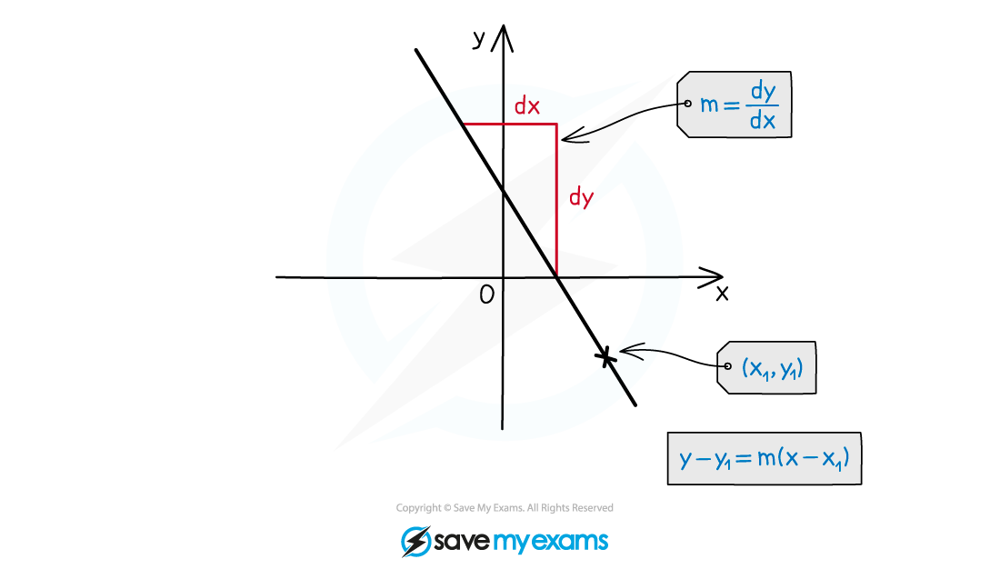
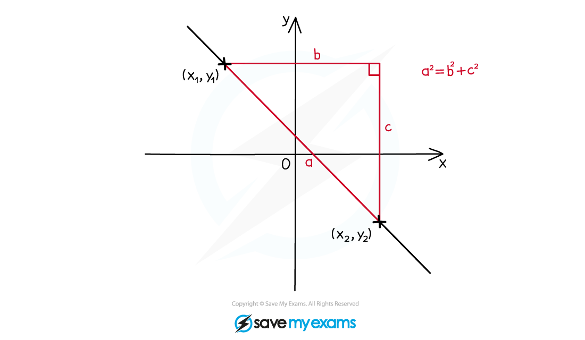

# Linear Graphs

## Equations of a Straight Line

> **Spec point** — `spcpt_xr9KqPmDKQdy6Nvt`

## Equations of a straight line

### How do I find the gradient of a straight line?

- Find two points that the line passes through with coordinates (*x**1**, y**1*) and (*x**2**, y**2*)
- The gradient between these two points is calculated by

$m=\frac{y_{2}-y_{1}}{x_{2}-x_{1}}$

- The gradient of a straight line measures its** slope**

  - A line with gradient 1 will go up 1 unit for every unit it goes to the right
  - A line with gradient -2 will go down two units for every unit it goes to the right

### What are the equations of a straight line?

- $y=mx+c$

  - This is the **gradient-intercept form**
  - It clearly shows the gradient *m *and the *y*-intercept (0, *c*)
- `space y minus y subscript 1 equals m open parentheses x minus x subscript 1 close parentheses`
- This is the **point-gradient form**

  - It clearly shows the gradient *m *and a point on the line (*x**1**, y**1*)
- $ax+by+d=0$

  - This is the **general form**
  - You can quickly get the *x*-intercept$(-\frac{d}{a},0)$ and *y*-intercept$(0,-\frac{d}{b})$

### How do I find an equation of a straight line?

- You will need the gradient

  - If you are given two points then first find the gradient
- It is easiest to start with the **point-gradient form**

  - then rearrange into whatever form is required
  
    - multiplying both sides by any denominators will get rid of fractions

> **Exam Hint**
> - Quickly sketching the graph of the straight line(s) can be helpful if you are struggling with an exam question
> - Ensure you state equations of straight lines in the format required
> 
>   - Usually  $y=mx+c$  or  $ax+by+d=0$
>   - Check whether coefficients need to be integers (they usually are for $ax+by+d=0$)

> **Worked Example**
> (a) Find the equation of the straight line with gradient 3 that passes through (5, 4).
> 
> > *We know that the gradient is 3 so the line takes the form *
> 
> $y=3x+c$
> 
> > *To find the value of **c**, substitute (5, 4) into the equation*
> 
> `4 equals 3 open parentheses 5 close parentheses plus c
> 4 equals 15 plus c
> c equals negative 11`
> 
> > *Replace **c** with −11 to complete the equation of the line*
> 
> **Final answer:** **y**** = 3****x**** − 11**
> 
> (b) Find the equation of the straight line that passes through (-2, 6) and (8, 1).
> 
> > *You may find it helpful to sketch the information given*
> 
> 
> 
> > *First find **m**, the gradient*
> 
> `table attributes columnalign right center left columnspacing 0px end attributes row m equals cell fraction numerator 6 minus 1 over denominator negative 2 minus 8 end fraction end cell row blank equals cell fraction numerator 5 over denominator negative 10 end fraction end cell row blank equals cell negative 1 half end cell end table`
> 
> > *We know that the line takes the form *
> 
> `table attributes columnalign right center left columnspacing 0px end attributes row y equals cell negative 1 half x plus c end cell end table`
> 
> > *To find the value of **c**, substitute either of the given points into this equation. Here we will pick (8, 1) as it is doesn't contain negative numbers so is easier to work with*
> 
> `1 equals negative 1 half open parentheses 8 close parentheses plus c
> 1 equals negative 4 plus c
> c equals 5`
> 
> > *Replace **c** with −11 to complete the equation of the line*
> 
> $y=-\frac{1}{2}x+5$
> 
> > *We can check against our sketch that this equation looks correct- it has a negative gradient and it crosses the **y**-axis between 1 and 6*

## Midpoint of a Straight Line

> **Spec point** — `spcpt_qGRkKXMcdz3j7rXz`

## Midpoint of a line segment

### How do I find the midpoint of a line segment?

- The midpoint of a line will be the same distance from both endpoints
- You can think of a midpoint as being the average (mean) of two coordinates
- The midpoint of `open parentheses x subscript 1 comma space y subscript 1 close parentheses` and `open parentheses x subscript 2 comma space y subscript 2 close parentheses` is

`open parentheses fraction numerator x subscript 1 plus x subscript 2 over denominator 2 end fraction space comma space fraction numerator y subscript 1 plus y subscript 2 over denominator 2 end fraction close parentheses`

- M is often used as the midpoint between two points (**x**1, **y**1) (**x**2, **y**2)
- It is the average of both the **x** and **y** coordinates

> **Worked Example**
> The coordinates of *A *are (−4, 3) and the coordinates of *B *are (8, −12).
> 
> Find *M*, the midpoint of *AB*.
> 
> > *The midpoint can be found using **M** = *`open parentheses fraction numerator x subscript 1 plus x subscript 2 over denominator 2 end fraction space comma space fraction numerator y subscript 1 plus y subscript 2 over denominator 2 end fraction close parentheses`
> 
> > *Fill in the values of **x** and **y ** from each coordinate*
> 
> `open parentheses fraction numerator negative 4 plus 8 over denominator 2 end fraction space comma space fraction numerator 3 plus negative 12 over denominator 2 end fraction close parentheses equals open parentheses 4 over 2 comma space fraction numerator negative 9 over denominator 2 end fraction close parentheses`
> 
> > *Simplify*
> 
> **Final answer:** **M**** = (2, −4.5)**

## Length of a Straight Line

> **Spec point** — `spcpt_ncx2cx6xgbgqBZXw`

## Length of a line segment

### How do I calculate the length of a line segment?

- The distance between two points with coordinates `open parentheses x subscript 1 space comma space y subscript 1 close parentheses` and `open parentheses x subscript 2 space comma space y subscript 2 close parentheses` can be found using the formula

`d equals square root of open parentheses x subscript 1 minus x subscript 2 close parentheses squared plus open parentheses y subscript 1 minus y subscript 2 close parentheses squared end root`

- This formula is really just Pythagoras’ Theorem  $a^{2}=b^{2}+c^{2}$, applied to the difference in the $x$-coordinates and the difference in the $y$-coordinates;

- You may be asked to find the length of a diagonal in 3D space

  - This can be answered using **3D Pythagoras**

> **Exam Hint**
> - Work with the **square** of a distance for as long as possible as this avoids early rounding errors
> 
>   - In the non-calculator paper your answer may need to be left as a surd
> - Only square root when forced to or for a final answer, and use the ANS button (and other memory features) on your calculator

> **Worked Example**
> Point *A* has coordinates (3, -4) and point *B* has coordinates (-5, 2).
> 
> Calculate the distance of the line segment *AB*.
> 
> > *Using the formula for the distance between two points, *`d equals square root of open parentheses x subscript 1 minus x subscript 2 close parentheses squared plus open parentheses y subscript 1 minus y subscript 2 close parentheses squared end root`* *
> 
> > *Substituting in the two given coordinates:*
> 
> `d equals square root of open parentheses 3 minus negative 5 close parentheses squared plus open parentheses negative 4 minus 2 close parentheses squared end root`
> 
> *Simplify:*
> 
> `d equals square root of open parentheses 8 close parentheses squared plus open parentheses negative 6 close parentheses squared end root space equals space square root of 64 plus 36 end root equals square root of 100 equals 10`
> 
> **Final answer:** **Answer = 10 units**
