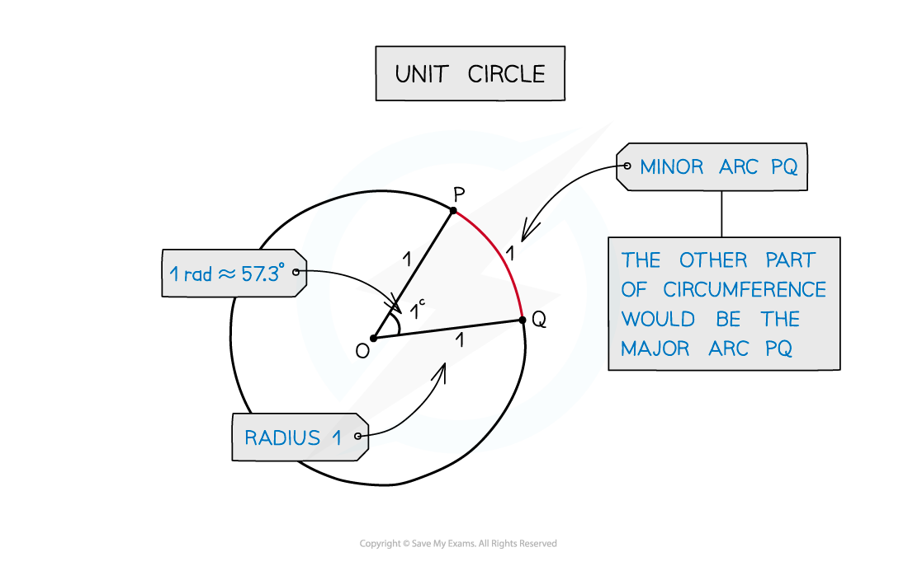
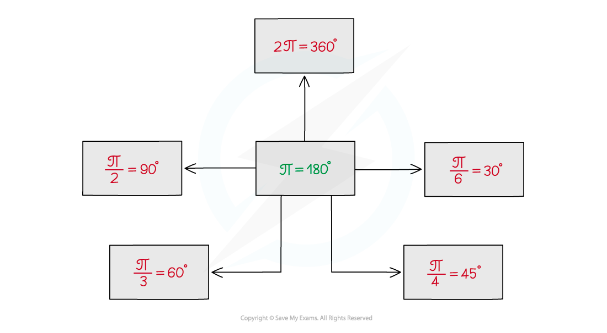

# Radian Measure

## Radian Measure

> **Spec point** — `spcpt_zXphyXMSJcGf9zsp`

## Radian measure

### What are radians?

- Radians are an alternative to degrees for measuring angles
- 1 radian is the angle in a **sector** of radius 1 and arc length 1

  - A circle with radius 1 is called a **unit circle**
- Radians are normally quoted in terms of π

  - 2π radians = 360°
  - π radians = 180°
- The symbol for radians is c but it is more usual to see **rad**

  - Often, when π is involved, no symbol is given as it is obvious it is in radians
  - Whilst it is okay to omit the symbol for radians, you should never omit the symbol for degrees
- In the exam you should use radians unless otherwise indicated

### Definition of a radian using a unit circle

### How do I convert between radians and degrees?

- Use π* *c = 180° to convert between radians and degrees

  - To convert from radians to degrees multiply by $\frac{180}{π}$
  - To convert from degrees to radians multiply by $\frac{π}{180}$
- Some of the common conversions are:

  - $2π^{c}=360^{\circ}$
  - $π^{c}=180^{\circ}$
  - $\frac{π}{2}^{c}=90^{\circ}$
  - $\frac{π}{3}^{c}=60^{\circ}$
  - $\frac{π}{4}^{c}=45^{\circ}$
  - $\frac{π}{6}^{c}=30^{\circ}$
- It is a good idea to remember some of these and use them to work out other conversions

> **Exam Hint**
> - Sometimes an exam question will specify whether you should be using degrees or radians and sometimes it will not, if it doesn't it is expected that you will work in radians
> - If the question involves π then working in radians is useful as there will likely be opportunities where you can cancel out π
> - Make sure that your calculator is in the correct mode for the type of angle you are working with

> **Worked Example**
> a) Convert 43.8° to radians.
> 
> > *Divide by 180°.*
> 
> $\frac{43.8^{\circ}}{180^{\circ}}=\frac{73}{300}$
> 
> > *Multiply by π radians.*
> 
> $\frac{73}{300}\timesπ$
> 
> $43.8^{\circ}=\frac{73}{300}π=0.764(3\mathrm{sf})$
> 
> b) Convert $\frac{5π}{4}$to degrees.
> 
> > *Divide by π radians.*
> 
> $\frac{5π}{4}\divπ=\frac{5}{4}$
> 
> > *Multiply by 180°.*
> 
> $\frac{5}{4}\times180^{\circ}$
> 
> $\frac{5π}{4}\mathrm{radians}=225^{\circ}$
