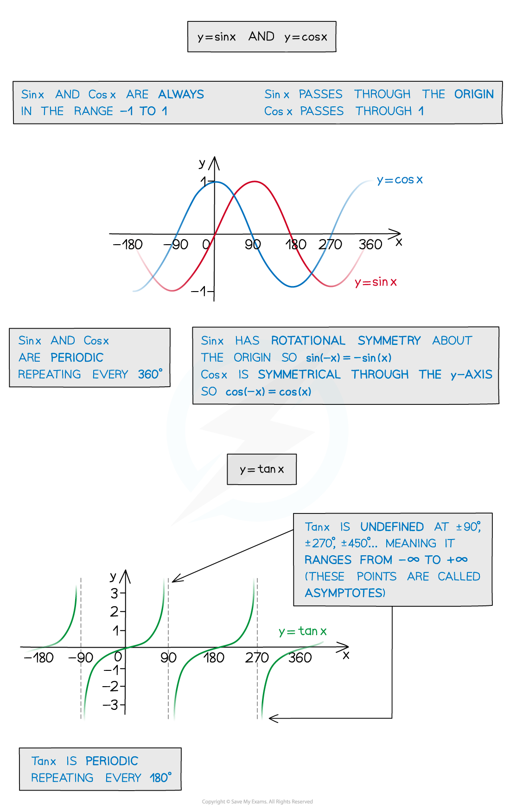
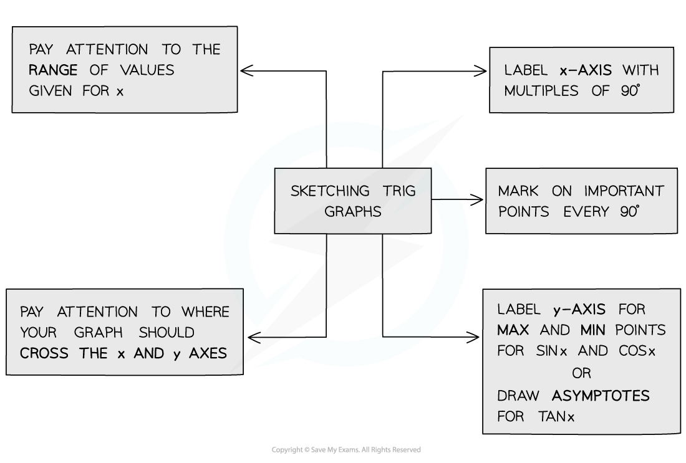
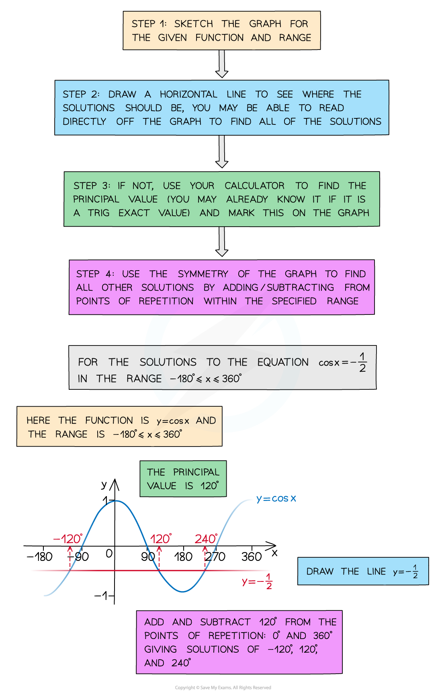
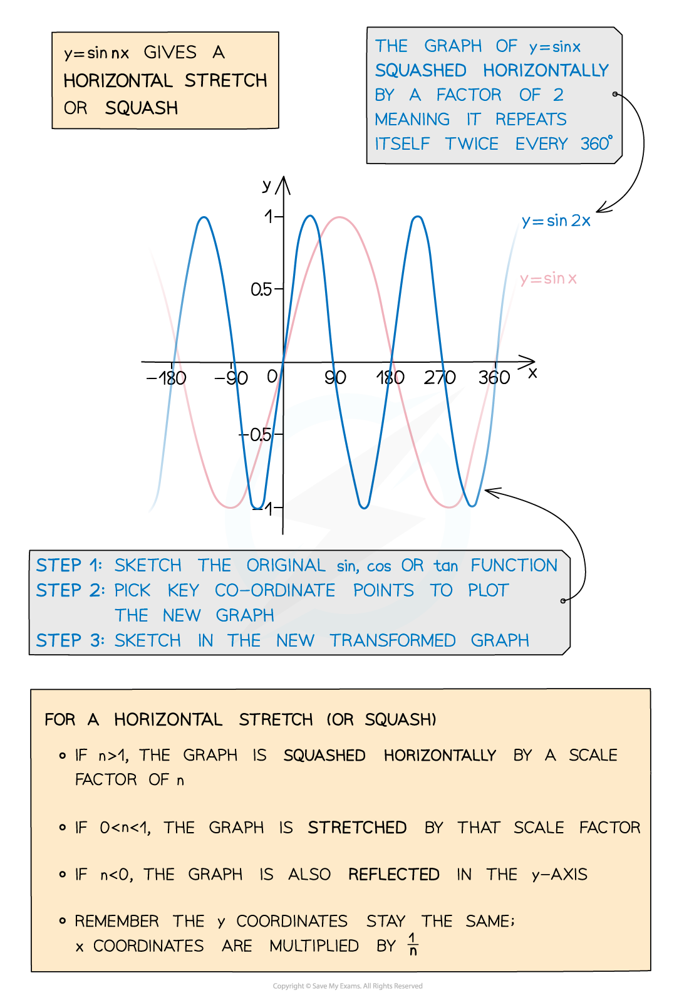

# Graphs of Trigonometric Functions

## Graphs of Trig Functions

> **Spec point** — `spcpt_8t6PxrTbYZBMSWXQ`

## Graphs of trig functions

### What are the graphs of trigonometric functions?

- The trigonometric functions sin, cos and tan all have special *periodic graphs*
- You’ll need to know their properties and how to sketch them for a given domain in either **degrees** or **radians**
- Sketching the trigonometric graphs can help to

  - Solve trigonometric equations and find all solutions
  - Understand transformations of trigonometric functions

### What are the properties of the graphs of sin x and cos x?

- The graphs of sin x and cos x are both **periodic**

  - They **repeat every 360°** (2π radians)
  - The angle will always be on the x-axis
  
    - Either in degrees or radians
- The graphs of sin x and cos x are always in the **range -1 ≤ *****y***** ≤ 1**

  - **Domain: **$\{ \boldsymbol{x} \vert \boldsymbol{x} \in \mathrm{real} \text{numbers} \}$
  - **Range: **`{ y _ |−1 _ <= y _ <= 1 }`
  - The graphs of sin x and cos x are identical however one is a **translation **of the other
  
    - sin x passes through the origin
    - cos x passes through (0, 1)
- The **amplitude** of the graphs of sin x and cos x is 1

### What are the properties of the graph of tan x?

- The graph of tan x is **periodic**

  - It **repeats every 180°** (π radians)
  - The angle will always be on the x-axis
  
    - Either in degrees or radians
- The graph of tan x is **undefined** at the points ± 90°, ± 270° etc

  - There are **asymptotes** at these points on the graph
  - In radians this is at the points ± $\frac{π}{2}$, ± $\frac{3π}{2}$ etc
- The range of the graph of tan x is

  - **Domain: **$\{ \boldsymbol{x} \vert \boldsymbol{x} ≠ π / 2+ \boldsymbol{k} π , \boldsymbol{k} ∈ \mathrm{integer} \text{numbers} \}$** **
  - **Range: **$\{ \boldsymbol{y} \vert \boldsymbol{y} \in \mathrm{real} \text{numbers} \}$

### How do I sketch trigonometric graphs?

- You may need to sketch a trigonometric graph so you will need to remember the key features of each one
- The following steps may help you sketch a trigonometric graph

  - STEP 1: Check whether you should be working in degrees or radians
  
    - You should check the domain given for this
    - If you see π in the given domain then you should work in radians
  - STEP 2: Label the x-axis in multiples of 90°
  
    - This will be multiples of $\frac{π}{2}$ if you are working in radians
    - Make sure you cover the whole domain on the x-axis
  - STEP 3: Label the y-axis
  
    - The range for the y-axis will be – 1 ≤ y ≤ 1 for sin or cos
    - For tan you will not need any specific points on the y-axis
  - STEP 4: Draw the graph
  
    - Knowing exact values will help with this, such as remembering that sin(0) = 0 and cos(0) = 1
    - Mark the important points on the axis first
    - If you are drawing the graph of tan x put the asymptotes in first
    - If you are drawing sin x or cos x mark in where the maximum and minimum points will be
    - Try to keep the symmetry and rotational symmetry as you sketch, as this will help when using the graph to find solutions

### How do I use trigonometric graphs?

- By sketching the graph you can read off all the solutions in a given *range (or interval)*
- Your calculator will only give you the *principal value*
- However, due to the **periodic **nature of the trig functions there could be an infinite number of solutions

  - Further solutions are called the **secondary values**
- This is why you will be given a **domain **(interval) in which your solutions should be found

  - This could either be in degrees or in radians
  
    - If you see π or some multiple of π then you must work in radians
- The following steps will help you use the **trigonometric graphs** to find **secondary values**

  - STEP 1: Sketch the graph for the given function and interval
  
    - Check whether you should be working in degrees or radians and label the axes with the key values
  - STEP 2: Draw a horizontal line going through the y-axis at the point you are trying to find the values for
  
    - For example if you are looking for the solutions to sin-1(-0.5) then draw the horizontal line going through the y-axis at -0.5
    - The number of times this line cuts the graph is the number of solutions within the given interval
  - STEP 3: Find the primary value and mark it on the graph
  
    - This will either be an exact value and you should know it
    - Or you will be able to use your calculator to find it
  - STEP 4: Use the symmetry of the graph to find all the solutions in the interval by adding or subtracting from the key values on the graph

- You should recognise any values/angles associated with **exact values**
- You should be able to spot the pattern of solutions using the **symmetry** and **periodicity** of the graph

> **Exam Hint**
> - Always sketch with a pencil, draw a smooth curve and pay attention to the key features of each graph:
> 
>   - Where it crosses the x and y axes
>   - How often it repeats
>   - Whether it is symmetrical
> - Remember, when answering exam questions that ask for solutions, a sketch will help ensure you give **all** the appropriate solutions for a given interval

> **Worked Example**
> 

## Transformations of Trig Functions

> **Spec point** — `spcpt_w3hb87JScmvzrv7b`

## Transformations of trig functions

### What transformations of trigonometric functions do I need to know?

- As with other graphs of functions, trigonometric graphs can be transformed through **translations, stretches **and **reflections**
- **Translations** can be either horizontal (parallel to the x-axis) or vertical (parallel to the y-axis)

  - For the function** y = sin (x)**
  
    - A **vertical** translation of ***a *****units** in the **positive direction **(up) is denoted by **y = sin (x) + *****a***
    - A **vertical** translation of ***a***** units** in the **negative direction** (down) is denoted by **y = sin (x) - *****a***
    - A **horizontal** translation in the **positive direction **(right) is denoted by **y = sin (x - *****a*****)**
    - A **horizontal** translation in the **negative direction** (left) is denoted by **y = sin (x + *****a*****)**
- **Stretches** can be either horizontal (parallel to the x-axis) or vertical (parallel to the y-axis)

  - For the function** y = sin (x)**
  
    - A **vertical** stretch of a **factor** ***a***** units** is denoted by **y = *****a *****sin (x)**
    - A **horizontal** stretch of a **factor** ***a *****units** is denoted by **y = sin (**$\frac{x}{a}$**)**
- **Reflections** can be either across the x-axis or across the y-axis

  - For the function** y = sin (x)**
  
    - A **reflection** across the x-axis is denoted by **y = - sin (x)**

### What combined transformations are there?

- **Stretches **in the horizontal and vertical direction are often combined
- The functions** *****a *****sin(*****bx*****)***** ***and** *****a *****cos(*****bx*****) **have the following properties:

  - The** amplitude **of the graph is |*a* |
  - The **period** of the graph is $\frac{360}{b}$° (or $\frac{2π}{b}$ rad)
  
    - In this course, *a* will always be a positive integer and *b* will be a simple fraction or integer
- **Translations **in both directions could also be combined with the stretches
- The functions** *****a *****sin*****bx***** + *****c ***and** *****a *****cos*****bx***** + *****c ***have the following properties:

  - The** amplitude **of the graph is |*a* |
  - The **period** of the graph is $\frac{360}{b}$° (or $\frac{2π}{b}$)
  - The translation in the vertical direction is *c*
  
    - *c* represents the **principal axis **(the line that the function fluctuates about)
    - It helps to start by sketching the principle axis
- The function** *****a *****tan*****bx***** + *****c ***has the following properties:

  - The** amplitude **of the graph does not exist
  - The **period** of the graph is $\frac{180}{b}$° (or $\frac{π}{b}$)
  - The translation in the vertical direction (principal axis) is *c*
  
    - Finding and drawing the asymptotes first can help to sketch these graphs

### How do I sketch transformations of trigonometric functions?

- Sketch the graph of the original function first
- Carry out each transformation separately

  - The **order** in which you carry out the transformations is important
  - Given the form ***y *****= *****a *****sin*****bx***** + *****c*** carry out any **stretches** first, **translations** next and **reflections** last
  - Use a very light pencil to mark where the graph has moved for each transformation
- It is a good idea to mark in the principal axis the lines corresponding to the maximum and minimum points first

  - The **principal axis** will be the line ***y = c***
  - The **maximum points** will be on the line ***y = c + a***
  - The **minimum points** will be on the line ***y = c - a***
- Sketch in the new transformed graph
- Check it is correct by looking at some key points from the **exact values**

> **Exam Hint**
> - Always sketch with a pencil and draw a smooth curve
> - When you sketch the transformation of a graph, be sure to indicate the new coordinates of any points that are marked on the original graph
> 
>   - Fir any graph involving tan the asymptotes must be clearly labelled
> - Try to indicate the coordinates of points where the new graph intersects the axes

> **Worked Example**
> 
