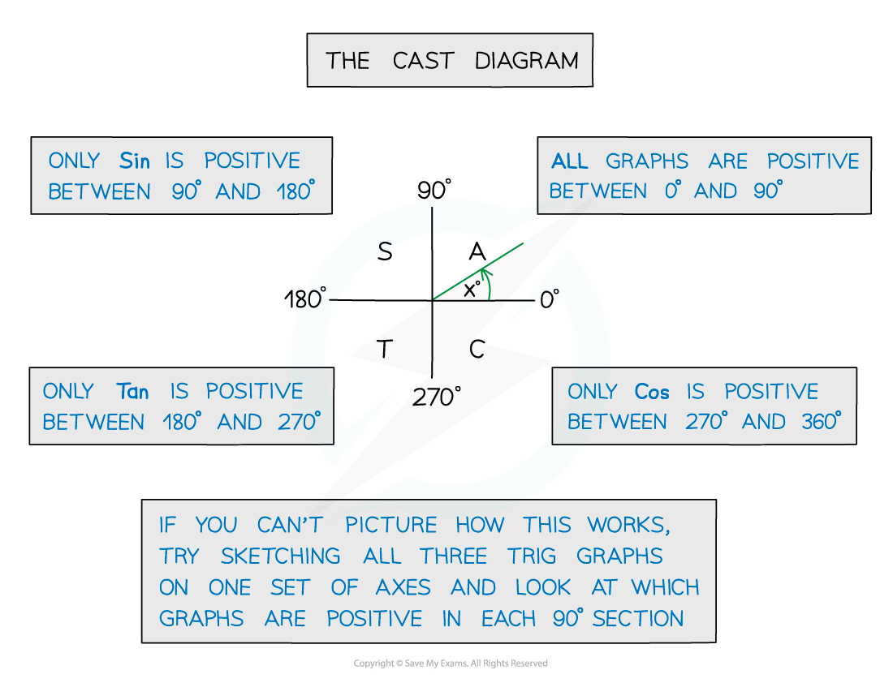
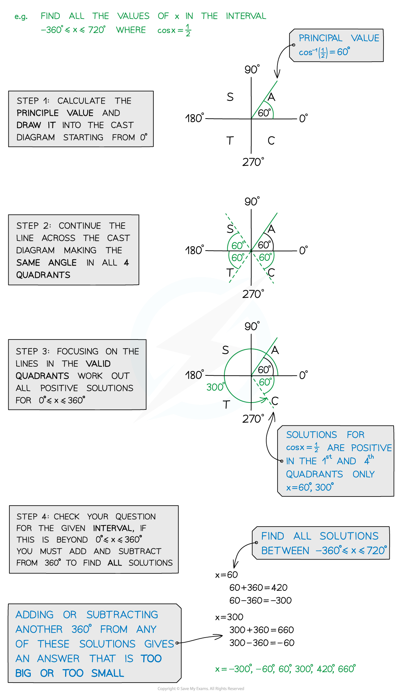
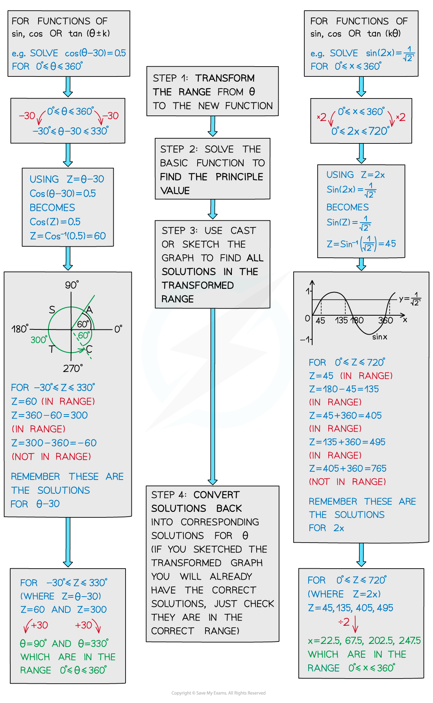
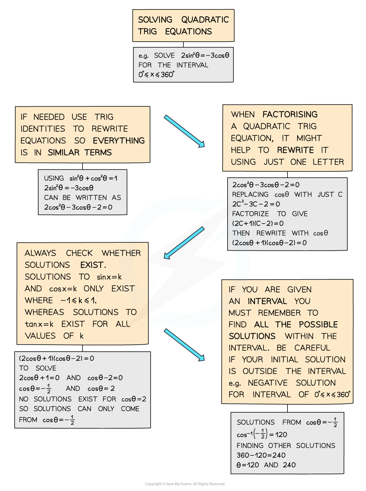
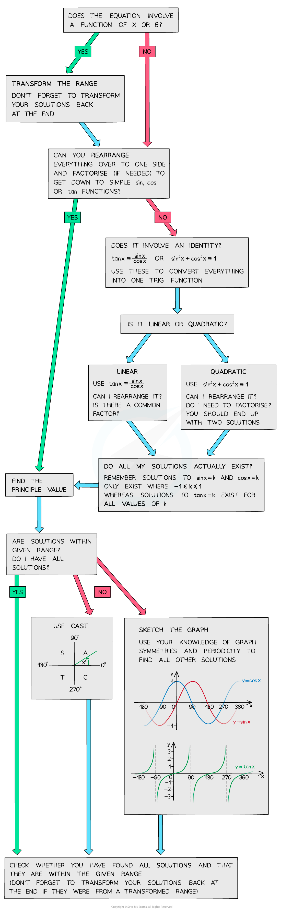

# Solving Trigonometric Equations

## Linear Trig Equations

> **Spec point** — `spcpt_3ZWSxrRmy47H5V4d`

## Linear trig equations

### How are trigonometric equations solved?

- Trigonometric equations can have an infinite number of solutions

  - For an equation in sin or cos you can add 360° or 2π to each solution to find more solutions
  - For an equation in tan you can add 180° or π to each solution
- When solving a trigonometric equation you will be given a range of values within which you should find all the values
- Solving the equation normally and using the inverse function on your calculator or your knowledge of **exact values** will give you the **primary value**
- The **secondary values** can be found with the help of:

  - The **unit circle**
  
    - By using the** *****CAST***** d**iagram which shows where each function has positive solutions
  - The **graphs of trigonometric functions**
  
    - By **sketching the graph** (see Graphs of Trigonometric Functions) you can read off all the solutions in a given *range (or interval)*
- By using** trigonometric identities** you can simplify harder equations
- You may be asked to use **degrees or radians** to solve trigonometric equations

  - Make sure your calculator is in the **correct mode**
  - Remember common angles
  
    - 90° is ½π radians
    - 180° is π radians
    - 270° is 3π/2 radians
    - 360° is 2π radians** **

### How are trigonometric equations of the form sin x = k solved?

- It is a good idea to sketch the graph of the trigonometric function first

  - Use the given range of values as the domain for your graph
  - The intersections of the graph of the function and the line y = k will show you
  
    - The location of the solutions
    - The number of solutions
  - You will be able to use the symmetry properties of the graph to find all secondary values within the given range of values
- The method for finding secondary values are:

  - For the equation sin x = k the primary value is x1 = sin -1 k
  
    - A secondary value is x2 = 180° - sin -1 k
    - Then all values within the range can be found using x1 ± 360n and x2 ± 360n where *n ∈ * $ℕ$
  - For the equation cos x = k the primary value is x1 = cos -1 k
  
    - A secondary value is x2 = - cos -1 k
    - Then all values within the range can be found using x1 ± 360n and x2 ± 360n where *n ∈ * $ℕ$
  - For the equation tan x = k  the primary value is x = tan -1 k
  
    - All secondary values within the range can be found using x ± 180n where *n ∈  *$ℕ$

### How do I use the CAST diagram?

### What about more complicated trig equations?

- Some trig equations could involve a **function** of *x* or θ (see Transformations of Trigonometric Functions)
- Trigonometric equations in the form sin(*ax + b*) can be solved in more than one way
- The easiest method is to consider the transformation of the angle as a substitution

  - For example let *u *= *ax *+ *b*
- Transform the given interval for the solutions in the same way as the angle

  - For example if the given interval is 0° ≤ x ≤ 360° the new interval will be
  - (*a *(0°) + *b*) ≤ *u ≤ *(*a *(360°) + *b*)
- Solve the function to find the primary value for *u*
- Use either the unit circle or sketch the graph to find all the other solutions in the range for *u*
- Undo the substitution to convert all of the solutions back into the corresponding solutions for *x*
- Another method would be to sketch the transformation of the function

  - If you use this method then you will not need to use a substitution for the range of values

### What about equations using sec, cosec, and cot?

- Equations in the form $\mathrm{sec}x=k$ (or $\mathrm{cosec}x=k$ or $\mathrm{cot}x=k$) are not solvable using your calculator, as it does not have an inverse function for these
- Use the definitions of these functions to rewrite the equation in terms of $\mathrm{sin}x$, $\mathrm{cos}x$, or $\mathrm{tan}x$

  - and then solve as normal, remembering to find all the solutions within the given domain of $x$
- It is often useful to swap sec, cosec, and cot for their definitions as one of the first steps when solving an equation

> **Exam Hint**
> - Your calculator will only give you the principal value and you need to find all other solutions for the given interval
> - Also, remember the CAST diagram only gives you some solutions, so again you may need to find more depending on the given interval
> - It is entirely up to you how you solve a trig equation, but some ways are more helpful than others depending on the type of equation you are trying to solve

> **Worked Example**
> 

## Quadratic Trig Equations

> **Spec point** — `spcpt_fQFynNhPB6hhRWym`

## Quadratic trig equations

### How are quadratic trigonometric equations solved?

- A quadratic trigonometric equation is one that includes either $\mathrm{sin}^{2}θ$, $\mathrm{cos}^{2}θ$ or $\mathrm{tan}^{2}θ$
- Often the **identity**$\mathrm{sin}^{2}θ+\mathrm{cos}^{2}θ=1$ can be used to rearrange the equation into a form that is possible to solve

  - If the equation involves both sine and cosine then the **Pythagorean identity **should be used to write the equation in terms of just one of these functions
  - If the equation involves a mixture of regular trig functions (sin, cos, and tan) as well as reciprocal functions (sec, cosec, and cot) it may be useful to:
  
    - rewrite the reciprocal trig functions using their definitions,
    
      - use the identities $1+\mathrm{tan}^{2}θ=\mathrm{sec}^{2}θ$ and $1+\mathrm{cot}^{2}θ=\mathrm{cosec}^{2}θ$
- Solve the **quadratic equation **using the quadratic equation or factorisation

  - This can be made easier by changing the function to a single letter
  
    - Such as changing $2\mathrm{cos}^{2}θ-3\mathrm{cos}θ-1=0$ to $2c^{2}-3c-1=0$
- A quadratic can give up to two solutions

  - You must consider both solutions to see whether a real value exists
  - Remember that solutions for sin *θ *= k and cos *θ *= k only exist for -1 ≤ k ≤ 1
  - Solutions for tan *θ *= k exist for all values of k
- Find all solutions within the given interval

  - There will often be more than two solutions for one quadratic equation
  - The best way to check the number of solutions is to sketch the graph of the function

- You may be asked to use **degrees or radians** to solve trigonometric equations

  - Make sure your calculator is in the **correct mode**
  - Remember common angles
  
    - 90° is ½π radians
    - 180° is π radians
    - 270° is 3π/2 radians
    - 360° is 2π radians

> **Exam Hint**
> - Sketch the appropriate sin, cos, tan graph to ensure you find ALL solutions **within** the given interval, and be super careful if you get a negative solution but have a positive interval
> - For example, for an equation, in the interval 0° ≤ x ≤ 360°, with solution sin x = ‑¼ then sin‑1(‑¼) = -14.5 (to 1d.p.), which is not between 0 and 360
> 
>   - by sketching the graph you’ll be able to spot the two solutions will be 180 + 14.5 and 360 ‑ 14.5

> **Worked Example**
> 

## Strategy for Further Trig Equations

> **Spec point** — `spcpt_phwm6hyNGPpsYKTW`

## Strategy for further trig equations

### How to approach solving trig equations

- You can solve trig equations in a variety of different ways

  - **Sketching a graph **(see **Graphs of Trig Functions**)
  - Using** trigonometric identities **(see **Simple Trig Identities **and **Further Trig identities**)
  - Using the** CAST **diagram (see **Linear Trig Equations**)
  - Factorising** quadratic** trig equations (see **Quadratic Trig Equations**)
- You may be asked to use **degrees or radians** to solve trigonometric equations

  - Make sure your calculator is in the **correct mode**
  - Remember common angles
  
    - 90° is ½π radians
    - 180° is π radians
    - 270° is 3π/2 radians
    - 360° is 2π radians** **
- If you’re having trouble solving a trig equation, this flowchart might help:

** **

> **Exam Hint**
> - Don’t forget to check the function range and ensure you have included all possible solutions
> - If the question involves a function of x or θ, make sure you transform the range first (and ensure you transform your solutions back again at the end!)

> **Worked Example**
> 
