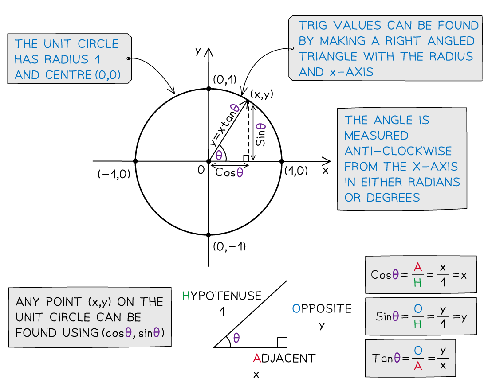
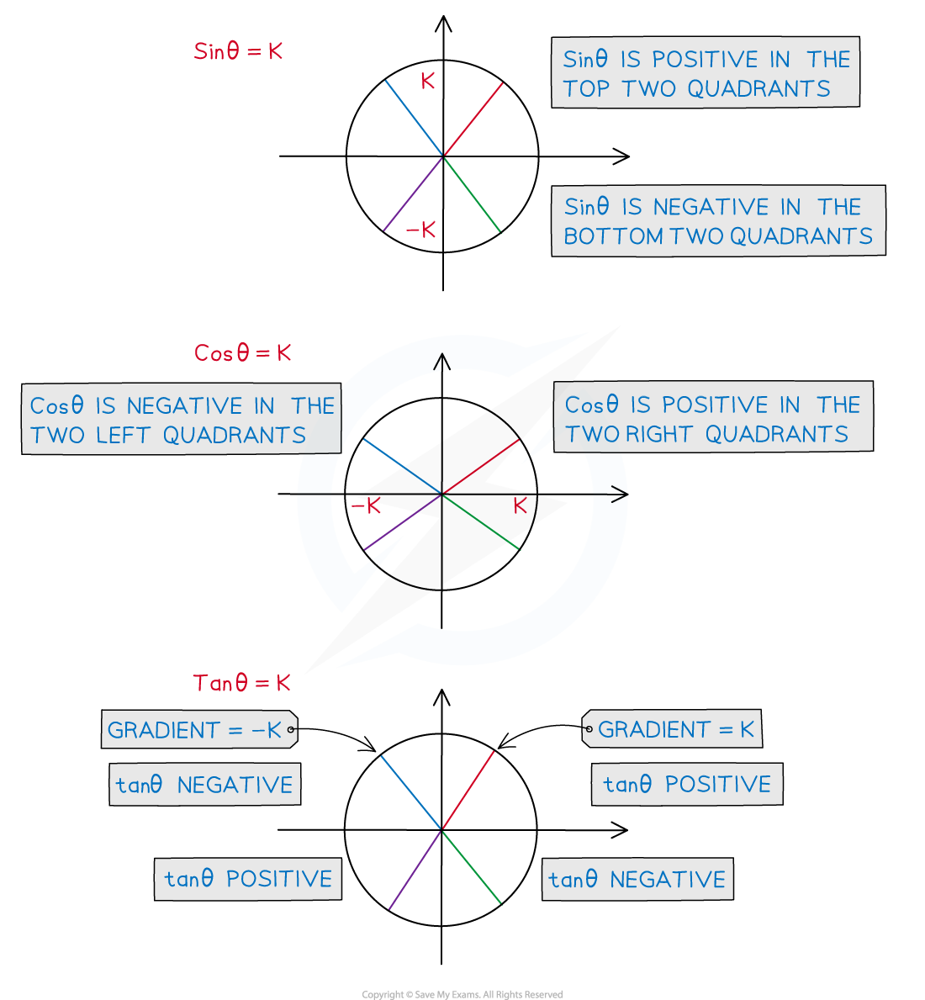

# The Unit Circle

## The Unit Circle

> **Spec point** — `spcpt_twB2NbY3p4vrrFJR`

## The unit circle

### What is the unit circle?

- The unit circle is a circle with radius 1 and centre (0, 0)
- The unit circle can be used to explain how trig functions work with angles that are **not acute**
- Angles are always measured from the positive x-axis and turn:

  - **anticlockwise **for **positive** angles
  - **clockwise** for **negative** angles
- It can be used to calculate trig values as a coordinate point (x, y) on the circle

  - Trig values can be found by making a right triangle with the radius as the hypotenuse
  - Where θ is the angle measured anticlockwise from the positive *x*-axis
  - The *x*-axis will always be adjacent to the angle, θ
- SOHCAHTOA can be used to find the values of sinθ, cosθ and tanθ easily
- As the radius is 1 unit

  - the ***x***** coordinate** gives the value of **cosθ**
  - the ***y***** coordinate** gives the value of **sinθ**
- As the origin is one of the end points - dividing the y coordinate by the x coordinate gives the gradient

  - the **gradient** of the line gives the value of **tanθ**
- It allows us to calculate sin, cos and tan for angles greater than 90° ($\frac{π}{2}$rad)

> **Worked Example**
> The coordinates of a point on a unit circle, to 3 significant figures, are (0.629, 0.777).
> 
> Find θ in radians correct to 2 significant figures..
> 
> 
> 
> > *We know that *$( x , y ) = ( \cos \\theta , \sin \\theta )$* so we can use either ratio to solve for  *$θ$*.*
> 
> $\begin{gathered} \cos \\theta & = 0.629 \\ \\theta & = \cos ^{- 1 } 0.629 \\ = 0.89053... \end{gathered}$
> 
> > *or*
> 
> $\begin{gathered} \sin \\theta & = 0.777 \\ \\theta & = \sin ^{- 1 } 0.777 \\ = 0.88988... \end{gathered}$
> 
> $θ=0.89\mathrm{rad}(2s.f.)$

## Using The Unit Circle

> **Spec point** — `spcpt_PY4kyrWsnz25RQjs`

## Using the unit circle

### What are the properties of the unit circle?

- The unit circle can be split into four **quadrants** at every 90° ($\frac{π}{2}$ rad)

  - The first quadrant is for angles between 0 and 90°
  
    - **A**ll three of Sinθ, Cosθ and Tanθ are positive in this quadrant
  - The second quadrant is for angles between 90° and 180° ($\frac{π}{2}$ rad and $π$ rad)
  
    - **S**inθ is positive in this quadrant
  - The third quadrant is for angles between 180° and 270° ($π$ rad and $\frac{3π}{2}$)
  
    - **T**anθ is positive in this quadrant
  - The fourth quadrant is for angles between 270° and 360° ($\frac{3π}{2}$ rad and $2π$)
  
    - **C**osθ is positive in this quadrant
  - Starting from the **fourth** quadrant (on the bottom right) and working anti-clockwise the positive trig functions spell out **CAST**
  
    - This is why it is often thought of as the **CAST** diagram
    - You may have your own way of remembering this
    - A popular one starting from the first quadrant is **All Students Take Calculus**
  - To help picture this better try sketching all three trig graphs on one set of axes and look at which graphs are positive in each 90° section

### How is the unit circle used to find secondary solutions?

- Trigonometric functions have **more than one input** to each output

  - For example sin 30° = sin 150° = 0.5
  - This means that trigonometric equations have **more than one solution**
  - For example both 30° and 150° satisfy the equation sin *x* = 0.5
- The unit circle can be used to find all solutions to trigonometric equations in a given interval

  - Your calculator will only give you the first solution to a problem such as *x* = sin-1(0.5)
  
    - This solution is called the **primary value**
  - However, due to the **periodic **nature of the trig functions there could be an infinite number of solutions
  
    - Further solutions are called the **secondary values**
  - This is why you will be given a **domain** in which your solutions should be found
  
    - This could either be in degrees or in radians
    - If you see π or some multiple of π then you must work in radians
- The following steps may help you use the unit circle to find **secondary values**

STEP 1: Draw the angle into the first quadrant using the *x* or *y *coordinate to help you

- If you are working with **sin** *x* = *k*, draw the line from the origin to the circumference of the circle at the point where the **y coordinate** is *k*
- If you are working with **cos** *x* = *k*, draw the line from the origin to the circumference of the circle at the point where the **x coordinate** is *k*
- If you are working with **tan** *x* = *k*, draw the line from the origin to the circumference of the circle such that the **gradient** of the line is *k*

  - This will give you the angle which should be measured from the **positive x-axis…**
  
    - … anticlockwise for a positive angle
    - … clockwise for a negative angle

STEP 2: Draw the radius in the other quadrant which has the same...

- *... ****x-*****coordinate** if* *solving **cos** *x *= *k*

  - This will be the quadrant which is vertical to the original quadrant
- *... ****y-*****coordinate** if* *solving **sin** *x *= k

  - This will be the quadrant which is horizontal to the original quadrant
- ... **gradient** if solving **tan** x = k

  - This will be the quadrant diagonal to the original quadrant

STEP 3: Work out the size of the second angle, measuring from the positive x-axis

- … anticlockwise for a positive angle
- … clockwise for a negative angle

  - You should look at the given range of values to decide whether you need the negative or positive angle

STEP 4: Add or subtract either 360° or 2π radians to both values until you have all solutions in the required range

> **Exam Hint**
> - Being able to sketch out the unit circle and remembering CAST can help you to find all solutions to a problem in an exam question

> **Worked Example**
> Given that one solution of cos*θ* = 0.8 is *θ *= 0.6435 radians correct to 4 decimal places, find all other solutions in the range -2π ≤ *θ *≤ 2*π*.  Give your answers correct to 3 significant figures.
> 
> > *Cosine is positive in the first and fourth quadrants so draw the angle from the horizontal axis in both quadrants. *
> 
> 
> 
> > *The primary value is 0.6435 and a secondary value is -0.6435.*
> 
> > *Consider all four possible angles that can be made from the horizontal axis to each of the lines drawn. The range is -2π ≤ **θ **≤ 2**π **so the angles can be in both the positive and negative direction. *
> 
> 
> 
> > *The angle in the positive direction to the line in the fourth quadrant is 2π - 0.6435 = 5.63968... The angle in the negative direction to the line in the first quadrant is -2π + 0.6435 = -5.63968...*
> 
> **Final answer:** **Solutions are -5.64, -0.644, 0.644, 5.64 rads (3 s.f.)**
