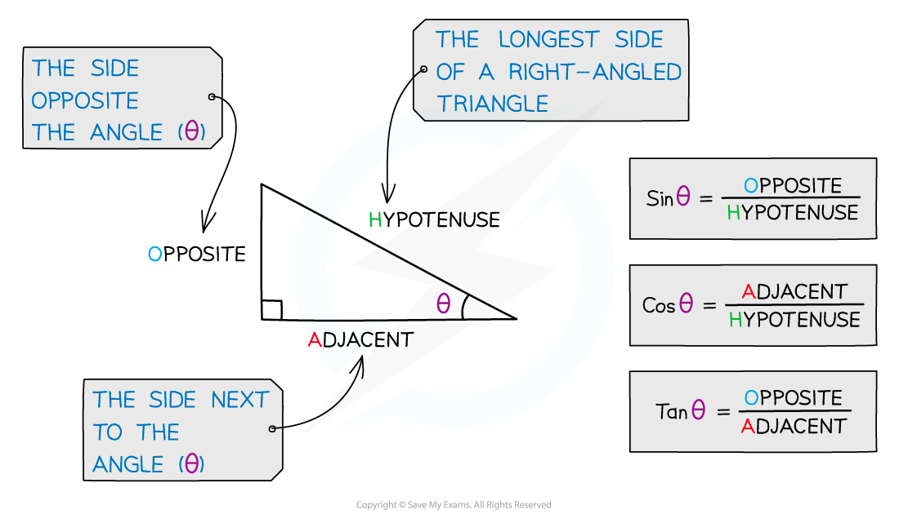
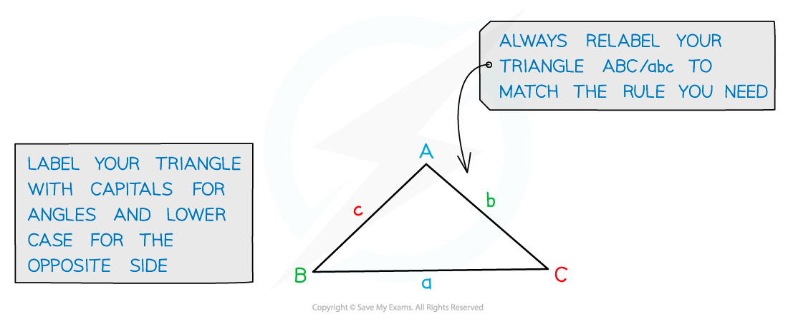
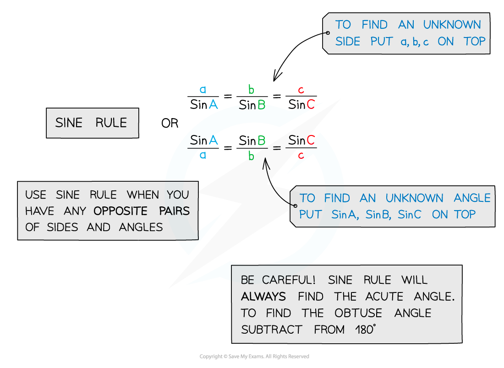
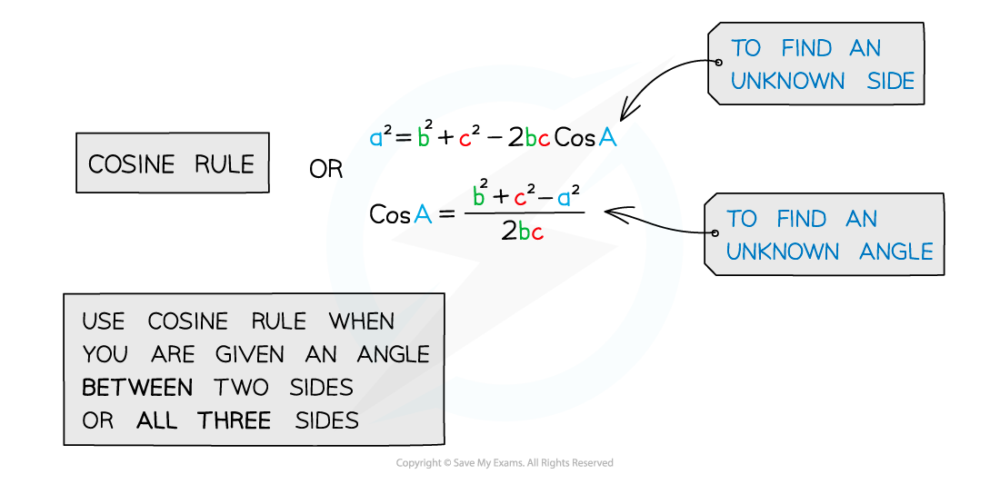
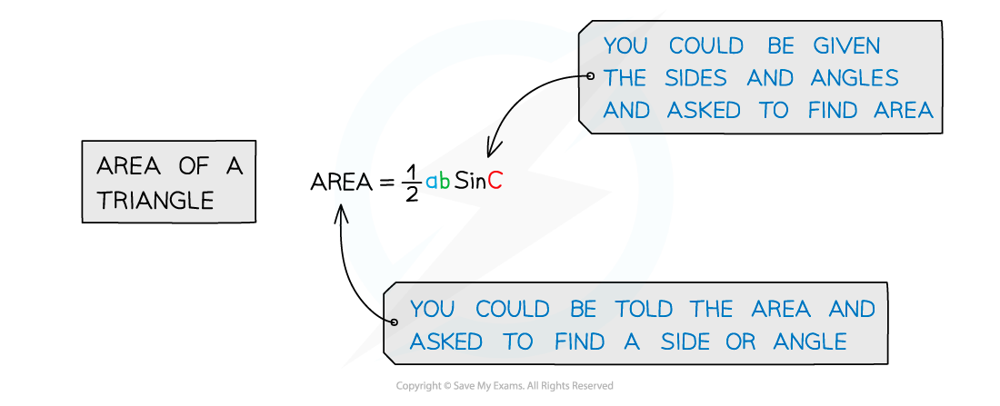

# Trigonometric Functions

## Trigonometric Functions

> **Spec point** — `spcpt_XDWys9bTRGXtjfF6`

## Trigonometric functions

### What are the trigonometric functions?

- The three standard trigonometric functions are: sine, cosine and tangent
- The functions are many-to-one mappings

  - They do not have inverses unless their domain is restricted

| **Function** | **Notation** | **Domain** | **Range** |
|---|---|---|---|
| Sine | $\sin ( x )$ | $x\inℝ$ | $- 1 \le \text{sin} ( x ) \le 1$ |
| Cosine | $\cos ( x )$ | $x\inℝ$ | $- 1 \le \text{cos} ( x ) \le 1$ |
| Tangent | $\tan ( x )$ | `x in real numbers | x !=+/- 90 deg ,+/- 270 deg ,+/- 450 deg ,... (in degrees) | x !=+/- π / 2 ,+/- (3π)/(2) ,+/- (5π)/(2) ,... (in radians)` | $\tan ( x ) \in \mathbb{R}$ |

### How can I use the trigonometric functions with right-angled triangles?

- The three trigonometric functions sine, cosine and tangent give the **ratios** of side lengths in right-angled triangles
- For an acute angle in a right-angled triangle:

  - **Sine** of the angle is the length of the side **opposite** the angle divided by the **hypotenuse**
  - **Cosine** of the angle is the length of the side **adjacent** to the angle divided by the **hypotenuse**
  - **Tangent** of the angle is the length of the **opposite** side divided by the length of the **adjacent** side
- You can use the acronym **SOHCAHTOA** to help you remember these

### How can I use the trigonometric functions with non-right-angled triangles?

- You can find missing angles and the lengths of missing sides using the **sine rule** and the **cosine rule**
- You can also use the **area formula**

## Reciprocal Trig Functions

> **Spec point** — `spcpt_N8PS5Sgsz8vCHW7q`

## Reciprocal trig functions

### What are the reciprocal trig functions?

- There are three reciprocal trig functions that each correspond to either sin, cos or tan

  - **Secant **(sec *x*)
  
    - $\sec x = \frac{1}{\cos x}$
  - **Cosecant **(cosec *x*)
  
    - $\text{cosec} x = \frac{1}{\sin x}$
  - **Cotangent** (cot *x*)
  
    - $\cot x = \frac{1}{\tan x }$
- A good way to remember which function is which is to look at the **third** letter in each of the reciprocal trig functions

  - co**t** *x* is 1 over **t**an *x* etc
- Each of the reciprocal trig functions are **undefined** for certain values of *x*

  - **sec ***x *is undefined for values of* x* for which **cos *****x***** = 0**
  - **cosec** *x* is undefined for values of *x* for which **sin *****x***** = 0**
  - **cot ***x *is undefined for values of* x* for which **tan *****x***** = 0**
  
    - When tan *x* is undefined, cot *x* = 0
- **Be careful** not to confuse the reciprocal trig functions with the inverse trig functions

  - $\sin ^{- 1} x \text{eq} \frac{1}{\sin x}$

> **Worked Example**
> Without the use of a calculator, find the values of
> 
> a) $\sec \frac{\pi }{6}$
> 
> > *The third letter of sec is c so it is the reciprocal of cos.*
> 
> `sec ( pi / 6 ) = (1)/(cos ( pi / 6 ))`
> 
> > *Write down the value of* `cos ( pi / 6 )`*.*
> 
> `sec ( pi / 6 ) = (1)/(( (sqrt( 3)/(2) ))`
> 
> > *Simplify.*
> 
> $\mathrm{sec}(\frac{π}{6})=\frac{2}{\sqrt{3}}\mathrm{or}\frac{2\sqrt{3}}{3}$
> 
> b) $\mathrm{cot}45^{\circ}$
> 
> > *The third letter of cot is t so it is the reciprocal of tan.*
> 
> $\cot ( 45^{\circ} ) = \frac{1}{\tan ( 45^{\circ} )}$
> 
> > *Write down the value of tan(45°).*
> 
> $\cot ( 45^{\circ} ) = \frac{1}{1}$
> 
> $\mathrm{cot}(45^{\circ})=1$
