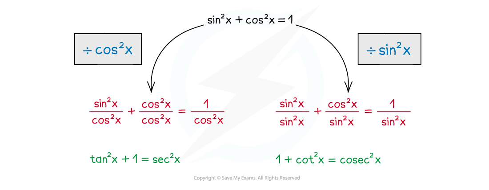

# Trigonometric Identities

## Simple Trig Identities

> **Spec point** — `spcpt_67PsY5NNcWyfFjqJ`

## Simple trig identities

### What is a trigonometric identity?

- Trigonometric identities are statements that are true for all values of $x$ or $θ$
- They are used to help simplify trigonometric equations before solving them
- Sometimes you may see identities written with the symbol ≡

  - This means 'identical to'

### What trigonometric identities do I need to know?

- The two trigonometric identities you must know are

  - $\mathrm{tan}θ=\frac{\mathrm{sin}θ}{\mathrm{cos}θ}$
  
    - This is the identity for tan *θ*
    - This formula does **not **appear in the list of formulae
  - $\mathrm{sin}^{2}θ+\mathrm{cos}^{2}θ=1$
  
    - This is the Pythagorean identity
    - Note that the notation $\mathrm{sin}^{2}θ$ is the same as $(\mathrm{sin}θ)^{2}$
    - This formula appears in the list of formulae
- Rearranging the second identity often makes it easier to work with

  - $\mathrm{sin}^{2}θ=1-\mathrm{cos}^{2}θ$
  - $\mathrm{cos}^{2}θ=1-\mathrm{sin}^{2}θ$

### Where do the trigonometric identities come from?

- You do not need to know the proof for these identities but it is a good idea to know where they come from
- From SOHCAHTOA we know that

  - $\mathrm{sin}θ=\frac{\mathrm{opposite}}{\mathrm{hypotenuse}}=\frac{O}{H}$
  - $\mathrm{cos}θ=\frac{\mathrm{adjacent}}{\mathrm{hypotenuse}}=\frac{A}{H}$
  - $\mathrm{tan}θ=\frac{\mathrm{opposite}}{\mathrm{adjacent}}=\frac{O}{A}$
- The identity for $\mathrm{tan}θ$ can be seen by* *diving $\mathrm{sin}θ$ by $\mathrm{cos}θ$?

  - $\frac{\mathrm{sin}θ}{\mathrm{cos}θ}=\frac{\frac{O}{H}}{\frac{A}{H}}=\frac{O}{A}=\mathrm{tan}θ$
- This can also be seen from the unit circle by considering a right-triangle with a hypotenuse of 1

  - $\mathrm{tan}θ=\frac{O}{A}=\frac{\mathrm{sin}θ}{\mathrm{cos}θ}$
- The Pythagorean identity can be seen by considering a right-triangle with a hypotenuse of 1

  - Then (opposite)2 + (adjacent)2 = 1
  - Therefore $\mathrm{sin}^{2}θ+\mathrm{cos}^{2}θ=1$
- Considering the equation of the unit circle also shows the Pythagorean identity

  - The equation of the unit circle is $x^{2}+y^{2}=1$
  - The coordinates on the unit circle are $(\mathrm{cos}θ,\mathrm{sin}θ)$
  - Therefore the equation of the unit circle could be written $\mathrm{cos}^{2}θ+\mathrm{sin}^{2}θ=1$

### How are the trigonometric identities used?

- Most commonly trigonometric identities are used to change an equation into a form that allows it to be solved
- They can also be used to prove further identities

> **Exam Hint**
> - If you are asked to show that one thing is identical (≡) to another, look at what parts are missing
> 
>   - For example, if tan x has gone it must have been substituted

> **Worked Example**
> Show that the equation $2\mathrm{sin}^{2}x-\mathrm{cos}x=0$ can be written in the form $a\mathrm{cos}^{2}x+b\mathrm{cos}x+c=0$, where $a$, $b$ and $c$ are integers to be found.
> 
> > *Substitute *$\mathrm{sin}^{2}x=1-\mathrm{cos}^{2}x$* into the equation to form a quadratic in terms of *$\mathrm{cos}x$*.*
> 
> `2 open parentheses 1 minus cos squared x close parentheses minus cos x equals 0`
> 
> > *Expand the bracket.*
> 
> $2-2\mathrm{cos}^{2}x-\mathrm{cos}x=0$
> 
> > *Rewrite in the required form.*
> 
> $2\mathrm{cos}^{2}x+\mathrm{cos}x-2=0$
> 
> **or**
> 
> $-2\mathrm{cos}^{2}x-\mathrm{cos}x+2=0$

## Further Trig Identities

> **Spec point** — `spcpt_S7Xk8ZTCxJCCFDHV`

## Further trig identities

### What are the identities linking tan, sec, cot, and cosec?

- Aside from the Pythagorean identity sin2*x *+ cos2*x* = 1** **there are two further Pythagorean identities you will need to learn

  - `1 plus tan squared space invisible function application theta equals sec squared space invisible function application theta`
  - `1 plus cot squared space invisible function application theta equals cosec squared space invisible function application theta`
  - Both can be found in the list of formulae
- Both of these identities can be derived from sin2*x *+ cos2*x* = 1** **

  - To derive the identity for **sec****2*****x*** divide sin2*x *+ cos2*x* = 1** **by **cos****2*****x***
  - To derive the identity for **cosec****2*****x ***divide sin2*x *+ cos2*x* = 1** **by **sin****2*****x***

### How do I prove new trigonometric identities?

- You can use trigonometric identities you already know to prove new identities
- To prove an identity start on one side and proceed step by step until you get to the other side

  - It is more common to start on the left hand side but you can start a proof from either end
  - Occasionally it is easier to show that one side subtracted from the other is zero
  - You should not work on both sides simultaneously

- Look for anything that could be a part of one of the above identities on either side

  - For example if you see $\mathrm{sin}^{2}θ$ you can replace it with $1-\mathrm{cos}^{2}θ$
- Look for ways of reducing the number of different trigonometric functions there are within the identity

  - For example if the identity contains tan θ, cot θ and cosec θ you could try
  
    - Using the identities tan θ = 1/cot θ and 1 + cot2 θ = cosec2 θ to write it all in terms of cot θ
    - Or rewriting it all in terms of sin θ and cos θ and simplifying
- Often you may need to trial a few different methods before finding the correct one
- Always keep an eye on the 'target' expression – this can help suggest what identities to use

> **Exam Hint**
> - Writing down all the identities you know can be a good way to spot how to get started on a question

> **Worked Example**
> Solve the equation 9 sec2 *θ *– 11 = 3 tan *θ* in the interval 0 ≤ *θ *≤ 2π. Give your answers to three decimal places.
> 
> > *The squared term can be rewritten using the identity *$\mathrm{sec}^{2}θ=1+\mathrm{tan}^{2}θ$*. Substitute this into the equation.*
> 
> `9 open parentheses 1 plus tan squared theta close parentheses minus 11 equals 3 tan theta`
> 
> > *Rearrange to form a quadratic.*
> 
> $9+9\mathrm{tan}^{2}θ-11=3\mathrm{tan}θ\,9\mathrm{tan}^{2}θ-3\mathrm{tan}θ-2=0$
> 
> > *Treat as a quadratic using *$x=\mathrm{tan}θ$*.*
> 
> `9 x squared minus 3 x minus 2 equals 0
> open parentheses 3 x minus 2 close parentheses open parentheses 3 x plus 1 close parentheses equals 0
> x equals 2 over 3 comma space x equals negative 1 third`
> 
> > *Substitute *$x=\mathrm{tan}θ$* back in and find the principal value for each equation.*
> 
> `tan theta equals 2 over 3 rightwards arrow tan to the power of negative 1 end exponent open parentheses 2 over 3 close parentheses equals 0.5880...
> tan theta equals negative 1 third rightwards arrow tan to the power of negative 1 end exponent open parentheses negative 1 third close parentheses equals negative 0.3217...`
> 
> > *Find the other solutions in the interval by adding multiples of π.*
> 
> `straight pi plus 0.5880... equals 3.7295...
> straight pi plus open parentheses negative 0.3217... close parentheses equals 2.8198...
> 2 straight pi plus open parentheses negative 0.3217... close parentheses equals 5.9614...`
> 
> > *Ignore the solution that is outside the interval (-0.3217...). Round the other four to three decimal places.*
> 
> $θ=0.588,2.820,3.730,5.961$
