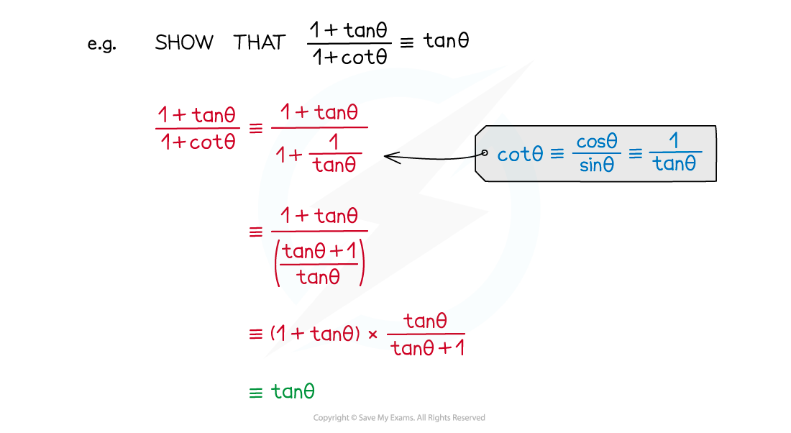

# Trigonometric Proof

## Trigonometric Proof

> **Spec point** — `spcpt_9wdm8dH4bQQbc97k`

## Trigonometric proof

### Proving trigonometric identities

- You can use trigonometric identities you already know to prove new identities
- Make sure you know the **simple trigonometric identities** and **further trigonometric identities**

  - $\mathrm{sin}^{2}θ+\mathrm{cos}^{2}θ=1$
  - $\frac{\mathrm{sin}θ}{\mathrm{cos}θ}=\mathrm{tan}θ$
  - $1+\mathrm{tan}^{2}θ=\mathrm{sec}^{2}θ$
  - $1+\mathrm{cot}^{2}θ=\mathrm{cosec}^{2}θ$
- To prove an identity start on one side and proceed step by step until you get to the other side

  - e.g. to prove that `open parentheses sin theta plus cos theta close parentheses squared equals 1 plus 2 sin theta cos theta`
  - Start with the left hand side, and expand
  
    - $\mathrm{sin}^{2}θ+\mathrm{cos}^{2}θ+2\mathrm{sin}θ\mathrm{cos}θ$
  - Simplify using the identity $\mathrm{sin}^{2}θ+\mathrm{cos}^{2}θ=1$
  
    - $1+2\mathrm{sin}θ\mathrm{cos}θ$
  - This is now equal to the expression on the right, so the statement has been proven

- Make sure you are confident handling fractions and fractions-within-fractions

- Always keep an eye on the 'target' expression – this can help suggest what identities to use

> **Exam Hint**
> - Don't forget that you can start a proof from either side – sometimes it might be easier to start with a particular side
> 
>   - If you get stuck - try starting from the other side instead!

> **Worked Example**
> Prove that:
> 
> `sec squared space x open parentheses cot squared space x minus cos squared space x close parentheses equals cot to the power of 2 space end exponent x`
> 
> > *Use the definitions of *$\mathrm{sec}x=\frac{1}{\mathrm{cos}x}$* and *$\mathrm{cot}x=\frac{1}{\mathrm{tan}x}=\frac{\mathrm{cos}x}{\mathrm{sin}x}$*, to rewrite the left hand side*
> 
> `fraction numerator 1 over denominator cos squared italic space x end fraction open parentheses fraction numerator cos squared space x over denominator sin squared space x end fraction space minus space cos squared space x close parentheses`
> 
> > *Expand the brackets, using the fact that multiplying by *$\frac{1}{\mathrm{cos}^{2}x}$* is the same as dividing by *$\mathrm{cos}^{2}x$
> 
> $\frac{1}{\mathrm{sin}^{2}x}-1$
> 
> > *Use the definition of *$\mathrm{cosec}x=\frac{1}{\mathrm{sin}x}$* to rewrite the expression*
> 
> $\mathrm{cosec}^{2}x-1$
> 
> > *Use the identity *$1+\mathrm{cot}^{2}x=\mathrm{cosec}^{2}x$* to rewrite the expression*
> 
> $1+\mathrm{cot}^{2}x-1$
> 
> > *Simplify to achieve the right hand side*
> 
> $\mathrm{cot}^{2}x$
