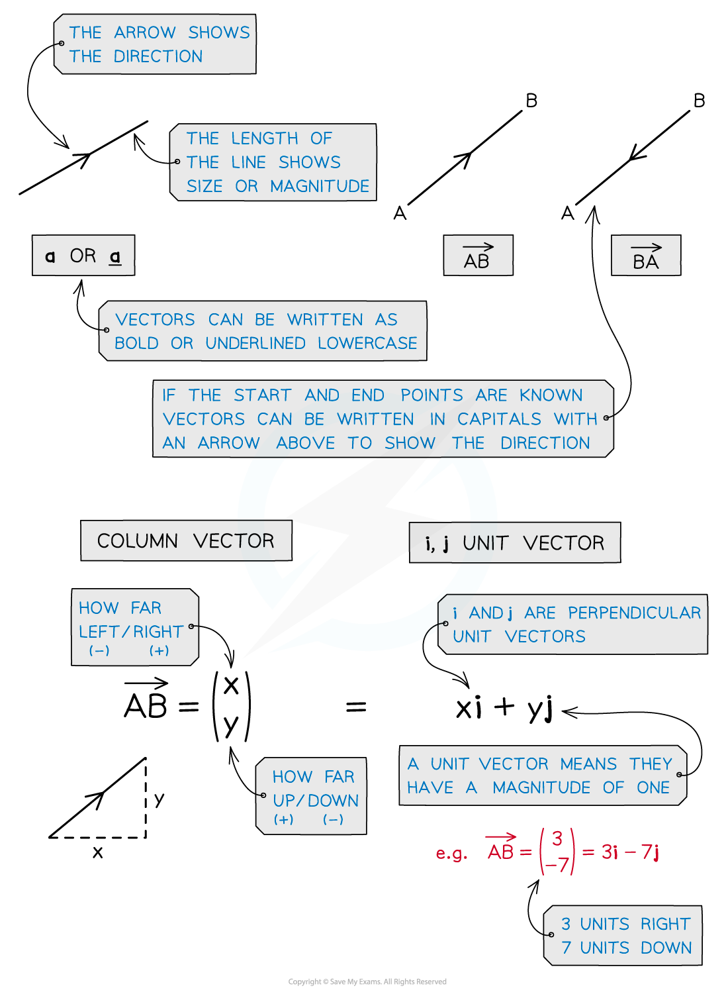
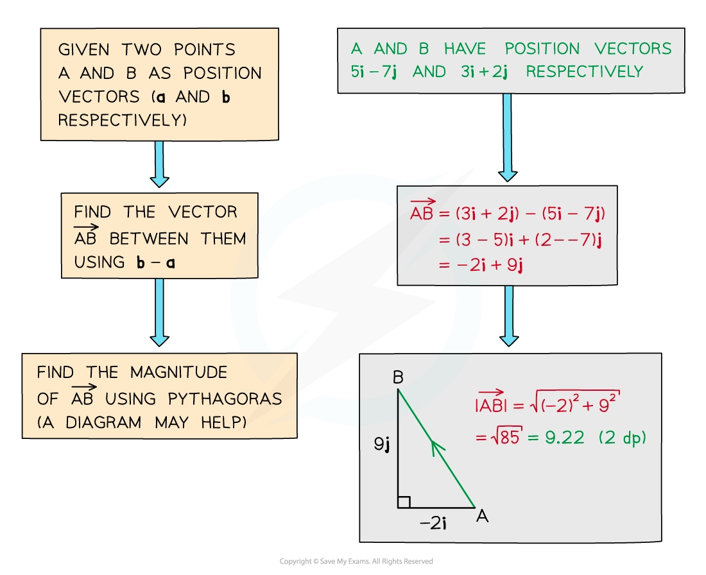

# Introduction to Vectors

## Basic Vectors

> **Spec point** — `spcpt_Gn4BvbNhMZGX7ZXM`

## Basic vectors

### What is a vector?

- Vectors represent a movement of a certain **magnitude** (size) in a given **direction**

  - For example: two objects with **velocities** of 7 m/s and ‑7 m/s are travelling at the **same speed** but in **opposite** **directions**
- You should have already come across **vectors** when translating functions of graphs
- They appear in many contexts of maths including **mechanics** for modelling forces
- A** **vector in two directions** **has** components **in the direction of the *x-* and *y-* axes

  - Vector quantities can have **positive **or** negative **components
- Vectors can be represented in different ways such as a **column vector** or as an **i** and **j** unit vector
- Some examples of vector quantities you may come across are **displacement**, **velocity **or **acceleration**

> **Exam Hint**
> - Think of vectors like a journey from one place to another
> - Diagrams can help, if there isn’t one, draw one
> - In your exam you can’t write in **bold **so should <u>underline</u> your vector notation

> **Worked Example**
> 
> 
> 

## Magnitude of a Vector

> **Spec point** — `spcpt_h8zq2Wx95W5M7kZB`

## Magnitude of a vector

### How do you find the magnitude of a vector?

- The **magnitude **of a vector tells us its **size **or **length**
- The magnitude of the vector $\overset{\rightarrow}{\mathrm{AB}}$ is denoted $\left| A \vec{B} \right|$

  - The magnitude of the vector **a** is denoted |**a**|
- The magnitude of a vector can be found using  *Pythagoras’ theorem*
- The magnitude of a vector $v=v_{1}i+v_{2}j$ is found using

  - $\left| v \right| = \sqrt{v_{1}^{ 2} + v_{2}^{ 2} }$
  - where $v = ( \begin{gathered} v_{1} \\ v_{2} \end{gathered} )$

### What is a unit vector?

- A **unit vector** has a **magnitude** of 1
- The vectors $i$ and $j$ are unit vectors

  - the direction of $i$ is in the positive $x$-direction
  - the direction of $j$ is in the positive $y$-direction
- To find a unit vector in the direction of a given vector **divide** the **vector** by its **magnitude**

> **Exam Hint**
> - Finding the magnitude of a vector is the same as finding the distance between two coordinates
> 
>   - Commit the formula to memory and be prepared to use it in the exam

> **Worked Example**
> A vector $\vec{XY} = ( \begin{gathered} - 12 \\ 5 \end{gathered} )$.
> 
> a) Find $\vert \vec{XY} \vert$.
> 
> > $\vert \vec{XY} \vert$* is the magnitude of the vector, so use Pythagoras' theorem.*
> 
> $\vert \vec{XY} \vert = \sqrt{12^{2} + 5^{2}} = \sqrt{169}$
> 
> $\vert \vec{XY} \vert = 13$
> 
> b) Find the unit vector in the direction of $\overset{\rightarrow}{XY}$.
> 
> > *For a unit vector, divide the vector *$\overset{\rightarrow}{XY}$* by its magnitude, which was found in part (a).*
> 
> $\frac{\vec{XY}}{\vert \vec{XY} \vert} = \frac{- 12 i + 5 j}{13} = - \frac{12}{13} i + \frac{5}{13} j$
> 
> **The unit vector in the direction of **$\overset{\rightarrow}{XY}$** is **$( \begin{gathered} \text{bevelled} \frac{- 12}{13} \\ \text{bevelled} \frac{5}{13} \end{gathered} )$**.**

## Position Vectors

> **Spec point** — `spcpt_dZM7H7pcBzmvwZnf`

## Position vectors

### What is a position vector?

- Position vectors describe the **position of a point** in relation to the *origin*
- They are different to **displacement vectors** which describe the **direction and distance** between any two points
- The position vector of point A is written with the notation **a** = $\overset{\rightarrow}{\mathrm{OA}}$

  - The origin is always denoted O
- The individual components of a position vector are the coordinates of its end point

  - For example the point with coordinates (3, -2) has position vector 3**i **– 2**j**

### How do I find the distance between two points using vectors?

- The distance between two points is the **magnitude** of the vector between them

#### How do I find the magnitude of a displacement vector?

- You can use **coordinate geometry** to find **magnitudes **of **displacement vectors** from *A * to *B*

  - From the **position vectors** of *A*  and *B*  you know their coordinates
  
    - If  $a = \vec{OA} = x_{1} i + y_{1} j = ( \begin{gathered} x_{1} \\ y_{1} \end{gathered} )$,  then point A has coordinates $( x_{1} , y_{1} )$
    - If  $b = \vec{OB} = x_{2} i + y_{2} j = ( \begin{gathered} x_{2} \\ y_{2} \end{gathered} )$,  then point B has coordinates $( x_{2} , y_{2} )$
  - The **distance** between two points is given by $d = \sqrt{( x_{1} - x_{2} )^{2} + ( y_{1} - y_{2} )^{2}}$
  
    - So  $\left| \vec{AB} \right| = \sqrt{( x_{1} - x_{2} )^{2} + ( y_{1} - y_{2} )^{2}}$
  - For example, if points A and B have position vectors $5i+3j$ and $3i-6j$ respectively
  
    - then  $\left| \vec{AB} \right| = \sqrt{( 5 - 3 )^{2} + ( 3 - ( - 6 ) )^{2}} = \sqrt{85} = 9.22 ( 3 \mathrm{s} . \mathrm{f} . )$

- Alternatively, you could find $\left| \vec{AB} \right|$ by

  - first using  $\overset{\rightarrow}{AB}=-\overset{\rightarrow}{OA}+\overset{\rightarrow}{OB}$ to find $\overset{\rightarrow}{AB}$ in **vector form**
  
    - and then calculating its **magnitude** directly
  - See the Worked Example below

> **Exam Hint**
> - Remember if asked for a position vector, you must find the vector all the way from the origin
> - Diagrams can help, if there isn’t one, draw one

> **Worked Example**
> 
