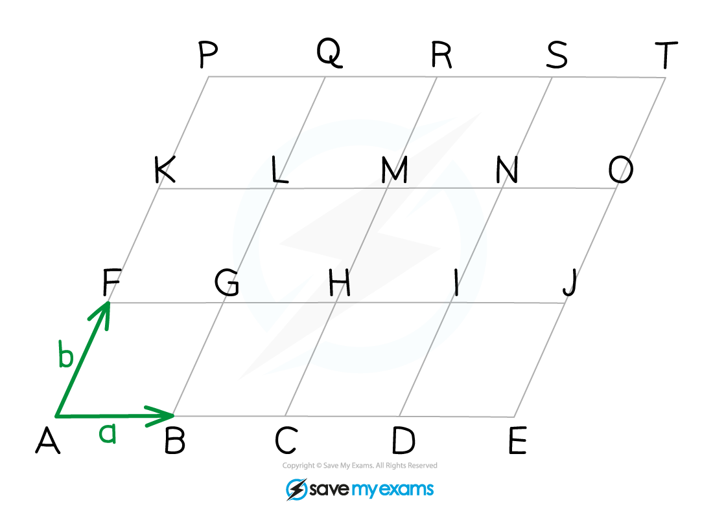

# Problem Solving using Vectors

## Problem Solving using Vectors

> **Spec point** — `spcpt_6t7nbbZn4Vvm55Gd`

## Problem-solving using vectors

### What problems may I be asked to solve involving vectors?

- Showing that two lines or vectors are **parallel**

  - Two vectors are parallel if they are scalar multiples of each other
  - i.e.  $a=kb$ where $k$ is a constant
  
    - See **Vector Addition**
- Finding the **midpoint** of two (position) vectors
- Showing that three points are **collinear**

  - **Collinear **describes points that lie on the same **straight line**
  
    - e.g.  The points `open parentheses negative 2 comma space minus 2 close parentheses comma space open parentheses 3 comma space 3 close parentheses` and `open parentheses 8 comma space 8 close parentheses` all lie on the line with equation $y=x$
    - Vectors can be used to show this, and similar, results
- Results concerned with **geometric shapes**

  - Shapes with **parallel lines** are often involved
  
    - e.g.  **parallelogram, rhombus**
  - These often include lines or vectors being split into *ratios*
  
    - e.g.  The point $Q$ lies on the line $PR$ such that $\overset{\rightarrow}{PQ}:\overset{\rightarrow}{QR}=3:1$

### How do I find the midpoint of two vectors?

- If the point $A$ has position vector $a$ and the point $B$ has position vector $b$

  - the **position vector **of the **midpoint **of $AB$ is `1 half open parentheses bold a plus bold b close parentheses`
- This can be derived by considering

  - $\overset{\rightarrow}{AB}=b-a$
  
    - using the result from **Vector Addition**
  - If $M$ is the midpoint of $AB$ then
  
    - $\overset{\rightarrow}{AM}=\frac{1}{2}\overset{\rightarrow}{AB}$
  - Therefore, the position vector of the midpoint, $\overset{\rightarrow}{OM}$ is
  
    - `stack O M with rightwards arrow on top equals stack O A with rightwards arrow on top plus stack A M with rightwards arrow on top equals bold a plus 1 half open parentheses bold b minus bold a close parentheses` `stack O M with rightwards arrow on top equals 1 half open parentheses bold a plus bold b close parentheses`

### How do I show three points are collinear?

- Three points are collinear if they all** **lie on the** same straight line**
- There are two ways to show this for three points, $A,B$ and $C$ say

  - *Method 1 *Show that $\overset{\rightarrow}{AB}=k\overset{\rightarrow}{AC}$ where $k$ is a constant i.e.  show that $\overset{\rightarrow}{AB}$ and $\overset{\rightarrow}{AC}$ are **scalar multiples** of each other
  
    - As the vectors are scalar multiples they will have the **same direction** (and so be **parallel)**
    - So as both vectors start at point $A$, they must be **collinear**
  - *Method 2 *Show that $\overset{\rightarrow}{AB}=k\overset{\rightarrow}{BC}$  **AND**  that point $B$ lies on both the vectors $\overset{\rightarrow}{AB}$ and $\overset{\rightarrow}{BC}$
- Which method you should use will depend on the information given and how you happen to see the question

### How do I solve problems involving geometric shapes?

- Problems involving **geometric shapes** involve finding paths around the shape using **known vectors**

  - there will be many other vectors in the shape that are **equal** and/or **parallel** to the known vectors
- The following grid is made up entirely of **parallelograms,** with the vectors $a$ and $b$ defined as marked in the diagram:

- Note the difference between "specific" and "general" vectors

  - The vector $\overset{\rightarrow}{AB}$ in the diagram is specific and refers only to the vector starting at $A$ and ending at $B$
  
    - However, the vector $a$ is a general vector
    
      - any vector the **same length** as $\overset{\rightarrow}{AB}$ and parallel to it is equal to $a$
      - e.g.  $\overset{\rightarrow}{RS}=a$
    - Vector $b$ is also a general vector
    
      - e.g.  $\overset{\rightarrow}{GL}=b$
  - There will also be vectors in the diagram that are the same magnitude but have the opposite direction to $a$ or $b$
  
    - e.g.  $\overset{\rightarrow}{ON}=-a,\overset{\rightarrow}{JE}=-b$
- There are also many instances of the vector addition result $\overset{\rightarrow}{FB}=b-a$

  - e.g.  $\overset{\rightarrow}{PL}=b-a$
- There are many **scalar multiples** of the vectors $a$ or $b$

  - e.g.  $\overset{\rightarrow}{FI}=3a,\overset{\rightarrow}{IS}=2b,\overset{\rightarrow}{QE}=3(b-a)$
- Using a combination of these it is possible to describe a vector between any two points in terms of $a$ and $b$

> **Exam Hint**
> - Diagrams are helpful in vector questions
> 
>   - If a diagram has been given, label it and add to it as you progress through a question
>   - If a diagram has not been given, draw one, it does not need to be accurate!

> **Worked Example**
> The following diagram consists of a grid of identical parallelograms.
> 
> Vectors $a$* *and $b$*** ***are defined by $a=\overset{\rightarrow}{AB}$ and $b=\overset{\rightarrow}{AF}$.
> 
> 
> 
> Write the following vectors in terms of $a$ and $b$.
> 
> a) $\overset{\rightarrow}{AE}$
> 
> > *To get from **A **to **E **follow vector *$a$* **four times (to the right).*
> 
> > * *
> 
> `table row cell stack A E with rightwards arrow on top space end cell equals cell space stack A B with rightwards arrow on top plus stack B C with rightwards arrow on top plus space stack C D with rightwards arrow on top plus stack D E with rightwards arrow on top end cell row blank equals cell space bold italic a plus bold a plus bold a plus bold a end cell end table`
> 
> > * *
> 
> **Final answer:** $\overset{\rightarrow}{AE}=4a$** **
> 
> b) $\overset{\rightarrow}{GT}$
> 
> > *There are many ways to get from** G** to **T. **One option is to go from **G **to **Q **(*$b$* **twice), and then from **Q **to **T **(*$a$* three times).*
> 
> > * *
> 
> `table row cell stack G T with rightwards arrow on top end cell equals cell stack G L with rightwards arrow on top plus stack L Q with rightwards arrow on top plus stack Q R with rightwards arrow on top plus stack R S with rightwards arrow on top plus stack S T with rightwards arrow on top end cell row blank equals cell bold b plus bold b plus bold a plus bold a plus space bold a end cell end table`
> 
> > * *
> 
> $\overset{\rightarrow}{GT}=3a+2b$
> 
> > * *
> 
> c) Point $Z$ is such that it is midpoint of $HM$. 
> Find the vector $\overset{\rightarrow}{PZ}$.
> 
> > *There are many ways to get from** P** to **Z**. *
> *One option is to go from **P **to **R **(*$a$* **twice), and then from **R **to Z** **(*$-b$* one-and-a-half times).*
> 
> > * *
> 
> `table row cell stack P Z with rightwards arrow on top end cell equals cell stack P R with rightwards arrow on top plus stack R Z with rightwards arrow on top space space end cell row blank equals cell bold a plus bold a minus bold b minus 1 half bold b end cell end table`
> 
> > * *
> 
> $\overset{\rightarrow}{PZ}=2a-\frac{3}{2}b$
