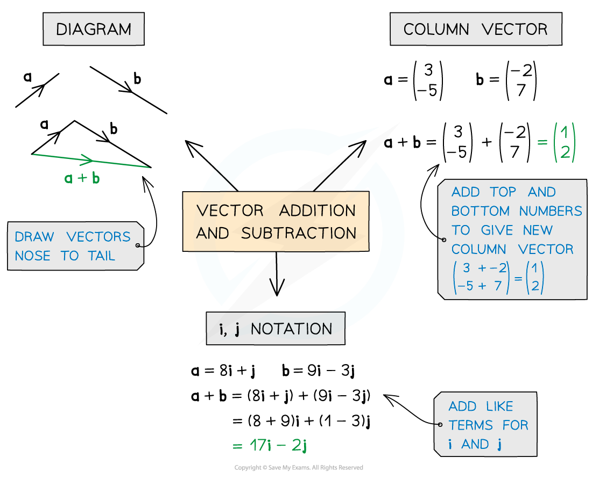
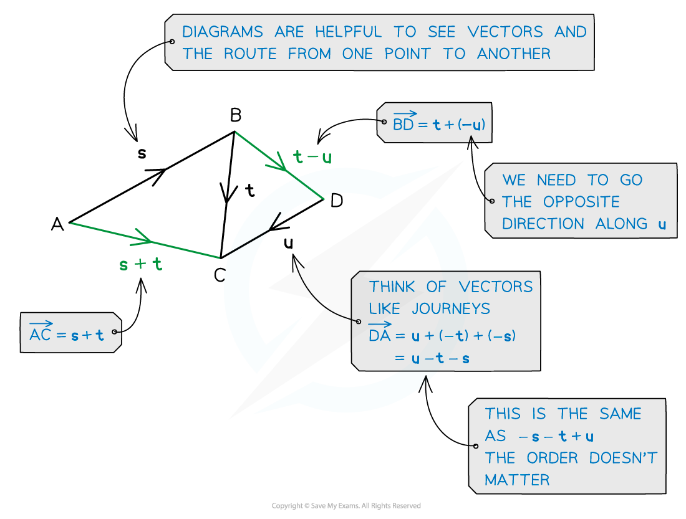

# Vector Addition

## Vector Addition

> **Spec point** — `spcpt_FmGc8J5VsdvQDDCP`

## Vector addition

### What is vector addition?

- **Adding** vectors together lets us describes the **movement between two points**
- To **add** or **subtract **vectors numerically simply add or subtract each of the corresponding components
- In **column vector** notation just add the top, middle and bottom parts together

  - For example: $( \frac{2}{1} ) - ( 1 \frac{1}{4} ) = ( \frac{1}{- 3} )$
- In **base vector** notation add each of the **i **and **j** components together separately

  - For example: (2**i **+ **j**)** **– (**i** + 4**j**) = (**i** – 3**j)**

- Adding vectors creates a **single** vector which is called the **resultant vector**

  - The **resultant** vector will be the shortest route from the start of the first vector to the end of the second
- **Subtracting** a vector is the same as **adding a negative** vector
- Adding the vectors** PQ **and **QP **gives the zero vector, denoted by a bold zero **0 **(0 in handwriting)

### What are scalars and parallel vectors?

- Two vectors are **parallel** if and only if one is a **scalar multiple** of the other

  - i.e both **components** of the vector have been **multiplied** by the **same constant**
- Multiplying a vector by a **positive scalar** changes the **magnitude** (size) but **not** its **direction**
- Multiplying a vector by a **negative scalar** changes the magnitude and the **direction** would be **reversed**

### How do I find the vector between two points?

- If, relative to the origin $O$, the points $A$ and $B$ have **position vectors**

  - $\overset{\rightarrow}{OA}=a$
  - $\overset{\rightarrow}{OB}=b$

then

- $\overset{\rightarrow}{AB}=\overset{\rightarrow}{AO}+\overset{\rightarrow}{OB}=-\overset{\rightarrow}{OA}+\overset{\rightarrow}{OB}=-a+b=b-a$
- Similarly, $\overset{\rightarrow}{BA}=\overset{\rightarrow}{BO}+\overset{\rightarrow}{OA}=a-b$
- This result is particularly useful when working with **position vectors** (as the 'journey' can always go via the origin)

  - but the result applies to any set of three vectors

> **Exam Hint**
> - Think of vectors like a journey from one place to another
> 
>   - You may have to take a detour eg. A to B might be A to O then O to B.
> - Diagrams can help, so if there isn’t one, draw one
> 
>   - If there are any, labelling parallel vectors will help

> **Worked Example**
> 
