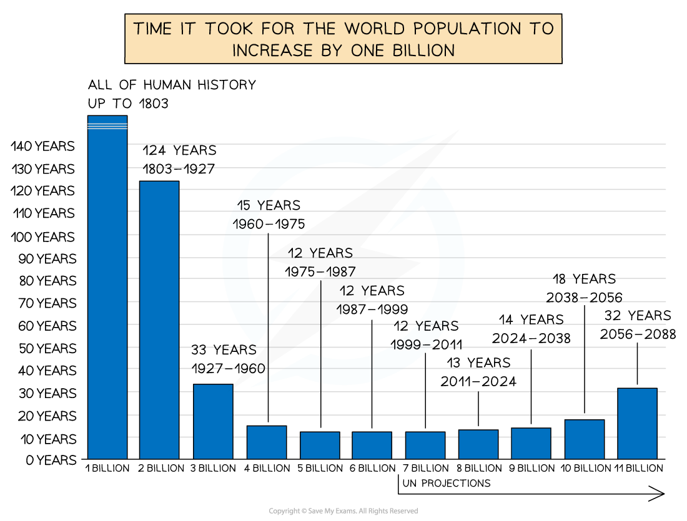
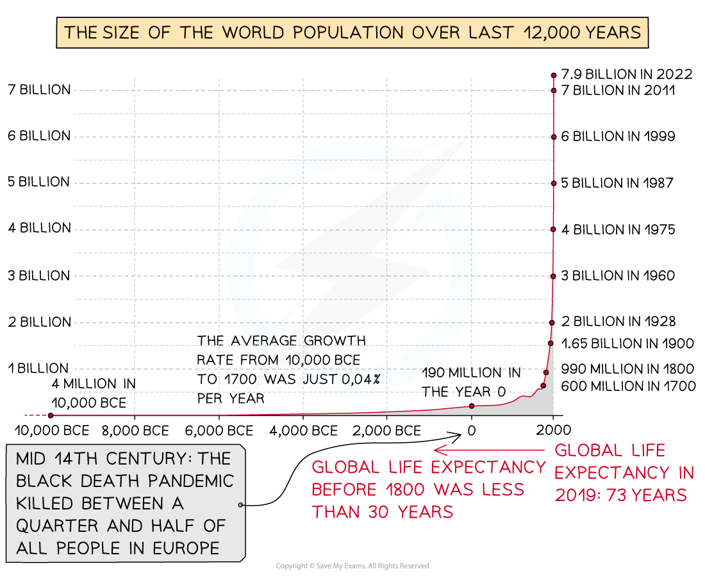
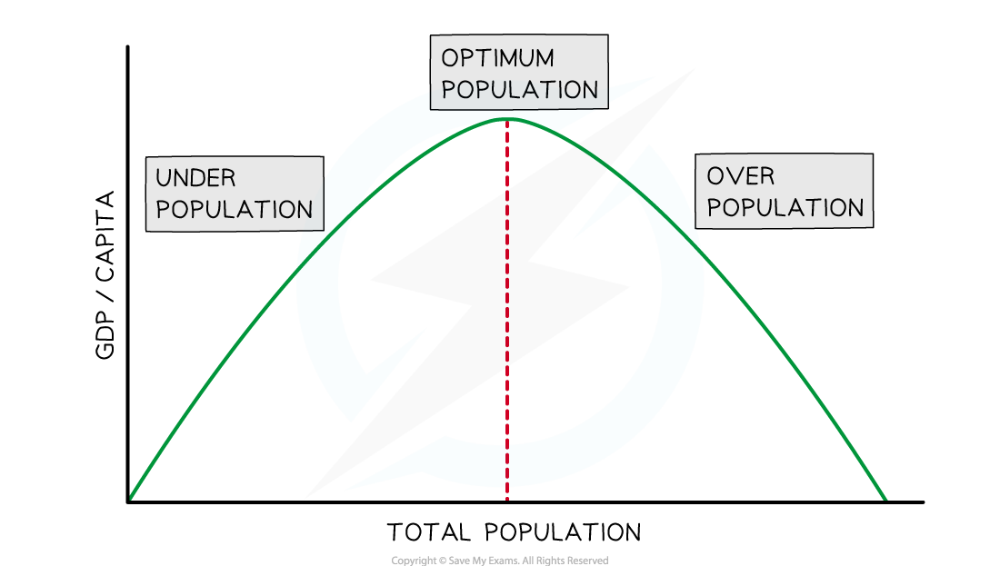
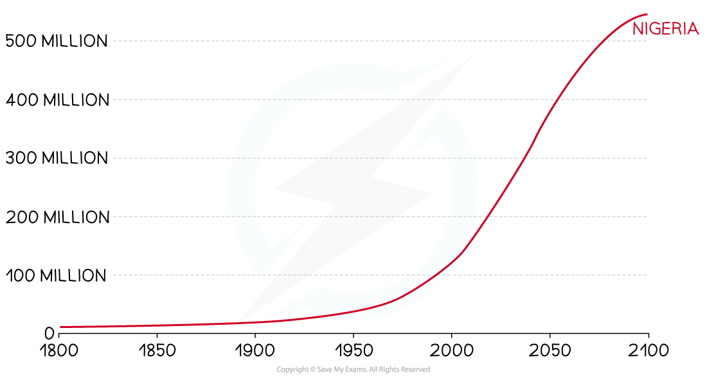

# Population

## Population Increase

> **Spec point** — `spcpt_R85qFn6mj4FCRMkM` · Describe & give reasons for the rapid increase in the world's population

## Population Increase

- Nearly 80 million people are added to the world's population each year
- Population growth was steady and low until 1804, when the world population reached 1 billion
- After 1804, it took just over 100 years for the population to double to 2 billion

> **Exam Hint**
> The exam may ask you to describe population change on a graph. Remember to consider the following points:
> 
> - What is the main trend? Is it:
> 
>   - increasing
>   - decreasing
>   - staying about the same
> - Has the change been rapid or slow?
> - Have changes occurred during specific times?
> - Are there any *anomalies*?
> - Don't forget to use figures from the graph

- The rate of increase after 1930 was more rapid and led to a ***population explosion***
- The fastest increase in population happened during the 1980s and 1990s
- **Population growth rate **is the average annual change of the population size during a set period of time, usually a year

  - The population is still increasing but at a slower rate
  - In 1970, the growth rate was 2%
  - In 2022, the growth rate is under 1%
- It is predicted by the UN that the population will stabilise at around 11 billion in 2100

> **Exam Hint**
> Population increase is not the same as the population growth rate. Population can increase at different rates. The **rate** at which it is increasing is known as the **population growth rate.**

## Overpopulation & Underpopulation

> **Spec point** — `spcpt_VHpRfbYkKTj5JwDJ` · Show an understanding of over-population & underpopulation

## Overpopulation & Underpopulation

- Every area has a ***carrying capacity*** this is the number of people that an area can support

  - **Overpopulation **occurs when there are more people in an area than can be supported by its resources and technology
  - **Underpopulation** occurs when there are more resources available than the population can use effectively
- Overpopulation can lead to increased:

  - levels of pollution
  - crime rates
  - unemployment or ***underemployment***
  - levels of food and water shortages
  - pressure on services such as hospitals and schools
- Underpopulation also has consequences, including:

  - fewer people pay taxes, which can lead to higher taxes
  - underused resources, which can lead to waste
  - a shortage of workers
  - lower levels of exports and production, which affects the wealth of an area
  - fewer customers for goods and services
- The **optimum population** occurs when there is a balance between the number of people and the resources and technology available
- It is the optimum population that results in the highest standard of living because:

  - there are not so many people or so few resources that the standard of living falls
  - there are enough people to develop the resources of the country

*Optimum Theory of Population*

> **Worked Example**
> **Study Figure 1.1, which shows information about population and resources**
> 
> 
> 
> **How does the balance between population and resources differ between a country that is underpopulated and one that is overpopulated? **
> 
> **[1 mark]**
> 
> **Final answer:** **Answer**
> 
> - An under-populated country has more resources than population but an overpopulated country has more population than resources** [1]**

> **Exam Hint**
> Remember that overpopulation and underpopulation are not just about the number of people. The terms refer to the balance between population and resources. There may be many people in a country, but it is only overpopulated when there are too few resources to support that population.

## Case Study: Nigeria

> **Spec point** — `spcpt_CdT9NwDVVD3yFcVb` · A country which is over-populated

## Case Study: Nigeria

- Nigeria's population is over **227 million** (2024)
- It is forecast to reach 400 million by 2050 and 1 billion by 2100

  - **Lagos** is predicted to become the world's largest city by 2100
- Over 30% of the population live in poverty, earning less than \$515 a year
- The **urban population** has increased from 18% in 1960 to almost 53% in 2021
- Nigeria is experiencing **rapid population growth** at 2.5%
- Nigeria's **population density** is 226 people per km2

  - In Lagos, the population density reaches 6871 people per km2

### Resources

- Nigeria has many resources, including oil, gas, iron ore, coal, zinc and arable land
- The resources do not provide wealth to the whole population due to:

  - poor management
  - ownership by foreign companies
  - corruption
- The top 5 richest Nigerians own and control more resources than the remaining 95% combined
- When combined with rapid population growth, this means that currently, resources are not supporting the population

### Causes of over-population

- The **high birth** and **fertility rates** are the main cause of the rapidly increasing population
- The age of marriage in some areas can be as low as 13 and 45% of women are married before they reach 18

  - This increases the number of children each woman has due to being married and of childbearing age for longer
  - The **fertility rate** is 5.32 births per woman (2019)
- Larger families are traditionally associated with higher social status
- In the past, infant mortality rates have been high 125 per 1000 (1990); this decreased to 72 per 1000

  - **High infant mortality** rates are associated with high fertility rates as women have more children to ensure that some survive to adulthood. It takes time for this to adjust to lower infant mortality rates
- Other factors affecting the population growth rate include:

  - Religious beliefs lead to larger family size
  - Lack of education about family planning and contraception
  - The decreasing death rate
  - Life expectancy is increasing
  - The death rate has fallen from 19 per 1000 (1990) to 11 per 1000 (2020)

*Population of Nigeria*

### Impacts of overpopulation

- Lack of fresh water, which leads to the spread of disease

  - 29% of children in Nigeria do not have enough water to meet their daily needs
- Increased levels of **water, air **and **land pollution**

  - Lagos has one of the highest levels of air pollution of any city in the world
- **Increased cultivation** of land for food, which leads to **soil erosion** and **desertification**

  - Approximately 40 million people in northern Nigeria are at risk of losing their livelihoods due to desertification
  - Over 19.5 million people face ***acute food insecurity***
- Increased pressure on already poor services such as health and education
- **Higher crime rates**
- **High youth unemployment** has led to increased gang activity and militant groups
- Development of **informal settlements** around cities, particularly Lagos

  - An estimated 70% of the population of Lagos lives in informal settlements
  - 66% live on less than \$1 US a day

## Case Study: Canada

> **Spec point** — `spcpt_DyqmRcvxr3xk2cSw`

## Case Study: Canada

- Canada is the second-largest country in the world

  - Population of **38.5 million**
  - **Population density **of 4 people per km2
- The rate of **natural increase** for Canada is 2.42 per 1000
- The net population increase is mostly the result of immigration

### Resources

- Canada has vast resources:

  - fishing—it has the longest coastline in the world
  - largest producer of zinc and uranium
  - timber
  - gas, coal and oil
  - gold, nickel, lead and aluminium
  - major exporter of wheat

### Causes of under-population

- The main cause of underpopulation in Canada is the low birth and fertility rates. It has:

  - **a low birth rate** of 9 births per 1000
  - **a fertility rate** of 1.47 children per woman, which is below the ***fertility replacement rate*** of 2.1
- The reasons for these low rates include:

  - the average age for a woman to have her first child is 31 years, which means that her **childbearing years are reduced **
  - increased levels of **family planning** and access to **contraceptives**
  - higher levels of education mean that women have careers and delay having children
- It has many areas which are **remote** and difficult to access; building infrastructure for settlements and industry would be costly

### Impacts of under-population

- There are many impacts of underpopulation, including:

  - Low rates of unemployment
  - Shortage of workers in several areas, including:
  
    - Construction
    - Engineering
    - Food services
    - Health care
  - An ageing population means more people of retirement age
  - Fewer workers to pay taxes
  - Healthcare and other social costs increase as the population ages
  - Resources are not exploited, fully reducing potential
  - Lack of services due to low demand, particularly in rural areas

> **Worked Example**
> **Describe the impacts of over-population on a country**
> 
> **[4 marks]**
> 
> - Identify the command word
> - The command word is 'describe'
> - The focus of the question is '**overpopulation.'** Take care to make sure that you do not include any information about underpopulation.
> 
> **Final answer:** **Answer**
> 
> - Any four of the following:
> 
>   - lack of housing/overcrowded houses/shanty towns** [1]**
>   - pressure on health care **[1]**
>   - pressure on educational facilities **[1]**
>   - lack of employment/low wages **[1]**
>   - lack of food/farmland/starvation/need to import more food **[1]**
>   - pressure on water supplies/lack of water **[1]**
>   - pressure on sanitation/lots of waste/waste disposal problems **[1]**
>   - traffic congestion/jams **[1]**
>   - overuse of agricultural land/desertification/having to farm marginal land **[1]**
>   - deforestation **[1]**
>   - air/water pollution **[1]**
>   - poverty **[1]**
>   - pressure on electricity/power/fuel shortages **[1]**
>   - government introduces anti-natal policy **[1]**
