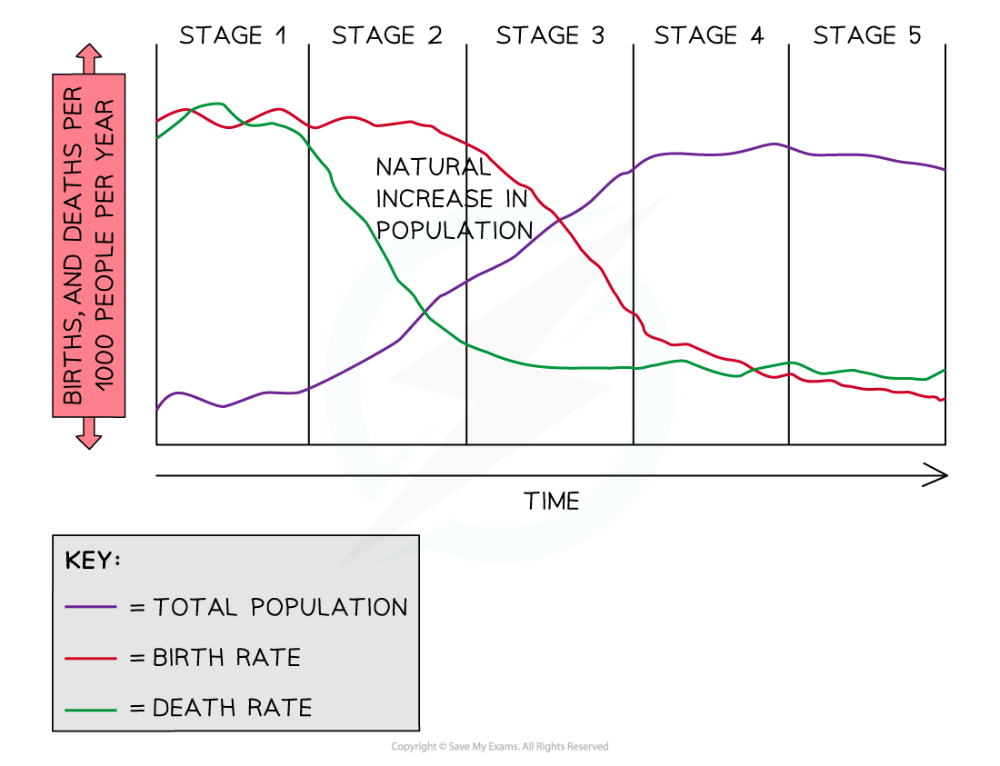
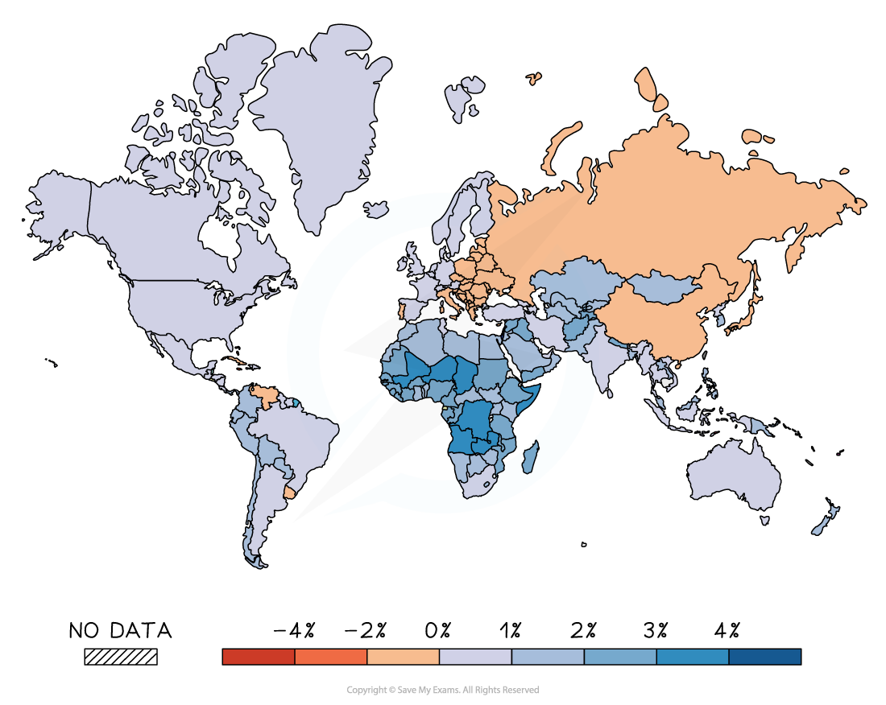
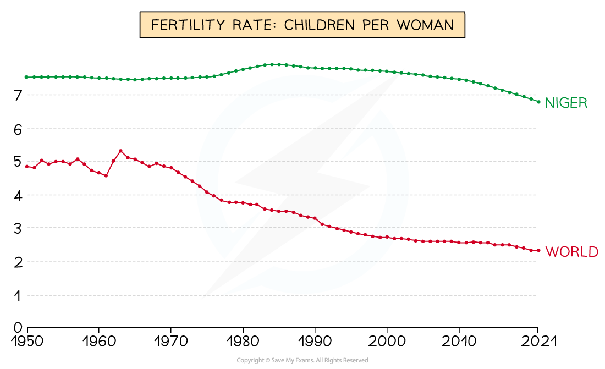
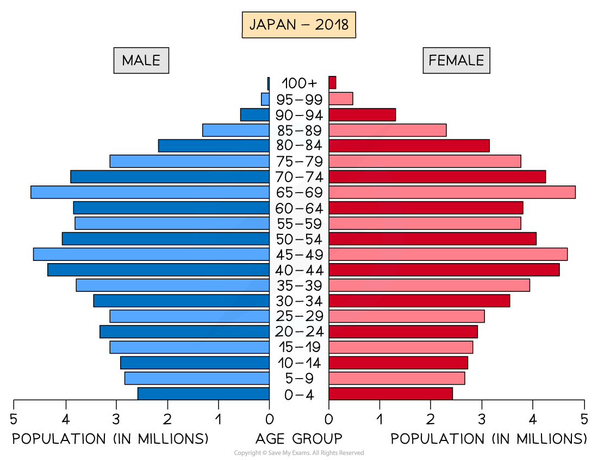

# Population Change

## Population Change

- There are two ways in which a population can change:

  - Migration
  - Natural population change

### Migration

- ***Migration*** can cause the population to either increase or decrease
- This occurs as the result of ***emigration*** or ***immigration***
- **Net migration** is the difference between the number of people moving into a country **(immigrants)** and the number of people leaving the country** (emigrants)**

> **Exam Hint**
> Remember, immigration and emigration are not the same. Immigration is the **inward** movement of people into a country. Emigration is the **outward** movement of people from a country.

## Natural Population Change

> **Spec point** — `spcpt_dmRCn8H6YCZmhjWq`

## Natural Population Change

### Natural causes of population change

- Rapid global population increase has been the combination of numerous factors, including improvements in:

  - agriculture, particularly during the ***agricultural revolution,*** led to higher yields and more varied diets
  - medicine and medical care, which reduces the death rate
  - technology and transport led to a wealthier population, which increased ***life expectancy***
  - water supply and sewage disposal leading to a reduction in disease
- All these factors also led to a decrease in the ***death rate***
- The ***birth rate*** has remained high mainly in LEDCs due to:

  - lack of access to family planning and contraception
  - an increase in women surviving childbirth
  - families continuing to have large numbers of children to look after their parents in old age and to help support the family
  - the culture of having larger families, which takes many years to change
  - religious reasons
- **Natural change** in population is calculated by subtracting the **death rate **from the **birth rate**
- The combination of a decreasing death rate and high birth rate led to rapid ***natural increase*** and population explosion
- A ***natural decrease*** happens when the birth rate is lower than the death rate
- Population also changes as a result of **migration** into and out of a country/area but this is not part of the natural increase

### Demographic Transition Model

- The **demographic transition model** shows the five generalised stages of population change that countries pass through as they develop
- It shows how birth and death rates change over time and how this affects the overall population as the country

*The Demographic Transition Model*

### Stage 1

- The total population is** low **
- **High birth rates** due to **lack of contraception/family planning**
- **High death rates **due to **poor healthcare**, **poor diet** and famine
- **High infant mortality** leads people to have more children so that some children survive to adulthood

### Stage 2

- The total population starts to rise rapidly
- **Birth rates remain high** as people continue to have large families
- **Death rates decrease** as a result of improved diets, better healthcare, lower infant mortality and increased access to clean water

### Stage 3

- The total population continues to increase but the rate of growth begins to slow
- The birth rate begins to **fall rapidly** due to increased birth control, family planning, increased cost of raising children and low infant mortality rate
- The death rate is still **decreasing** but at a **slower rate** as improvements in medicine, hygiene, diet and water quality continue

### Stage 4

- The total population is high and is **increasing slowly **
- The birth rate is low and fluctuating due to accessible birth control and the choice of having fewerchildren, as well as delaying the age women start to have children
- The death rate is low and fluctuates

### Stage 5

- The total population starts to **slowly decline** as the death rate exceeds the birth rate
- The birth rate is low and slowly decreasing
- The death rate is low and fluctuates

> **Worked Example**
> **Explain why birth rates are still high in many LEDCs  **
> 
> **[4 marks]**
> 
> - *Identify the command word*
> - *The command word is '**explain**'*
> - *The focus of the question is 'birth rates'*
> - *Take care to ensure that you focus on** LEDCs (Less Economically Developed Countries)*
> 
> **Final answer:** **Answer**
> 
> - Any two from the following with an explanation or any four from the following:
> 
>   - Lack of/don’t use/cannot afford contraception** [1]**
>   - Lack of education about contraception/about problems of large families** [1]**
>   - Children needed for work/to earn money/for farming; needed to look after elderly/no pensions** [1]**
>   - Children needed to do household chores, or example, fetching wood/water, cleaning the house, and looking after younger children** [1]**
>   - Traditional views about large families/polygamy/families wanting a male child** [1]**
>   - Religious/cultural views on contraception/abortion/family size** [1]**
>   - High infant mortality/they have more babies so some will survive** [1]**
>   - Early marriages/teenage pregnancy** [1]**
>   - Lack of ***emancipation*** for women/women don’t have careers/lack of education for women** [1]**
>   - No access to sexual (family) health clinics, including abortion, etc.** [1]**

## Population Change

> **Spec point** — `spcpt_y4vXnGMH7vqCZCf3`

## Population Change

- All countries have different rates of population change
- Population growth rates are currently **highest in LEDCs** such as Niger, Mali and Zambia
- Population growth rates are** lowest in MEDCs **

  - In someMEDCs, such as Italy and Japan, the population is decreasing as the number of deaths is higher than the number of births

*World population growth rates*

- These changes are dependent on three factors:

  - fertility
  - mortality
  - migration

### Fertility

- As well as the birth rate, fertility can also be measured by the ***fertility rate***
- There are several factors affecting fertility which can be categorised as social, economic or political

#### Social

- **Infant mortality rate **

  - When this is high, the fertility rate also tends to be high as women have more children to ensure some survive to adulthood
- **Education**

  - Higher levels of education lead to lower fertility rates as more women are in formal employment
- **Religion **

  - Religious beliefs can influence how many children a woman has
- **Healthcare**

  - The availability of contraception and family planning

#### Economic

- **Cost of having children **

  - In MEDCs the cost of raising children may reduce the number of children a woman has
- **Lack of pensions **

  - In LEDCs, children are needed to care for elderly parents as there are no pensions. This increases the fertility rate
- **Contribution to family income **

  - In LEDCs, children often work to contribute to family income so more children are needed, increasing the fertility rate

#### Political

- ***Pronatalist***** policies **

  - Encourage women to have children and increase the fertility rate
- ***Anti-natalist***** policies**

  - Encourage women to have fewer children, which decreases the fertility rate

### Mortality

- The **death rate** is affected by a range of factors:

  - Quality of, and access to, healthcare
  - Natural disasters: famine, drought, etc.
  - Diseases such as HIV/AIDS
  - War/conflict

> **Worked Example**
> **Give three reasons why death rates vary from country to country  **
> 
> **[3 Marks]**
> 
> **Final answer:** **Answer**
> 
> - Any three from ideas such as (variations in the amount/quality of):
> 
>   - health care/hospital/clinics/medicines** [1]**
>   - number of people per doctor/availability of doctors **[1]**
>   - food supply/diet/famine/starvation **[1]**
>   - water supply/quality/drought **[1]**
>   - sanitation/hygiene **[1]**
>   - diseases or examples/AIDS or HIV **[1]**
>   - wars **[1]**
>   - vaccinations **[1]**
>   - education about healthcare/disease **[1]**
>   - care for the elderly/pensions **[1]**

## Case Study: Niger

> **Spec point** — `spcpt_9w56YywDBX6nZGP8`

## Case Study: Niger

- In 1960, the population of Niger was 3.3 million

  - By 2021, the population had reached nearly 25 million
- Niger has a **population growth rate** of 3.8%

  - This is the combination of a high birth rate and a rapidly decreasing death rate

### High Birth Rate

- The reasons for the high birth and fertility rates in Niger include:

  - The **average age of marriage is 15.7 years**, meaning that women have more childbearing years
  - **Low levels of education** for women only 4 out of 10 girls finish primary school
  - High value is placed on large families
  - Only 12% of women use modern contraception

*Fertility Rate in Niger*

- The **death rate** in Niger is decreasing, falling from 29 per 1000 (1960) to 8 per 1000 (2020)
- The **decreasing death rate** has been the result of:

  - **Increased urbanisation,** which improves access to services such as healthcare and food
  - Better food and **clean water** supply
  - Improved access to **healthcare**
  - Government policies to improve farming practices, which have increased food supplies
  - Free healthcare to pregnant women improving mother and baby survival rates

### Impacts

- The impacts include:

  - A highly **dependent population** of young people below the age of 15
  - Increased pressure on schools and health services
  - A younger population should increase economic growth but job and wealth distribution is uneven
  - **Increased rural-urban migration** to seek work
  
    - Development of** illegal settlements** on the edges of cities
  - **Food shortages:** an estimated 2.5 million people are suffering from food insecurity

### Reducing population growth

- In 2014, Niger adopted a framework to promote fertility reduction by:

  - **abolishing child marriage** (marriage under the age of 18)
  - **improving access to education**
  - **improved access to health services**, contraception and family planning advice
  - girls and women no longer need permission from parents/husbands to access contraception
  - married and/or pregnant girls can still go to school to ensure they continue to receive an education

## Case Study: Japan

> **Spec point** — `spcpt_R3qYQ6WhQfBjdCxF` · A country with a low rate of natural population growth

## Case Study: Japan

- In 2010, Japan's population reached 128.1 million people

  - By 2020, the population had decreased to 125.8 million people
- Japan has a** population change rate** of -0.3%
- This is a combination of a low birth rate and an ageing population

*Japan's Population Structure*

### Low Birth Rate

- The fertility rate in Japan is 1.36 births per woman, well below the fertility replacement rate of 2.1
- The birth rate is 7.1 per 1000 people
- The reasons for the low birth rate include:

  - increasing numbers of women focusing on careers and delaying having children
  - inability to afford buying/renting own home (70% of unmarried people live with their parents)
  - declining marriage rate and increase in average age people get married (women 29.5 years, men 31 years)
  - economic insecurity: jobs are not as secure
  - the expense of children is high due to childcare costs

### Ageing population

- The death rate has increased in Japan from a low of 6 per 1000 in 1982 to 11 per 1000 in 2020
- In that time, life expectancy has increased from an average of 77 years to 84.36 years
- This means the increased death rate is not due to poorer healthcare, diet or standard of living but because the population is ageing
- One-third of the population is over 60 years old and over 12% are over 75

  - Older people are more likely to become unwell and die
  - The older the population, the higher the proportion of people who will die

### Impacts

- **Shortage of workers**

  - With increasing numbers of the population being retired, there are not enough workers to replace them
  - Fewer innovations
  - Closure of some services
- **Higher taxes**

  - An ageing population puts more pressure on health service and pension payments
  - There is predicted to be a shortage of 380,000 workers for elderly care by 2025
  - Taxes have to be increased to pay for healthcare and pensions
- **School closures**

  - Fewer children mean that schools and childcare facilities may close with the loss of jobs
  - An average of 450 schools close each year due to falling numbers
- **Economic stagnation**

  - The economy does not grow due to a lack of workers and the closure of businesses and industry
  - The standard of living does not improve or falls

### Solutions

- Development of robots to help with elderly care, such as in the Shin-tomi nursing home in Tokyo
- Immigration laws were revised in 2018 to attract foreign workers and help with the worker shortage

  - The aim is to attract 340,000 new workers
- The **Angel Plan **was a five-year plan in 1994 to increase the birth rate, followed by the **New Angel Plan** in 1999 and **Plus One Policy** in 2009, these all aimed to encourage people to have children by;

  - improving the work environment to fit with family responsibilities
  - better childcare services
  - improved maternity and child health services
  - better housing for families
  - improved education facilities
- **Plus One Proposal** is the most recent policy and aims to increase 'parent-friendly' working and the construction of 50,000 new daycare facilities
