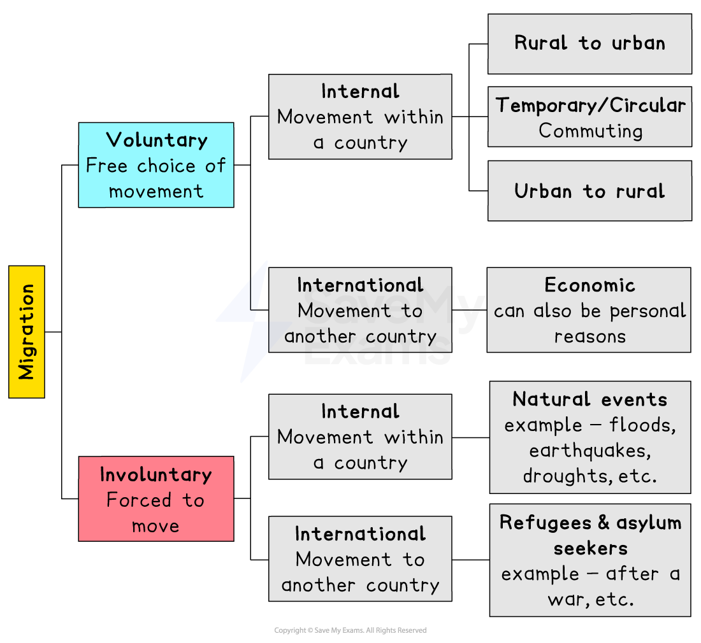
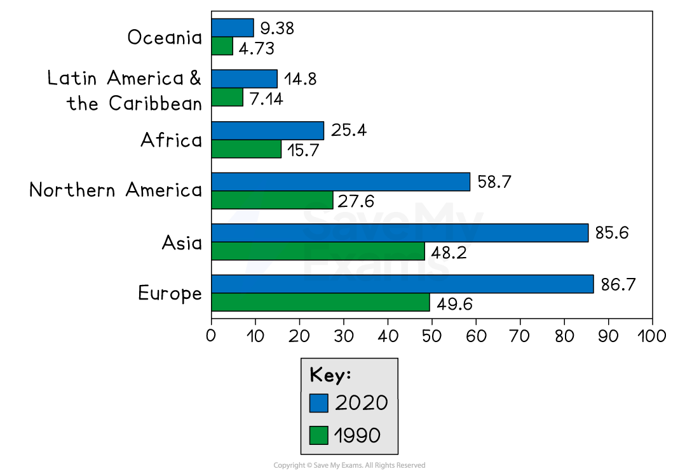
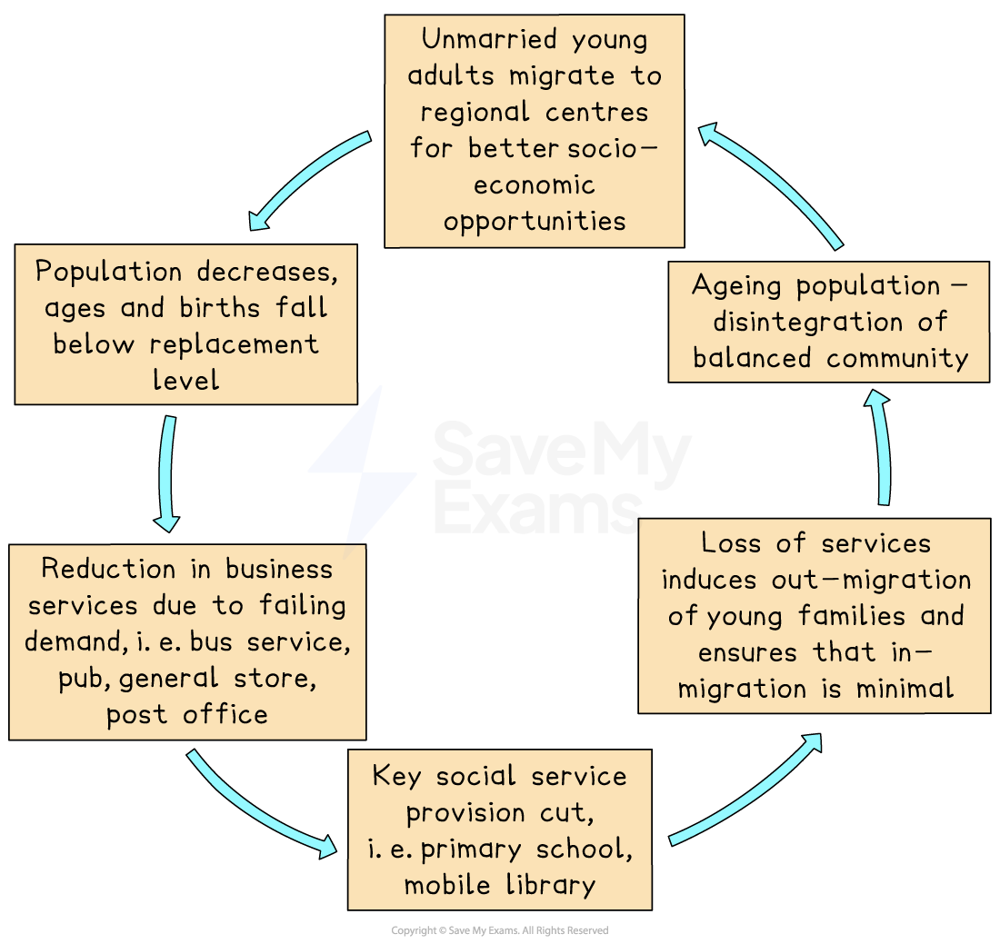

# Reasons for Migration

## Voluntary & Involuntary Migration

> **Spec point** — `spcpt_9mNpxSbNhS8GZZqZ` · Explain & give reasons for population migration

## Voluntary & Involuntary Migration

### What is migration?

- **Migration **is the movement of people across an **official boundary**, either internationally or nationally, **intending **to create a permanent place of residence
- The ***UN*** defines the term **permanent** as a change of residence for more than 1 year
- Migration has shaped the world we now live in, having effects on the economy, culture, politics, and the environment
- Over the course of their lives, most people will move several times

*Migration pathways*

> **Exam Hint**
> Do not confuse the terms immigration and emigration; they are **not** the same.
> 
> - Immigration is the **inward **movement of people into a country
> - Emigration is the **outward **movement of people out of a country

### Push and pull factors

- There are different types of migration:

  - **Voluntary**
  - **Involuntary or forced**
  - **Internal**
  - **Politica**l: internally displaced, refugees, and/or asylum seekers
- The reasons for these moves are the same: **pull and push factors**
- The push factor is what the migrant's current situation is like; it is what makes them think about leaving their home country or **place of origin**
- The pull factor is the **perceived outcome**

  - This is what people think  the **place of destination **will bring them
- Depending on their end goal, each migrant has different push and pull forces

  - What works for one migrant might not work for another
- These factors can be further divided into:

  - **Social**
  - **Economic**
  - **Political**
  - **Environmental**
- High levels of unemployment are a **push factor,** whereas higher wages and a better lifestyle are a **pull factor**

*Push-Pull Factors*

### Barriers to migration

- There are personal, national and legal barriers to migration
- **Personal **barriers include emotional and financial factors; these include:

  - The cost of migrating:
  
    - Closing down costs: selling of a home, legal fees, etc.
    - Moving costs: transport, packing and shipping, visas, etc.
    - Setting up costs: renting or buying a home, legal fees, schooling, etc.
  - Emotional costs such as not seeing loved ones again, leaving behind their culture and country, etc.
- **Immigration laws** present the greatest **legal **barrier to migration
- **National** barriers occur at a physical or political level:

  - Distance between origin and destination
  - Physical danger
  - Blocked from leaving a country

### Voluntary and involuntary migration

- **Voluntary **migration involves the **free choice** of movement either internally or internationally

  - The usual reason is economic for work, promotion, etc.
  - In developing countries, this is usually internal from rural to urban areas
  - In developed countries, counter-urbanisation is more common—urban to rural

- **Involuntary **or **forced **migration is where the migrant has **no choice** but to leave their place of origin

  - This is **usually **an **international **movement **but **can **also **be an **internal **movement
- The United Nations High Commission for Refugees (UNHCR) estimates 89.3 million people worldwide were forcibly displaced at the end of 2021, of which 53.2 million were internally displaced people and 27.1 million were refugees, with the remaining 4.6 million seeking ***asylum***
- There are a number of **reasons **for internal forced migration for example:

  - A natural hazard such as a tropical storm will force people to move away but they will move back home when it is safe to do so
- The biggest reasons for forced migration are** war and persecution**

  - The Syrian civil war, where more than half of the country's population (13 million) has been forcibly displaced
  - Ethnic cleansing forces out entire groups or communities from the country - Sunni and Shia Muslims in the Middle East or Rwanda in 1994 where the Hutus attempted to wipe out the Tutsis in 3 months forcing 2 million people to flee
- Not all forced migrants leave their country, and these migrants are termed an **internally displaced person **

  - The Syrian conflict has created many ***refugees*** and internally displaced people, as have the conflicts in Afghanistan and Yemen
  - Major natural disasters can displace people, such as the 2011 tsunami that forced the evacuation of Fukushima in Japan or the recent floods in Pakistan

> **Exam Hint**
> Remember that involuntary or forced migration is not only due to war or persecution but can also be due to natural events such as flooding, earthquakes, desertification, etc.

## Migration Trends

> **Spec point** — `spcpt_s2cY9HNbxZs9gDTY` · Explain & give reasons for migration trends

## Migration Trends

- According to the UN, approximately** **3.6% of the world's population lives outside their country of birth
- That equates to around **281 million international migrants** in the world as of 2020, an increase of 37 million people since 2015
- Over 61% of global international migrants reside in Europe and Asia, with North America hosting 21%, Africa 9%, Latin America and the Caribbean at 5%, and Oceania 3%
- The COVID-19 pandemic severely restricted migration; however, there are signs of a slow return to previous levels of migration (UN, World Migration Report 2022)
- Most people who move to another country do so for work

  - COVID-19 shows that working from home may make **work-related** movement less necessary, though some jobs will still need highly skilled workers
- The number of female migrants has increased since women do most contract employment, making migration temporary and circular
- The majority of movement is between developing and developed countries, but low- to middle-income developing countries are also increasing
- Human trafficking and exploitation have increased as developed countries have tightened border controls to fight illegal immigration and security threats

*Number of International Migrants by Destination 1990 and 2020*

- International migration varies globally
- Economic, demographic, and geographical factors have shaped migration patterns or **corridors **over time
- The major corridors are from developing economies to France, USA, Germany, and Saudi Arabia
- **Globalisation** makes these movements easier and faster

## Internal Population Movements

> **Spec point** — `spcpt_XwMYGYGFK9r37zrV` · Explain & give reasons for internal movement

## Internal Population Movements

- **Internal migration** is higher than international movement in developing **and **developed countries
- Most internal movement in developing countries is from **rural to urban **regions and has resulted in the rapid growth of urban areas
- People move from poorer rural areas to wealthier, developing urban areas for better standards of living
- China's rapidly developing urban/industrial sectors have caused the largest rural-to-urban migration in history, with over 150 million people moving to meet factory labour demand
- Since the 1950s, Dhaka, Cairo, Nairobi, and Sao Paulo have grown rapidly, and while there is no guarantee of work, the perceived opportunities are still greater at the destination than at the point of origin

> **Worked Example**
> **Study Fig. 1.2, which shows information about types of migration**
> 
> 
> 
> **Which type of migration are the following examples of?  Circle your answer for each of the three examples.**
> 
> **[3 Marks]**
> 
> - Refugees moving to another country to avoid persecution
> 
>   1. forced internal
>   2. forced international
>   3. voluntary internal
>   4. voluntary international
> - A professional footballer moving from Spain to play in the English Premier League
> 
>   1. forced internal
>   2. forced international
>   3. voluntary internal
>   4. voluntary international
> - A teenage girl moving from rural Kenya to study in Nairobi, the capital city of Kenya.
> 
>   1. forced internal
>   2. forced international
>   3. voluntary internal
>   4. voluntary international
> 
> **Final answer:** **Answer**
> 
> 2. Forced international
> 
> 4. Voluntary international
> 
> 3. Voluntary internal

## Depopulation & Counter-Urbanisation

> **Spec point** — `spcpt_PWRZbTNvqS6gD49G`

## Depopulation & Counter-Urbanisation

### Depopulation

- Developed countries such as the USA, France, Germany and the UK experienced **rural-to-urban migration** since the late 18th century due to the Industrial Revolution and urbanisation
- These processes have been central to ***depopulation*** in many rural areas
- Generally, it is the most **isolated regions** that are affected
- Once the cycle starts, there is a gradual decline in the area

*Model of Rural Depopulation*

### Counter-urbanisation

- Due to overcrowding, pollution, and rising costs, many people have moved from cities to rural areas in a movement called **counter-urbanisation** since the 1970s
- Some other reasons include:

  - Increased personal car ownership, public transport, and road improvements improve **mobility and accessibility **in remote areas
  - **Increased wealth:** making housing and travel more affordable
  - Mechanisation and farm mergers lead to **agricultural decline**, resulting in increased housing availability and workers leaving
  - The **green belt** pushes people to travel further for a rural lifestyle
  - **Second homes and early retirement** have led to more urban people moving to the countryside

> **Exam Hint**
> - Consider how global warming and climate change may contribute to migration
> - It is predicted that by 2050, tropical storms, desert droughts, and rising sea levels will displace 200 million people
