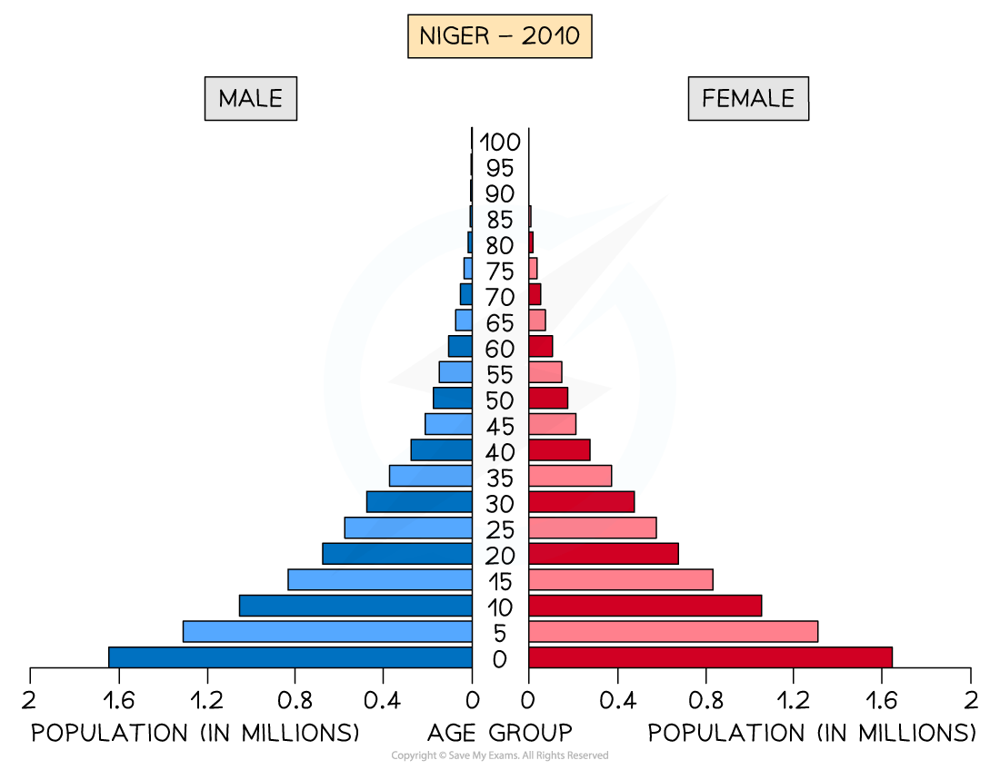
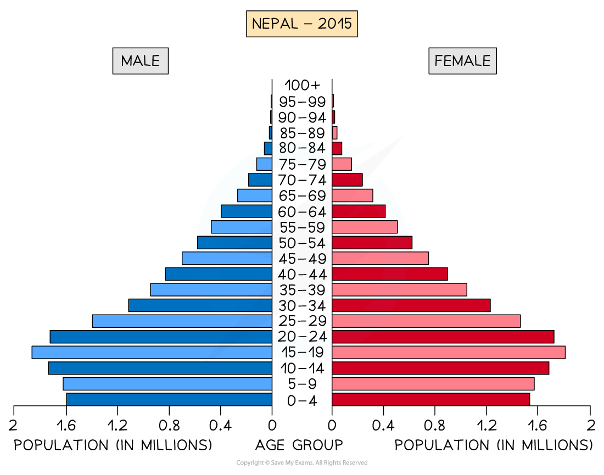
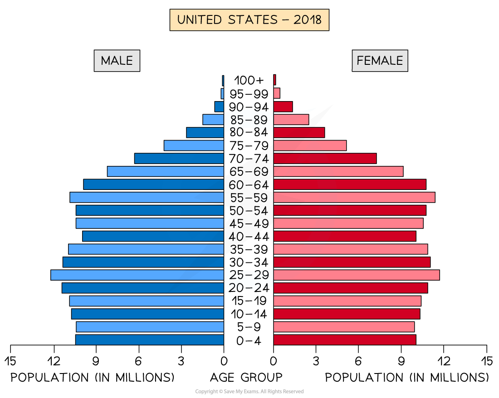

# Reasons for & Implications of Different Population Structures

## Population Pyramids

> **Spec point** — `spcpt_GkQ8YRN9W22tQrpY` · Identify & give reasons for and implications of different types of population structure

## Population Pyramids

- The characteristics of a population—the distribution of age, sex, ethnicity, religion, etc.—are known as the **population structure**
- The population structure is the result of changes in:

  - fertility
  - mortality
  - migration
- The two main components of age and sex can be shown on a **population pyramid**

### Population pyramids

- Population pyramids (also known as an **age structure graph**) are used to display the **gender and age structure** of a given population

  - They illustrate the distribution of the population across age groups and between male and female
- They enable governments nationally and regionally to assess the needs of the population for services such as healthcare and education

  - This means the governments can estimate and plan for spending
- As countries develop and pass through the stages of *demographic transition,* the shape of the population pyramid changes
- The population pyramid can be used to identify the following groups:

  - **Young dependents **
  - **Old dependents **
  - **Economically active **(working population)
  - **Dependency ratio **

*Population Pyramid - Niger*

- **LEDCs** like Niger have a **concave pyramid shape**
- Stages 1 and 2 of the model and this indicates:

  - high birth rate
  - low life expectancy
  - high death rate but starting to decrease
  - high infant mortality rate
  - **a young dependent population** dominates

*Population pyramid of Nepal*

- **LEDCs/NICs** that are a little further along the demographic transition, such as Nepal, have a convex pyramid shape
- Stage 3 of the demographic transition model
- This indicates:

  - decreasing birth rate
  - increasing life expectancy
  - decreasing death rate
  - decreasing infant mortality
  - larger working-age population

*Population pyramid of the USA*

- **MEDC** countries such as the USA have a **column-shape**
- Stage 4 of the demographic transition model
- This indicates:

  - decreasing birth rate
  - increasing life expectancy
  - decreasing death rate
  - low infant mortality
  - larger working-age population

*Population pyramid of Japan*

- **MEDC** countries such as Japan have a pentagon shape with a narrowing base
- Stage 5 of the demographic transition model
- This indicates:

  - Decreasing birth rate
  - Increasing life expectancy
  - The death rate is higher than the birth rate due to the **ageing population**
  - Low infant mortality
  - Ageing population: older dependent population

### Implications of population structure

- Population pyramids mean that population issues can be identified
- There are a range of issues, including:

  - ageing populations
  - falling birth rates
  - impacts of migration

### Ageing populations

- Many HICs are experiencing ageing populations and an increase in the older dependent population; the implications of this include increased:

  - **pension payments**
  - need for **care homes**
  - pressure on the healthcare service and social care
- It also results in fewer workers, which means:

  - governments are not able to collect as much tax
  - some areas suffer worker shortages

### Falling birth rates

- Countries experiencing falling birth rates include many MEDCs and NICs; the implications of this are:

  - **school closures due to fewer children**
  - **future workforce shortages **

### Migration

- In some countries, **migration** can lead to an imbalance in the population structure
- The UAE has significantly more males than females
- Approximately 29% of the population are males between the ages of 25 and 39, whereas only 10.5% of the population are women between 25 and 39

  - This is the result of the migration of males to the UAE to work in the oil, gas and construction industries
- Rapid population growth in some areas as a result of migration can lead to:

  - increased pressure on services such as healthcare and schools
  - a shortage of housing
  - increased traffic congestion
  - increased water and air pollution
  - a shortage of food
  - a lack of clean water

> **Exam Hint**
> When interpreting a population pyramid, you need to look at four key areas
> 
> - Young dependents: is the birth rate high or low?
> - Working population: are there enough people of working age to support the young and old dependents?
> - Old dependents: is it large or small? If it is large, then life expectancy is high
> - Male-to-female split: are there any noticeable differences between the numbers of males and females?
> 
> To calculate the dependency ratio:
> 
> $dependencyratio=\frac{youngdependents+olddependents}{workingpopulation}\times100$

## Case Study: Japan

> **Spec point** — `spcpt_HqQj4MRdf2wXr65F` · A country with a high dependent population

## Case Study: Japan

> **Case Study**
> - Japan's population is **decreasing**
> - It has fallen from 128 million in 2007 to 125.8 million in 2020
> - The **fertility rate** is 1.36 births per woman, which is well below the 2.1 fertility replacement rate
> - The **birth rate** is 6.8 per 1000
> - The **death rate** is 11.1 per 1000
> 
>   - The death rate has increased from 6 per 1000 in 1979
>   - This is not because healthcare or diets are worse but because there are far more elderly people who are more likely to become ill and die
> - Japan has the highest life expectancy in the world at 84.36 years
> 
> 
> 
> *Japan's population pyaramid*
> 
> - Increasing life expectancy in Japan has led to an ageing population with an increasing proportion of elderly dependents
> - The issues that this has led to include:
> 
>   - increased pressure on health and social care
>   - greater cost of providing pensions
>   - more use of public transport as the elderly age group is less likely to drive
>   - increased need for care homes
>   - shortages of workers as more people retire and there are not enough economically active people to take their place
> - These issues are further increased by the falling birth rate
> - The future impact on Japan may include:
> 
>   - increased taxes to cover health, social care and pension costs
>   - continued population decrease
>   - reduced economic development due to a shortage of workers
>   - reconsideration of the immigration policies, which are currently very strict
>   - introduction of pro-natalist policies to increase the birth rate and encourage larger families

> **Worked Example**
> **Study Figure 1, which shows population pyramids of the structure of Mexico's population in 1980 and 2010.**
> 
> 
> 
> **Describe the changes in Mexico's population structure between 1980 and 2010**
> 
> **[3 Marks]**
> 
> **Answer**** **
> 
> **Remember, your answer needs to be a comparison so it needs to state 'more' or 'less'**
> 
> - Any three of the following:
> 
>   - In 2010, there are:
>   
>     - More economically active/working 15-64-year-olds **[1]**
>     - More elderly/old dependents/65+ **[1]**
>     - More young dependents in total/bands up to 19 become more even  **[1]**
